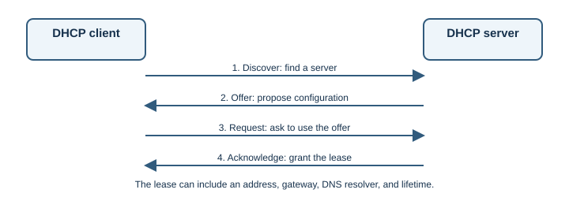

# DHCP

## Introduction

Dynamic Host Configuration Protocol (DHCP) automatically supplies network
configuration to devices. A DHCP server can provide an IPv4 address, subnet
mask, default gateway, DNS resolver, and lease duration.

## Why does it exist?

Without automatic configuration, each device would need its network
parameters entered manually. DHCP reduces setup work and helps prevent
address conflicts by managing address leases centrally.

## How does it work?

A common DHCPv4 exchange is called DORA:

1. **Discover:** a new client broadcasts to find DHCP servers.
2. **Offer:** a server proposes an address and configuration.
3. **Request:** the client asks to use one offered configuration.
4. **Acknowledge:** the server confirms the lease and its options.

The client uses the address for a lease period and attempts to renew it
before it expires. A lease is temporary ownership of an address, not a
permanent identity. If the DHCP server is on another network, a configured
DHCP relay can forward the client's messages between networks.

Common configuration includes:

| Option | Purpose |
|---|---|
| IP address and subnet mask/prefix | Identify the client's interface and local subnet |
| Default gateway | Provide a next hop for destinations outside the subnet |
| DNS resolver | Tell the client where to send name lookups |
| Lease time | Set how long the client may use the assigned address |

DHCPv6 provides IPv6 configuration services, but IPv6 can also use Router
Advertisements and Stateless Address Autoconfiguration (SLAAC). Networks
may use these mechanisms together. DHCPv4's DORA exchange is not the exact
message sequence for DHCPv6.

## Real-world example

When a phone joins home Wi-Fi, the router or a separate DHCP server commonly
leases it a private IP address and tells it which gateway and DNS resolver to
use. The same setup lets a laptop reach a government website or a bank
without manually configuring an address for each service.

## Developer perspective

DHCP is normally managed by operating systems and network administrators,
not web application code. It is still useful to understand when a device
gets no address, receives the wrong gateway, or uses an unexpected resolver.
Cloud servers often use static or managed addressing rather than a typical
home DHCP setup, but automatic configuration concepts remain relevant.

## Practical example

On Windows, `ipconfig /all` shows the DHCP status, lease information, and
network settings reported by the operating system. On Linux, `ip address`
and `ip route` show assigned addresses and routes. These inspect current
configuration; they do not change a DHCP server.

## Important terminology

- **Lease:** time-limited assignment of an address and configuration.
- **DHCP server:** service that provides address configuration.
- **DHCP client:** device requesting configuration.
- **Relay agent:** forwards DHCP messages when clients and servers are on
  different IP networks.
- **SLAAC:** IPv6 mechanism that lets a device configure an address from
  router-advertised prefix information.

## Advantages and disadvantages

DHCP simplifies onboarding and centralized address management. Clients
depend on correct server configuration and network reachability; a faulty
server can provide unusable settings to many devices.

## Common misconceptions

- DHCP provides local network configuration; it does not provide Internet
  access by itself.
- A DHCP address can change when a lease is renewed or a device joins a
  different network.
- DNS and DHCP are separate protocols, even when one home router provides
  both services.
- IPv6 address configuration may use SLAAC, DHCPv6, or both.

## Further learning

- [RFC 2131: Dynamic Host Configuration Protocol](https://www.rfc-editor.org/rfc/rfc2131)
- [RFC 8415: Dynamic Host Configuration Protocol for IPv6 (DHCPv6)](https://www.rfc-editor.org/rfc/rfc8415)
- [RFC 4862: IPv6 Stateless Address Autoconfiguration](https://www.rfc-editor.org/rfc/rfc4862)
