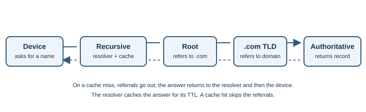
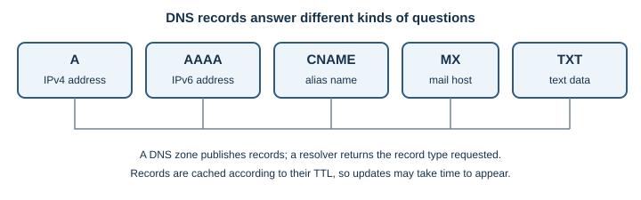
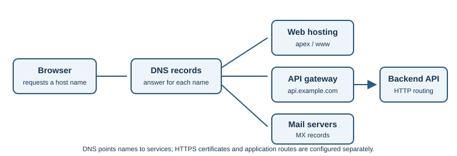

# DNS

## Introduction

The Domain Name System (DNS) is a distributed naming system. It lets people
use names such as `www.example.com` while software looks up records such as
an IPv4 (`A`) or IPv6 (`AAAA`) address.

## Why does it exist?

Numeric addresses are awkward to remember and may change as services move.
DNS separates a memorable name from network configuration. It is a hierarchy
of independently managed zones, not one central address book.

## How does it work?

A browser or operating system asks a **recursive resolver** for an answer.
The resolver may already have a cached answer. If not, it follows DNS
delegation:

1. A root server points it toward the relevant top-level domain, such as
   `.com`.
2. A top-level domain server points it toward the domain's authoritative
   servers.
3. An authoritative server returns the record for the requested name.
4. The resolver caches the answer for its time-to-live (TTL) and returns it
   to the client.

The client normally asks a recursive resolver; it usually does not contact
root servers directly. DNS commonly uses port 53 over UDP or TCP. Traditional
DNS is not encrypted in transit. DNS-over-HTTPS (DoH) and DNS-over-TLS (DoT)
encrypt the connection to a resolver, but that resolver can still see the
query.

### Common record types

| Record | What it stores | Example use |
|---|---|---|
| `A` | IPv4 address | Map `www.example.com` to an IPv4 endpoint |
| `AAAA` | IPv6 address | Map a name to an IPv6 endpoint |
| `CNAME` | Another DNS name | Make one name an alias of another |
| `MX` | Mail exchange host and priority | Route email for a domain |
| `TXT` | Text data | Publish domain verification or email policy data |
| `NS` | Name server for a zone | Delegate DNS authority |
| `CAA` | Certificate issuance policy | Indicate which certificate authorities may issue for a domain |

If a record has a TTL of `300` seconds, a resolver may reuse the cached
answer for about five minutes. A low TTL can help changes become visible
sooner after caches expire, but it does not force resolvers to discard
existing cached data immediately.

## DNS for application domains

When deploying a web application, DNS connects the name users type to the
hosting platform or service endpoint. A typical setup might include:

| Name and record | Example purpose |
|---|---|
| `example.com` — `A` or `AAAA` | Point the domain to an IPv4 or IPv6 address when the host provides one |
| `www.example.com` — `CNAME` | Alias `www` to a platform-provided hostname |
| `api.example.com` — `CNAME`, `A`, or `AAAA` | Route API traffic to its host, gateway, or load balancer |
| `example.com` — `MX` | Route email for the domain; unrelated to web hosting |
| Domain verification — `TXT` | Prove domain control to a hosting or identity provider |

This is an illustrative design, not a universal deployment recipe. A DNS
provider may offer an apex-alias feature for the root domain, and hosting
providers specify which targets and record types they support. A DNS
`CNAME` cannot generally coexist with other ordinary records at the same
owner name; follow the provider's instructions for the domain apex.

Changing a record changes authoritative DNS data, but resolvers can retain
older answers until cached TTLs expire. During a migration, the old and new
destinations may both receive traffic for a time. Lowering a TTL well before
a planned change can reduce some cache delay, but does not guarantee
instantaneous propagation.

DNS selects a destination name or address; it does not configure TLS
certificates, application virtual hosts, redirects, or API routing. Those
must also be configured at the host, proxy, and application layers.

DNSSEC adds signatures that let a validating resolver check that DNS data
matches its signed chain of trust. It does not encrypt DNS queries; DoH and
DoT encrypt the connection to the chosen resolver. These technologies address
different concerns.

## Real-world example

When opening `https://www.example.com/`, the browser may check local caches
before asking a resolver. Once it gets an address, it can attempt a connection
to that server. A DNS answer is not proof the server is available. See
[IP addressing](ip-addressing.md) and [HTTP and HTTPS](http-and-https.md).

## Developer perspective

TTL and resolver caches mean a DNS change may not appear everywhere
immediately. Troubleshoot name resolution separately from routing, firewall,
TLS, and application errors. Multiple DNS answers can distribute traffic,
but do not by themselves guarantee health-aware routing. For an application,
check that the DNS record points to the intended host and that the host is
configured to serve the requested domain name.

## Practical example

On Windows, run `nslookup example.com`. On Linux or macOS, `dig example.com`
shows a query and answer when `dig` is installed. Both query a resolver; they
do not change DNS records. Another resolver may have a different cached
answer.

To inspect selected record types, use `dig example.com A`,
`dig example.com AAAA`, or `dig example.com MX`. On Windows,
`nslookup -type=MX example.com` queries MX records. These commands do not
reveal every resolver's cache state or prove that the web service is healthy.

## Important terminology

- **Recursive resolver:** service that looks up answers for a client and
  returns a result.
- **Authoritative server:** server that publishes records for a DNS zone.
- **Record:** typed DNS data, such as `A`, `AAAA`, `MX`, or `CNAME`.
- **TTL:** how long a DNS response may be cached.
- **Delegation:** referral from one part of the DNS hierarchy to another.
- **DNSSEC:** signatures that support validation of DNS data authenticity
  and integrity.
- **Cache miss:** a lookup for which the resolver does not have a reusable
  answer.

## Advantages and disadvantages

Delegation lets organizations manage their own domains, and caching helps
reduce repeated lookups. Caches can temporarily hold old data, and DNS can
fail independently of the website it helps locate.

## Common misconceptions

- A DNS response does not prove the server is healthy.
- Changing a record does not instantly clear every resolver's cache.
- HTTPS protects the web connection; it does not automatically encrypt a
  traditional DNS query.
- DNSSEC does not hide a query; encrypted DNS does not mean the resolver
  cannot see the name being requested.

## Further Learning & References

- **Official documentation — MDN (beginner-friendly):** [DNS](https://developer.mozilla.org/en-US/docs/Glossary/DNS) introduces the naming system and the role of DNS records.
- **Official standard — RFC Editor:** [RFC 1034, Domain Names—Concepts and Facilities](https://www.rfc-editor.org/rfc/rfc1034) explains DNS design and delegation.
- **Official standard — RFC Editor:** [RFC 1035, Domain Names—Implementation and Specification](https://www.rfc-editor.org/rfc/rfc1035) describes DNS messages and basic record handling.
