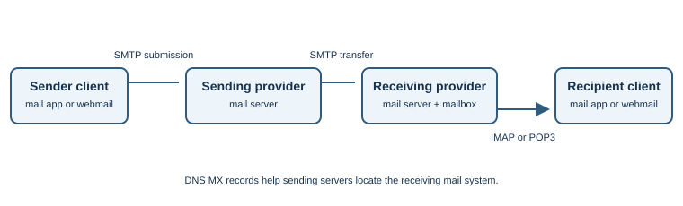

# Email Protocols

## Introduction

Email relies on several protocols because sending a message between mail
servers and accessing a mailbox are different tasks. Simple Mail Transfer
Protocol (SMTP) sends and relays mail. Internet Message Access Protocol
(IMAP) and Post Office Protocol version 3 (POP3) let a client access
messages in a mailbox.

## Why do they exist?

Email must move between independently operated providers while allowing
users to read messages from different devices. SMTP supports transfer
between mail systems; IMAP is designed for synchronized mailbox access;
POP3 provides a simpler download-oriented mailbox model.

## How does it work?

1. A user composes mail in a webmail service or mail application.
2. The sending client submits the message to its provider, commonly with
   authenticated SMTP submission.
3. The sending mail server looks up the recipient domain's DNS `MX` record
   and transfers the message to a receiving mail server using SMTP.
4. The receiving provider applies its policies and stores the message in
   the recipient's mailbox.
5. The recipient reads it through webmail or an email client using IMAP,
   POP3, or a provider-specific interface.

| Protocol and common port | Role | Typical use |
|---|---|---|
| SMTP relay, TCP 25 | Transfer mail between mail servers | Server-to-server delivery |
| SMTP submission, TCP 587 | Authenticated message submission, commonly with STARTTLS | Mail client sends through its provider |
| SMTP submission, TCP 465 | Submission with implicit TLS in common deployments | Encrypted client-to-provider submission |
| IMAP, TCP 143 / 993 | Access and synchronize mailbox | 143 may upgrade with STARTTLS; 993 commonly uses implicit TLS |
| POP3, TCP 110 / 995 | Retrieve mailbox messages | 110 may upgrade with STARTTLS; 995 commonly uses implicit TLS |

Port use can vary by provider configuration; verify the provider's published
settings. TLS protects the connection between the two endpoints using it,
but mail may pass through multiple systems and is not necessarily
end-to-end encrypted.

### Domain and sender checks

DNS `MX` records identify mail exchangers for a domain. Email-domain
authentication mechanisms include SPF, DKIM, and DMARC. They help receiving
systems evaluate whether mail is authorized and whether signed or aligned
domain information is present. They do not prove that every message is
truthful or safe.

## Real-world example

A government office sends a notification from its mail provider. SMTP moves
the message toward the recipient's provider; IMAP may synchronize it to the
recipient's phone and laptop. A phishing email can imitate the same visible
sender name, so users and mail systems need additional checks beyond
recognizing a protocol.

## Developer perspective

Applications that send mail often call a provider API or submit through an
SMTP service. Protect credentials, configure domain authentication, handle
delivery failures, and avoid treating "accepted by SMTP" as proof that a
person received or read a message. Do not send sensitive information through
email without understanding the organization's data-protection requirements.

## Practical example

Inspect the mail settings published by an email provider to identify its
SMTP submission and IMAP/POP3 endpoints. Use only a mailbox and provider
account you are authorized to access; do not test guessed credentials or
third-party mail servers.

## Important terminology

- **Mail user agent (MUA):** app or interface a person uses to read or send
  email.
- **Mail transfer agent (MTA):** server software that relays mail.
- **SMTP:** protocol for submitting and transferring email.
- **IMAP:** protocol for synchronized access to mailbox messages.
- **POP3:** protocol for retrieving messages using a simpler download model.
- **MX record:** DNS record identifying mail exchangers for a domain.
- **SPF, DKIM, DMARC:** domain-based mechanisms that help receiving systems
  assess authorization and message-domain alignment.

## Advantages and disadvantages

Open email protocols allow communication across providers and a broad range
of clients. Delivery can be delayed, filtered, rejected, or misclassified,
and conventional SMTP transport does not guarantee end-to-end confidentiality.

## Common misconceptions

- SMTP sends and relays mail; IMAP and POP3 are for mailbox access.
- Email is not necessarily private end-to-end just because a client uses TLS.
- An MX record routes mail; it does not validate the content or safety of a
  message.
- SPF, DKIM, and DMARC reduce some forms of domain abuse but do not make all
  email trustworthy.

## Further learning

- [RFC 5321: Simple Mail Transfer Protocol](https://www.rfc-editor.org/rfc/rfc5321)
- [RFC 9051: Internet Message Access Protocol (IMAP) Version 4rev2](https://www.rfc-editor.org/rfc/rfc9051)
- [RFC 1939: Post Office Protocol Version 3](https://www.rfc-editor.org/rfc/rfc1939)
- [RFC 7208: Sender Policy Framework (SPF)](https://www.rfc-editor.org/rfc/rfc7208)
- [RFC 6376: DomainKeys Identified Mail (DKIM)](https://www.rfc-editor.org/rfc/rfc6376)
- [RFC 7489: Domain-based Message Authentication, Reporting, and Conformance (DMARC)](https://www.rfc-editor.org/rfc/rfc7489)
