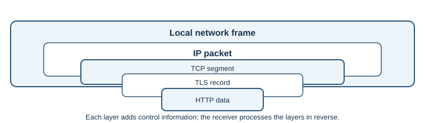

# Ethernet and Wi-Fi

## Introduction

Ethernet and Wi-Fi connect a device to a nearby network. Ethernet usually
uses a cable; Wi-Fi uses radio. They carry link-layer frames between devices
on the local network. IP then carries packets between networks.

## Why do they exist?

An application needs a way to send data to the next device on its path.
Ethernet and Wi-Fi provide local delivery over different physical media while
allowing higher-level protocols such as IP, TCP, DNS, and HTTP to work above
them.

## How do they work?

1. A device joins a local network. A wired device connects to an Ethernet
   switch; a wireless device associates with a Wi-Fi access point.
2. The network interface sends a frame containing local link information,
   including source and destination Media Access Control (MAC) addresses.
3. A switch or access point forwards the frame on the local network.
4. If the IP destination is outside the local subnet, the frame is addressed
   to the local router. The router removes the local frame and forwards the
   IP packet toward another network.
5. At each link, a new frame is used for that link. The end-to-end IP
   destination normally remains the same, except where network address
   translation or other gateways change it.

Ethernet and Wi-Fi are not the same protocol, but both can carry IP traffic.
Ethernet defines wired local-network behavior. Wi-Fi (IEEE 802.11) defines
wireless local-network behavior, including how devices share radio airtime.
Wi-Fi access points commonly bridge wireless devices onto the same local
network as wired devices.

| Property | Ethernet | Wi-Fi |
|---|---|---|
| Medium | Cable, commonly twisted-pair copper or fiber through network equipment | Radio |
| Typical connection | Network interface to switch or router | Device associates to an access point |
| Common trade-off | Stable performance and predictable physical connection | Mobility and convenient access; performance varies with signal and interference |
| Link protection | Depends on the network and configuration | WPA2 or WPA3 can protect access to the local wireless network |

Link-layer security protects a local wireless connection. It does not replace
HTTPS/TLS, which protects a connection across the wider network to a service.

## Real-world example

When a phone opens a government portal, it first sends traffic over Wi-Fi to
the home access point. The access point forwards it toward the router. A
banking app on Ethernet follows the same network-layer route from the
computer's point of view, even though its local link is wired.

## Developer perspective

Most application code does not construct Ethernet or Wi-Fi frames directly;
the operating system's network stack handles them. Understanding the local
link helps distinguish a weak Wi-Fi signal or disconnected cable from a DNS,
TLS, or application problem. A browser can fail to reach the Internet even
when it is still connected to a local access point.

## Practical example

On Windows, `ipconfig /all` shows network adapters and connection details.
On Linux, `ip link` lists network interfaces. These commands inspect local
configuration; they do not prove that a remote website is reachable.

## Important terminology

- **Frame:** data unit used for delivery over a local link.
- **MAC address:** link-layer address used to deliver frames on a local
  network; it is not a permanent identity for a person.
- **Switch:** device that forwards frames within a local network.
- **Access point:** device that connects Wi-Fi clients to a network.
- **SSID:** name advertised for a Wi-Fi network.
- **Router:** device that forwards IP packets between networks.

## Advantages and disadvantages

Ethernet is often predictable and fast but requires a physical connection.
Wi-Fi supports mobility and simpler access but shares radio spectrum and can
be affected by walls, distance, interference, and access-point capacity.

## Common misconceptions

- Wi-Fi is not the same thing as the Internet; it is one way to join a local
  network.
- MAC addresses are used for local frame delivery, not global Internet
  routing.
- A strong Wi-Fi signal does not prove that DNS, routing, or the remote
  service is working.
- WPA-protected Wi-Fi does not replace HTTPS for protecting web traffic.

## Further learning

- [IEEE 802.11 Working Group](https://www.ieee802.org/11/)
- [IEEE 802.3 Ethernet Working Group](https://www.ieee802.org/3/)
- [MDN: How the Web works](https://developer.mozilla.org/en-US/docs/Learn/Getting_started_with_the_web/How_the_Web_works)
