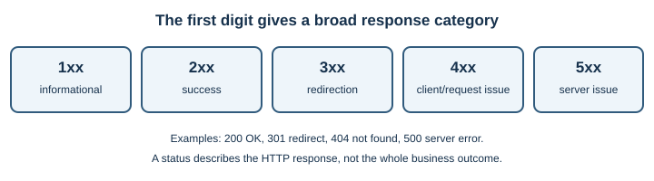

# HTTP and HTTPS

## Introduction

Hypertext Transfer Protocol (HTTP) defines how clients and servers exchange
resources. A browser sends a request; a server sends a response. HTTPS is
HTTP protected by TLS. This builds on [DNS](dns.md), [IP addressing](ip-addressing.md),
and [TCP and UDP](tcp-and-udp.md).

## Why does it exist?

Clients and servers need shared rules for describing actions, data, and
results. HTTP defines methods, headers, status codes, and message semantics
so different browsers, servers, and applications can interoperate.

## How does it work?

1. The client connects to the server. HTTP/1.1 and HTTP/2 commonly use TCP;
   HTTP/3 uses QUIC over UDP.
2. For HTTPS, TLS protects the connection before HTTP data is exchanged.
3. The client sends a request with a method, target, headers, and sometimes a
   body.
4. The server sends a response with a status code, headers, and sometimes a
   body.
5. The client interprets the response and may request related resources.




| Method | Common use | Useful property |
|---|---|---|
| `GET` | Retrieve a representation | Intended to be safe; should not change application state |
| `POST` | Submit data or request processing | Often creates or triggers an operation |
| `PUT` | Replace a resource representation | Defined as idempotent |
| `DELETE` | Request resource removal | Defined as idempotent |

The exact result depends on the server and resource. Status codes also have
families: `2xx` indicates success, `3xx` redirection, `4xx` a client-side
issue, and `5xx` a server-side issue. A `404` means the requested resource
was not found; a `200` means the response was successful according to HTTP
semantics, not necessarily that the business task succeeded.

### Read a simple exchange

A request can be represented in a simplified form like this:

```http
GET /products/42 HTTP/1.1
Host: shop.example
Accept: application/json
```

The server might return `200 OK`, a `Content-Type` header, and a response body
containing the product representation. Real exchanges include more headers,
and HTTP/2 and HTTP/3 encode messages differently on the wire, but the
request/response semantics are familiar.

Cookies are commonly sent in headers. They can help a site associate several
requests with a session, but sensitive session cookies need appropriate
security attributes and must be protected by HTTPS.

| Status family | Meaning | Example |
|---|---|---|
| `2xx` | Request succeeded according to the response | `200 OK`, `201 Created` |
| `3xx` | Further action such as following a redirect | `301 Moved Permanently` |
| `4xx` | Request or authorization problem | `400 Bad Request`, `404 Not Found` |
| `5xx` | Server failed to fulfill a valid request | `500 Internal Server Error` |

## Real-world example

Opening a product page may issue `GET` requests for HTML, images, and
stylesheets. Submitting an order form may send a `POST` request with order
data. The server can respond with a result or an error that the page displays.

## Developer perspective

Use methods and status codes according to their defined semantics. HTTP is
stateless: each request is interpreted independently, although cookies and
server-side storage can maintain user sessions. Never put passwords or
sensitive data in URLs. Use HTTPS, validate server inputs, and do not assume
that a successful connection means a successful request.

## Practical example

`curl -i https://example.com/` sends an HTTP request and prints response
headers and body. `curl -I https://example.com/` sends a `HEAD` request and
prints headers only. These are real requests to the specified public site;
use an endpoint you are permitted to query.

## Important terminology

- **Method:** the intended action, such as `GET` or `POST`.
- **Header:** metadata about a request or response.
- **Status code:** a numeric summary of the response outcome.
- **Body:** optional data sent with a request or response.
- **Idempotent:** repeating an operation has the same intended effect as
  performing it once.
- **Stateless:** each request carries the information needed to interpret it;
  the protocol itself does not require the server to remember earlier
  requests.
- **Cookie:** a small value a browser stores and may send with later
  requests to a site.

## Advantages and disadvantages

HTTP is widely supported and extensible. Plain HTTP does not protect data in
transit; HTTPS adds TLS protection but cannot make an unsafe application
secure by itself.

## Common misconceptions

- HTTPS does not prove a site is honest; it protects a connection to a host.
- `200 OK` does not guarantee that the user's broader task succeeded.
- HTTP transfers more than HTML, including JSON, images, and media.

## Further Learning & References

- **Official documentation — MDN (beginner-friendly):** [An overview of HTTP](https://developer.mozilla.org/en-US/docs/Web/HTTP/Overview) introduces requests, responses, and the client-server model.
- **Official standard — RFC Editor:** [RFC 9110, HTTP Semantics](https://www.rfc-editor.org/rfc/rfc9110) defines methods, status codes, fields, and HTTP semantics.
- **Official standards — IETF:** [HTTP/3, RFC 9114](https://www.rfc-editor.org/rfc/rfc9114) explains HTTP/3's use of QUIC.
