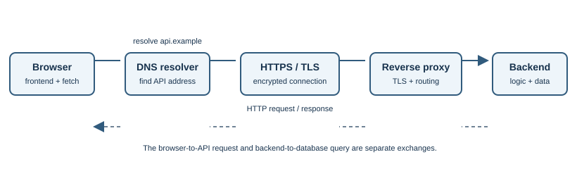

# HTTP and HTTPS

## Introduction

Hypertext Transfer Protocol (HTTP) defines how clients and servers exchange
resources. A browser sends a request; a server sends a response. HTTPS is
HTTP protected by TLS. This builds on [DNS](dns.md), [IP addressing](ip-addressing.md),
and [TCP and UDP](tcp-and-udp.md).

## Why does it exist?

Clients and servers need shared rules for describing actions, data, and
results. HTTP defines methods, headers, status codes, and message semantics
so different browsers, servers, and applications can interoperate.

## How does it work?

1. The client connects to the server. HTTP/1.1 and HTTP/2 commonly use TCP;
   HTTP/3 uses QUIC over UDP.
2. For HTTPS, TLS protects the connection before HTTP data is exchanged.
3. The client sends a request with a method, target, headers, and sometimes a
   body.
4. The server sends a response with a status code, headers, and sometimes a
   body.
5. The client interprets the response and may request related resources.


| Method | Common use | Useful property |
|---|---|---|
| `GET` | Retrieve a representation | Intended to be safe; should not change application state |
| `POST` | Submit data or request processing | Often creates or triggers an operation |
| `PUT` | Replace a resource representation | Defined as idempotent |
| `PATCH` | Apply a partial modification | Meaning depends on the API and patch format |
| `DELETE` | Request resource removal | Defined as idempotent |
| `HEAD` | Retrieve response metadata without a body | Useful for checking headers |
| `OPTIONS` | Ask about communication options | Used for browser CORS preflight in relevant cases |

The exact result depends on the server and resource. Status codes also have
families: `2xx` indicates success, `3xx` redirection, `4xx` a client-side
issue, and `5xx` a server-side issue. A `404` means the requested resource
was not found; a `200` means the response was successful according to HTTP
semantics, not necessarily that the business task succeeded.

### Read a simple exchange

A request can be represented in a simplified form like this:

```http
GET /products/42 HTTP/1.1
Host: shop.example
Accept: application/json
```

The server might return `200 OK`, a `Content-Type` header, and a response body
containing the product representation. Real exchanges include more headers,
and HTTP/2 and HTTP/3 encode messages differently on the wire, but the
request/response semantics are familiar.

For a JSON API, the frontend might send:

```http
POST /api/orders HTTP/1.1
Host: shop.example
Content-Type: application/json
Accept: application/json

{"productId":"p-42","quantity":1}
```

`Content-Type` describes the request body; `Accept` describes response
formats the client can handle. The server must validate the body and
authenticate and authorize the operation before changing application state.

### Headers, authentication, and browser CORS

Common headers include `Content-Type`, `Accept`, `Authorization`,
`Cache-Control`, and `Origin`. Bearer tokens are commonly sent as
`Authorization: Bearer ...`; treat them as credentials and never put them in
URLs.

Browsers use Cross-Origin Resource Sharing (CORS) response headers to decide
whether frontend JavaScript may read a cross-origin response. For some
requests, the browser first sends an `OPTIONS` preflight describing the
intended method and headers. The server responds with appropriate
`Access-Control-Allow-*` headers.

CORS is not authentication, authorization, or a firewall. Other clients are
not restricted by browser CORS checks, so the API must verify identity,
permissions, and input for every request. Cookie-based authentication needs
CSRF protections appropriate to the application. JavaScript-accessible
tokens require protection against script injection.

### Caching and conditional requests

HTTP caching can reduce latency and server work. `Cache-Control` controls
whether and how responses can be stored. `ETag` and `Last-Modified` let a
client revalidate a cached representation; the server can reply `304 Not
Modified` when it remains current.

Personalized or sensitive API responses need deliberate cache rules. Check
authorization, shared proxy caches, and cache keys so one user's content is
not served to another. `no-store` is useful for some sensitive responses,
but cache policy should follow the data and application requirements.

### HTTP versions and connection reuse

| Version | Typical transport | Developer-relevant point |
|---|---|---|
| HTTP/1.1 | TCP | Persistent connections can be reused |
| HTTP/2 | TCP | Multiplexes request streams over a connection and compresses headers |
| HTTP/3 | QUIC over UDP | Uses QUIC streams; see [QUIC and HTTP/3](quic-and-http3.md) |

Application code generally uses the same HTTP semantics regardless of
version. Browsers, servers, proxies, and CDNs negotiate a compatible version.

## HTTP in a full-stack application

1. The browser requests the frontend document and static assets from a web
   server or content delivery network.
2. Frontend JavaScript sends API requests, often using `fetch()` with JSON.
3. A reverse proxy or API gateway may terminate TLS, route by host or path,
   enforce request limits, and forward the request to an application service.
4. The backend authenticates and authorizes the operation, validates input,
   runs business logic, and may query databases or other services.
5. The backend returns a status, headers, and an optional body; the frontend
   interprets the response and updates the interface.



The browser-to-API call and the backend-to-database query are separate
protocol exchanges. HTTP does not define business rules or database
transactions.

For frontend code, handle network errors separately from HTTP error
responses. `fetch()` normally resolves with a `Response` for statuses such
as `404` and `500`; check `response.ok` or `response.status`. A DNS failure,
TLS error, timeout, and API validation error need different handling.

| Status family | Meaning | Example |
|---|---|---|
| `2xx` | Request succeeded according to the response | `200 OK`, `201 Created`, `202 Accepted`, `204 No Content` |
| `3xx` | Further action such as following a redirect | `301 Moved Permanently` |
| `4xx` | Request or authorization problem | `400 Bad Request`, `401 Unauthorized`, `403 Forbidden`, `404 Not Found`, `409 Conflict`, `422 Unprocessable Content`, `429 Too Many Requests` |
| `5xx` | Server failed to fulfill a valid request | `500 Internal Server Error` |

## Real-world example

Opening a product page may issue `GET` requests for HTML, images, and
stylesheets. Submitting an order form may send a `POST` request with order
data. A banking frontend might make a similar HTTPS API call to retrieve
account information after sign-in; the API still needs authorization checks
on every request, even if the interface hides restricted actions.

## Developer perspective

Use methods and status codes according to their defined semantics. **Safe**
means a method is not intended to change server state; **idempotent** means
repeating it has the same intended effect as performing it once. Do not
automatically retry non-idempotent operations, such as a payment submission,
unless the API defines a safe mechanism such as an idempotency key.

HTTP is stateless: each request is interpreted independently, although
cookies, tokens, and server-side storage can maintain authenticated
sessions. Never put passwords, access tokens, or sensitive data in URLs.
Use HTTPS, validate inputs, enforce authorization on the server, and do not
assume a successful connection means a successful request.

## Practical example

`curl -i https://example.com/` sends an HTTP request and prints response
headers and body. `curl -I https://example.com/` sends a `HEAD` request and
prints headers only. These are real requests to the specified public site;
use an endpoint you are permitted to query.

## Important terminology

- **Method:** the intended action, such as `GET` or `POST`.
- **Header:** metadata about a request or response.
- **Status code:** a numeric summary of the response outcome.
- **Body:** optional data sent with a request or response.
- **Idempotent:** repeating an operation has the same intended effect as
  performing it once.
- **Stateless:** each request carries the information needed to interpret it;
  the protocol itself does not require the server to remember earlier
  requests.
- **Cookie:** a small value a browser stores and may send with later
  requests to a site.

## Advantages and disadvantages

HTTP is widely supported and extensible. Plain HTTP does not protect data in
transit; HTTPS adds TLS protection but cannot make an unsafe application
secure by itself.

## Common misconceptions

- HTTPS does not prove a site is honest; it protects a connection to a host.
- `200 OK` does not guarantee that the user's broader task succeeded.
- HTTP transfers more than HTML, including JSON, images, and media.

## Further Learning & References

- **Official documentation — MDN (beginner-friendly):** [An overview of HTTP](https://developer.mozilla.org/en-US/docs/Web/HTTP/Overview) introduces requests, responses, and the client-server model.
- **Official standard — RFC Editor:** [RFC 9110, HTTP Semantics](https://www.rfc-editor.org/rfc/rfc9110) defines methods, status codes, fields, and HTTP semantics.
- **Official standards — IETF:** [HTTP/3, RFC 9114](https://www.rfc-editor.org/rfc/rfc9114) explains HTTP/3's use of QUIC.
