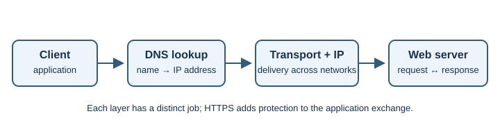

# Networking and Protocols

This section explains how computers communicate and how information travels
between a client and a server across the Internet.

Think of a web request as several cooperating layers: a name is resolved to an
address, the network carries packets, a transport protocol manages delivery,
and an application protocol describes the request and response.

## Learning objectives

- Understand the Internet's basic building blocks and addressing.
- Follow the journey of a request through DNS, transport, and web protocols.
- Recognize the roles of encryption, persistent connections, and ports.

## Topics

- [Internet Fundamentals](internet-fundamentals.md)
- [IP Addressing](ip-addressing.md)
- [TCP and UDP](tcp-and-udp.md)
- [DNS](dns.md)
- [HTTP and HTTPS](http-and-https.md)
- [TLS and SSL](tls-and-ssl.md)
- [WebSockets](web-sockets.md)
- [Network Ports](network-ports.md)

Follow the topics in order for a first pass, then revisit the links between
lessons. For example, [HTTP and HTTPS](http-and-https.md) build on
[DNS](dns.md), [IP addressing](ip-addressing.md), and
[TCP and UDP](tcp-and-udp.md).
