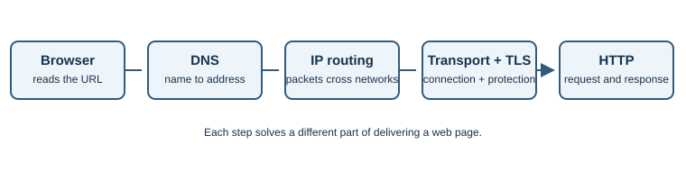
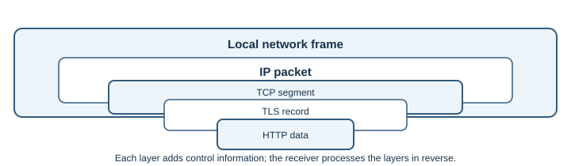

# Internet Fundamentals

## Introduction

The Internet is a global system of interconnected networks. Home networks,
mobile providers, universities, cloud platforms, and businesses operate their
own networks and exchange traffic using shared protocols. The Web is one
service that uses the Internet; email, voice calls, games, and file transfer
use it too.

## Why does it exist?

Networking lets devices share information and services without requiring one
central computer. Standard protocols let equipment and software from
different makers communicate. The trade-off is that communication depends on
many independently operated networks, so a failure or policy on the path can
affect a connection.

## How does it work?

When a browser opens a site, several jobs happen in sequence:

1. The browser reads the URL and identifies the host name.
2. [DNS](dns.md) finds an IP address for that name.
3. The device sends packets toward the address. A home router forwards them
   to an Internet provider, then routers pass them between networks.
4. A transport such as [TCP](tcp-and-udp.md), or QUIC over UDP, carries data
   between application endpoints. [Ports](network-ports.md) help identify the
   destination program.
5. For HTTPS, [TLS](tls-and-ssl.md) protects the connection. [HTTP](http-and-https.md)
   carries the request and response.

Each layer has a distinct job. A router forwards packets; it does not need to
understand the web page. The response can take a different route back.

An application creates data, such as an HTTP request. Lower layers add
information needed for delivery: transport data identifies the application
endpoint, IP data identifies network endpoints, and the local network
technology carries a frame to the next device. At the destination, those
layers are interpreted in reverse. This wrapping is called **encapsulation**.

Networks also have different performance characteristics. **Bandwidth** is
the capacity of a link; **throughput** is the rate actually achieved;
**latency** is the time a packet takes to travel. A fast link can still feel
slow when latency is high or the server takes time to respond.

| Term | Simple meaning | Example effect |
|---|---|---|
| Bandwidth | Maximum link capacity | Limits how much data can be sent at once |
| Throughput | Measured successful data rate | Drops during congestion or loss |
| Latency | Time for data to travel | Affects interactive actions such as a game move |
| Packet loss | Data that fails to reach its destination | May trigger recovery or lower-quality media |

## Real-world example

Loading a video page may involve one request for HTML, others for images and
scripts, and separate media requests to a content delivery network. The
browser coordinates these exchanges while the network carries their packets.

## Developer perspective

Layering helps narrow down problems. If DNS returns an address, name lookup
worked, but that does not prove the server accepts connections. A connection
does not prove the application returned the expected page. Diagnose one step
at a time; see [DNS](dns.md), [IP addressing](ip-addressing.md), and
[HTTP and HTTPS](http-and-https.md).

## Practical example

On Windows, run `nslookup example.com` to inspect name resolution, then
`ping example.com` to try a network diagnostic. To inspect the path on
Windows, use `tracert example.com`; on many Linux systems use
`traceroute example.com` or `tracepath example.com`. These commands may show
incomplete results because some routers do not send diagnostic replies.
A blocked ping or missing hop does not prove the website is offline. On
Linux or macOS, `ping -c 4 example.com` sends four echo requests.

## Important terminology

- **Packet:** a formatted unit of network data.
- **Router:** equipment that forwards packets between networks.
- **Protocol:** shared rules for communication.
- **Client/server:** roles in which a client requests a service and a server
  provides it.
- **ISP:** an Internet service provider that connects customers to other
  networks.
- **Latency:** time taken for data to travel between endpoints.
- **Throughput:** measured rate of successfully transferred data.
- **Encapsulation:** adding layer-specific information around data for
  delivery.

## Advantages and disadvantages

Interconnection enables global services and lets networks be operated
independently. The same distributed design means congestion, equipment
failures, or filtering along a path can interrupt service.

## Common misconceptions

- The Internet and the Web are not synonyms; the Web is one Internet service.
- Packets do not necessarily follow one fixed route.
- An IP address identifies a network endpoint at a point in time, not
  reliably a person.
- Bandwidth is not the same as throughput, and neither is the same as latency.

## Revision questions

1. What is the difference between the Internet and the Web?
2. Which job does a router perform?
3. Why might `ping` fail even if a website works?
4. Which step translates a host name into an address?

## Further Learning & References

- **Official documentation — MDN (beginner-friendly):** [How the Web works](https://developer.mozilla.org/en-US/docs/Learn/Getting_started_with_the_web/How_the_Web_works) follows a browser request and response in accessible language.
- **Official standard — RFC Editor:** [RFC 1122, Requirements for Internet Hosts](https://www.rfc-editor.org/rfc/rfc1122) describes core host communication requirements.
