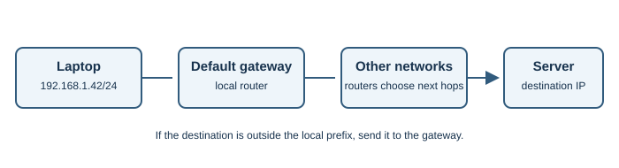
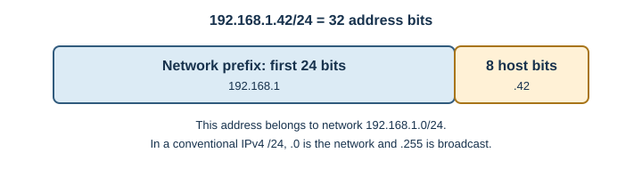

# IP Addressing

## Introduction

An Internet Protocol (IP) address labels a network interface so packets can
be delivered toward it. IPv4 addresses contain 32 bits and are often written
as four decimal numbers, such as `192.0.2.25`. IPv6 addresses contain 128
bits and use hexadecimal groups, such as `2001:db8::25`.

An address is not a web site name. [DNS](dns.md) can resolve a name to one or
more IP addresses.

## Why does it exist?

Routers need a destination address to decide where to forward a packet.
Prefixes group addresses into networks so routing can use compact rules
instead of listing every device separately.

## How does it work?

1. A device sends an IP packet with source and destination addresses.
2. It checks whether the destination is on its local subnet. If not, it sends
   the packet to a configured gateway, usually a router.
3. Routers use routing tables to choose a next hop. The packet may cross
   several networks before reaching its destination.
4. IP makes a best-effort delivery attempt. It does not itself guarantee that
   packets arrive, arrive once, or arrive in order.

A prefix such as `192.168.1.0/24` means the first 24 bits identify the
network. That leaves 8 bits for addresses within this IPv4 subnet. In a
typical `/24` local network, `192.168.1.42` belongs to the range represented
by `192.168.1.0/24`.

### Worked prefix example

For `192.168.1.42/24`, `/24` means the first 24 bits are the network prefix.
The corresponding network is `192.168.1.0/24`; in a conventional IPv4
subnet, `.0` names the network and `.255` is its directed broadcast address,
leaving `.1` through `.254` for host addresses. This `/24` arithmetic is a
learning example, not a rule that every network must use a `/24`. IPv6 uses
prefix lengths too, but has no broadcast address.

| Address type | Example | Typical purpose |
|---|---|---|
| Private IPv4 | `192.168.1.42` | Internal home or office network |
| Public IPv4 | Assigned by a provider or cloud host | Globally routed destination |
| Loopback IPv4 | `127.0.0.1` | This same device |
| Loopback IPv6 | `::1` | This same device |
| IPv6 documentation prefix | `2001:db8::/32` | Examples in learning material, not public assignment |

Private IPv4 ranges are used inside networks and are not globally routed.
Network address translation (NAT) commonly lets multiple private devices
share a public IPv4 address. IPv6 provides a much larger address space; it
does not remove the need for firewalls or all forms of address translation.

## Real-world example

Your laptop may receive `192.168.1.42` from a home router. When it connects
to a public web server, the router typically translates the connection so the
outside service sees the network's public address rather than that private
address.

## Developer perspective

Do not treat an IP address as a permanent identity. Addresses can change,
servers can have several, and NAT can place many users behind one public
address. Use DNS names for service discovery and IP tools to diagnose
network paths. An address alone does not establish a user's identity.

## Practical example

On Windows, `ipconfig` shows interface addresses and the default gateway.
On Linux, `ip address` lists local addresses and `ip route` displays routes.
These commands inspect local configuration. `127.0.0.1` and `::1` are
loopback addresses used to reach the same device.

## Important terminology

- **Interface:** a network attachment such as Wi-Fi or Ethernet.
- **Prefix/subnet:** a set of addresses sharing a number of leading bits.
- **Gateway:** a router used to reach destinations outside the local subnet.
- **Loopback:** an address used by a device to communicate with itself.
- **NAT:** translation of network addresses, often performed by a router.
- **Network address:** the prefix identifying a subnet, such as
  `192.168.1.0/24`.
- **Broadcast:** an IPv4 destination used to reach all hosts on a local
  subnet; IPv6 does not use broadcast.

## Advantages and disadvantages

IP is scalable and independent of application meaning. Its best-effort
delivery means applications need an appropriate transport or recovery
strategy. IPv6 offers many more addresses, but real networks still need to
interoperate with IPv4 during deployment.

## Common misconceptions

- A public IP does not necessarily identify one person or one device.
- A private address can reach public services through a gateway.
- IP by itself does not provide reliable, ordered application data; see
  [TCP and UDP](tcp-and-udp.md).
- IPv6 is not simply IPv4 written differently; it has a larger address format
  and different network behaviors.

## Revision questions

1. How do IPv4 and IPv6 address sizes differ?
2. What does `/24` describe in a network prefix?
3. When does a device send a packet to its default gateway?
4. Why might a server see a different address from a laptop's local address?
5. In `192.168.1.42/24`, which bits identify the network?

## Further Learning & References

- **Official documentation — MDN (beginner-friendly):** [IP address](https://developer.mozilla.org/en-US/docs/Glossary/IP_Address) introduces the address concept and its role in routing.
- **Official standard — RFC Editor:** [RFC 791, Internet Protocol](https://www.rfc-editor.org/rfc/rfc791) specifies IPv4 packet delivery.
- **Official standard — RFC Editor:** [RFC 8200, Internet Protocol, Version 6](https://www.rfc-editor.org/rfc/rfc8200) specifies IPv6.
- **Official standard — RFC Editor:** [RFC 1918, Address Allocation for Private Internets](https://www.rfc-editor.org/rfc/rfc1918) defines the familiar private IPv4 address ranges.
