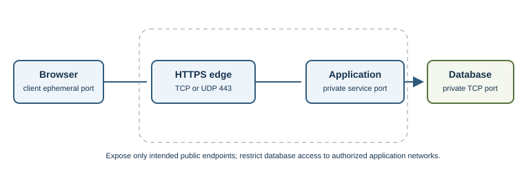
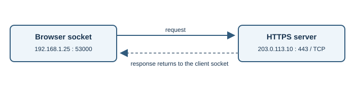
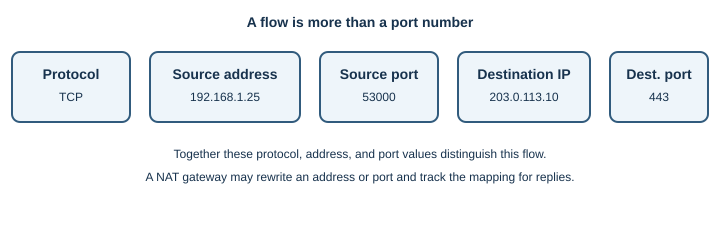

# Network Ports

## Introduction

A network port is a number used by a transport protocol to deliver traffic
to an application endpoint. An IP address identifies a network interface;
the port helps distinguish services using that address. TCP and UDP have
separate port spaces.

## Why does it exist?

A server can offer several services on one address, and a computer can run
many client programs at once. Ports let the operating system match incoming
TCP segments or UDP datagrams to the appropriate socket.

## How does it work?

TCP and UDP headers include source and destination ports. A server application
binds a socket to a local address and port and listens or waits for datagrams.
A client normally uses a temporary **ephemeral port** as its source port.

A network connection is commonly distinguished by the transport protocol,
source address and port, and destination address and port. The same port
number can be used simultaneously by TCP and UDP because they are separate
transport namespaces.

For example, these values describe an HTTPS connection from a laptop:

| Part | Example | Role |
|---|---|---|
| Protocol | TCP | Selects the transport behavior |
| Source address | `192.168.1.25` | Client's local interface address |
| Source port | `53000` | Temporary client endpoint |
| Destination address | `203.0.113.10` | Server network endpoint |
| Destination port | `443` | HTTPS service endpoint |

Together, the protocol and these four values form what is commonly called a
five-tuple. Network address translation may rewrite an address or port as
traffic passes through a router, then track the mapping so replies can be
sent back to the correct internal client.

### Ports full-stack developers commonly encounter

| Port | Transport | Common service | Developer context |
|---|---|---|---|
| `22` | TCP | SSH | Authorized remote administration and Git over SSH |
| `53` | UDP and TCP | DNS | Name queries; TCP is also used for some responses and transfers |
| `80` | TCP | HTTP | Unencrypted web endpoint, often redirected to HTTPS |
| `443` | TCP and UDP | HTTPS / HTTP/3 | HTTPS commonly uses TCP; HTTP/3 uses QUIC over UDP |
| `3000`, `5173` | TCP | Common development servers | Examples only; framework and developer configuration determine actual ports |
| `5432` | TCP | PostgreSQL default | Keep database access private and restricted |
| `3306` | TCP | MySQL default | Keep database access private and restricted |
| `6379` | TCP | Redis default | Do not expose an unauthenticated service to untrusted networks |

These are conventions and defaults, not guarantees. A service can use a
different port, and a port number does not prove which program is listening.
Cloud firewalls, host firewalls, containers, proxies, and network policies
also affect reachability.

The port range is split into registration categories:

| Range | IANA category | Common description |
|---|---|---|
| `0–1023` | System Ports | Well-known service ports |
| `1024–49151` | User Ports | Registered application services |
| `49152–65535` | Dynamic/Private Ports | Often used for temporary client ports |

Operating systems may use different local ephemeral-port ranges. IANA
categories are not a promise that a port is free or safe to expose.

IANA divides the range into System Ports (`0–1023`), User Ports
(`1024–49151`), and Dynamic/Private Ports (`49152–65535`). These categories
describe registration and allocation practices; they do not guarantee that
a port is available or that an application uses its registered number.

## Real-world example

A browser might connect from an ephemeral local port such as `53000` to a
web server's TCP port `443`. The server's reply is addressed back to that
client socket. The exact client port is selected by the operating system and
can differ for another connection.

## Developer perspective

Applications bind to a local address and port. A service bound only to
loopback is intended for local access; a service bound to a network interface
may be reachable from other devices, subject to routing and firewalls.
Opening a listener is not the same as making it reachable from the Internet.
For local development, a backend can listen only on `127.0.0.1` when it needs
to serve the same computer. Binding to `0.0.0.0` listens on all IPv4
interfaces and can expose the service to other devices if the network and
firewall permit it. Use the narrowest binding and access rules needed.

In production, a common arrangement exposes HTTP(S) only at a load balancer
or reverse proxy and keeps application and database ports on private
networks. For example, a public HTTPS listener may forward to an application
service, while the database accepts connections only from approved
application hosts. Network segmentation complements database credentials
and application authorization; it does not replace them.

## Practical example

On Linux, `ss -tuln` lists listening TCP and UDP sockets without changing
configuration. On Windows, `netstat -ano` lists connection and listening
information with process IDs. These show local state, not whether an external
firewall permits access.

For an authorized Windows TCP connectivity check, use
`Test-NetConnection example.com -Port 443`. It tests whether a TCP connection
to that endpoint could be established; it does not validate TLS, HTTP, or
application authorization. For HTTP/3, a TCP-only port test does not test
the UDP-based QUIC path.

## Important terminology

- **Listening:** a TCP socket waiting for incoming connections.
- **Ephemeral port:** temporary port commonly used by a client.
- **Socket:** operating-system endpoint for network communication.
- **Binding:** associating an application socket with a local address and
  port.
- **Port range:** a range used for specific registration and allocation
  categories.
- **Five-tuple:** transport protocol plus the source and destination
  addresses and ports that identify a network flow.

## Advantages and disadvantages

Ports let many services share an address and help operating systems route
traffic to applications. Misconfigured listeners can expose services; a port
number provides no authentication or encryption.

## Common misconceptions

- A network port is not a physical connector.
- Port `443` alone does not guarantee correct TLS.
- A listening port does not prove that external networks can reach it.
- TCP port 53 and UDP port 53 are distinct endpoints; DNS can use both.

## Further Learning & References

- **Official documentation — MDN (beginner-friendly):** [Port](https://developer.mozilla.org/en-US/docs/Glossary/Port) introduces network ports and their role in communication.
- **Official standard — RFC Editor:** [RFC 6335, Internet Assigned Numbers Authority Procedures for the Management of the Service Name and Transport Protocol Port Number Registry](https://www.rfc-editor.org/rfc/rfc6335) explains port ranges and registration procedures.
