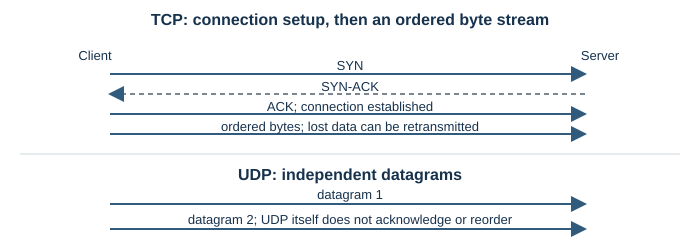
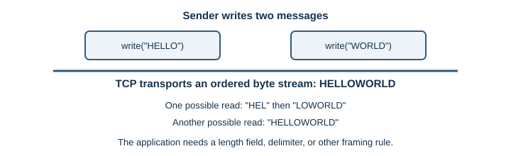
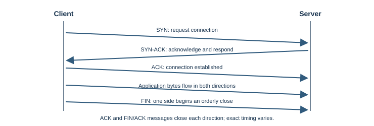

# TCP and UDP

## Introduction

Transmission Control Protocol (TCP) and User Datagram Protocol (UDP) carry
application data between programs using port numbers. Both sit above
[IP addressing](ip-addressing.md), but they offer different communication
models.

## Why does it exist?

IP forwards packets but does not promise that application data arrives
complete or in order. Applications need transport behavior suited to their
task: some need an ordered stream, while others need independent messages and
can tolerate loss.

## How does it work?

TCP first establishes connection state. A typical opening uses a
three-message handshake: the client sends `SYN`, the server replies
`SYN-ACK`, and the client sends `ACK`. Once established, sequence numbers and
acknowledgements let TCP detect missing data and retransmit it. Flow control
helps avoid overwhelming the receiver; congestion control adapts sending to
network conditions.

TCP delivers an ordered **byte stream**, not a sequence of the application's
original writes. If a program sends two writes, the receiver may read their
bytes in a different grouping.

UDP sends separate datagrams without a TCP-style connection. It provides no
transport-level retransmission, ordering, or congestion control. An
application protocol can add behavior it needs. For example, QUIC runs over
UDP while implementing reliability and congestion control itself.

| Property | TCP | UDP |
|---|---|---|
| Data model | Ordered byte stream | Independent datagrams |
| Delivery recovery | Acknowledgements and retransmission | Not provided by UDP |
| Setup | Connection handshake | No TCP-style handshake |
| Typical fit | Web pages, file transfer, database connections | DNS queries, voice, games, or protocols built on UDP |

### Reliable delivery is not the same as fast delivery

TCP retransmits missing bytes and keeps later bytes from being delivered to
the application before earlier missing bytes. This provides a useful ordered
stream, but waiting for recovery can delay later data. UDP exposes individual
datagrams to the application without doing that transport-level recovery.
Applications that need reliable UDP-based communication must implement or
use a protocol that handles acknowledgements, retransmissions, and congestion
control. QUIC is one such protocol and is used by HTTP/3.

TCP's byte-stream behavior also matters when designing a server. A single
`send` call is not guaranteed to match a single `receive` call. Applications
need message framing, such as a length field or delimiter, to identify where
their own messages end. UDP preserves datagram boundaries, but a datagram can
still be lost or too large for a path.

### TCP in web applications

Traditional HTTP/1.1 and HTTP/2 deployments commonly use TCP. A client
establishes a TCP connection to a server endpoint, often TCP port 443 for
HTTPS, and the HTTP implementation may reuse that connection for multiple
requests. Browsers and servers manage connection pools and keep-alive
behavior; application code usually does not open one TCP socket per
`fetch()` call.

Connections can fail or become idle while a request is in flight. Backend
and proxy clients should use appropriate connect, read, and overall
deadlines. Retrying can help with transient failures, but retries should be
bounded and must not duplicate non-idempotent operations unless the
application has a safe retry mechanism.

WebSockets also commonly begin over TCP before the protocol upgrade; see
[WebSockets](web-sockets.md). HTTP/3 is different: it uses QUIC over UDP,
which provides its own reliable streams.

**HTTP persistent connections** let an HTTP implementation reuse a
connection for more than one request. **TCP keepalive probes** are a
separate operating-system mechanism that can probe an idle TCP connection.
Neither mechanism guarantees that an application server is healthy or that a
request will complete; applications still need deadlines and error handling.

## Real-world example

A file download normally needs all bytes in order, so TCP's recovery is
useful. A live call values timely audio; an old packet that arrives late may
be less useful than continuing with newer audio. The calling application
still manages its own media and network behavior.

## Developer perspective

Choose a transport based on required delivery semantics, latency, and the
application protocol—not on the claim that UDP is always faster. TCP handles
many reliability details, but stream boundaries must be designed at the
application layer. UDP provides datagrams, but the application must consider
loss, ordering, security, and congestion. HTTP/3 uses QUIC over UDP; see
[HTTP and HTTPS](http-and-https.md).

## Practical example

On Linux, `ss -t -a` lists TCP sockets and `ss -u -a` lists UDP sockets.
These commands inspect local socket state. An empty result does not prove a
remote service is unreachable; proxies, containers, and firewalls affect what
is visible. To test a service you are authorized to reach from Windows,
`Test-NetConnection example.com -Port 443` reports whether a TCP connection
could be established; it does not test whether an HTTP page works.

## Important terminology

- **Handshake:** opening exchange that establishes protocol state.
- **Byte stream:** ordered bytes with no preserved message boundaries.
- **Datagram:** a discrete message delivered by UDP.
- **Acknowledgement:** a signal used to confirm receipt of data.
- **Congestion control:** behavior that adapts sending to network load.
- **Flow control:** behavior that helps prevent a sender from overwhelming
  the receiver.
- **Retransmission:** sending data again after it appears to have been lost.

## Advantages and disadvantages

TCP provides a convenient ordered stream and recovery, but maintains
connection state and retransmits lost data. UDP has simple datagram semantics
and no TCP-style setup, but leaves important reliability behavior to the
application.

## Common misconceptions

- UDP is not inherently insecure or guaranteed to be faster.
- TCP does not preserve the boundaries of individual writes.
- UDP does not mean an application cannot be reliable; QUIC is an example of
  a protocol that builds additional behavior over UDP.

## Further Learning & References

- **Official documentation — MDN (beginner-friendly):** [Transmission Control Protocol (TCP)](https://developer.mozilla.org/en-US/docs/Glossary/TCP) summarizes TCP's role in network communication.
- **Official documentation — MDN (beginner-friendly):** [User Datagram Protocol (UDP)](https://developer.mozilla.org/en-US/docs/Glossary/UDP) introduces UDP datagrams and how they differ from TCP.
- **Official standard — RFC Editor:** [RFC 9293, Transmission Control Protocol](https://www.rfc-editor.org/rfc/rfc9293) defines TCP behavior.
- **Official standard — RFC Editor:** [RFC 768, User Datagram Protocol](https://www.rfc-editor.org/rfc/rfc768) specifies UDP datagrams and checksums.
