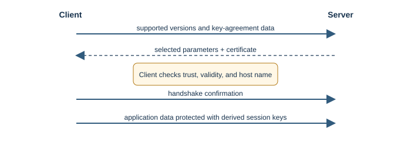
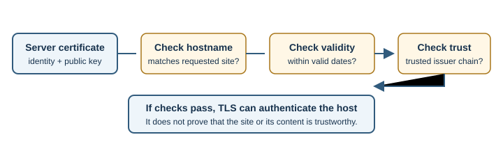

# TLS and SSL

## Introduction

Transport Layer Security (TLS) protects data exchanged between endpoints.
It is designed to provide confidentiality, integrity, and authentication.
HTTPS is HTTP carried over TLS. Secure Sockets Layer (SSL) is the obsolete
predecessor; current systems should use modern TLS, not SSL.

## Why does it exist?

Network traffic can cross equipment and networks neither endpoint controls.
Without protection, an intermediary could read or alter data, or a client
could be tricked into connecting to an impostor. TLS helps protect the
connection in transit.

## How does it work?

In a simplified TLS 1.3 connection:

1. The client offers supported TLS versions and cryptographic parameters.
2. Client and server exchange key-agreement data and derive shared session
   keys.
3. The server presents a certificate. The client checks that it is trusted,
   valid, and matches the requested host name.
4. The endpoints confirm the handshake and protect application records with
   the derived keys.
5. HTTP data travels inside the protected connection.

Certificates are signed statements that bind a public key to one or more
names. A browser checks the certificate chain against trusted certificate
authorities and verifies the requested name. Ordinary web browsing typically
authenticates the server; client certificates can also be used when mutual
authentication is required.

### Public-key and symmetric cryptography

Public-key cryptography helps establish shared secrets and verify signatures
without sending the eventual session key as plain text. After the handshake,
TLS uses symmetric session keys to protect application data efficiently.
Modern TLS also uses authenticated encryption so the receiver can detect
tampering. The protocol and library manage these details; application
developers should not invent their own key exchange.

Certificate checking is a chain of specific questions:

1. Is the certificate within its validity period?
2. Does it identify the host name the browser requested?
3. Does its signature chain lead to a certificate authority the client
   trusts?
4. Has the client been configured with any additional trust or revocation
   checks?

Passing these checks means the connection is authenticated according to the
client's trust model. It does not certify the site's intent or content.

## Real-world example

When signing in to an online service, the browser checks the service's
certificate, establishes TLS, and sends the login request through the
encrypted connection. TLS protects the data in transit but cannot protect a
compromised browser or server.

## Developer perspective

Use maintained TLS libraries and secure defaults; do not write custom
cryptography or disable certificate checks to silence an error. Keep
certificates valid and host names correct. Remember that TLS does not hide
all connection metadata, prevent phishing, or make application logic secure.
See [HTTP and HTTPS](http-and-https.md) and [SSL certificates](../07-devops-and-deployment/ssl-certificates.md).

## Practical example

`curl -I https://example.com/` requests a response over TLS. If OpenSSL is
installed, `openssl s_client -connect example.com:443 -servername example.com`
displays connection and certificate details. These commands connect to the
specified host; do not send credentials or private data in a diagnostic test.

## Important terminology

- **Handshake:** initial negotiation and authentication exchange.
- **Certificate:** signed information binding a public key to one or more
  identities.
- **Certificate authority (CA):** an issuer trusted to sign certificates.
- **Session key:** a temporary symmetric key used to protect data.
- **Integrity:** assurance that protected data has not been silently altered.
- **Public key:** a key that can be shared and used for operations such as
  signature verification.
- **Symmetric encryption:** encryption that uses a shared secret key for
  protecting data.
- **Certificate chain:** linked certificates used to establish trust from a
  server certificate to a configured trust anchor.

## Advantages and disadvantages

TLS reduces eavesdropping and tampering and helps authenticate the server.
It requires correct configuration and certificate maintenance. A valid
connection cannot protect data after it reaches a compromised endpoint.

## Common misconceptions

- The browser padlock signals a protected connection, not an honest business.
- SSL is not the current protocol to enable; modern deployments use TLS.
- Encryption does not prevent phishing, malware, or unsafe application code.

## Further Learning & References

- **Official documentation — MDN (beginner-friendly):** [Transport Layer Security (TLS)](https://developer.mozilla.org/en-US/docs/Web/Security/Transport_Layer_Security) explains TLS, certificates, and their role in web security.
- **Official standard — RFC Editor:** [RFC 8446, The Transport Layer Security (TLS) Protocol Version 1.3](https://www.rfc-editor.org/rfc/rfc8446) specifies TLS 1.3 handshakes and record protection.
