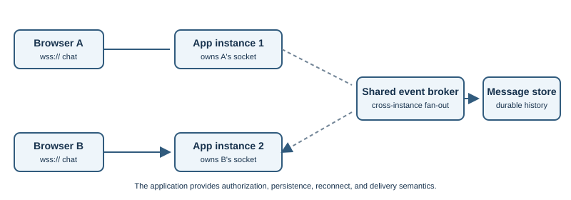

# WebSockets

## Introduction

WebSocket enables two-way communication over a long-lived connection. After
the connection is established, either endpoint can send messages without
waiting for the other to make a new request. Standard URLs use `ws://`;
`wss://` uses TLS.

## Why does it exist?

Ordinary web requests are usually initiated by the client. A page that needs
frequent server updates could repeatedly poll, but that adds requests and
delays. WebSockets are useful for chat, collaboration, live dashboards, and
multiplayer features where both sides need timely updates.

## How does it work?

1. The browser connects to a server and negotiates a WebSocket connection.
   The classic WebSocket opening uses an HTTP/1.1 upgrade handshake.
2. If the server accepts, both sides switch to the WebSocket framing
   protocol.
3. The client and server send text or binary messages independently.
4. Either side can close the connection. The application must decide whether
   and how to reconnect.

WebSocket provides framing, not application meaning. The application still
needs a message format, authorization rules, validation, error handling, and
resource cleanup. With `wss://`, TLS protects the connection in transit.

### Choosing between live-update approaches

| Approach | How updates arrive | Often a good fit |
|---|---|---|
| Repeated polling | Browser asks again at intervals | Infrequent updates or simple prototypes |
| Server-Sent Events | Server streams one-way text events to browser | Live feeds where the browser mainly receives updates |
| WebSocket | Both sides send over one long-lived connection | Chat, collaboration, and interactive sessions |

WebSockets also have control frames, including Ping, Pong, and Close. They
help manage the connection, but applications still need a clear policy for
stale clients. A heartbeat can detect a connection that appears open but is
no longer responsive.

Reconnection should use a bounded delay that grows between attempts, often
with random variation (jitter), rather than retrying continuously. After a
reconnect, the app may need to authenticate again and request missed updates;
the WebSocket protocol itself does not provide durable message history.

## Real-world example

A signed-in chat page opens a `wss://` connection. When a new message arrives,
the server can push it to the browser without waiting for the browser to poll
again. The app still needs to decide who may join each conversation.

## Developer perspective

Use WebSockets for ongoing two-way communication. For one-way server updates,
polling or Server-Sent Events may be simpler. Account for reconnects,
timeouts, load balancing, and authentication. Validate every message and
check the browser `Origin` where appropriate; a secure transport does not
replace authorization.

## Practical example

For an application you control, open browser developer tools and inspect the
Network panel when its live feature connects. Look for the handshake,
connection status, frames, and close reason. This observes traffic without
sending test messages to a third-party service.

## Important terminology

- **Handshake:** negotiation that opens a WebSocket connection.
- **Frame:** protocol unit carrying data or control information.
- **Full-duplex:** both endpoints can send independently.
- **Heartbeat:** periodic application or protocol check that helps notice a
  stale connection.
- **Close frame:** signal used to end a WebSocket connection.
- **Server-Sent Events (SSE):** a browser API for receiving a stream of
  server-to-client events over HTTP.
- **Jitter:** a small random variation in retry delays to prevent many
  clients reconnecting at exactly the same time.

## Advantages and disadvantages

WebSockets enable server push and two-way messages without repeated HTTP
requests. Persistent connections consume resources and require careful
handling during restarts, reconnections, and horizontal scaling.

## WebSockets in a full-stack chat application

1. The browser first authenticates with the application, commonly through
   an existing session or another documented credential flow.
2. The browser opens `wss://` to the WebSocket endpoint. The server validates
   the request and its `Origin` against the application's allowed origins.
3. The server authenticates the connection and associates it with a user or
   authorized room. It must still authorize each action; being connected is
   not permission to read or send every message.
4. The client and server exchange application messages, often JSON with a
   message type, identifier, and payload. The server validates size, shape,
   rate, and authorization before acting.
5. To deliver a message to clients connected to multiple application
   instances, deployments commonly publish events through a shared broker
   or message system. Each instance forwards the event to its own connected
   clients.

The WebSocket protocol does not define chat rooms, message persistence,
read receipts, offline delivery, or exactly-once processing. Store durable
messages separately when required, and let reconnecting clients request
missed events using an application-level cursor or sequence.

### Browser authentication considerations

The browser's built-in `WebSocket` constructor does not provide a general
option for setting arbitrary HTTP request headers. Common designs therefore
use a secure session cookie during the handshake or an application-defined
authentication exchange after the connection opens. If authentication is
sent as the first WebSocket message, restrict what an unauthenticated
connection can do and close it promptly if authentication fails.

Avoid putting long-lived access tokens in the WebSocket URL: URLs can appear
in logs and monitoring systems. If a design uses a short-lived connection
ticket in the URL, it should be single-use where practical, narrowly scoped,
and protected from logging. Regardless of the credential design, validate
the expected `Origin` for browser clients and authorize each requested room
or action.

### Connection lifecycle and operational details

| Concern | Developer responsibility |
|---|---|
| Authentication | Validate the user during connection setup and handle session expiry or revocation |
| Authorization | Check room membership and permissions for each subscription and message |
| Origin | Allow only expected web origins when cookie-based authentication is used |
| Heartbeat | Detect broken or idle connections; network intermediaries may close quiet connections |
| Reconnect | Use bounded backoff with jitter and define how clients recover missed state |
| Scaling | Track connection ownership and distribute events across server instances when needed |
| Backpressure | Bound queued messages or disconnect slow consumers to avoid unbounded memory growth |
| Deployment | Configure proxies and load balancers to support long-lived upgraded connections and sensible idle timeouts |
| Observability | Record connection counts, close reasons, message rates, and errors without logging secrets or private message bodies |

If authentication uses cookies, browsers may attach those cookies to a
WebSocket handshake. Validate `Origin` and use appropriate cookie and
session protections to reduce cross-site WebSocket hijacking risk. Do not
assume CORS response rules alone protect WebSockets.

## Common misconceptions

- WebSocket starts with an HTTP-based handshake, then uses WebSocket frames.
- `wss://` protects transport but does not validate application permissions.
- A persistent connection can still be interrupted by networks or servers.

## Further Learning & References

- **Official documentation — MDN:** [The WebSocket API](https://developer.mozilla.org/en-US/docs/Web/API/WebSockets_API) explains browser-side connections and message events.
- **Official standard — RFC Editor:** [RFC 6455, The WebSocket Protocol](https://www.rfc-editor.org/rfc/rfc6455) specifies the opening handshake and framing.
- **Official documentation — MDN:** [Writing WebSocket client applications](https://developer.mozilla.org/en-US/docs/Web/API/WebSockets_API/Writing_WebSocket_client_applications) describes browser connection and event handling.
