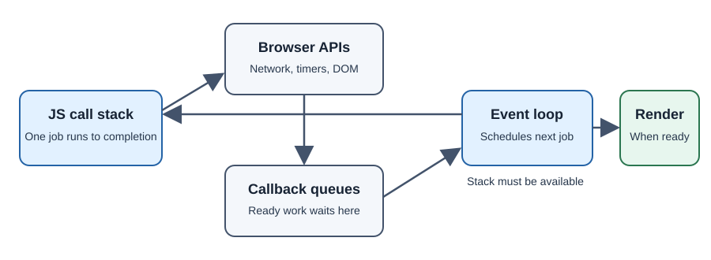

# JavaScript Runtime and the Browser Event Loop

The browser provides the environment around JavaScript: a JavaScript engine,
Web APIs, event handling, rendering, and an event loop that coordinates
queued work.

## Engine, APIs, and scheduling

The engine parses and executes JavaScript. The browser exposes APIs such as
the DOM, timers, and `fetch`. Some operations are handled by browser
subsystems while JavaScript continues; completion queues callbacks for later
execution. JavaScript on the main thread runs a job to completion before a
different job can run there.

## Why it matters

A long-running JavaScript task can delay input, animation, and rendering.
Understanding the runtime helps explain why asynchronous code improves
responsiveness but does not make CPU-heavy synchronous work disappear.

## Developer perspective

Keep main-thread work short. Use a Worker for suitable CPU-intensive work
that can be separated from DOM access. Use DevTools Performance recordings
to find real long tasks before optimizing.

## Common misconceptions

- The event loop is not a second JavaScript thread that executes callbacks
  simultaneously.
- Browser APIs are not part of the ECMAScript language specification.
- An asynchronous API can still lead to expensive synchronous callback work.

## Further learning

- [MDN: JavaScript event loop](https://developer.mozilla.org/en-US/docs/Web/JavaScript/Event_loop)
- [MDN: Web Workers](https://developer.mozilla.org/en-US/docs/Web/API/Web_Workers_API)
