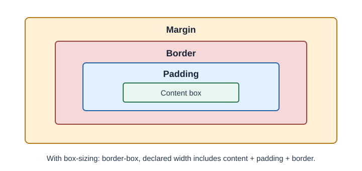

# CSS Box Model and Layout

Every rendered element has a box. The box model describes the content area,
padding, border, and margin. Layout systems such as Flexbox and Grid arrange
these boxes.

## Why it matters

Understanding box sizing helps explain unexpected widths and spacing. Layout
tools let developers arrange content without fragile positioning hacks.

## How it works

With the default `content-box`, declared width applies to the content; padding
and border are added outside it. With `border-box`, the declared width
includes content, padding, and border. Flexbox is suited to arranging items
along one primary axis; Grid is suited to rows and columns together.

## Practical example

```css
*,
*::before,
*::after {
  box-sizing: border-box;
}

.cards {
  display: grid;
  grid-template-columns: repeat(auto-fit, minmax(15rem, 1fr));
  gap: 1rem;
}

.toolbar {
  display: flex;
  align-items: center;
  justify-content: space-between;
}
```

`auto-fit` and `minmax()` let the grid use available space while respecting a
minimum card width.



## Developer perspective and terminology

Use normal flow, Flexbox, or Grid for most layouts. Reserve absolute
positioning for overlays or elements intentionally removed from normal flow.
**Padding** is inner spacing, **margin** is outer spacing, and **gap** spaces
items in a layout without adding margins to each child.

## Common misconceptions

- Margin is not part of an element's background-painted content box.
- `z-index` does not place every element in one global stack; stacking
  contexts affect ordering.
- Flexbox and Grid can be combined; they solve related but different layout
  problems.

## Check your understanding

1. How does `border-box` change width calculations?
2. When is Grid a natural choice over Flexbox?
3. What is the difference between padding and margin?

## Further learning

- [MDN: The box model](https://developer.mozilla.org/en-US/docs/Web/CSS/CSS_box_model/Introduction_to_the_CSS_box_model)
- [MDN: CSS layout](https://developer.mozilla.org/en-US/docs/Learn_web_development/Core/CSS_layout)
