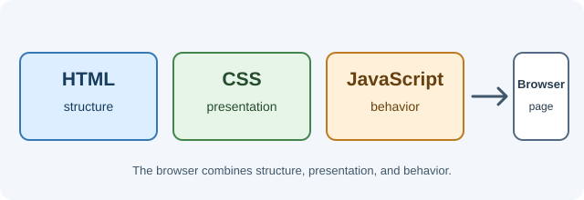

# Frontend Development

This section covers how websites are structured, styled, and made interactive,
and how modern frontend frameworks build on browser capabilities.

Frontend development combines web standards with tools for building useful,
accessible interfaces. Start with HTML, CSS, and JavaScript, then explore how
browsers render pages and how TypeScript, React, and Next.js help organize
larger applications. The lessons link to one another so you can follow the
path from browser fundamentals to application frameworks.

## Learning objectives

- Understand the browser's role in turning web resources into a user interface.
- Build a foundation in HTML, CSS, JavaScript, and TypeScript.
- Learn how React and Next.js support frontend application development.
- Connect foundational browser technologies with framework-based applications.

## Topics

- [HTML](html.md)
- [CSS](css.md)
- [JavaScript](javascript.md)
- [TypeScript](typescript.md)
- [Browser Internals](browser-internals.md)
- [React](react.md)
- [Next.js](nextjs.md)
