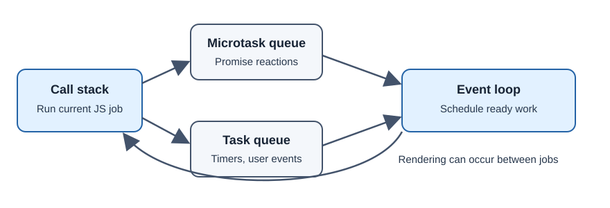

# JavaScript Event Loop and Concurrency

The event loop coordinates JavaScript execution with queued work such as
timers, user events, and completed network operations. It lets browser
applications handle asynchronous activity without blocking on each result.

## A useful mental model

JavaScript code runs to completion on an execution stack. The host environment
(such as a browser) performs many operations outside that stack. When work is
ready, callbacks are queued. Promise reactions use the microtask queue, which
is generally processed before the browser moves to the next task and renders.
Exact scheduling details depend on the host and specification.



## Practical example

```js
console.log("A");
setTimeout(() => console.log("timer task"), 0);
Promise.resolve().then(() => console.log("promise microtask"));
console.log("B");
```

The synchronous logs run first (`A`, then `B`); the Promise callback is
normally processed before the timer callback. A zero-millisecond timer does
not mean “run immediately.”

## Developer perspective

Long synchronous work can block input and rendering. Break expensive tasks
into manageable work or use a Web Worker for suitable CPU-heavy computation.
**Task** is queued host work; **microtask** is a higher-priority queue used by
Promise reactions; **run to completion** means the current JavaScript job
finishes before another job starts on that thread.

## Common misconceptions

- JavaScript being single-threaded in a given context does not mean browsers
  perform only one operation at a time.
- `setTimeout(fn, 0)` does not guarantee immediate execution.
- `async`/`await` changes how asynchronous code is written, not the underlying
  need to schedule completion.

## Further learning

- [MDN: JavaScript event loop](https://developer.mozilla.org/en-US/docs/Web/JavaScript/Event_loop)
- [HTML Standard: Event loops](https://html.spec.whatwg.org/multipage/webappapis.html#event-loops)
