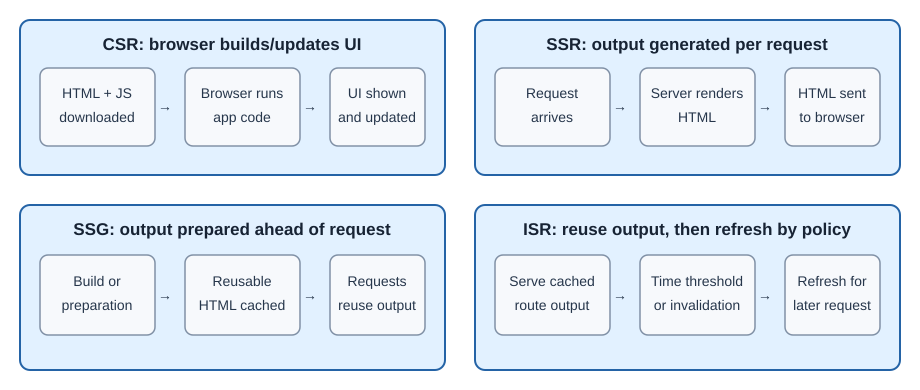

# Next.js Rendering Strategies

Rendering describes when and where page output is produced. Next.js can
combine browser rendering, static output, server rendering, cached data, and
interactive Client Components. A route's behavior depends on its code,
configuration, framework version, and hosting platform.

## Choose a focused lesson

- [Client-side rendering](client-side-rendering.md): build or update UI in
  the browser.
- [Static rendering](static-rendering.md): prepare shareable output before
  visitors request it.
- [Server-side rendering](server-side-rendering.md): produce output on the
  server for a request.
- [Incremental Static Regeneration](incremental-static-regeneration.md):
  refresh cached output using time-based or event-based revalidation.

## These strategies can be combined

A page can contain server-produced HTML, cached public data, and interactive
client-side controls. Server Components describe where component code runs;
SSR, static rendering, and revalidation describe when or how output is
produced. They are related but are not interchangeable terms.

## Questions to guide a choice

1. Is the content public or specific to one signed-in user?
2. How quickly must updates appear?
3. Can the output be reused safely for many visitors?
4. Does the deployment platform support the required server and cache
   behavior?

## Common misconceptions

- Server rendering does not guarantee a fixed speed increase or search
  ranking.
- Static output must not contain private, user-specific information.
- Hydration is not the same thing as rendering.
- ISR is not necessarily a scheduled rebuild at an exact wall-clock time.

## Further learning

- [Next.js: Rendering](https://nextjs.org/docs/app/building-your-application/rendering)
- [Next.js: Caching](https://nextjs.org/docs/app/building-your-application/caching)
