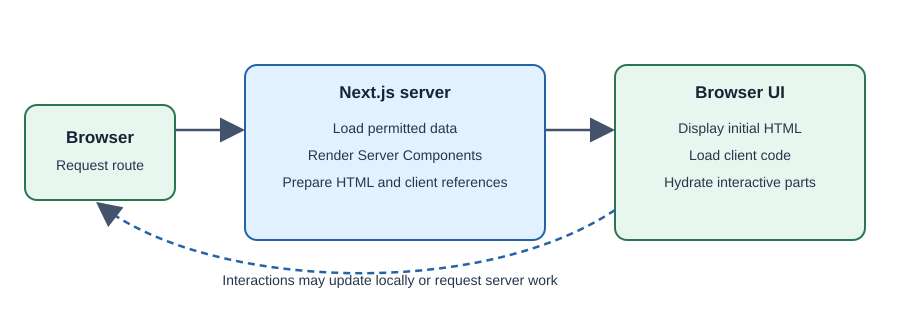

# Server and Client Components

The App Router uses React Server Components by default. Client Components
are used when a component needs browser-side interactivity or APIs.

## Why separate components?

Code that only prepares or displays data does not always need to be sent to
the browser. Interactive controls, however, need browser JavaScript. Keeping
the boundary intentional can reduce client work and clarify where code runs.

## How the boundary works

A file beginning with the `"use client"` directive becomes a Client Component
entry point. Its imported component subtree is included in the client
boundary. Server Components can access server-side resources, but cannot use
browser-only APIs or client hooks. Props crossing the boundary need to be
serializable; functions and many server-only values cannot be passed directly.

## Practical example

```tsx
// app/components/counter.tsx
"use client";

import { useState } from "react";

export function Counter() {
  const [count, setCount] = useState(0);
  return <button onClick={() => setCount(count + 1)}>Count: {count}</button>;
}
```

A page can render this small interactive control alongside server-rendered
content. Add `"use client"` only where browser behavior is required.



## Developer perspective and terminology

Keep database access, secrets, and server-only work on the server. Keep
interactive state near the controls that use it. **Server Component** runs
within the server-oriented rendering model; **Client Component** participates
in browser-side React behavior; **hydration** attaches client behavior to
server-rendered UI when needed.

## Common misconceptions

- `"use client"` does not mean “render only in the browser”; a client
  component may also contribute to initial server-generated HTML.
- Server Components are not a security boundary by themselves; do not expose
  sensitive values in rendered output.
- Adding `"use client"` to the root unnecessarily can increase client-side
  JavaScript.

## Check your understanding

1. When does a component need the client boundary?
2. What kind of props can cross a server/client boundary?
3. Why should secrets remain out of rendered output?

## Further learning

- [Next.js: Server and Client Components](https://nextjs.org/docs/app/building-your-application/rendering/server-components)
- [Next.js: Client Components](https://nextjs.org/docs/app/building-your-application/rendering/client-components)
