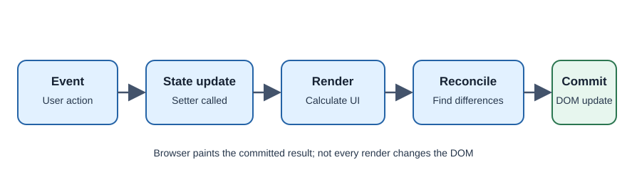

# React Rendering and Reconciliation

Rendering is React calling components to calculate the UI for current props
and state. Reconciliation is how React compares the new description with the
previous one and decides what changes are needed in the host environment.

## What triggers a render?

A component may render when its state changes, its parent renders and passes
new props, or a context value it reads changes. Rendering calculates a
description; it does not mean React replaces the whole DOM tree.

## Render and commit

React's render work calculates the next UI. The commit phase applies required
changes to the DOM and runs relevant effects. React may skip work or render
again before committing; components should therefore remain pure and avoid
side effects during render.

## Developer perspective and terminology

Keep rendering deterministic: the same props and state should describe the
same UI. Give list items stable keys so React can match them across updates.
**Reconciliation** compares element trees; **commit** applies changes;
**pure component render** avoids changing external state while calculating UI.

## Common misconceptions

- Every render does not mean every DOM node is recreated.
- A component function may run more than once in development.
- Do not perform network requests or mutate global values during render.

## Check your understanding

1. What is the difference between render and commit?
2. Why should component rendering be pure?
3. What information do stable keys provide?

## Further learning

- [React Learn: Render and commit](https://react.dev/learn/render-and-commit)
- [React Learn: Keeping components pure](https://react.dev/learn/keeping-components-pure)
