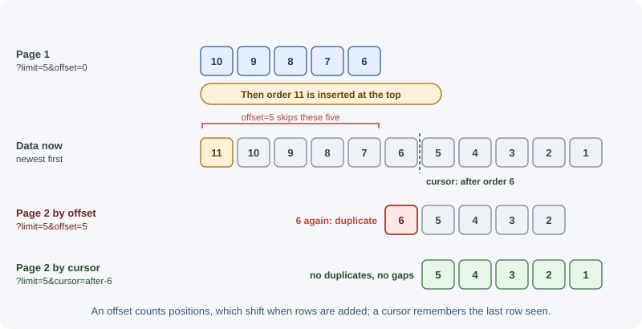

# API Design Best Practices

An API is a product whose users are developers. Once clients depend on it,
every name, field, and status code becomes hard to change. Good API design
makes endpoints predictable, consistent, safe to evolve, and pleasant to use.
This page collects the conventions that well-run APIs follow.

## Why it matters

- **APIs outlive their first client.** A mobile app version in users' pockets
  may call your API for years; a breaking change can crash it.
- **Consistency reduces mistakes.** If every list paginates the same way and
  every error has the same shape, client code can be written once.
- **Good design prevents performance problems.** Unpaginated lists and
  unbounded filters are how one request takes down a database.
- **Clear contracts enable parallel work.** With an agreed OpenAPI document,
  frontend and backend teams can build at the same time.

## Real-world usage

- **Stripe uses cursor pagination.** Stripe's list endpoints accept
  [`limit`, `starting_after`, and `ending_before`](https://docs.stripe.com/api/pagination),
  where the cursors are object IDs, and the response includes `has_more`.
  Stripe describes this as cursor-based pagination.
- **GitHub paginates with the `Link` header.** GitHub's REST API returns a
  subset of results and a
  [`link` header](https://docs.github.com/en/rest/using-the-rest-api/using-pagination-in-the-rest-api)
  pointing to other pages; endpoints that support `per_page` let clients
  change the page size. GitHub's best practices tell clients to follow the
  links rather than build pagination URLs by hand.
- **Stripe and GitHub version by date.** Stripe requests use the account's
  default API version unless the
  [`Stripe-Version` header](https://docs.stripe.com/api/versioning)
  overrides it. GitHub uses the
  [`X-GitHub-Api-Version` header](https://docs.github.com/en/rest/about-the-rest-api/api-versions)
  and says a previous version is supported for at least 24 months after a
  new one is released.
- **Stripe makes `POST` safe to retry.** Stripe
  [accepts idempotency keys on all `POST` requests](https://docs.stripe.com/api/idempotent_requests),
  so a client can retry a payment request without charging twice.
- **Zalando publishes its API rules.** The
  [Zalando RESTful API guidelines](https://opensource.zalando.com/restful-api-guidelines/)
  include rules such as "MUST support problem JSON", "SHOULD prefer
  cursor-based pagination, avoid offset-based pagination", and "MUST not
  break backward compatibility". They are a good example of turning the
  practices on this page into a company-wide standard.

## How it works

### Naming conventions

| Element | Convention | Example |
|---|---|---|
| Path segments | Lowercase nouns, hyphens between words, plural collections | `/api/shipping-addresses/12` |
| Query parameters | One casing style used everywhere (camelCase is common in JSON APIs) | `?pageSize=20&sortBy=createdAt` |
| JSON fields | One casing style used everywhere; camelCase is most common for JavaScript clients, snake_case is also popular | `"createdAt"` or `"created_at"` |
| Booleans | Read as a yes/no question | `"isActive"`, `"hasAttachments"` |
| Enumerations | Lowercase strings, documented | `"status": "paid"` |
| Actions | A noun sub-resource or a verb sub-path, used consistently | `POST /orders/9/cancellation` or `POST /orders/9/cancel` |

The specific choice matters less than applying it everywhere. Mixed casing
(`created_at` in one response, `updatedAt` in another) is a sign of an API
designed one endpoint at a time.

### Resource modelling

- **Model what clients care about**, not your tables. A "checkout" resource
  may touch carts, payments, and inventory internally.
- **Hide implementation details:** internal flags, database column names,
  and join tables do not belong in responses.
- **Keep representations stable** and reasonably complete, so clients do not
  need five requests to render one screen.
- **Use sub-resources for owned data** (`/orders/9/items`) and top-level
  resources for things that stand alone.
- **Embed or link related data deliberately.** Offer an `expand` or
  `include` parameter (`?include=customer`) instead of always nesting
  everything.

### Pagination

Every collection endpoint needs pagination before the data grows. There are
two main styles.

#### Offset/limit pagination

```text
GET /api/orders?limit=20&offset=40      (or ?page=3&pageSize=20)
```

The database skips `offset` rows and returns `limit` rows.

- **Pros:** simple, supports "jump to page 7", easy to show total pages.
- **Cons:** gets slower as the offset grows (the database still walks past
  the skipped rows), and results shift when rows are inserted or deleted
  between requests, so users see duplicates or miss items.

#### Cursor (keyset) pagination

```text
GET /api/orders?limit=20
GET /api/orders?limit=20&cursor=eyJjcmVhdGVkQXQiOiIyMDI2LTExLTAzVDEwOjE1OjAwWiIsImlkIjo5MDF9
```

The cursor encodes the position of the last item returned (for example its
`createdAt` and `id`). The next query asks for items *after* that position:

```sql
SELECT * FROM orders
WHERE (created_at, id) < ($1, $2)   -- position from the cursor
ORDER BY created_at DESC, id DESC
LIMIT 21;                            -- one extra row tells us if there is more
```

- **Pros:** fast at any depth with an index on the sort columns; stable when
  data changes; ideal for infinite scroll and feeds.
- **Cons:** no jumping to an arbitrary page; total counts are a separate,
  potentially expensive query.

| | Offset/limit | Cursor |
|---|---|---|
| Performance on deep pages | Degrades | Constant |
| Consistency during inserts/deletes | Duplicates or gaps | Stable |
| Jump to page N | Yes | No |
| Typical use | Admin tables, small datasets | Feeds, large or fast-changing collections, public APIs |



Make cursors **opaque** (base64-encoded JSON is common) so clients cannot
depend on their contents, and always include a tie-breaker such as `id` in
the sort so the order is unique.

#### Pagination metadata

Return paging information with the data:

```json
{
  "data": [ { "id": "ord_901" }, { "id": "ord_900" } ],
  "pagination": {
    "limit": 20,
    "nextCursor": "eyJpZCI6Im9yZF85MDAifQ",
    "hasMore": true
  }
}
```

Or use the standard `Link` header (RFC 8288), as GitHub's API does:

```text
Link: <https://api.example.com/orders?cursor=abc&limit=20>; rel="next",
      <https://api.example.com/orders?limit=20>; rel="first"
```

Always enforce a **maximum `limit`** (for example 100) on the server, and
use a sensible default when the client sends none.

### Filtering, sorting, field selection, and search

| Feature | Common convention | Example |
|---|---|---|
| Exact filter | Field name as parameter | `?status=paid&customerId=cus_7` |
| Multiple values | Comma list or repeated parameter | `?status=paid,shipped` |
| Ranges | Suffixes or bracket syntax | `?createdAfter=2026-11-01` or `?total[gte]=1000` |
| Sorting | `sort` with `-` for descending, comma for secondary | `?sort=-createdAt,id` |
| Field selection | `fields` listing what to return | `?fields=id,status,total` |
| Expanding relations | `include` or `expand` | `?include=customer,items` |
| Full-text search | `q` parameter or a search endpoint | `?q=desk+lamp` |

Rules:

- **Allowlist** filterable and sortable fields. Never pass client input
  straight into a database query; that invites injection and unindexed
  queries.
- **Index** what you allow clients to filter and sort by.
- **Validate types**: query strings are always strings, so convert and check
  them.

### Versioning strategies

You will eventually need a breaking change. Versioning lets old clients keep
working while new ones move on.

| Strategy | Example | Pros | Cons |
|---|---|---|---|
| URI path | `/api/v1/orders`, `/api/v2/orders` | Obvious, easy to route, cache, and test in a browser | Version is part of the resource identity; tends to version everything at once |
| Custom header | `Api-Version: 2026-11-01` | Clean URLs; date-based versions allow fine-grained changes | Less visible; easy to forget; caches must `Vary` on it |
| Media type | `Accept: application/vnd.example.v2+json` | Most aligned with HTTP content negotiation | Awkward for clients and tooling |
| Query parameter | `/api/orders?version=2` | Simple | Mixes versioning with filtering; easy to drop by accident |

URI versioning is the most common and the easiest to operate. Whatever you
choose, version **rarely**: most changes can be made compatibly.

### Backward-compatible vs breaking changes

| Usually safe (additive) | Breaking |
|---|---|
| Adding a new endpoint | Removing or renaming an endpoint |
| Adding an optional request field with a default | Making an optional field required |
| Adding a field to a response | Removing or renaming a response field |
| Adding a new enum value (if clients were told to expect unknown values) | Changing a field's type or meaning (string to number, cents to dollars) |
| Adding a new optional query parameter | Changing default behavior, sorting, or pagination |
| Relaxing validation | Tightening validation on existing inputs |
| Adding a new error code (documented) | Changing status codes clients rely on |

Two rules make additive changes safe: servers ignore unknown request fields
(or reject them consistently from day one), and **clients ignore unknown
response fields**. Tell client developers to tolerate unknown fields and
enum values.

### A consistent error format: RFC 9457 problem details

Pick one error shape and use it for every error. RFC 9457 defines a standard
one with the media type `application/problem+json`:

```text
HTTP/1.1 422 Unprocessable Content
Content-Type: application/problem+json

{
  "type": "https://api.example.com/problems/validation-error",
  "title": "Your request is not valid.",
  "status": 422,
  "detail": "2 fields failed validation.",
  "instance": "/api/orders",
  "errors": [
    { "field": "quantity", "message": "must be at least 1" },
    { "field": "email", "message": "must be a valid email address" }
  ],
  "requestId": "7f3c9a2e"
}
```

| Member | Meaning |
|---|---|
| `type` | A URI identifying the problem type; ideally a page documenting it. Defaults to `about:blank` |
| `title` | A short, human-readable summary of the problem type; stays the same for every occurrence |
| `status` | The HTTP status code, repeated for convenience |
| `detail` | A human-readable explanation of this occurrence |
| `instance` | A URI identifying this specific occurrence (often the request path or an error ID) |
| extensions | Any extra members you define, such as `errors` or `requestId` |

Clients should branch on `type` (stable) rather than parsing `detail`
(human text that may change).

### Dates, times, and IDs

- **Dates and times:** ISO 8601 strings in **UTC** with a `Z` suffix:
  `"2026-11-03T10:15:00Z"`. Avoid Unix timestamps in JSON (ambiguous units)
  and local times without an offset. Use date-only strings
  (`"2026-11-03"`) for calendar dates like birthdays.
- **Money:** integers in the smallest unit plus a currency
  (`{"amount": 4999, "currency": "USD"}`), never floating point.
- **IDs:** treat them as **opaque strings**, even if they look numeric.
  Prefer non-guessable IDs (UUIDs, or prefixed random IDs like `ord_8Fh2...`)
  for public resources; sequential integers leak business volume and invite
  enumeration attacks. Prefixes make logs and support tickets clearer.

### Bulk operations

Many small requests are slow; one giant request is fragile. For bulk work:

- Offer a batch endpoint such as `POST /api/contacts/batch` with a capped
  array size.
- Decide whether the batch is **all-or-nothing** (a transaction) or
  **partial**. For partial success, return `200` (or `207 Multi-Status` if
  you follow WebDAV conventions) with a per-item result:

```json
{
  "results": [
    { "index": 0, "status": 201, "id": "con_1" },
    { "index": 1, "status": 422, "error": { "title": "email is not valid" } }
  ]
}
```

- For very large imports, accept a file and process it in the background.

### Long-running operations

Do not keep an HTTP request open for minutes. Instead:


Clients poll the status resource, or the server notifies them through a
webhook or a real-time channel when the job finishes. See
[background jobs](background-jobs-and-scheduling.md) and
[webhooks](webhooks.md).

### Documentation with OpenAPI

The OpenAPI Specification describes an HTTP API in a YAML or JSON document:
paths, parameters, request and response schemas, auth schemes, and examples.

```yaml
openapi: 3.1.0
info:
  title: Orders API
  version: 1.0.0
paths:
  /api/orders/{id}:
    get:
      summary: Get an order
      parameters:
        - name: id
          in: path
          required: true
          schema: { type: string }
      responses:
        "200":
          description: The order
          content:
            application/json:
              schema: { $ref: "#/components/schemas/Order" }
        "404":
          description: Order not found
          content:
            application/problem+json:
              schema: { $ref: "#/components/schemas/Problem" }
components:
  schemas:
    Order:
      type: object
      required: [id, status]
      properties:
        id: { type: string }
        status: { type: string, enum: [pending, paid, shipped] }
    Problem:
      type: object
      properties:
        type: { type: string }
        title: { type: string }
        status: { type: integer }
```

From one document you can generate interactive docs (Swagger UI, Redoc),
client SDKs, mock servers, and contract tests. Keep it in the repository and
update it in the same change as the code.

### Deprecation

When you plan to remove something, warn clients early and in a
machine-readable way:

```text
Deprecation: @1780272000                  (RFC 9745: deprecated since 2026-06-01, as a Unix time)
Sunset: Fri, 01 Jan 2027 00:00:00 GMT     (RFC 8594: will stop working at this time)
Link: <https://api.example.com/docs/migrate-v2>; rel="deprecation"
```

Also announce it in the changelog, email API consumers, monitor who still
calls the old endpoint, and only remove it after the sunset date. After
removal, `410 Gone` is clearer than `404`.

### Idempotency keys

For non-idempotent operations such as payments, let clients send a unique
`Idempotency-Key` header. If a retry arrives with the same key, the server
returns the original result instead of charging twice. See
[timeouts, retries, and idempotency](timeouts-retries-and-idempotency.md).

## When to use and when not to use

| Decision | Use | When | Avoid when |
|---|---|---|---|
| Pagination style | Cursor (keyset) | Feeds, large or fast-changing collections, public APIs | Users must jump to page N or see exact totals |
| | Offset/limit | Small datasets, admin tables with page numbers | Deep pages on large tables; data changing between requests |
| New version | URI or header version | A breaking change you cannot avoid | Additive changes; add fields or endpoints instead |
| Error format | RFC 9457 problem details | Any API that returns errors to programs | Never; at most, extend it with your own members |
| Bulk endpoint | `POST .../batch` with a size cap | Clients regularly create or update many items | Rare bulk needs; per-item requests are simpler |
| Long-running work | `202` + status resource | Work that can outlive a proxy timeout | Fast operations; a direct response is simpler |
| Idempotency keys | `Idempotency-Key` header | Payments, orders, anything costly to duplicate | Naturally idempotent methods (`GET`, `PUT`, `DELETE`) |

The practices on this page matter most for APIs other teams or companies
depend on. For a small internal API used by one frontend you also own, the
same ideas apply, but you can keep the ceremony light: you can change both
sides together, so formal versioning and deprecation headers are often
unnecessary.

## Practical examples

### Cursor pagination in Express

```js
import express from "express";

const app = express();
const MAX_LIMIT = 100;

const encodeCursor = (obj) => Buffer.from(JSON.stringify(obj)).toString("base64url");
const decodeCursor = (str) => JSON.parse(Buffer.from(str, "base64url").toString("utf8"));

app.get("/api/orders", async (req, res) => {
  const limit = Math.min(Number(req.query.limit) || 20, MAX_LIMIT);

  let after = null;
  if (typeof req.query.cursor === "string") {
    try {
      after = decodeCursor(req.query.cursor); // { createdAt, id }
    } catch {
      return res.status(400).type("application/problem+json")
        .json({ title: "Invalid cursor", status: 400 });
    }
  }

  // Fetch one extra row to know whether another page exists
  const rows = await db.findOrders({ after, limit: limit + 1 }); // keyset query
  const page = rows.slice(0, limit);
  const last = page.at(-1);

  res.json({
    data: page,
    pagination: {
      limit,
      hasMore: rows.length > limit,
      nextCursor: rows.length > limit ? encodeCursor({ createdAt: last.createdAt, id: last.id }) : null,
    },
  });
});
```

`db.findOrders` stands for a query like the SQL keyset example above.

### A problem-details error helper

```js
import { STATUS_CODES } from "node:http";

export function sendProblem(res, status, { type, title, ...extras } = {}) {
  res.status(status).type("application/problem+json").json({
    type: type ?? "about:blank",
    // RFC 9457: with "about:blank", the title should be the standard
    // status phrase ("Not Found"); custom titles belong to custom types
    title: type ? title : STATUS_CODES[status],
    status,
    ...extras,
  });
}

// Usage inside handlers
// sendProblem(res, 409, {
//   type: "https://api.example.com/problems/email-taken",
//   title: "Email already registered",
//   detail: "Try signing in instead.",
// });
// sendProblem(res, 404, { detail: "No order with id ord_901." }); // title "Not Found"
```

Clients branch on `type`, so give every problem they must handle
differently its own documented `type` URI, and use `about:blank` only for
errors that mean nothing beyond the status code.

## Best practices

- **Design the contract first** (OpenAPI), review it, then implement.
- **Be consistent** in casing, pagination, errors, dates, and IDs across the
  whole API.
- **Paginate every list** and cap page sizes.
- **Allowlist and index** filter and sort fields.
- **Prefer additive changes**; version only for unavoidable breaking changes.
- **Use one error format** (RFC 9457) with stable `type` identifiers.
- **Use UTC ISO 8601 dates, integer money, and opaque IDs.**
- **Return `202` plus a status resource** for slow work.
- **Announce deprecations** with headers and a sunset date.
- **Treat the API docs as part of the code.**

## In production

- **Deep pages get slower and slower.**
  *Detect:* slow-query logs show queries with large `OFFSET` values, and
  latency rises with the page number. *Cause:* offset pagination on a large
  table. *Fix:* switch to keyset pagination with an index on the sort
  columns plus a unique tie-breaker.
- **Users see duplicates or miss items while scrolling.**
  *Detect:* support reports of repeated items in feeds; it happens more
  during busy periods. *Cause:* rows inserted or deleted between
  offset-based page requests. *Fix:* cursor pagination.
- **One request exhausts memory.**
  *Detect:* a memory spike or out-of-memory restart right after a request
  with `?limit=100000`. *Cause:* no maximum page size. *Fix:* clamp `limit`
  on the server and return the applied value in the response.
- **A new enum value breaks clients.**
  *Detect:* client errors such as "unknown status" or deserialization
  failures right after you add a value like `"refunded"`. *Cause:* clients
  that treat enums as closed lists. *Fix:* document that new values can
  appear, have clients handle unknown values, and announce additions.
- **Dates shift by hours.**
  *Detect:* records created near midnight show on the wrong day for some
  users. *Cause:* local times without an offset in the API. *Fix:* send UTC
  ISO 8601 timestamps and convert only in the client's display layer.
- **An endpoint is removed while someone still uses it.**
  *Detect:* a burst of `404`s from one API key or user agent right after a
  release. *Cause:* removal without measuring usage. *Fix:* log usage per
  client after announcing deprecation, contact remaining callers, and
  return `410 Gone` after the sunset date.

## Important terminology

- **API contract:** the agreed description of endpoints, inputs, outputs,
  and errors.
- **Offset pagination:** paging by skipping a number of rows.
- **Cursor (keyset) pagination:** paging from the position of the last item
  seen.
- **Opaque cursor/ID:** a value clients must pass back unchanged and not
  interpret.
- **Breaking change:** a change that makes existing correct clients fail.
- **Problem details:** the RFC 9457 standard JSON error format.
- **OpenAPI:** a specification for describing HTTP APIs in YAML or JSON.
- **Deprecation / sunset:** marking a feature as discouraged / announcing when
  it will stop working.
- **Idempotency key:** a client-chosen unique value that makes retries of a
  request safe.

## Common mistakes and misconceptions

- **Returning unbounded lists** ("we only have 50 users") that later grow to
  millions.
- **Offset pagination on large, fast-changing data**, causing slow queries
  and duplicate items.
- **Letting clients sort or filter by any field**, producing slow unindexed
  queries.
- **Renaming a field "because it reads better"** and breaking every client.
- **Different error shapes per endpoint**, forcing clients to special-case
  each one.
- **Local times without offsets and floats for money.**
- **Sequential IDs on public resources**, which leak volume and enable
  scraping.
- **Holding a request open for a long job** until a proxy times it out with
  `504`.

## Revision questions

1. Compare offset and cursor pagination. When would you choose each?
2. List three backward-compatible changes and three breaking changes.
3. What are the standard members of an RFC 9457 problem details object, and
   which one should clients branch on?
4. Why should dates be sent as UTC ISO 8601 strings and money as integers?
5. How should an API handle a report that takes five minutes to generate?
6. Which headers announce that an endpoint is deprecated and when it will be
   removed?

## Further learning

- **RFC 9457:** [Problem Details for HTTP APIs](https://www.rfc-editor.org/rfc/rfc9457).
- **RFC 8288:** [Web Linking](https://www.rfc-editor.org/rfc/rfc8288)
  defines the `Link` header used for pagination.
- **RFC 8594:** [The Sunset HTTP Header Field](https://www.rfc-editor.org/rfc/rfc8594).
- **RFC 9745:** [The Deprecation HTTP Response Header Field](https://www.rfc-editor.org/rfc/rfc9745).
- **OpenAPI:** [OpenAPI Specification (latest)](https://spec.openapis.org/oas/latest.html).
- **OWASP:** [REST Security Cheat Sheet](https://cheatsheetseries.owasp.org/cheatsheets/REST_Security_Cheat_Sheet.html).
