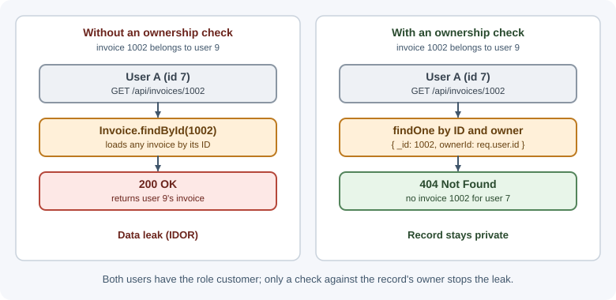

# Authentication and Authorization

Authentication asks, "Who are you?" Authorization asks, "What are you
allowed to do?" A backend must answer both questions on every protected
request: first establish the identity behind the request, then decide whether
that identity may perform the requested action on the requested resource.

## Why it matters

Many serious web application breaches are not exotic attacks; they are
missing or incorrect access checks. Broken access control is ranked first in
the [OWASP Top 10 (2021)](https://owasp.org/Top10/2021/A01_2021-Broken_Access_Control/),
which found some form of it in 94% of the applications tested. A signed-in
user changes an ID in a URL and reads someone else's invoice. An API accepts
a role from the request body. A password database leaks and the passwords
were stored in a form that can be reversed. Each of these is an
authentication or authorization failure.

Getting this right protects users' data, keeps the application compliant with
privacy and security obligations, and makes the rest of the system simpler:
when identity and permission are established in one well-tested place,
individual route handlers do not each invent their own rules.

## Real-world usage

- **Mandatory MFA at GitHub.** Since March 2023, GitHub has required users
  who contribute code on GitHub.com to enable two-factor authentication, to
  protect developers and the wider software supply chain
  ([GitHub Docs: mandatory 2FA](https://docs.github.com/en/authentication/securing-your-account-with-two-factor-authentication-2fa/about-mandatory-two-factor-authentication)).
- **Passkeys at Google.** Google's developer guidance explains that with
  passkeys a site stores only a public key, and a passkey works only on the
  site it was registered for, so users cannot be tricked into signing in to a
  look-alike site
  ([Google for Developers: Passkeys](https://developers.google.com/identity/passkeys)).
- **Least-privilege tokens at GitHub.** Fine-grained personal access tokens
  can be limited to specific repositories and specific permissions; GitHub
  recommends them over classic tokens, which can access every repository the
  user can
  ([GitHub Docs: personal access tokens](https://docs.github.com/en/authentication/keeping-your-account-and-data-secure/managing-your-personal-access-tokens)).
- **Attribute-based access control in AWS IAM.** IAM policies can grant
  permissions based on attributes — AWS calls them tags — attached to users,
  roles, and resources, so one policy covers many resources
  ([AWS IAM: ABAC](https://docs.aws.amazon.com/IAM/latest/UserGuide/introduction_attribute-based-access-control.html)).
- **Authorization as a shared service at Google.** Zanzibar stores and
  evaluates access control lists for hundreds of Google services, including
  Calendar, Cloud, Drive, Maps, Photos, and YouTube
  ([Google Research: Zanzibar](https://research.google/pubs/zanzibar-googles-consistent-global-authorization-system/)).

**Popular tools and providers:** identity providers such as Auth0, Okta,
Microsoft Entra ID, Amazon Cognito, Firebase Authentication, and Keycloak
(open source); policy engines such as Open Policy Agent and OpenFGA.

## How it works

### Authentication versus authorization

| Question | Authentication (AuthN) | Authorization (AuthZ) |
|---|---|---|
| What it decides | Who is making the request | Whether that identity may do this action |
| Typical inputs | Password, passkey, one-time code, token, session cookie | Identity, roles, attributes, resource ownership, policy |
| Failure status | `401 Unauthorized` (not authenticated) | `403 Forbidden` (authenticated, but not allowed) |
| When it runs | At sign-in, then on each request (verify session or token) | On every request that reads or changes protected data |

The two are separate steps. A valid login proves identity; it does not grant
access to everything.


### Authentication factors

An authentication factor is a category of evidence:

- **Something you know (knowledge):** a password or PIN.
- **Something you have (possession):** a phone with an authenticator app, a
  hardware security key, or a device that holds a passkey.
- **Something you are (inherence):** a fingerprint or face, usually used to
  unlock a local device or key rather than sent to the server.

**Multi-factor authentication (MFA)** requires evidence from at least two
different categories. Two passwords are still a single factor.

### Storing passwords

A backend should never be able to recover a user's password. It stores a
**password hash** produced by a slow, salted algorithm designed for passwords:

- **Argon2id** — the current first choice in OWASP guidance.
- **scrypt** — memory-hard, a good alternative.
- **bcrypt** — widely available and acceptable; note that it only uses the
  first 72 bytes of input.

General-purpose hashes such as SHA-256 or MD5 are the wrong tool: they are
designed to be fast, which lets an attacker test billions of guesses per
second against a leaked database.

- **Salt:** a unique random value per password, stored alongside the hash. It
  makes identical passwords produce different hashes and defeats precomputed
  tables. Modern password-hashing libraries generate and embed the salt for
  you.
- **Pepper:** an optional secret value applied to every password and stored
  outside the database (for example, in a secret manager). A database leak
  alone is then not enough to start cracking.
- **Work factor:** the cost parameters (iterations, memory) that make each
  hash deliberately slow. Increase them as hardware improves and rehash on
  the user's next successful login.

Encryption is also wrong for passwords: anything encrypted can be decrypted by
whoever obtains the key.

### Multi-factor authentication options

| Method | How it works | Notes |
|---|---|---|
| TOTP (authenticator app) | Server and app share a secret; both derive a 6-digit code from the current time (RFC 6238) | Good baseline; phishable if a user types the code into a fake site |
| SMS or voice codes | Server sends a code to a phone number | Weakest option: SIM swapping, number porting, interception |
| Email codes or links | Code or link sent to the user's mailbox | Only as strong as the email account |
| Push approval | App on a registered device approves a sign-in | Watch for "MFA fatigue" — users approving repeated prompts |
| Passkeys / WebAuthn | Device holds a private key bound to the site's origin; server stores the public key | Phishing-resistant, no shared secret on the server; the strongest common option |

Passkeys use public-key cryptography: the server sends a challenge, the
authenticator signs it with a private key that is never sent to the server,
and the server verifies the signature with the stored public key. (The
private key stays on the device, or is end-to-end encrypted when a password
manager syncs it between the user's devices.) Because the key
is bound to the site's origin, a look-alike phishing domain cannot use it.

### Keeping a user signed in

After authentication, the server needs proof on later requests that this
client already signed in. The two main approaches are:

- **Session-based:** the server stores session data and gives the browser an
  opaque session ID in a cookie.
- **Token-based:** the server issues a signed token (often a JWT) that the
  client presents on each request.

Both are covered in depth in
[sessions, cookies, and JWT](sessions-cookies-and-jwt.md). Signing in with an
external identity provider ("Sign in with Google") uses OpenID Connect,
covered in [OAuth 2.0, OpenID Connect, and SSO](oauth-and-openid-connect.md).

### Authorization models

| Model | Decision based on | Example | Good for |
|---|---|---|---|
| ACL (access control list) | A list of who may do what on each resource | Document shared with specific users | File sharing, per-object grants |
| RBAC (role-based) | The roles assigned to a user | `admin` can delete users; `editor` can publish | Most business applications |
| ABAC (attribute-based) | Attributes of user, resource, action, and environment | Doctors may read records of patients in their own clinic during working hours | Fine-grained, policy-driven rules |
| ReBAC (relationship-based) | Relationships in a graph | You may edit a document if you are a member of the team that owns its folder | Collaboration apps, nested sharing |

Real systems often combine them: RBAC for broad capabilities ("can manage
billing") plus an ownership or relationship check for specific records.

### Least privilege and deny by default

**Least privilege** means every user, service, and token gets only the
permissions it needs, for only as long as it needs them. **Deny by default**
means that if no rule explicitly allows an action, it is refused. A new route
without a permission check should fail closed, not open.

### Object-level authorization and IDOR

**Broken object level authorization (BOLA)**, also called **IDOR** (insecure
direct object reference), is ranked first in the
[OWASP API Security Top 10 (2023)](https://owasp.org/API-Security/editions/2023/en/0x11-t10/).
It happens when a
handler loads a record by the ID in the request without checking that the
current user may access that record:

```text
GET /api/invoices/1001   ← my invoice, fine
GET /api/invoices/1002   ← someone else's invoice; server returns it anyway
```

A role check is not enough here: both users have the role `customer`. The
server must check the relationship between this user and this specific
record, on every read, update, and delete.



### Enforce on the server, on every request

The frontend can hide buttons for convenience, but it is not a security
boundary. Anyone can call the API directly with `curl` or a modified client.
Every protected endpoint must authenticate the caller and authorize the
action, and it must take identity and roles from the verified session or
token, never from the request body or query string.

### 401 versus 403

- **`401 Unauthorized`:** the request has no valid credentials (missing,
  expired, or invalid). Despite the name, it means "unauthenticated." RFC 9110
  requires a 401 response to include a `WWW-Authenticate` header naming the
  expected scheme, for example `WWW-Authenticate: Bearer`.
- **`403 Forbidden`:** the server knows who the caller is, and the caller is
  not allowed to do this. Signing in again will not help.
- **`404 Not Found` instead of `403`:** acceptable when revealing that a
  resource exists would itself leak information (for example, another
  user's private document).

See [HTTP status codes](http-status-codes.md) for the full list.

### Account security

- **Rate limiting and lockout:** limit sign-in attempts per account and per
  IP. Prefer progressive delays or temporary lockouts over permanent
  lockouts, which let an attacker lock legitimate users out. See
  [rate limiting and throttling](rate-limiting-and-throttling.md).
- **Generic errors:** respond "Invalid email or password" for both unknown
  emails and wrong passwords, and keep response times similar, to avoid
  **user enumeration**. Apply the same idea to registration and password
  reset ("If an account exists, we sent an email").
- **Password reset tokens:** generate long random tokens with a
  cryptographically secure generator, store only a hash of the token,
  make them single-use and short-lived (minutes, not days), and invalidate
  existing sessions after a reset.
- **Breached-password checks:** reject passwords known from public breaches
  instead of enforcing complicated composition rules.
- **Re-authentication:** require the password or MFA again before sensitive
  actions such as changing email, password, or MFA settings.

## When to use and when not to use

Every backend with private data needs authentication and authorization; the
real decisions are **how** to authenticate and **which** authorization model
to use.

**Run your own password sign-in when:**

- The product is small, users are your own customers, and you can follow the
  password storage, rate limiting, and reset guidance on this page.

**Use an external identity provider (OpenID Connect) instead when:**

- Users already have company or social accounts (workforce apps, B2B SaaS
  with single sign-on).
- You need MFA, passkeys, breached-password checks, and account recovery
  without building them yourself.
- Compliance requires centralized audit and account lifecycle management.

**Avoid:**

- Inventing your own token or password scheme.
- Relying on the frontend, API gateway, or "hidden" URLs as the only check.

| Need | Good fit | Not a good fit |
|---|---|---|
| Broad capabilities ("can manage billing") | RBAC | Per-record rules — roles alone cannot say "only your own invoices" |
| Rules on context (department, region, time) | ABAC | Tiny apps where two roles are enough |
| Sharing and nested ownership (docs, folders, teams) | ReBAC | Simple single-owner records — an `ownerId` check is enough |
| Strongest sign-in for consumers | Passkeys, with a fallback | Kiosk or shared devices without a recovery plan |
| Second factor where passkeys are not yet possible | TOTP authenticator apps | SMS as the only factor for high-value accounts |

## Practical examples

### Hashing and verifying a password with Argon2id

```js
import argon2 from "argon2";

// At registration: store only the hash (it embeds the salt and parameters)
export async function hashPassword(plainPassword) {
  return argon2.hash(plainPassword, { type: argon2.argon2id });
}

// At sign-in: compare a candidate password with the stored hash
export async function verifyPassword(storedHash, candidatePassword) {
  return argon2.verify(storedHash, candidatePassword);
}
```

### Sign-in that avoids user enumeration

```js
// Hash of a throwaway password, computed once at startup, so unknown emails
// still pay the cost of a hash comparison and take a similar time.
const dummyHash = await hashPassword("not-a-real-password");

export async function signIn(email, password) {
  const user = await users.findByEmail(email.toLowerCase());
  const hashToCheck = user ? user.passwordHash : dummyHash;
  const valid = await verifyPassword(hashToCheck, password);

  if (!user || !valid) {
    // Same message whether the email exists or not
    throw new UnauthorizedError("Invalid email or password");
  }
  return user;
}
```

### Role check middleware (RBAC)

```js
// Runs after authentication middleware has set request.user
export function requireRole(...allowedRoles) {
  return (request, response, next) => {
    if (!request.user) {
      return response.status(401).json({ error: "Sign in required" });
    }
    if (!allowedRoles.includes(request.user.role)) {
      return response.status(403).json({ error: "Not allowed" });
    }
    next();
  };
}

app.delete("/api/users/:id", authenticate, requireRole("admin"), deleteUser);
```

### Ownership check (preventing IDOR)

Always scope the query by the current user rather than loading first and
hoping to remember the check:

```sql
SELECT id, title, amount FROM invoices WHERE id = ? AND owner_id = ?;
```

```js
app.get("/api/invoices/:id", authenticate, async (request, response) => {
  const invoice = await db.invoices.findOne({
    _id: request.params.id,
    ownerId: request.user.id, // identity from the verified session, not input
  });
  if (!invoice) {
    return response.status(404).json({ error: "Invoice not found" });
  }
  response.json(invoice);
});
```

The Express side of this — wiring sessions, JWT middleware, and Passport — is
covered in [authentication in Express](../express/authentication-in-express.md).
[REST APIs](rest-apis.md) should also avoid leaking private details in their
error responses.

## Best practices

- Use established libraries and protocols (Argon2/bcrypt libraries,
  WebAuthn libraries, OpenID Connect providers) instead of inventing schemes.
- Centralize authentication in middleware and keep authorization rules in a
  small, testable policy layer.
- Deny by default; require an explicit permission for every protected route.
- Check object ownership or relationship for every record-level operation.
- Offer MFA, and prefer passkeys or authenticator apps over SMS.
- Expire sessions and tokens, and support revocation (sign out everywhere).
- Log authentication events (sign-ins, failures, MFA changes, password
  resets) without logging passwords, codes, or tokens.
- Write tests for "user A cannot access user B's data" for every resource.

## In production

- **Credential stuffing.** *Symptom:* failed sign-ins jump across many
  different accounts from many IP addresses. *Detect:* a dashboard of failed
  sign-ins per minute and the ratio of failures to successes; auth logs with
  the same password failing against many emails. *Cause:* attackers replaying
  passwords leaked from other sites. *Fix:* rate limit per account and per IP,
  check new passwords against breached-password lists, add MFA, and add bot
  detection or a challenge after repeated failures.
- **Sign-in becomes slow under load.** *Symptom:* p95 latency of
  `POST /login` climbs from about 100 ms to seconds during peak traffic.
  *Detect:* latency histogram for the sign-in route, CPU and memory on the
  auth instances. *Cause:* password hashing is deliberately expensive, and
  async hashing libraries such as `bcrypt` run on libuv's fixed-size thread
  pool (four threads unless `UV_THREADPOOL_SIZE` changes it), so hashes queue
  up. *Fix:* benchmark hash parameters on production
  hardware, scale sign-in capacity separately, and raise `UV_THREADPOOL_SIZE`
  only after measuring.
- **An IDOR reaches production.** *Symptom:* a bug report or security report
  says a user saw another customer's data. *Detect:* audit logs show reads
  where the record's owner differs from the requesting user. *Cause:* a
  handler loads a record by ID without an ownership condition. *Fix:* scope
  every query by owner or tenant, add "user A cannot read user B's record"
  tests for each resource, and review new routes for the check.
- **Lockouts used as an attack.** *Symptom:* a wave of support tickets from
  users who cannot sign in. *Detect:* the count of locked accounts rises
  sharply without matching user activity. *Cause:* permanent lockout after N
  failures lets anyone lock out any account. *Fix:* use progressive delays or
  temporary locks, challenge suspicious attempts, and let users unlock through
  a verified email.
- **Permission changes do not take effect.** *Symptom:* a user who lost the
  admin role can still perform admin actions. *Detect:* audit log entries for
  admin actions by users whose current role is not admin. *Cause:* roles were
  copied into a long-lived token or cached session. *Fix:* keep access tokens
  short-lived, re-check roles on the server for sensitive actions, and revoke
  sessions when roles change.

## Important terminology

- **Identity:** the person or service represented by a request.
- **Principal:** the authenticated identity a request runs as.
- **Credential:** evidence used to authenticate, such as a password, key, or
  token.
- **Authentication (AuthN):** establishing or verifying identity.
- **Authorization (AuthZ):** deciding whether an identity may perform an
  action on a resource.
- **MFA:** multi-factor authentication; evidence from two or more factor
  categories.
- **Passkey:** a WebAuthn credential — a key pair bound to the site's origin,
  where the private key is never sent to the server.
- **Password hash:** the output of a slow, salted one-way function used to
  verify passwords without storing them.
- **Salt / pepper:** a per-password random value / a global secret applied to
  all passwords and stored outside the database.
- **RBAC / ABAC / ReBAC:** role-, attribute-, and relationship-based access
  control.
- **Least privilege:** granting only the minimum access needed.
- **IDOR / BOLA:** accessing an object by changing its identifier because the
  server does not check ownership.
- **User enumeration:** discovering which accounts exist from differences in
  responses or timing.

## Common mistakes and misconceptions

- **"Signed in means allowed."** Authentication does not grant access to
  every action or record.
- **Hiding UI is not access control.** Every API call must be checked on the
  server.
- **Trusting identity or role from the request body.** Read them only from the
  verified session or token.
- **Hashing passwords with SHA-256 or MD5.** Fast hashes are easy to brute
  force; use a password-hashing algorithm.
- **Encrypting passwords.** Encryption is reversible; hashing is not.
- **Treating encoding as security.** Base64 or a JWT payload is readable by
  anyone; encoding is not encryption.
- **Different errors for "no such user" and "wrong password."** This reveals
  which accounts exist.
- **Long-lived or reusable reset tokens.** Make them random, hashed,
  single-use, and short-lived.
- **Returning 403 when 401 is correct, or vice versa.** 401 means "who are
  you?"; 403 means "I know who you are, and no."

## Revision questions

1. What is the difference between authentication and authorization, and
   which status code does each failure usually produce?
2. Why are Argon2id, scrypt, and bcrypt suitable for passwords while SHA-256
   is not?
3. What makes passkeys resistant to phishing when TOTP codes are not?
4. Describe an IDOR vulnerability and the server-side check that prevents it.
5. How do RBAC and ABAC differ? Give an example rule that RBAC alone cannot
   express.
6. How should a sign-in endpoint respond to avoid user enumeration?

## Further learning

- [OWASP Authentication Cheat Sheet](https://cheatsheetseries.owasp.org/cheatsheets/Authentication_Cheat_Sheet.html)
- [OWASP Password Storage Cheat Sheet](https://cheatsheetseries.owasp.org/cheatsheets/Password_Storage_Cheat_Sheet.html)
- [OWASP Authorization Cheat Sheet](https://cheatsheetseries.owasp.org/cheatsheets/Authorization_Cheat_Sheet.html)
- [OWASP Multifactor Authentication Cheat Sheet](https://cheatsheetseries.owasp.org/cheatsheets/Multifactor_Authentication_Cheat_Sheet.html)
- [MDN: HTTP authentication](https://developer.mozilla.org/en-US/docs/Web/HTTP/Authentication)
- [MDN: Web Authentication API](https://developer.mozilla.org/en-US/docs/Web/API/Web_Authentication_API)
- [RFC 6238: TOTP](https://www.rfc-editor.org/rfc/rfc6238)
- Related notes: [Authentication security](../../09-security-and-testing/authentication-security.md),
  [API security](../../09-security-and-testing/api-security.md)
