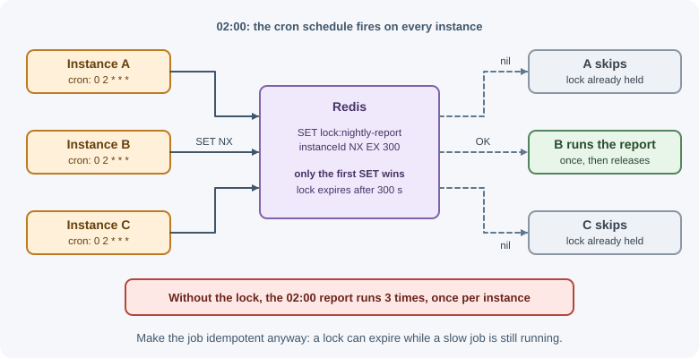

# Background Jobs and Scheduling

Not every piece of work should happen while the user waits for an HTTP
response. Sending emails, generating PDFs, resizing images, calling slow
third-party APIs, and nightly cleanups are better done **in the background**
by separate workers, either right away (a job queue) or at set times
(scheduling). This keeps responses fast and makes slow or unreliable work
retryable.

## Why it matters

If a sign-up handler sends a welcome email inline and the email provider
takes 8 seconds or is down, the user waits 8 seconds or sees an error —
even though their account was created fine. Doing heavy work inside requests
also:

- Ties up server capacity, so fewer requests can be served.
- Hits proxy and client timeouts for long tasks (reports, exports, imports).
- Loses work when the process restarts mid-request.
- Makes retries hard: the user would have to resubmit.

Background jobs move that work off the request path. The request records
what needs to happen and returns quickly; workers do the work, retry
failures, and report progress.

## Real-world usage

- **GitHub webhooks.** GitHub asks receivers to respond within 10 seconds
  and suggests setting up a queue so the server can acknowledge the webhook
  immediately and process the payload in the background
  ([GitHub Docs: webhook best practices](https://docs.github.com/en/webhooks/using-webhooks/best-practices-for-using-webhooks)).
- **Amazon SQS dead-letter queues.** A redrive policy's `maxReceiveCount`
  sets how many times a consumer can receive a message before SQS moves it to
  a dead-letter queue for inspection
  ([Amazon SQS: dead-letter queues](https://docs.aws.amazon.com/AWSSimpleQueueService/latest/SQSDeveloperGuide/sqs-dead-letter-queues.html)).
- **Kubernetes CronJobs.** A CronJob creates a Job approximately once per
  scheduled time; in some circumstances two Jobs, or none, may be created, so
  Kubernetes says those Jobs should be idempotent
  ([Kubernetes: CronJob](https://kubernetes.io/docs/concepts/workloads/controllers/cron-jobs/)).
- **BullMQ job IDs for deduplication.** BullMQ ignores a job added with an ID
  that already exists, which is how producers avoid enqueueing the same work
  twice
  ([BullMQ: job IDs](https://docs.bullmq.io/guide/jobs/job-ids)).

**Popular tools and providers:** BullMQ (Node.js on Redis), Amazon SQS,
RabbitMQ, Google Cloud Tasks, Celery (Python), Sidekiq (Ruby), Temporal for
long-running workflows, and schedulers such as Kubernetes CronJobs and Amazon
EventBridge Scheduler.

## How it works

### What belongs in the background

| Good candidates | Keep in the request |
|---|---|
| Sending emails, SMS, push notifications | Validating input and saving the core record |
| Generating PDFs, reports, exports | Anything the response depends on |
| Image and video processing | Fast reads |
| Calling slow or unreliable third-party APIs | Checks that must block the action (payment authorization, permission) |
| Webhook processing and fan-out | |
| Search indexing, cache warming, analytics events | |
| Scheduled cleanups, reminders, billing runs | |

### The job queue model


- **Producer:** the code that creates a job — usually your API, after saving
  the main record.
- **Job:** a small message describing the work: a type and the data needed
  (IDs, not huge payloads), plus an ID.
- **Broker / queue:** stores jobs durably until a worker takes them.
- **Worker:** a separate process (often the same codebase started with a
  different entry point) that takes jobs, performs them, and acknowledges
  success or reports failure.

Workers scale independently of the API: add more workers when the queue
grows.

### Common tools

| Tool | Notes |
|---|---|
| BullMQ (Node.js, on Redis) | Popular in Node; retries, backoff, delayed and repeatable jobs, priorities, rate limits, concurrency, job progress |
| RabbitMQ | General-purpose message broker; acknowledgments, routing, dead-letter exchanges |
| Amazon SQS | Managed queue; visibility timeouts, dead-letter queues, FIFO queues |
| Kafka | Event streaming log; great for high-volume event pipelines, less for simple task queues |
| Database-backed queues (e.g. pg-boss, Agenda on MongoDB) | No extra infrastructure; fine for moderate volume |

The broader trade-offs between brokers are covered in
[message queues](../../05-application-architecture/message-queues.md).

### Retries and backoff

Jobs fail for transient reasons (network errors, rate limits, a dependency
restarting). Configure:

- A **maximum number of attempts** (for example, 5).
- **Exponential backoff** between attempts (for example, 1 s, 2 s, 4 s, 8 s)
  so a struggling dependency gets breathing room.
- **Which errors are retryable:** do not retry a job whose input is invalid;
  fail it immediately.

See [timeouts, retries, and idempotency](timeouts-retries-and-idempotency.md).

### Dead-letter queues

A job that fails all its attempts should not disappear. It moves to a
**dead-letter queue (DLQ)** or a "failed" state, where engineers can inspect
it, fix the cause, and replay it. Alert when the DLQ grows.


### Idempotent jobs

Most queues deliver **at least once**: if a worker crashes after doing the
work but before acknowledging, the job runs again. Therefore jobs must be
**idempotent** — running them twice must not double the effect:

- Send the "order confirmation" email only if `order.confirmationSentAt` is
  empty, and set it atomically.
- Use the job ID or a business key as an idempotency key when calling
  payment or messaging APIs.
- Use unique constraints to prevent duplicate inserts.

Also keep job payloads small: store IDs and load fresh data in the worker,
so the job works on current state rather than a stale snapshot.

### Delayed and repeatable jobs

- **Delayed job:** run once, after a delay — "send a reminder 24 hours after
  sign-up if the profile is incomplete."
- **Repeatable job:** run on a schedule — every 5 minutes, or with a cron
  expression.

### Cron syntax

Cron expressions describe schedules with five fields (some libraries add a
sixth, leading field for seconds):

```text
┌───────────── minute (0–59)
│ ┌─────────── hour (0–23)
│ │ ┌───────── day of month (1–31)
│ │ │ ┌─────── month (1–12 or JAN–DEC)
│ │ │ │ ┌───── day of week (0–7 or SUN–SAT; 0 and 7 are both Sunday)
│ │ │ │ │
* * * * *
```

| Symbol | Meaning |
|---|---|
| `*` | Every value |
| `,` | List: `1,15` = 1st and 15th |
| `-` | Range: `9-17` = 9 through 17 |
| `/` | Step: `*/5` = every 5 units |

| Expression | Runs |
|---|---|
| `* * * * *` | Every minute |
| `*/15 * * * *` | Every 15 minutes |
| `0 * * * *` | At minute 0 of every hour |
| `0 2 * * *` | Every day at 02:00 |
| `30 9 * * 1-5` | 09:30 Monday to Friday |
| `0 0 1 * *` | Midnight on the first day of each month |
| `0 6 * * 0` | 06:00 every Sunday |

**Time zones matter.** A job at `0 2 * * *` runs at 02:00 in the scheduler's
time zone. Set the time zone explicitly (often UTC), and be careful around
daylight-saving changes, when 02:00 may happen twice or not at all in local
time.

**Watch the day-of-month and day-of-week combination:** in standard cron, if
both are restricted (not `*`), the job runs when **either** matches.

### node-cron and in-process schedulers

Libraries such as `node-cron` run a function on a schedule inside your Node
process. They are simple, but:

- If the app runs on **three instances**, the job runs **three times**.
- If the process is down at the scheduled time, the run is missed.
- Long jobs compete with request handling for the event loop.

### Running scheduled jobs exactly once across instances

Options, from simplest to most robust:

1. **A dedicated scheduler process:** run exactly one scheduler instance
   (separate from the scaled API), which enqueues jobs for workers.
2. **Queue-based repeatable jobs:** BullMQ repeatable jobs (job schedulers)
   are stored in Redis and produced once per interval regardless of how
   many workers exist.
3. **Distributed lock:** each instance tries to acquire a lock (for example,
   Redis `SET NX` with expiry) before running; only the winner runs. Make the
   job idempotent anyway.
4. **Platform schedulers:** Kubernetes CronJobs, AWS EventBridge Scheduler,
   cloud scheduler services that call an endpoint or start a task.



### Reporting progress to clients

For long tasks the user is waiting on (exports, imports):

```text
POST /api/exports              → 202 Accepted
                                 Location: /api/exports/exp_91
                                 { "id": "exp_91", "status": "queued" }

GET  /api/exports/exp_91       → 200 { "status": "processing", "progress": 40 }
GET  /api/exports/exp_91       → 200 { "status": "completed",
                                      "downloadUrl": "https://..." }
```

The client polls the status URL, or receives updates over SSE, WebSockets,
or a notification (see
[real-time communication](real-time-communication.md)). Status is stored in
the database or the job system.

### Monitoring queues

Track and alert on:

- **Queue depth** (waiting jobs) and its trend — a growing backlog means
  workers cannot keep up.
- **Job age / latency** — how long the oldest job has been waiting.
- **Failure rate** and **DLQ size**.
- **Processing duration** per job type.
- **Stalled jobs** — jobs whose worker died mid-processing.

Dashboards such as Bull Board show BullMQ queues; cloud queues expose
metrics in their consoles.

### Graceful shutdown for workers

When a worker receives `SIGTERM` (during deploys), it should stop taking new
jobs, let current jobs finish (within a time limit), then exit. Jobs that
cannot finish should be returned to the queue, not lost.

## When to use and when not to use

**Use a background job when:**

- The work takes more than a few hundred milliseconds and the response does
  not depend on its result (emails, PDFs, image processing).
- The work calls an unreliable third party and should be retried.
- A webhook or event must be acknowledged quickly and processed later.
- Work must happen on a schedule (cleanups, reminders, billing runs).

**Keep the work in the request when:**

- The response needs the result (a price, a permission decision, a payment
  authorization).
- It is fast and reliable — a queue adds infrastructure and failure modes.

| Need | Good fit | Avoid |
|---|---|---|
| Send an email after sign-up | Job queue with retries | Inline call in the request |
| Process a webhook | Acknowledge with 2xx, then queue | Doing the work before responding |
| Nightly cleanup on one server | `node-cron` | `node-cron` on a scaled app |
| Nightly cleanup on a scaled app | Queue job scheduler or platform cron | One schedule per instance |
| Long multi-step workflow (days, human steps) | Workflow engine such as Temporal | A chain of ad hoc jobs |
| Strict per-customer order | Partitioned queue or single-concurrency group | Many parallel workers on one queue |

## Practical examples

### A BullMQ queue, producer, and worker

```js
// queue.js — shared connection settings
import { Queue } from "bullmq";
import IORedis from "ioredis";

// BullMQ workers require maxRetriesPerRequest: null on their connection
export const connection = new IORedis(process.env.REDIS_URL, {
  maxRetriesPerRequest: null,
});

export const emailQueue = new Queue("emails", {
  connection,
  defaultJobOptions: {
    attempts: 5,
    backoff: { type: "exponential", delay: 1000 }, // 1 s, 2 s, 4 s, ...
    removeOnComplete: 1000, // keep the last 1000 completed jobs
    removeOnFail: false,    // keep failed jobs for inspection
  },
});
```

```js
// api.js — producer: respond fast, enqueue the slow work
import { emailQueue } from "./queue.js";

app.post("/api/users", async (request, response) => {
  const user = await createUser(request.validated.body);

  // jobId makes the enqueue idempotent: a job with an existing ID is ignored.
  // BullMQ rejects custom IDs containing ":", so use another separator.
  await emailQueue.add(
    "welcome-email",
    { userId: user.id },
    { jobId: `welcome-email-${user.id}` }
  );

  response.status(201).json({ id: user.id });
});
```

```js
// worker.js — a separate process: node worker.js
import { Worker, UnrecoverableError } from "bullmq";
import { connection } from "./queue.js";

const worker = new Worker(
  "emails",
  async (job) => {
    const user = await users.findById(job.data.userId); // load fresh data
    if (!user) {
      // Retrying will not help; fail permanently
      throw new UnrecoverableError("User no longer exists");
    }
    if (user.welcomeEmailSentAt) return; // idempotent: already done

    await emailProvider.send({ to: user.email, template: "welcome" });
    await users.markWelcomeEmailSent(user.id);
  },
  { connection, concurrency: 10 }
);

worker.on("failed", (job, error) => {
  logger.error({ jobId: job?.id, err: error }, "email job failed");
});

process.on("SIGTERM", async () => {
  await worker.close(); // waits for active jobs to finish
  process.exit(0);
});
```

### A repeatable job instead of in-process cron

```js
import { Queue } from "bullmq";
import { connection } from "./queue.js";

const maintenanceQueue = new Queue("maintenance", { connection });

// Upsert a scheduler: runs daily at 02:00 UTC no matter how many workers exist
await maintenanceQueue.upsertJobScheduler(
  "cleanup-expired-sessions",
  { pattern: "0 2 * * *", tz: "UTC" },
  { name: "cleanup-expired-sessions", data: {} }
);
```

### node-cron for a single-instance app

```js
import cron from "node-cron";

// Fine for one instance; runs once per instance if you scale out
cron.schedule(
  "*/15 * * * *",
  async () => {
    await refreshExchangeRates();
  },
  { timezone: "UTC" }
);
```

## Best practices

- Keep requests fast: save the core data, enqueue the rest, respond.
- Put only IDs and small parameters in job payloads; load fresh data in the
  worker.
- Make every job idempotent; assume it may run more than once.
- Configure attempts, exponential backoff, and a dead-letter destination.
- Fail immediately on non-retryable errors.
- Run workers as separate processes that scale independently.
- Ensure scheduled jobs run once across instances (dedicated scheduler,
  queue schedulers, or locks).
- Set time zones explicitly for schedules.
- Monitor queue depth, job age, failures, and DLQ size; alert on growth.
- Shut workers down gracefully.

## In production

- **The backlog keeps growing.** *Symptom:* emails arrive hours late.
  *Detect:* queue depth and the age of the oldest waiting job rise steadily.
  *Cause:* jobs arrive faster than workers finish them — too few workers, low
  concurrency, or a slow dependency. *Fix:* scale workers, raise concurrency
  where the dependency allows, and alert on job age rather than depth alone.
- **Enqueueing fails after "making it idempotent".** *Symptom:* sign-ups
  return 500 after a custom job ID is added. *Detect:* the error message
  `Custom Id cannot contain :` from BullMQ. *Cause:* BullMQ rejects most
  custom job IDs that contain a colon. *Fix:* use another separator, such as
  `welcome-email-42`.
- **Workers stop processing after a Redis blip.** *Symptom:* the queue grows
  while workers are running. *Detect:* worker logs show Redis connection
  errors and BullMQ warns that `maxRetriesPerRequest` must be `null`.
  *Cause:* the ioredis connection gives up on commands instead of waiting for
  Redis. *Fix:* create worker connections with `maxRetriesPerRequest: null`.
- **The nightly job runs three times.** *Symptom:* customers get three copies
  of a report. *Detect:* logs show the job starting on every instance at the
  same minute. *Cause:* `node-cron` runs inside each scaled instance. *Fix:*
  use a queue job scheduler, a single scheduler process, or a platform cron,
  and make the job idempotent.
- **Jobs run twice after a deploy.** *Symptom:* duplicate side effects around
  release time. *Detect:* the same job ID appears as processed twice, or as
  stalled and then retried. *Cause:* workers were killed mid-job, so the job
  was redelivered. *Fix:* close workers gracefully on `SIGTERM`, give them
  enough shutdown time, and keep jobs idempotent.

## Important terminology

- **Background job:** work performed outside the request-response cycle.
- **Producer / consumer (worker):** creates jobs / processes jobs.
- **Broker:** the system that stores and delivers jobs.
- **Acknowledgment:** a worker's confirmation that a job completed.
- **Dead-letter queue:** where jobs go after exhausting retries.
- **At-least-once delivery:** jobs may be processed more than once.
- **Idempotent job:** a job safe to run repeatedly.
- **Delayed job:** a job scheduled to run after a delay.
- **Repeatable job / job scheduler:** a job produced on a recurring schedule.
- **Cron expression:** a five- (or six-) field schedule format.
- **Concurrency:** how many jobs a worker processes at once.
- **Stalled job:** a job whose worker stopped responding mid-processing.

## Common mistakes and misconceptions

- **Doing slow work inside the request**, causing timeouts and poor
  throughput.
- **Fire-and-forget promises** (`sendEmail()` without awaiting or queueing):
  the work is lost on restart and errors go unnoticed.
- **Non-idempotent jobs** that send duplicate emails or charges on retry.
- **Large payloads** in jobs, holding stale copies of data.
- **In-process cron on a scaled app**, running the job once per instance.
- **Ignoring time zones and daylight saving** in schedules.
- **No dead-letter handling**, so failed jobs vanish silently.
- **Retrying jobs that can never succeed**, wasting resources.

## Revision questions

1. Which kinds of work should move to background jobs, and why?
2. Describe the roles of the producer, broker, and worker.
3. Why must background jobs be idempotent, and how can you make an email job
   idempotent?
4. Explain each field of the cron expression `30 9 * * 1-5`.
5. What goes wrong when `node-cron` runs in an app scaled to three instances,
   and how do you fix it?
6. How should an API report progress for a long-running export?

## Further learning

- [BullMQ documentation](https://docs.bullmq.io/)
- [node-cron on npm](https://www.npmjs.com/package/node-cron)
- [Amazon SQS dead-letter queues](https://docs.aws.amazon.com/AWSSimpleQueueService/latest/SQSDeveloperGuide/sqs-dead-letter-queues.html)
- [RabbitMQ: Dead letter exchanges](https://www.rabbitmq.com/docs/dlx)
- [Kubernetes: CronJob](https://kubernetes.io/docs/concepts/workloads/controllers/cron-jobs/)
- Related notes: [Message queues](../../05-application-architecture/message-queues.md),
  [Redis](../../05-application-architecture/redis.md),
  [Timeouts, retries, and idempotency](timeouts-retries-and-idempotency.md)
