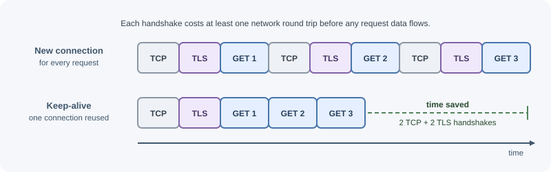

# Client-Server Model and Request Lifecycle

In the client-server model, a client asks for something and a server answers.
A single click in a browser sets off a chain of steps: name lookup, network
connections, encryption, proxies, your application code, and the database.
This page follows one request through every hop and back.

## Why it matters

When a request is slow or fails, the cause can sit at any hop: DNS, TLS, a
load balancer, your code, or the database. Knowing the full path lets you:

- Read an error and know *which layer* produced it (a `502` from a proxy is
  not the same problem as a `500` from your code).
- Find where latency comes from instead of guessing.
- Decide where a concern belongs: TLS at the proxy, authentication in
  middleware, business rules in a service.
- Understand why HTTP is called stateless and how logins still work.

## Real-world usage

Every hop in this page has a timeout or limit set by the platform in front
of your app. Three well-documented examples:

- **AWS Application Load Balancer.** The
  [load balancer attributes](https://docs.aws.amazon.com/elasticloadbalancing/latest/application/application-load-balancers.html)
  list a default idle timeout of 60 seconds, and AWS
  [recommends](https://docs.aws.amazon.com/elasticloadbalancing/latest/application/edit-load-balancer-attributes.html)
  configuring your application's idle (keep-alive) timeout to be larger than
  the load balancer's. Otherwise, the app can close a connection the load
  balancer is about to reuse, which is the source of the classic
  intermittent `502`.
- **Cloudflare.** When Cloudflare connects to your origin but gets no HTTP
  response within its default 125-second proxy read timeout, it returns its
  own [Error 524](https://developers.cloudflare.com/support/troubleshooting/http-status-codes/cloudflare-5xx-errors/error-524/).
  The status code comes from the CDN, not from your application.
- **Heroku.** The Heroku router
  [terminates a request after 30 seconds](https://devcenter.heroku.com/articles/request-timeout),
  returns an error page, and logs an `H12` error, even if your app is still
  working on it. The countdown starts after the router has sent the whole
  request to the app.

## How it works

### The client-server model

- A **client** initiates communication: a browser, a mobile app, a CLI, or
  another server calling your API.
- A **server** listens on an address and port and responds to requests.
- The roles describe *who starts the conversation*, not the hardware. Your
  backend is a server to the browser and a client to the payment provider it
  calls.

HTTP follows a request-response pattern: the client sends one request, the
server sends one response. The server does not push data on its own over
plain HTTP; for that, see [real-time communication](real-time-communication.md).

### The full journey of one request

Suppose a user opens `https://shop.example/orders` and the page calls
`GET https://api.shop.example/api/orders?page=1`.


### Each hop in detail

1. **URL parsing.** The browser splits the URL into scheme, host, port
   (default `443` for HTTPS), path, and query string.
2. **DNS resolution.** The host name is turned into an IP address. Results
   are cached by the browser, the operating system, and resolvers, so this
   is often instant on repeat visits. See [DNS](../../01-networking-and-protocols/dns.md).
3. **TCP connection.** For HTTP/1.1 and HTTP/2, the client opens a TCP
   connection with a three-way handshake. That costs one network round trip
   before any data flows. See [TCP and UDP](../../01-networking-and-protocols/tcp-and-udp.md).
4. **TLS handshake.** For HTTPS, client and server agree on encryption keys
   and the client verifies the server's certificate. TLS 1.3 needs one more
   round trip on a new connection. See [TLS and SSL](../../01-networking-and-protocols/tls-and-ssl.md).
5. **HTTP request.** The client sends the method, target, headers, and an
   optional body. See [HTTP methods](http-methods.md) and
   [HTTP headers](http-headers.md).
6. **CDN or edge cache.** If a CDN sits in front and holds a fresh cached
   copy, it answers without touching your servers. API responses are often
   not cached, but static files and public data can be. See
   [CDN](../../06-servers-and-infrastructure/cdn.md).
7. **Load balancer or reverse proxy.** It usually terminates TLS, chooses a
   healthy backend instance, enforces limits (body size, timeouts), and
   forwards the request over the internal network. It adds headers such as
   `X-Forwarded-For` so the app knows the real client IP. See
   [load balancing](../../06-servers-and-infrastructure/load-balancing.md).
8. **Application middleware.** Code that runs for many routes: assigning a
   request ID, logging, parsing the body, CORS, rate limiting, and checking
   the session or token. See [middleware](../express/middleware.md).
9. **Routing.** The framework matches the method and path to a handler.
10. **Controller.** Reads parameters, validates input, and calls a service.
11. **Service.** Applies business rules and decides what data is needed.
12. **Cache and database.** The service checks a cache, and on a miss
    queries the database. This is very often the slowest step.
13. **Response.** The app sets a status code, headers, and a body. It travels
    back through the proxy and CDN to the client.
14. **Client handling.** The browser checks the status, parses the body, and
    updates the page. For a document, it may then request more resources.

### Where latency comes from

| Hop | What adds time | How to reduce it |
|---|---|---|
| DNS | Uncached lookups, slow resolvers | DNS caching, sensible TTLs |
| TCP + TLS | Round trips on each new connection, distance to server | Connection reuse (keep-alive), HTTP/2, TLS 1.3, servers or CDN near users |
| Proxy / load balancer | Extra hop, queueing under load | Keep it close to the app; scale it |
| Middleware | Expensive work on every request | Keep middleware cheap; scope it to routes that need it |
| Business logic | CPU-heavy work blocking the event loop | Move heavy work to workers or queues |
| Database | Missing indexes, too many queries, large results | Indexes, pagination, caching, fewer round trips |
| External APIs | Slow third parties | Timeouts, caching, asynchronous processing |
| Response size | Large JSON bodies | Pagination, field selection, compression |

A useful habit: measure each step (with logs, timing headers, or tracing)
before optimizing. See [logging and monitoring](logging-and-monitoring.md).

### HTTP versions in brief

| Version | Transport | What changes for you |
|---|---|---|
| HTTP/1.1 | TCP | One request at a time per connection; browsers open several connections |
| HTTP/2 | TCP | Many requests multiplexed over one connection; compressed headers |
| HTTP/3 | QUIC over UDP | Faster connection setup; one lost packet does not stall every stream |

Your application code uses the same methods, headers, and status codes in
every version. The proxy or CDN often speaks HTTP/2 or HTTP/3 to browsers and
HTTP/1.1 to your app. See [HTTP and HTTPS](../../01-networking-and-protocols/http-and-https.md)
and [QUIC and HTTP/3](../../01-networking-and-protocols/quic-and-http3.md).

### Keep-alive and connection reuse

Opening a TCP and TLS connection is expensive. HTTP/1.1 keeps connections
open by default (persistent connections) so later requests skip the
handshakes. HTTP/2 goes further and sends many requests over one connection
at the same time.



On the server side, keep-alive has a timeout: an idle connection is closed
after a while. A classic bug happens when the app server's keep-alive
timeout is *shorter* than the load balancer's: the balancer reuses a
connection the app just closed, and some requests fail with `502`. Node.js
closes idle keep-alive connections after 5 seconds by default (responses
carry `Keep-Alive: timeout=5`), while load balancers often wait much longer;
AWS Application Load Balancers default to 60 seconds. Set the app's
keep-alive timeout longer than the proxy's idle timeout. See
[running Express in production](../express/production-and-performance.md).

Your backend is also a client. Reuse connections when it calls databases
(connection pools) and other APIs (HTTP agents with keep-alive).

### Where failures surface

| What you see | Usually produced by | Typical cause |
|---|---|---|
| Browser network error, no status | Client, DNS, or network | DNS failure, TLS error, server unreachable, CORS block |
| `500 Internal Server Error` | Your application | Unhandled exception, bug, failed dependency not mapped to another code |
| `502 Bad Gateway` | Proxy or load balancer | App crashed, closed the connection, or returned an invalid response |
| `503 Service Unavailable` | Proxy or the app itself | No healthy instances, overload, maintenance |
| `504 Gateway Timeout` | Proxy or load balancer | App took longer than the proxy's timeout |
| `4xx` codes | Your application (sometimes the proxy) | Bad input, missing auth, not found, rate limited |


The first question when debugging is "which layer returned this?" Response
headers (such as `Server` or a request-ID header) and proxy logs usually tell
you. See [HTTP status codes](http-status-codes.md).

### Statelessness and how state is carried

HTTP is **stateless**: each request is understood on its own, and the
protocol does not remember earlier requests. Applications still need to know
who is logged in and what is in a cart, so state travels in one of these
ways:

- **Cookies.** The server sets a cookie (often a session ID); the browser
  sends it back automatically on later requests to that site.
- **Tokens.** The client stores a token (for example a JWT) and sends it in
  the `Authorization` header.
- **Server-side storage.** The session ID or token points to data held in a
  database or cache such as Redis.
- **The URL.** Query parameters carry non-sensitive state such as the page
  number or filters.

See [sessions, cookies, and JWT](sessions-cookies-and-jwt.md).

## When to use and when not to use

The lifecycle is always there; the choices are which layers to put in front
of your app and where each concern lives.

Put a **CDN** in front when:

- You serve static assets or public, cacheable responses to users far from
  your servers.
- You want edge protection (TLS, DDoS filtering) without running it
  yourself.

Do not rely on a CDN for personalized API responses; they must not be
cached publicly, so the CDN only adds a hop for them.

Put a **reverse proxy or load balancer** in front when:

- You run more than one app instance, or want zero-downtime deploys.
- You want TLS termination, request size limits, and timeouts in one place.

Talking **directly** to a single app process is fine for local development
and internal tools, but it leaves TLS, health checks, and failover to you.

| Concern | Best place | Why not elsewhere |
|---|---|---|
| TLS termination | Load balancer or proxy | One place to manage certificates; apps stay simple |
| Static files | CDN or proxy | Node.js processes are better spent on dynamic work |
| Authentication and authorization | App middleware | Needs your user data and business rules |
| Rate limiting | Gateway or app (shared store) | Proxy limits are coarse; app limits know the user |
| Business rules | Service layer | Must be tested and reused independently of HTTP |
| Request IDs | Edge, propagated by every layer | One ID must follow the request end to end |

## Practical examples

### Watch a request with curl

```bash
curl -v https://api.example.com/health
```

`-v` prints the steps: the resolved IP, the TCP connection, the TLS
handshake, the request headers sent (`>` lines), and the response headers
received (`<` lines). Use an endpoint you are allowed to call.

Time each phase:

```bash
curl -o /dev/null -s -w "dns=%{time_namelookup} connect=%{time_connect} tls=%{time_appconnect} first_byte=%{time_starttransfer} total=%{time_total}\n" https://api.example.com/health
```

If `first_byte` is much larger than `tls`, the time is being spent on the
server, not on the network.

### The raw request and response

```text
GET /api/orders?page=1 HTTP/1.1
Host: api.shop.example
Accept: application/json
Authorization: Bearer eyJhbGciOi...
X-Request-Id: 7f3c9a2e
```

```text
HTTP/1.1 200 OK
Content-Type: application/json; charset=utf-8
Cache-Control: private, no-cache
X-Request-Id: 7f3c9a2e

{"data":[{"id":"ord_1","total":4999}],"page":1,"hasMore":false}
```

### Tracing the request through Express

```js
import express from "express";
import { randomUUID } from "node:crypto";

const app = express();

// Middleware: give every request an ID and time it
app.use((req, res, next) => {
  req.id = req.get("X-Request-Id") ?? randomUUID();
  res.set("X-Request-Id", req.id);
  const start = performance.now();
  res.on("finish", () => {
    const ms = (performance.now() - start).toFixed(1);
    console.log(`${req.id} ${req.method} ${req.originalUrl} ${res.statusCode} ${ms}ms`);
  });
  next();
});

// Router + controller
app.get("/api/orders", async (req, res) => {
  const page = Number(req.query.page ?? 1);
  const orders = await findOrdersForPage(page); // service + data access
  res.json({ data: orders, page });
});

async function findOrdersForPage(page) {
  return [{ id: "ord_1", total: 4999 }]; // stands in for a database query
}

app.listen(3000);
```

The `finish` event fires once the response is sent, so the log line shows
the final status and the total time spent inside the app.

## Best practices

- **Propagate a request ID** from the edge through every service and log
  line so one request can be traced end to end.
- **Set timeouts at every layer**, and make each inner timeout shorter than
  the outer one (database < app < proxy < client).
- **Reuse connections** with keep-alive and connection pools.
- **Configure trust in proxy headers** correctly so the app sees the real
  client IP and protocol. See [the request object](../express/request-object.md).
- **Cache where it is safe:** static assets at the CDN, expensive reads in a
  cache, and HTTP caching headers for public data.
- **Keep middleware cheap** and run expensive checks only on routes that need
  them.

## In production

- **Intermittent `502` errors with no app errors.**
  *Symptom:* about one request in a few thousand fails with `502`, often the
  first request after an idle period. *Detect:* the load balancer's logs show
  it generated the `502`, while the app logged no error for that request.
  *Cause:* the app's keep-alive timeout (5 seconds by default in Node.js) is
  shorter than the load balancer's idle timeout. *Fix:* raise
  `server.keepAliveTimeout` above the load balancer's idle timeout, as AWS
  recommends for its load balancers.
- **`504`, `524`, or `H12` on slow endpoints.**
  *Symptom:* large exports or reports fail, small ones work. *Detect:* the
  error is produced by the proxy or platform (Cloudflare `524`, Heroku `H12`,
  a load balancer `504`) at a fixed duration. *Cause:* the request outlives
  the proxy's timeout. *Fix:* make the work asynchronous (`202` plus a status
  URL), or speed it up; raising timeouts only hides the problem.
- **Every request appears to come from one IP.**
  *Symptom:* rate limiting blocks all users at once, and logs show the same
  client IP for everyone. *Detect:* the logged IP is the load balancer's
  private address. *Cause:* the app reads the socket address, not the
  forwarded header. *Fix:* configure trusted proxies (Express `trust proxy`)
  for exactly the proxies you run.
- **High latency on backend-to-backend calls.**
  *Symptom:* a call that takes 20 ms inside the data center takes 100 ms or
  more from your app. *Detect:* tracing shows time in connection setup and
  TLS handshakes on every call. *Cause:* a new connection per request.
  *Fix:* reuse one HTTP client or agent with keep-alive, and use database
  connection pools.
- **Timeouts that do not nest.**
  *Symptom:* clients retry while the server is still working, multiplying
  load during an incident. *Detect:* duplicate request IDs or repeated
  identical requests in logs during slowdowns. *Cause:* the client's timeout
  is shorter than the server's work, or inner timeouts are longer than outer
  ones. *Fix:* order timeouts database < app < proxy < client, and make
  retried operations idempotent.

## Important terminology

- **Client:** the side that initiates a request.
- **Server:** the side that listens and responds.
- **Round trip (RTT):** the time for a message to reach the other side and a
  reply to come back.
- **DNS resolution:** converting a host name to an IP address.
- **TLS termination:** decrypting HTTPS at a proxy and forwarding plain HTTP
  internally.
- **Reverse proxy:** a server that sits in front of application servers and
  forwards requests to them.
- **Upstream:** the server a proxy forwards to (your app, from the proxy's
  point of view).
- **Keep-alive:** reusing an open connection for more than one request.
- **Stateless protocol:** each request is interpreted without memory of
  earlier ones.
- **Latency:** the delay before a response arrives.

## Common mistakes and misconceptions

- **"HTTP keeps me logged in."** HTTP is stateless; cookies or tokens carry
  the login on every request.
- **Treating every `5xx` as an app bug.** `502` and `504` usually come from a
  proxy that could not get a good, timely answer from the app.
- **Ignoring connection setup cost.** Opening a new TLS connection for every
  backend-to-backend call adds round trips; use keep-alive agents and pools.
- **App keep-alive shorter than the load balancer's idle timeout**, causing
  intermittent `502` errors.
- **Trusting `X-Forwarded-For` from anyone.** Only trust it when it is set by
  your own proxy.
- **Optimizing code first** when the time is actually spent in a missing
  database index or a slow external call.

## Revision questions

1. List the steps between typing a URL and your Express handler running.
2. Which hops add round trips on a brand-new HTTPS connection, and how does
   keep-alive help?
3. A user sees `504 Gateway Timeout`. Which component produced it, and what
   are the likely causes?
4. If HTTP is stateless, how does a server know which user sent a request?
5. Why should the app's keep-alive timeout be longer than the load
   balancer's idle timeout?

## Further learning

- **MDN:** [An overview of HTTP](https://developer.mozilla.org/en-US/docs/Web/HTTP/Overview)
  covers the client-server model, requests, and responses.
- **MDN:** [Client-server overview](https://developer.mozilla.org/en-US/docs/Learn/Server-side/First_steps/Client-Server_overview)
  explains what happens when a browser talks to a web server.
- **RFC 9110:** [HTTP Semantics](https://www.rfc-editor.org/rfc/rfc9110)
  defines the request-response semantics shared by every HTTP version.
