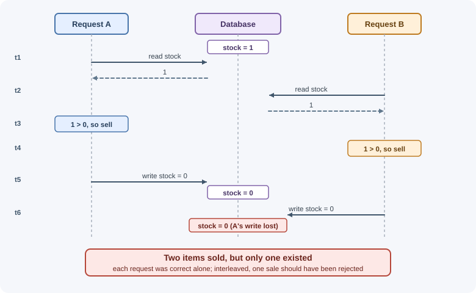
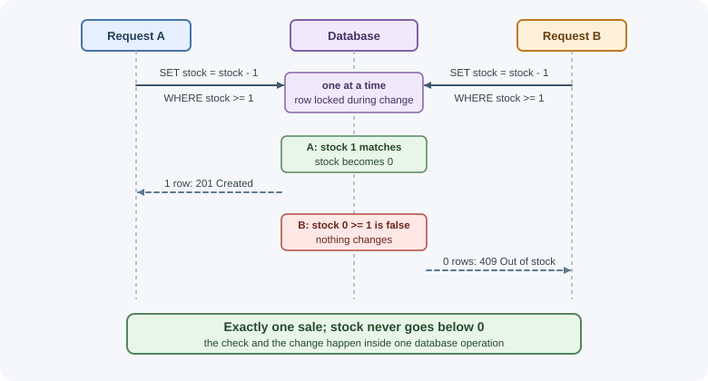

# Concurrency and Race Conditions

A backend handles many requests at the same time. When two of them read and
change the same data concurrently, the result can depend on the exact timing
of their steps — a **race condition**. Race conditions cause lost updates,
double bookings, and money appearing or disappearing, and they are hard to
find because they only happen under specific timing.

## Why it matters

Race conditions rarely show up in local testing, where one developer clicks
one button at a time. In production, they appear as:

- A product with 1 unit in stock sold to two customers.
- A seat or appointment slot booked twice.
- A balance withdrawn twice, or a coupon redeemed more than its limit.
- A counter (likes, views) that ends up lower than the real number.
- One user's edit silently overwriting another's.

These bugs damage trust and money, and they are often exploited
deliberately: attackers send many requests in parallel to redeem a gift card
several times. Knowing the standard defenses lets you design them out from
the start.

## Real-world usage

- **Kubernetes.** Every object has a `resourceVersion`. When a client updates
  an object using a stale version, the API server detects the lost update and
  returns `409 Conflict` — optimistic concurrency built into the platform
  ([Kubernetes: API concepts](https://kubernetes.io/docs/reference/using-api/api-concepts/)).
- **Amazon DynamoDB.** Writes are unconditional by default, but conditional
  writes succeed only if the item's attributes still meet the expected
  conditions, checked against the most recent version of the item
  ([DynamoDB: working with items](https://docs.aws.amazon.com/amazondynamodb/latest/developerguide/WorkingWithItems.html)).
- **Elasticsearch.** Because replication requests can arrive out of order,
  Elasticsearch uses optimistic concurrency control (`if_seq_no` and
  `if_primary_term`) so an older version of a document never overwrites a
  newer one
  ([Elasticsearch: optimistic concurrency control](https://www.elastic.co/docs/reference/elasticsearch/rest-apis/optimistic-concurrency-control)).
- **Database defaults differ.** PostgreSQL's default isolation level is Read
  Committed, and its Read Uncommitted behaves like Read Committed
  ([PostgreSQL: transaction isolation](https://www.postgresql.org/docs/current/transaction-iso.html));
  MySQL's InnoDB defaults to Repeatable Read
  ([MySQL: InnoDB isolation levels](https://dev.mysql.com/doc/refman/8.4/en/innodb-transaction-isolation-levels.html)).
  The same code can therefore behave differently on the two databases.

**Popular tools:** database features (unique indexes, conditional updates,
`SELECT ... FOR UPDATE`, serializable isolation), Redis `SET NX` for locks,
and partitioned queues (for example, Kafka partitions keyed by entity) for
per-entity ordering.

## How it works

### What a race condition is

A race condition happens when the correctness of an operation depends on the
relative timing of concurrent operations on shared state. Classic shapes:

- **Lost update:** two requests read the same value, each computes a new
  value, and the second write overwrites the first.
- **Check-then-act:** a request checks a condition ("seat is free"), then
  acts on it ("book seat"), but another request changes the condition in
  between.
- **Double spend:** two requests both verify a balance is sufficient, then
  both deduct.

### Lost update, step by step



Each request is correct on its own; together they are wrong.

### Why single-threaded Node.js still has races

Node runs your JavaScript on one thread, so two lines of JavaScript never
run at literally the same instant. Races still happen because:

1. **Interleaving at `await`:** while one request awaits a database read,
   the event loop runs other requests. Everything between a read and a write
   that spans an `await` can interleave with other requests.
2. **Multiple processes:** production runs several Node processes or
   containers behind a load balancer. They share the database, not memory.
3. **The database is concurrent:** it processes queries from many
   connections at once.

```js
// Race: the await between read and write lets other requests interleave
app.post("/api/products/:id/buy", async (request, response) => {
  const product = await db.products.findOne({ _id: request.params.id });
  if (product.stock < 1) {
    return response.status(409).json({ error: "Out of stock" });
  }
  // Another request may have bought the last item while we awaited
  await db.products.updateOne(
    { _id: product._id },
    { $set: { stock: product.stock - 1 } }
  );
  response.status(201).json({ ok: true });
});
```

In-process locks (a JavaScript `Map` of "busy" flags) only protect one
process; they do not help across instances.

### Defense 1: atomic database operations

Let the database perform the check and the change as a **single atomic
operation**, so no other request can slip in between.

```js
// MongoDB: conditional update — only decrements if stock is still >= 1
const result = await db.products.updateOne(
  { _id: productId, stock: { $gte: 1 } },
  { $inc: { stock: -1 } }
);
if (result.modifiedCount === 0) {
  // Either the product does not exist or it is out of stock
}
```

```sql
-- SQL: the condition and the change happen in one statement
UPDATE products SET stock = stock - 1 WHERE id = $1 AND stock >= 1;
-- check the affected row count: 0 means out of stock
```

Note the difference between `SET stock = stock - 1` (computed by the
database from the current value) and `SET stock = 0` computed in application
code from a stale read. Prefer operators like `$inc`, `$push`,
`$addToSet`, and `findOneAndUpdate` that work on the current value.



### Defense 2: unique constraints

Many "only one" rules can be enforced by a **unique index**, which the
database guarantees even under concurrency:

- One account per email: unique index on `email`.
- One booking per seat per show: unique index on `(showId, seatId)`.
- One vote per user per poll: unique index on `(pollId, userId)`.
- One processing of each webhook event: unique index on `eventId`.

Insert, and treat the duplicate-key error (MongoDB `11000`, PostgreSQL
`23505`) as "already exists" — usually a `409 Conflict`. Checking first with
a `find` and then inserting is a check-then-act race; the constraint is the
real guarantee.

### Defense 3: optimistic concurrency control

Assume conflicts are rare. Each record carries a **version** number (or a
last-modified timestamp). An update succeeds only if the version is unchanged
since it was read, and increments it.


On conflict, return `409 Conflict` (or reload and retry if the change can be
reapplied automatically).

Over HTTP, the same idea uses **ETags** and **conditional requests**:

```text
GET /api/documents/7
→ 200 OK, ETag: "v3"

PUT /api/documents/7
If-Match: "v3"
→ 200 OK, ETag: "v4"                (version still matched)
→ 412 Precondition Failed           (someone changed it; reload first)
```

This prevents the "last write wins" problem when two people edit the same
document. See [HTTP headers](http-headers.md) and
[HTTP status codes](http-status-codes.md).

### Defense 4: pessimistic locking

Assume conflicts are likely, and lock the row while working on it:

```sql
BEGIN;
SELECT balance FROM accounts WHERE id = $1 FOR UPDATE;  -- locks the row
-- other transactions trying to lock this row wait here
UPDATE accounts SET balance = balance - $2 WHERE id = $1;
COMMIT;                                                  -- releases the lock
```

- Simple to reason about: only one transaction works on the row at a time.
- Costs throughput (others wait), and can cause **deadlocks** if
  transactions lock rows in different orders. Databases detect deadlocks and
  abort one transaction, which you should retry.
- Keep locked sections short; never hold a lock while calling an external
  API.

MongoDB has no `SELECT ... FOR UPDATE`; use atomic conditional updates,
optimistic versioning, or multi-document transactions.

### Defense 5: transactions and isolation levels

A **transaction** groups operations so they all succeed or all fail
(atomicity) and controls how concurrent transactions see each other's
changes (isolation). Isolation levels trade safety for concurrency:

| Isolation level | Dirty read | Non-repeatable read | Phantom read | Notes |
|---|---|---|---|---|
| Read uncommitted | Possible | Possible | Possible | Rarely used; PostgreSQL treats it as read committed |
| Read committed | Prevented | Possible | Possible | Default in PostgreSQL and many databases |
| Repeatable read | Prevented | Prevented | Possible (standard); prevented in PostgreSQL's implementation | MySQL InnoDB default |
| Serializable | Prevented | Prevented | Prevented | Behaves as if transactions ran one at a time; may abort with serialization errors you must retry |

- **Dirty read:** reading another transaction's uncommitted change.
- **Non-repeatable read:** reading the same row twice in a transaction and
  getting different values because another transaction committed in between.
- **Phantom read:** re-running a query and getting new rows that another
  transaction inserted.
- **Lost update** and **write skew** (two transactions each read an overlapping
  set, then write different rows, together violating a rule like "at least
  one doctor on call") can still occur below serializable in some databases.

A transaction at the default level does **not** automatically prevent the
lost-update example above. Combine transactions with atomic updates,
`FOR UPDATE`, version checks, or the serializable level. See
[MongoDB transactions](../../04-databases/mongodb/transactions.md) and
[database fundamentals](../../04-databases/database-fundamentals.md).

### Defense 6: distributed locks

Sometimes the shared resource is not a single database row — for example,
"only one instance should regenerate this report" or "only one sync job per
account." A **distributed lock** in Redis can coordinate instances:

```text
SET lock:report:42 <unique-token> NX PX 30000
  NX  → only set if the key does not exist (acquire)
  PX  → expire after 30 s so a crashed holder does not block forever
Release: delete the key only if it still holds your token (atomic Lua script)
```

Caveats:

- If the holder pauses (GC, slow network) longer than the expiry, the lock
  expires and a second holder starts — **two holders at once**. Locks with
  expiry are best for efficiency (avoiding duplicate work), not as the only
  protection for correctness.
- For correctness, use **fencing tokens**: a number that increases with each
  lock acquisition, which the protected resource checks and rejects if it is
  older than one already seen.
- Prefer database constraints and atomic operations when the data lives in a
  database.

### Defense 7: serialize work through a queue

If operations on one entity must happen one at a time, send them through a
queue partitioned by that entity (for example, all events for `account 42`
go to the same partition or a single-concurrency job group). One consumer
processes them in order, so there is nothing to race. This is common for
ledgers, inventory, and per-user sync jobs. See
[background jobs and scheduling](background-jobs-and-scheduling.md).

### Choosing a defense

| Situation | Usual choice |
|---|---|
| Increment, decrement, conditional change of one record | Atomic update with a condition |
| "Only one of X may exist" | Unique constraint |
| Users editing the same document | Optimistic concurrency (version / ETag + If-Match) |
| Money transfer between rows, high contention | Transaction with `FOR UPDATE` (lock in a consistent order) |
| Multi-row invariant (write skew) | Serializable transaction with retry, or redesign |
| Duplicate job runs across instances | Distributed lock (plus idempotent job) |
| Strict ordering per entity | Partitioned queue |
| Retried client requests | [Idempotency keys](timeouts-retries-and-idempotency.md) |

## When to use and when not to use

**Use a concurrency defense whenever:**

- Two requests can change the same record — stock, balances, seats, quotas,
  counters, documents.
- A rule depends on "check, then act" (unique email, one vote per user,
  coupon limits).

**You may not need one when:**

- Data is append-only (logs, events) and never updated in place.
- Each record has a single writer, such as a user editing a private draft
  that nothing else changes.

**Optimistic or pessimistic?**

| | Optimistic (version check) | Pessimistic (`FOR UPDATE`) |
|---|---|---|
| Best when | Conflicts are rare | Conflicts are frequent on the same rows |
| Cost without conflicts | Almost none | Every transaction takes a lock |
| On conflict | Reject (409 / 412) and retry or reload | Wait for the lock |
| Good for | Users editing documents, settings, profiles | Balances, inventory under heavy contention |
| Risk | Many retries under high contention | Deadlocks and lock waits |

Avoid distributed locks when the data lives in one database — a constraint
or conditional update is simpler and correct.

## Practical examples

### Booking a seat safely with a unique index (MongoDB)

```js
// One-time setup: the database enforces one booking per seat per show
await db.bookings.createIndex({ showId: 1, seatId: 1 }, { unique: true });

app.post("/api/shows/:showId/seats/:seatId/book", async (request, response) => {
  try {
    await db.bookings.insertOne({
      showId: request.params.showId,
      seatId: request.params.seatId,
      userId: request.user.id,
      createdAt: new Date(),
    });
    response.status(201).json({ booked: true });
  } catch (error) {
    if (error.code === 11000) {
      return response.status(409).json({ error: "Seat already booked" });
    }
    throw error;
  }
});
```

### Optimistic update with a version field

```js
export async function renameDocument(id, expectedVersion, title) {
  const result = await db.documents.updateOne(
    { _id: id, version: expectedVersion },
    { $set: { title }, $inc: { version: 1 } }
  );
  if (result.matchedCount === 0) {
    throw new ConflictError("The document was changed by someone else. Reload and try again.");
  }
}
```

### Transfer with row locks in PostgreSQL (node-postgres)

```js
export async function transfer(pool, fromId, toId, amount) {
  const client = await pool.connect();
  try {
    await client.query("BEGIN");
    // Lock both rows in a consistent order to avoid deadlocks
    const [firstId, secondId] = fromId < toId ? [fromId, toId] : [toId, fromId];
    await client.query("SELECT id FROM accounts WHERE id IN ($1, $2) ORDER BY id FOR UPDATE", [firstId, secondId]);

    const debit = await client.query(
      "UPDATE accounts SET balance = balance - $1 WHERE id = $2 AND balance >= $1",
      [amount, fromId]
    );
    if (debit.rowCount === 0) throw new ConflictError("Insufficient funds");

    await client.query("UPDATE accounts SET balance = balance + $1 WHERE id = $2", [amount, toId]);
    await client.query("COMMIT");
  } catch (error) {
    await client.query("ROLLBACK");
    throw error;
  } finally {
    client.release();
  }
}
```

### Testing for races

Fire concurrent requests in a test to prove the defense works:

```js
// 20 parallel purchases of a product with stock = 1 → exactly one success
const results = await Promise.all(
  Array.from({ length: 20 }, () => request(app).post("/api/products/p1/buy"))
);
const successes = results.filter((r) => r.status === 201).length;
assert.equal(successes, 1);
```

## Best practices

- Assume every read-modify-write that spans an `await` can race.
- Push checks and changes into one atomic database operation where possible.
- Enforce uniqueness with database constraints, not prior lookups.
- Use version fields or ETags with `If-Match` for user-edited resources.
- Keep transactions and locks short; lock rows in a consistent order; retry
  deadlocks and serialization failures.
- Do not call external services while holding locks or open transactions.
- Treat distributed locks as an efficiency tool; add fencing or idempotency
  for correctness.
- Write concurrency tests for critical flows (stock, bookings, payments).

## In production

- **A flash sale oversells.** *Symptom:* more orders than units, or stock
  below zero. *Detect:* a reconciliation check comparing orders with
  inventory, or an alert on negative stock. *Cause:* read-then-write in
  application code under parallel requests. *Fix:* a conditional atomic
  update (`stock >= 1`), plus a database `CHECK (stock >= 0)` as a final
  guard.
- **Intermittent "deadlock detected" errors.** *Symptom:* a small share of
  transfers fail with a 500. *Detect:* PostgreSQL error code `40P01`
  (`deadlock_detected`) in logs. *Cause:* two code paths lock the same rows in
  different orders. *Fix:* always lock in a consistent order (for example, by
  ID), keep transactions short, and retry the aborted transaction.
- **Serialization failures after raising isolation.** *Symptom:* errors rise
  after switching a flow to Serializable. *Detect:* error code `40001`
  (`serialization_failure`). *Cause:* expected behavior — the database aborts
  transactions that would break serializability. *Fix:* wrap the transaction
  in a retry loop with backoff, and keep the transaction's reads and writes
  small.
- **A scheduled job runs twice.** *Symptom:* customers receive two copies of
  a report. *Detect:* logs show two instances holding the same lock. *Cause:*
  the job ran longer than the lock's expiry, so a second instance acquired
  it. *Fix:* extend the lock while working, use fencing tokens, and make the
  job idempotent.
- **One hot row slows everything.** *Symptom:* p99 latency spikes on
  endpoints that update a shared counter. *Detect:* `pg_stat_activity` shows
  many sessions waiting with `wait_event_type = 'Lock'`. *Cause:* every
  request updates the same row. *Fix:* shard the counter across several rows,
  batch increments, or aggregate asynchronously.

## Important terminology

- **Concurrency:** multiple operations in progress during overlapping time.
- **Race condition:** a bug where the outcome depends on timing.
- **Critical section:** code that must not run concurrently on the same data.
- **Lost update:** one write overwriting another based on stale data.
- **Check-then-act:** acting on a condition that may have changed since it
  was checked.
- **Atomic operation:** an operation that happens completely or not at all,
  with no visible intermediate state.
- **Optimistic concurrency control:** detect conflicts at write time with a
  version check.
- **Pessimistic locking:** lock data before changing it so others wait.
- **Isolation level:** how much concurrent transactions are shielded from
  each other.
- **Deadlock:** two transactions each waiting for a lock the other holds.
- **Write skew:** concurrent transactions each making a valid change that
  together break an invariant.
- **Distributed lock:** a lock coordinated across processes, often in Redis.
- **Fencing token:** an increasing number used to reject stale lock holders.

## Common mistakes and misconceptions

- **"Node is single-threaded, so there are no race conditions."**
  Interleaving at `await` and multiple instances still cause them.
- **Read, compute in JavaScript, then write the result**, instead of using
  atomic operators.
- **Checking for duplicates with `find` before `insert`** without a unique
  index.
- **"Wrapping it in a transaction fixes it."** Default isolation levels still
  allow lost updates and write skew.
- **In-memory locks** in a multi-instance deployment.
- **Trusting a Redis lock with expiry for strict correctness.**
- **Long transactions** that hold locks while waiting on network calls.

## Revision questions

1. Show, step by step, how two concurrent purchases can sell the last item
   twice.
2. Why can races occur in Node.js even though JavaScript runs on one thread?
3. How do a conditional atomic update and a unique index each prevent a race?
4. Explain optimistic concurrency with a version field, and how ETags and
   `If-Match` apply it over HTTP.
5. Which anomalies does each isolation level prevent?
6. What is the risk of using a Redis lock with an expiry, and how do fencing
   tokens help?

## Further learning

- [PostgreSQL: Transaction isolation](https://www.postgresql.org/docs/current/transaction-iso.html)
- [PostgreSQL: Explicit locking](https://www.postgresql.org/docs/current/explicit-locking.html)
- [MongoDB: Atomicity and transactions](https://www.mongodb.com/docs/manual/core/write-operations-atomicity/)
- [MDN: If-Match header](https://developer.mozilla.org/en-US/docs/Web/HTTP/Headers/If-Match)
- [Redis: Distributed locks](https://redis.io/docs/latest/develop/use/patterns/distributed-locks/)
- Related notes: [MongoDB transactions](../../04-databases/mongodb/transactions.md),
  [Timeouts, retries, and idempotency](timeouts-retries-and-idempotency.md)
