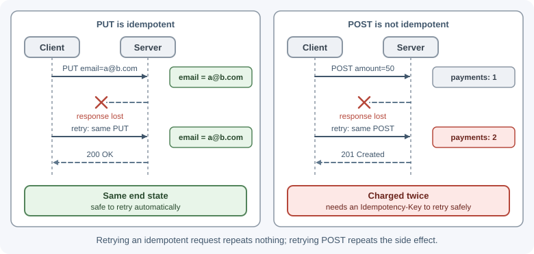

# HTTP Methods

An HTTP method (sometimes called a verb) tells the server what the client
wants to do with the target resource: read it, create something, replace it,
change part of it, or delete it. Each method has defined properties, such as
whether it is safe to repeat, that browsers, caches, proxies, and client
libraries rely on.

## Why it matters

Methods are a contract, not a naming convention. Infrastructure makes real
decisions based on them:

- **Caches** routinely store `GET` and `HEAD` responses. A `POST` response
  is cacheable only with explicit freshness information and a matching
  `Content-Location`, so in practice it is almost never cached.
- **Browsers and HTTP clients** may automatically retry idempotent requests
  after a dropped connection, but should not retry a `POST`.
- **Crawlers and link prefetchers** follow links with `GET`. If `GET` deletes
  data, a crawler can wipe your database.
- **CORS** sends a preflight for methods other than `GET`, `HEAD`, and
  `POST` (and for some headers and content types). See [CORS](cors.md).

Using the right method makes your API predictable and safe to use.

## Real-world usage

- **GitHub uses `PUT` for "make it so" operations and `PATCH` for updates.**
  [Starring a repository](https://docs.github.com/en/rest/activity/starring)
  is `PUT /user/starred/{owner}/{repo}`: the client names the exact
  resource, repeating it is harmless, and GitHub's docs note you must send
  `Content-Length: 0` because there is no body. Changing a repository's
  settings is
  [`PATCH /repos/{owner}/{repo}`](https://docs.github.com/en/rest/repos/repos),
  which returns `422` if validation fails.
- **Stripe uses `POST` for both create and update.**
  [Updating a customer](https://docs.stripe.com/api/customers/update) is
  `POST /v1/customers/:id`, and "any parameters not provided are left
  unchanged", which is partial-update (`PATCH`-like) behavior on `POST`. To
  make those non-idempotent requests safe to retry, Stripe
  [accepts idempotency keys on all `POST` requests](https://docs.stripe.com/api/idempotent_requests)
  and says not to send them with `GET` and `DELETE`, which are already
  idempotent.
- **Kubernetes supports several `PATCH` formats.** `kubectl patch`
  [takes a `--type`](https://kubernetes.io/docs/tasks/manage-kubernetes-objects/update-api-object-kubectl-patch/)
  of `json` (JSON Patch, RFC 6902), `merge` (JSON Merge Patch), or
  `strategic` (a Kubernetes-specific strategic merge patch), which is a real
  example of the patch-format choice described below.

## How it works

### Properties every method has

- **Safe:** the method is *read-only* in intent. The client does not request
  any change to server state. Logging or counting views is fine; changing
  data the client asked about is not.
- **Idempotent:** sending the same request once or ten times leaves the
  server in the same *intended* state. The responses can differ (a second
  `DELETE` may return `404`), but the end state is the same. Every safe
  method is also idempotent.
- **Cacheable:** a response to this method may be stored and reused for
  later requests.

| Method | Purpose | Safe | Idempotent | Cacheable | Request body | Response body |
|---|---|---|---|---|---|---|
| `GET` | Read a representation | Yes | Yes | Yes | No defined meaning; avoid | Yes |
| `HEAD` | Same as `GET` but headers only | Yes | Yes | Yes | No defined meaning; avoid | No |
| `POST` | Process data / create a subordinate resource / trigger an action | No | No | Only with explicit freshness info; rare in practice | Yes | Yes |
| `PUT` | Create or fully replace the resource at this URL | No | Yes | No | Yes | Optional |
| `PATCH` | Partially modify a resource | No | Not by definition | No | Yes | Optional |
| `DELETE` | Remove the resource | No | Yes | No | No defined meaning; avoid | Optional |
| `OPTIONS` | Ask which methods/features the target supports; CORS preflight | Yes | Yes | No | Rare | Optional |
| `TRACE` | Echo the request back for debugging | Yes | Yes | No | No | Yes (the echoed request) |
| `CONNECT` | Open a tunnel through a proxy (e.g. for HTTPS) | No | No | No | No | n/a |

### GET

Retrieves a representation of a resource. It must not change server state
in a way the client is responsible for.

- Typical responses: `200 OK` with the resource, `304 Not Modified` for a
  conditional request, `404 Not Found`.
- Parameters go in the path (`/orders/42`) and query string
  (`/orders?status=paid&page=2`), never in a body.
- Responses can be cached by browsers, CDNs, and proxies.

```text
GET /api/orders/42 HTTP/1.1
Host: api.shop.example
Accept: application/json
```

### HEAD

Identical to `GET`, except the server returns only the status line and
headers, no body. Clients use it to check whether a resource exists, read its
size (`Content-Length`), or check `ETag`/`Last-Modified` without downloading
it. Express answers `HEAD` automatically for routes defined with `app.get()`.

### POST

Asks the server to process the enclosed data according to the resource's own
rules. It is the most general method:

- Create a new resource in a collection: `POST /api/orders`.
- Trigger an action that does not map to a resource: `POST /api/orders/42/refund`.
- Submit a form, upload a file, run a search with a large query.

Typical responses: `201 Created` with a `Location` header pointing to the new
resource, `200 OK` with a result, `202 Accepted` if processing continues in
the background, `400`/`422` for invalid input.

`POST` is **not idempotent**: sending it twice can create two orders or
charge a card twice. Protect important `POST` endpoints with idempotency
keys. See [timeouts, retries, and idempotency](timeouts-retries-and-idempotency.md).

### PUT

Creates the resource at the given URL, or **replaces it entirely** with the
request body. The body is the full new representation; any field you leave
out is gone (or reset to its default).

- Typical responses: `201 Created` if it did not exist, `200 OK` (with body)
  or `204 No Content` if it was replaced.
- Idempotent: putting the same document ten times leaves the same result.
- The client chooses the URL, so `PUT` suits resources whose ID the client
  knows, such as `PUT /api/users/42/avatar` or `PUT /api/settings/theme`.

### PATCH

Applies a **partial modification**. Defined in RFC 5789, not in the core
HTTP specification. The body is a set of changes, and its format is given by
the `Content-Type`.

- Typical responses: `200 OK` with the updated resource, `204 No Content`,
  `409 Conflict`, `415 Unsupported Media Type` for an unknown patch format,
  `422` if the patch cannot be applied.
- Not idempotent *by definition*, because some patch operations are not (for
  example "append to this array" or "increment by 1"). A patch that only sets
  fields to fixed values is idempotent in practice.
- Servers can advertise accepted patch formats with the `Accept-Patch`
  response header.

### DELETE

Removes the resource at the URL.

- Typical responses: `204 No Content` (most common), `200 OK` with a status
  body, `202 Accepted` if deletion is queued, `404 Not Found`.
- Idempotent: after the first successful delete the resource is gone; later
  deletes leave it gone. Whether the second call returns `204` or `404` is an
  API design choice; document it.
- A request body has no defined meaning; some servers and proxies drop it.
  Put identifiers in the URL.

### OPTIONS

Asks what communication options the target supports. The server can reply
with an `Allow` header listing the methods. Browsers send `OPTIONS` as a
**CORS preflight** before many cross-origin requests; see [CORS](cors.md).
Express answers `OPTIONS` automatically with an `Allow` header if you do not
define a handler.

### TRACE

Asks the server to echo back the request it received, so a client can see
what proxies changed. It can expose sensitive headers (the old cross-site
tracing attack), so most servers disable it. You will rarely use it.

### CONNECT

Asks a proxy to open a raw TCP tunnel to another host, which is how HTTPS
traffic passes through a forward proxy (`CONNECT api.example.com:443`).
Application APIs do not implement it.

### PUT vs PATCH vs POST

Take a user resource:

```json
{ "id": 42, "name": "Ana", "email": "ana@example.com", "role": "editor" }
```

| Request | Body | Result |
|---|---|---|
| `PUT /users/42` | `{"name": "Ana Li", "email": "ana@example.com", "role": "editor"}` | Whole resource replaced; any field not sent is removed or reset |
| `PUT /users/42` | `{"name": "Ana Li"}` | Email and role are now missing or defaulted (a common bug) |
| `PATCH /users/42` | `{"name": "Ana Li"}` | Only the name changes |
| `POST /users` | `{"name": "Ben", "email": "ben@example.com"}` | New user created; server picks the ID |
| `POST /users/42/promote` | (empty) | An action; not a plain field update |

Rules of thumb:

- Use **`POST`** to create when the server assigns the ID, and for actions.
- Use **`PUT`** when the client sends the complete resource, or creates it at
  a URL it chooses.
- Use **`PATCH`** for partial updates (the most common kind of update in
  real APIs).


### JSON Merge Patch vs JSON Patch

Two standard formats describe the changes in a `PATCH` body.

**JSON Merge Patch** (RFC 7396, `Content-Type: application/merge-patch+json`)
sends an object that looks like the resource. Present fields are set, fields
set to `null` are removed, and missing fields are untouched.

```json
{ "name": "Ana Li", "nickname": null }
```

It is simple and readable, but it cannot set a field *to* `null` (null means
"remove"), and arrays are replaced wholesale, not edited.

**JSON Patch** (RFC 6902, `Content-Type: application/json-patch+json`) sends
an ordered list of operations: `add`, `remove`, `replace`, `move`, `copy`,
and `test`.

```json
[
  { "op": "test", "path": "/version", "value": 7 },
  { "op": "replace", "path": "/name", "value": "Ana Li" },
  { "op": "add", "path": "/tags/-", "value": "vip" },
  { "op": "remove", "path": "/nickname" }
]
```

It can edit arrays precisely and `test` makes the patch fail if the document
changed, but it is more verbose and harder to validate. The patch is applied
atomically: if one operation fails, none apply.

Many APIs simply accept `application/json` with merge-style semantics. That
is fine as long as the behavior for `null` and arrays is documented.

### Why GET must never change state

`GET` requests are made by things you do not control: browser prefetching,
link previews in chat apps, search crawlers, antivirus link scanners, and
caches replaying responses. If `GET /api/emails/9/delete` deletes an email, a
link preview can delete it. Change state only with `POST`, `PUT`, `PATCH`, or
`DELETE`.

### GET with a body: don't

RFC 9110 says content in a `GET` request has no generally defined meaning.
Many proxies, CDNs, and client libraries (including browser `fetch()`) drop
the body or reject the request. If a search query is too large for a URL,
use `POST /search` (an action) instead.

### Mapping CRUD to methods

| Operation | Method and path | Success status |
|---|---|---|
| List | `GET /api/articles` | `200` |
| Read one | `GET /api/articles/:id` | `200` |
| Create | `POST /api/articles` | `201` + `Location` |
| Replace | `PUT /api/articles/:id` | `200` or `204` (or `201` if created) |
| Update part | `PATCH /api/articles/:id` | `200` or `204` |
| Delete | `DELETE /api/articles/:id` | `204` |

### Idempotency in practice

| Request | Repeat 3 times | Idempotent? |
|---|---|---|
| `GET /accounts/7` | Same read three times | Yes |
| `PUT /accounts/7/email` with `{"email":"a@b.com"}` | Email is `a@b.com` | Yes |
| `DELETE /carts/7/items/3` | Item 3 is gone | Yes |
| `PATCH /accounts/7` with `{"email":"a@b.com"}` | Same state | Yes, in practice |
| `PATCH /accounts/7` with `{"op":"increment","field":"credits"}` | Credits +3 | No |
| `POST /payments` with `{"amount":50}` | Three payments | No (use an idempotency key) |

Idempotency matters because networks fail mid-request. If a client does not
know whether a request arrived, it can safely retry an idempotent one.



### 405 Method Not Allowed and the Allow header

If the resource exists but does not support the method, return
`405 Method Not Allowed`. RFC 9110 requires the response to include an
`Allow` header listing the supported methods.

```text
HTTP/1.1 405 Method Not Allowed
Allow: GET, HEAD, PATCH
Content-Type: application/problem+json
```

Compare with `501 Not Implemented`, which means the server does not recognize
or support the method *for any resource*.

### Method override, and why to avoid it

Old HTML forms can only send `GET` and `POST`, and some old proxies blocked
other methods. The workaround was to send `POST` with a hidden field or a
header such as `X-HTTP-Method-Override: DELETE`. Avoid it in new APIs:

- It hides the real operation from caches, logs, and security tools.
- It can let an attacker turn a `POST` into a `DELETE` past a filter that
  checks only the method.
- `fetch()` and every modern client support all methods directly.

## When to use and when not to use

- **`GET`:** use for every read, including searches that fit in a URL. Do
  not use it for anything that changes state, or for data that must not end
  up in logs and browser history (passwords, tokens).
- **`POST`:** use to create when the server picks the ID, for actions that
  are not plain field updates, and for searches too large for a URL. Avoid it
  for plain reads (you lose caching) and protect it with idempotency keys
  when duplicates would hurt.
- **`PUT`:** use when the client sends the complete resource or creates it at
  a URL it chooses, and when you want retries to be safe. Avoid it for
  partial updates; missing fields get wiped.
- **`PATCH`:** use for partial updates, which most edit forms are. Avoid it
  when clients cannot agree on a documented patch format, and remember it is
  not idempotent by definition.
- **`DELETE`:** use to remove the resource at the URL. Avoid request bodies;
  put identifiers in the path.

| You need to... | Use | Instead of | Why |
|---|---|---|---|
| Read data | `GET` | `POST /getX` | Cacheable, safe to retry, bookmarkable |
| Create with a server-generated ID | `POST /items` | `PUT /items` | The client does not know the new URL |
| Create or replace at a known URL | `PUT /items/42` | `POST` | Idempotent; retries are harmless |
| Change a few fields | `PATCH /items/42` | `PUT` with a partial body | `PUT` replaces the whole resource |
| Trigger an action (refund, publish) | `POST /items/42/refund` | `PATCH` with an `action` field | Actions have side effects beyond the fields |
| Remove | `DELETE /items/42` | `POST /items/42/delete` or `GET .../delete` | Idempotent, and `GET` can be triggered by crawlers |

## Practical examples

### A full set of routes in Express

```js
import express from "express";

const app = express();
app.use(express.json());

const articles = new Map(); // stand-in for a database
let nextId = 1;

app.get("/api/articles", (req, res) => {
  res.json([...articles.values()]);
});

app.get("/api/articles/:id", (req, res) => {
  const article = articles.get(req.params.id);
  if (!article) return res.sendStatus(404);
  res.json(article);
});

app.post("/api/articles", (req, res) => {
  const id = String(nextId++);
  const article = { id, title: req.body.title, body: req.body.body ?? "" };
  articles.set(id, article);
  res.status(201).location(`/api/articles/${id}`).json(article);
});

// PUT: full replacement; fields not sent are reset
app.put("/api/articles/:id", (req, res) => {
  const existed = articles.has(req.params.id);
  const article = { id: req.params.id, title: req.body.title, body: req.body.body ?? "" };
  articles.set(req.params.id, article);
  res.status(existed ? 200 : 201).json(article);
});

// PATCH: only the fields sent change
app.patch("/api/articles/:id", (req, res) => {
  const article = articles.get(req.params.id);
  if (!article) return res.sendStatus(404);
  const { title, body } = req.body;
  if (title !== undefined) article.title = title;
  if (body !== undefined) article.body = body;
  res.json(article);
});

app.delete("/api/articles/:id", (req, res) => {
  articles.delete(req.params.id); // deleting twice is harmless
  res.sendStatus(204);
});

// Registered after the real routes, so it only sees other methods.
// HEAD is already answered by the GET route above.
app.all("/api/articles", (req, res) => {
  res.set("Allow", "GET, HEAD, POST, OPTIONS");
  if (req.method === "OPTIONS") return res.sendStatus(204);
  res.sendStatus(405); // PUT, PATCH, DELETE on the collection
});

app.listen(3000);
```

Validation is left out to keep the method behavior visible. See
[request validation](../express/request-validation.md).

### Try them with curl

```bash
curl -i -X POST http://localhost:3000/api/articles \
  -H "Content-Type: application/json" -d '{"title":"Hello"}'

curl -i -X PATCH http://localhost:3000/api/articles/1 \
  -H "Content-Type: application/json" -d '{"body":"First post"}'

curl -I http://localhost:3000/api/articles/1     # HEAD: headers only
curl -i -X DELETE http://localhost:3000/api/articles/1
curl -i -X PUT http://localhost:3000/api/articles  # 405 with Allow
```

## Best practices

- Choose methods by their **semantics**, not by convenience.
- Keep `GET`, `HEAD`, and `OPTIONS` free of side effects.
- Return `201 Created` with a `Location` header when `POST` creates
  something.
- Prefer `PATCH` for partial updates; document how `null` and arrays behave.
- Protect non-idempotent operations (payments, orders) with idempotency keys.
- Return `405` with an `Allow` header for unsupported methods on a known
  resource.
- Put identifiers in the path, filters in the query string, and data in the
  body.

## In production

- **Data disappears with nobody clicking "delete".**
  *Detect:* access logs show `GET` requests to an action URL (such as
  `/unsubscribe/...` or `/items/9/delete`) from crawler or link-preview user
  agents just before the change. *Cause:* a state-changing `GET`. *Fix:*
  make the action a `POST` (a confirmation page can link to a form that
  posts).
- **Duplicate orders or charges after network blips.**
  *Detect:* pairs of identical `POST`s seconds apart from the same client,
  often after a timeout in the client logs. *Cause:* the client or a library
  retried a non-idempotent `POST`. *Fix:* require an `Idempotency-Key` and
  return the stored result for repeats, as Stripe does.
- **Fields wiped by an "update".**
  *Detect:* audit logs show fields set to `null` or defaults right after a
  `PUT` from a client that only edits some fields. *Cause:* partial bodies
  sent with `PUT`. *Fix:* switch the client to `PATCH`, or reject `PUT`
  bodies that are missing required fields with `400`/`422`.
- **A `DELETE` or `GET` body arrives empty in production only.**
  *Detect:* the same request works locally but fails behind the CDN or
  proxy. *Cause:* some intermediaries drop bodies on methods where the body
  has no defined meaning. *Fix:* move the data into the path or query
  string, or use `POST` for a bulk action.
- **Clients get `404` and give up on a URL that exists.**
  *Detect:* `404`s for known paths with an unusual method in access logs.
  *Cause:* unsupported methods fall through to the "not found" handler.
  *Fix:* return `405` with an `Allow` header so clients see what is
  supported.

## Important terminology

- **Method (verb):** the action requested on a resource.
- **Safe method:** a method that does not request a change to server state.
- **Idempotent method:** repeating the request has the same intended effect
  as sending it once.
- **Cacheable:** responses may be stored and reused.
- **Representation:** the data sent for a resource, such as a JSON document.
- **Preflight:** a browser's `OPTIONS` request that checks CORS permission
  before the real request.
- **JSON Merge Patch:** a patch format that looks like a partial resource.
- **JSON Patch:** a patch format made of ordered operations.

## Common mistakes and misconceptions

- **Using `GET` for actions** such as `/logout` or `/delete`, which crawlers
  and prefetchers can trigger.
- **Treating `PUT` as a partial update** and accidentally wiping fields the
  client did not send.
- **"Idempotent means the same response every time."** It means the same
  server state; the status code can differ.
- **Using `POST` for everything** and losing caching, safe retries, and
  clarity.
- **Sending a body with `GET` or `DELETE`** and having proxies silently drop
  it.
- **Returning `404` for a wrong method** instead of `405` with `Allow`.

## Revision questions

1. Define safe, idempotent, and cacheable, and give one method that is each.
2. Why is `DELETE` idempotent even though the second call may return `404`?
3. A client sends `PUT /users/42` with only `{"name": "Ana"}`. What should
   happen to the other fields, and why is that a common bug?
4. When would you choose JSON Patch over JSON Merge Patch?
5. Why is it dangerous for a `GET` endpoint to delete data?
6. What must a `405` response include?

## Further learning

- **MDN:** [HTTP request methods](https://developer.mozilla.org/en-US/docs/Web/HTTP/Methods)
  documents every method with examples.
- **RFC 9110:** [Section 9, Methods](https://www.rfc-editor.org/rfc/rfc9110#section-9)
  defines method semantics, safety, and idempotency.
- **RFC 5789:** [PATCH Method for HTTP](https://www.rfc-editor.org/rfc/rfc5789).
- **RFC 7396:** [JSON Merge Patch](https://www.rfc-editor.org/rfc/rfc7396).
- **RFC 6902:** [JSON Patch](https://www.rfc-editor.org/rfc/rfc6902).
