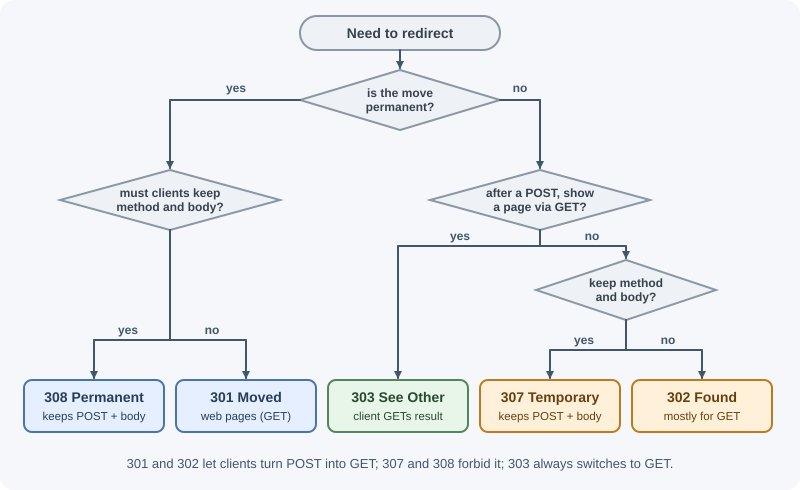

# HTTP Status Codes

Every HTTP response starts with a three-digit status code that summarizes
the outcome: success, redirect, client mistake, or server failure. Clients,
browsers, caches, monitoring tools, and retry logic all make decisions based
on this number, so choosing the right code is part of designing an API.

## Why it matters

- **Clients branch on it.** Frontend code, mobile apps, and SDKs decide
  whether to show data, ask the user to log in, retry, or display an error
  based on the status code.
- **Infrastructure acts on it.** Browsers follow `3xx` redirects, caches
  store `200` and revalidate with `304`, load balancers mark instances
  unhealthy on `5xx`, and retry libraries retry `503` but not `400`.
- **Monitoring depends on it.** Error-rate dashboards and alerts count `5xx`
  responses. Returning `200` for failures hides outages.
- **It is the first debugging clue.** `401` points to authentication, `403`
  to permissions, `502` to a proxy that could not reach your app.

## Real-world usage

- **GitHub returns `404` instead of `403` for private resources.** Its
  [REST API troubleshooting guide](https://docs.github.com/en/rest/using-the-rest-api/troubleshooting-the-rest-api)
  says an unauthenticated request for a private resource gets `404 Not
  Found` "instead of a 403 Forbidden response to avoid confirming the
  existence of private repositories". The same guide says requests that
  cannot be processed may get `422 Unprocessable Entity` with a "Validation
  Failed" message and an `errors` property.
- **GitHub signals rate limits with `403` or `429`.** When you exceed the
  primary rate limit, you
  [receive a 403 or 429 response](https://docs.github.com/en/rest/using-the-rest-api/rate-limits-for-the-rest-api)
  and `x-ratelimit-remaining` is `0`; clients should wait until the time in
  `x-ratelimit-reset`.
- **Stripe documents a status code summary and gives `402` a meaning.**
  Stripe's [error reference](https://docs.stripe.com/api/errors) uses `402
  Request Failed` for "the parameters were valid but the request failed",
  `409 Conflict` for a request that conflicts with another (such as reusing
  an idempotency key), `424` for a failure in a dependency outside Stripe,
  and `429` with a recommendation to use exponential backoff. It lists a
  failed charge or a declined card among its `4xx` errors.
- **Proxies and CDNs add their own codes.** Cloudflare returns non-standard
  [`52x` codes](https://developers.cloudflare.com/support/troubleshooting/http-status-codes/cloudflare-5xx-errors/)
  such as `521` (web server is down) and `524` (a timeout occurred). Seeing
  one tells you the CDN, not your application, produced the response.

## How it works

### The five classes

The first digit defines the class. The other two digits refine it.

| Class | Meaning | Who is "at fault" | Typical client reaction |
|---|---|---|---|
| `1xx` Informational | Interim response; the final response follows | Nobody | Keep waiting |
| `2xx` Successful | The request was received, understood, and accepted | Nobody | Use the response |
| `3xx` Redirection | The client must take another step, usually follow a new URL | Nobody | Follow `Location` or use the cache |
| `4xx` Client error | The request is wrong or not allowed | The client | Fix the request; usually do not retry as-is |
| `5xx` Server error | The server failed to handle a valid request | The server | Maybe retry later |


A client that receives a code it does not recognize treats it as the `x00`
code of its class. An unknown `479` is handled like `400`, and an unknown
`531` like `500`. That rule is why inventing private codes is pointless:
clients will not know what they mean.

The text after the number (the reason phrase, such as `Not Found`) is only
for humans. HTTP/2 and HTTP/3 do not even send it. Clients must rely on the
number.

```text
HTTP/1.1 404 Not Found
^^^^^^^^ ^^^ ^^^^^^^^^
version  code reason phrase (informational only)
```

In Express you set the code with `res.status(code)` before sending, or send
it alone with `res.sendStatus(code)`, which uses the reason phrase as the
body. See [the response object](../express/response-object.md).

---

### 1xx: Informational

Interim responses sent before the final one. Application code rarely sends
them directly; servers and proxies handle them.

#### 100 Continue

- **Meaning:** "Your headers look fine; go ahead and send the body."
- **When:** a client about to upload a large body sends
  `Expect: 100-continue` and waits. The server answers `100` to proceed, or
  a final error (such as `401` or `413`) so the client does not waste
  bandwidth uploading.
- **Example:** a 2 GB upload is rejected with `413` before any of it is sent.
- **Related headers:** `Expect` (request).

#### 101 Switching Protocols

- **Meaning:** the server agrees to switch to the protocol named in the
  client's `Upgrade` header.
- **When:** opening a WebSocket. The client sends `Upgrade: websocket`, and
  the server replies `101`; after that the connection speaks WebSocket, not
  HTTP. See [real-time communication](real-time-communication.md).
- **Related headers:** `Upgrade`, `Connection: Upgrade`.

#### 103 Early Hints

- **Meaning:** "While I prepare the real response, start loading these."
- **When:** a server or CDN sends `Link` headers for critical CSS or fonts
  early, so the browser can preload them while the page is still being
  generated.
- **Related headers:** `Link: </app.css>; rel=preload; as=style`.

---

### 2xx: Successful

#### 200 OK

- **Meaning:** the request succeeded. The body depends on the method: the
  resource for `GET`, the result of the action for `POST`, the updated
  resource for `PATCH`/`PUT`.
- **When:** the default for a successful read or an update that returns
  data.
- **Example:** `GET /api/orders/42` returns the order as JSON.
- **Express:** `res.json(order)` (200 is the default).

#### 201 Created

- **Meaning:** a new resource was created.
- **When:** after `POST` to a collection, or `PUT` to a URL that did not
  exist yet.
- **Example:** `POST /api/orders` creates order `ord_901`.
- **Related headers:** `Location` should point to the new resource. The body
  usually contains it so the client does not need another request.
- **Express:**
  `res.status(201).location(`/api/orders/${order.id}`).json(order)`

#### 202 Accepted

- **Meaning:** the request was accepted for processing, but the work is not
  finished (and might still fail).
- **When:** long-running or queued work: video encoding, report generation,
  bulk imports, sending a large email campaign.
- **Example:** `POST /api/reports` returns `202` with a link to check status.
- **Related headers:** `Location` (or a body field) pointing to a status
  resource such as `/api/reports/jobs/77`.
- **Express:**
  `res.status(202).location(`/api/jobs/${job.id}`).json({ jobId: job.id, status: "queued" })`

#### 203 Non-Authoritative Information

- **Meaning:** the request succeeded, but a transforming proxy modified the
  content from what the origin sent. Rarely used; your API should not send
  it.

#### 204 No Content

- **Meaning:** success, and there is intentionally no body.
- **When:** `DELETE` succeeded; `PUT`/`PATCH` succeeded and you choose not to
  return the resource; a "fire and forget" action such as marking a
  notification as read.
- **Rules:** a `204` response cannot have a body. Do not send JSON with it.
- **Express:** `res.sendStatus(204)` or `res.status(204).end()`.

#### 206 Partial Content

- **Meaning:** the response contains only the byte range(s) the client asked
  for.
- **When:** resuming a download, video players seeking within a file,
  parallel downloads.
- **Related headers:** request `Range: bytes=0-1048575`; response
  `Content-Range: bytes 0-1048575/52428800` and `Accept-Ranges: bytes`.
- **Express:** `res.sendFile()` and `express.static` handle range requests
  for you.

---

### 3xx: Redirection

The key differences between redirect codes are **permanent vs temporary**
and **whether the method and body are preserved**.

| Code | Permanent? | Method preserved? | Typical use |
|---|---|---|---|
| `301` | Yes | Not guaranteed (clients may change `POST` to `GET`) | Old URL moved forever (pages, `GET`) |
| `302` | No | Not guaranteed | Temporary redirect, mostly for `GET` |
| `303` | No | No: becomes `GET` (or `HEAD`) | After a form `POST`, send the user to a result page |
| `307` | No | Yes | Temporary redirect that must keep `POST` and body |
| `308` | Yes | Yes | Permanent move of an API endpoint that receives `POST` |



#### 300 Multiple Choices

- **Meaning:** several representations are available and the client may
  choose. Rarely used in practice.

#### 301 Moved Permanently

- **Meaning:** the resource has a new permanent URL.
- **When:** a page or domain moved for good (`http://` to `https://`,
  `/blog/old-slug` to `/blog/new-slug`). Search engines transfer ranking to
  the new URL, and browsers cache the redirect.
- **Related headers:** `Location`.
- **Caution:** for historical reasons clients may change a `POST` into a
  `GET` when following it. Use `308` when the method must be kept. Because
  browsers cache `301` aggressively, a mistaken `301` is hard to undo.
- **Express:** `res.redirect(301, "https://new.example.com/path")`

#### 302 Found

- **Meaning:** the resource is temporarily at another URL; keep using the
  original URL in future.
- **When:** temporary redirects of `GET` requests, such as sending a
  logged-out user to `/login`.
- **Related headers:** `Location`.
- **Caution:** like `301`, clients may switch `POST` to `GET`. Use `303` or
  `307` to be explicit.
- **Express:** `res.redirect("/login")` sends `302` by default.

#### 303 See Other

- **Meaning:** "The result is at another URL; fetch it with `GET`."
- **When:** the Post/Redirect/Get pattern: after a form `POST` creates an
  order, redirect to `/orders/901` so refreshing the page does not resubmit
  the form.
- **Related headers:** `Location`.
- **Express:** `res.redirect(303, `/orders/${order.id}`)`

#### 304 Not Modified

- **Meaning:** "The copy you already have is still current; use it."
- **When:** answering a conditional `GET` whose `If-None-Match` matches the
  current `ETag`, or whose `If-Modified-Since` is not older than the last
  change.
- **Rules:** no body. The client reuses its cached copy, which saves
  bandwidth and time.
- **Related headers:** request `If-None-Match`, `If-Modified-Since`; response
  `ETag`, `Cache-Control`, `Last-Modified`.
- **Express:** sends `304` automatically for `res.send()`/`res.json()` when
  the generated `ETag` matches. See [HTTP headers](http-headers.md).

#### 307 Temporary Redirect

- **Meaning:** temporary redirect that **must** keep the original method and
  body.
- **When:** temporarily routing a `POST /api/upload` to another server during
  maintenance; HSTS upgrades in browsers appear as an internal `307`.
- **Related headers:** `Location`.
- **Express:** `res.redirect(307, "https://backup.example.com/api/upload")`

#### 308 Permanent Redirect

- **Meaning:** permanent redirect that **must** keep the method and body.
- **When:** an API endpoint moved permanently and clients still `POST` or
  `PUT` to the old URL.
- **Related headers:** `Location`.
- **Express:** `res.redirect(308, "/api/v2/orders")`

---

### 4xx: Client errors

The request has a problem the client must fix. Retrying the same request
unchanged will normally fail again (exceptions: `408`, `425`, `429`). Include
a body that explains what went wrong, ideally in one consistent format such
as [RFC 9457 problem details](api-design-best-practices.md).

#### 400 Bad Request

- **Meaning:** the server cannot or will not process the request because of
  a client error: malformed syntax, invalid framing, or invalid input.
- **When:** malformed JSON, a missing required field, a wrong type
  (`"quantity": "lots"`), an invalid query parameter. Many APIs use `400` for
  all validation errors.
- **Example:** `POST /api/orders` with body `{"quantity": -3}`.
- **Express:**
  `res.status(400).json({ title: "Invalid request", errors: [{ field: "quantity", message: "must be at least 1" }] })`
- **Note:** Express's JSON parser produces a `400` automatically for
  malformed JSON. See [body parsing](../express/body-parsing-and-content-types.md).

#### 401 Unauthorized

- **Meaning:** despite the name, it means **unauthenticated**: no valid
  credentials were provided. "Who are you?"
- **When:** missing token, expired token, invalid signature, no session
  cookie.
- **Related headers:** the response **must** include `WWW-Authenticate`
  describing how to authenticate, for example
  `WWW-Authenticate: Bearer realm="api", error="invalid_token"`.
- **Client reaction:** refresh the token or send the user to log in.
- **Express:**
  `res.status(401).set("WWW-Authenticate", 'Bearer realm="api"').json({ title: "Authentication required" })`

#### 402 Payment Required

- **Meaning:** reserved by the HTTP specification for future use, with no
  standard semantics.
- **When:** some APIs use it when a subscription has lapsed or a quota needs
  payment. If you use it, document it clearly.

#### 403 Forbidden

- **Meaning:** the server understood the request and knows who the caller
  is (or does not need to), but **refuses** it. "I know who you are; you
  can't do this."
- **When:** a regular user calls an admin endpoint; a user tries to edit
  another user's document; an IP is blocked; a CSRF token check fails.
- **Client reaction:** do not retry with the same credentials; logging in
  again will not help.
- **Express:** `res.status(403).json({ title: "You do not have permission to delete this project" })`

#### 404 Not Found

- **Meaning:** the server has no current representation for the target URL,
  or will not reveal that one exists.
- **When:** unknown route, or `GET /api/orders/999` where order 999 does not
  exist.
- **Also used:** instead of `403` to avoid revealing that a private resource
  exists (see "403 vs 404" below).
- **Express:** `return res.status(404).json({ title: "Order not found" })`, and a
  final catch-all handler for unknown routes.

#### 405 Method Not Allowed

- **Meaning:** the resource exists but does not support this method.
- **When:** `DELETE /api/orders` on a collection that cannot be deleted.
- **Related headers:** the response **must** include `Allow`, for example
  `Allow: GET, POST`.
- **Express:** `res.set("Allow", "GET, POST").sendStatus(405)`

#### 406 Not Acceptable

- **Meaning:** the server cannot produce a representation matching the
  client's `Accept` headers.
- **When:** the client sends `Accept: application/xml` to a JSON-only API.
  Many APIs ignore `Accept` and return JSON anyway, which is allowed.
- **Express:** `res.format()` sends `406` when nothing matches. See
  [HTTP headers](http-headers.md).

#### 407 Proxy Authentication Required

- **Meaning:** like `401`, but the client must authenticate with a proxy
  between it and the server. Comes with `Proxy-Authenticate`. Your API will
  not send it.

#### 408 Request Timeout

- **Meaning:** the server gave up waiting for the client to finish sending
  the request.
- **When:** a client opened a connection but sent headers or the body too
  slowly. Usually sent by the server or proxy, not application code.
- **Related headers:** typically `Connection: close`. Clients may retry.
- **Node.js:** controlled by `server.requestTimeout` and
  `server.headersTimeout`. See [the http module](../nodejs/http-module.md).

#### 409 Conflict

- **Meaning:** the request conflicts with the current state of the resource.
- **When:** creating a user whose email already exists; updating a record
  that someone else changed (version mismatch); trying to cancel an order
  that has already shipped.
- **Body:** explain the conflict so the client can resolve it.
- **Express:** `res.status(409).json({ title: "Email already registered" })`

#### 410 Gone

- **Meaning:** the resource existed but has been removed **permanently**, and
  no forwarding address is known.
- **When:** a deleted promotion page, a retired API version, a deliberately
  expired share link. Unlike `404`, it tells clients and search engines to
  stop asking.
- **Express:** `res.status(410).json({ title: "API v1 was retired. Use /api/v2." })`

#### 411 Length Required

- **Meaning:** the server refuses a request body without a `Content-Length`
  header. Rare with modern clients and chunked transfer.

#### 412 Precondition Failed

- **Meaning:** a condition in the request headers evaluated to false.
- **When:** optimistic concurrency. The client sends `If-Match: "v7"` with a
  `PUT`, but the resource is now at `"v8"` because someone else edited it.
  The update is rejected instead of silently overwriting their change.
- **Related headers:** `If-Match`, `If-Unmodified-Since`, `ETag`.
- **Express:**
  `if (req.get("If-Match") !== currentEtag) return res.sendStatus(412);`
- See [concurrency and race conditions](concurrency-and-race-conditions.md).

#### 413 Content Too Large

- **Meaning:** the request body is larger than the server will accept.
  (Older name: Payload Too Large.)
- **When:** an upload over the size limit, a JSON body over the parser limit.
- **Related headers:** `Retry-After` if the condition is temporary.
- **Express:** `express.json({ limit: "100kb" })` produces `413` for larger
  bodies automatically.

#### 414 URI Too Long

- **Meaning:** the URL is longer than the server will process.
- **When:** a client stuffs huge filters or data into the query string. The
  fix is usually to move the data into a `POST` body.

#### 415 Unsupported Media Type

- **Meaning:** the server will not accept the body's format.
- **When:** the client sends `Content-Type: text/xml` to a JSON endpoint, or
  sends a `PATCH` in a patch format you do not support.
- **Related headers:** `Accept-Patch` (for `PATCH`) or a description of
  accepted types in the body; `Accept-Encoding` if the problem is the
  content encoding.
- **Express:** `if (!req.is("application/json")) return res.sendStatus(415);`

#### 416 Range Not Satisfiable

- **Meaning:** the requested byte range is outside the resource.
- **When:** `Range: bytes=900000-` on a 500 KB file.
- **Related headers:** `Content-Range: bytes */512000` tells the client the
  real size.

#### 417 Expectation Failed

- **Meaning:** the server cannot meet the request's `Expect` header (for
  example an unsupported `Expect` value). Rare.

#### 418 I'm a teapot

- **Meaning:** an April Fools' joke from RFC 2324 (the "Hyper Text Coffee Pot
  Control Protocol"). RFC 9110 lists it as "(Unused)" and reserves it in the
  IANA registry, so it cannot currently be assigned to anything else. Some
  sites return it for fun or to brush off bots. Never use it in a real API.

#### 421 Misdirected Request

- **Meaning:** the request reached a server that is not configured to
  answer for that host. Happens with HTTP/2 connection reuse across
  host names sharing a certificate. Infrastructure-level; clients retry on a
  new connection.

#### 422 Unprocessable Content

- **Meaning:** the body is syntactically correct (valid JSON, correct
  content type) but **semantically invalid**, so the server cannot process
  it. (Older name: Unprocessable Entity.)
- **When:** valid JSON whose values break business rules: an end date before
  the start date, a referenced product that does not exist, a password that
  fails the policy.
- **Express:**
  `res.status(422).json({ title: "Validation failed", errors: [{ field: "endDate", message: "must be after startDate" }] })`
- See "400 vs 422" below.

#### 423 Locked

- **Meaning:** the resource is locked. From WebDAV.
- **When:** a document is checked out by another user in a collaborative
  editor that uses explicit locks.

#### 424 Failed Dependency

- **Meaning:** the request failed because a previous request it depended on
  failed. From WebDAV; uncommon in general APIs.

#### 425 Too Early

- **Meaning:** the server will not risk processing a request sent as TLS 1.3
  early data (0-RTT), because early data can be replayed. The client retries
  after the handshake completes. Infrastructure-level.

#### 426 Upgrade Required

- **Meaning:** the server refuses the request with the current protocol, but
  would accept it after the client upgrades.
- **Related headers:** `Upgrade` lists the required protocol(s).

#### 428 Precondition Required

- **Meaning:** the server requires the request to be conditional.
- **When:** an API that refuses `PUT`/`PATCH`/`DELETE` without `If-Match`, to
  prevent "lost update" problems where two clients overwrite each other.
- **Express:** `if (!req.get("If-Match")) return res.sendStatus(428);`

#### 429 Too Many Requests

- **Meaning:** the client sent too many requests in a given time (rate
  limiting).
- **When:** a user exceeds 100 requests per minute; too many login attempts.
- **Related headers:** `Retry-After` tells the client how long to wait (in
  seconds or as a date). Many APIs also send rate-limit headers showing the
  limit, remaining requests, and reset time.
- **Client reaction:** wait and retry with backoff.
- **Express:**
  `res.status(429).set("Retry-After", "30").json({ title: "Too many requests" })`
- See [rate limiting and throttling](rate-limiting-and-throttling.md).

#### 431 Request Header Fields Too Large

- **Meaning:** the headers (all together, or one of them) are too large.
- **When:** a client sends a huge cookie jar or a giant token. Node.js
  rejects headers over its limit (16 KB by default) with `431`.
- **Fix:** shrink cookies and tokens rather than raising the limit.

#### 451 Unavailable For Legal Reasons

- **Meaning:** the server is legally required to deny access, for example
  because of a court order or sanctions.
- **Related headers:** a `Link` header with `rel="blocked-by"` can identify
  who requires the block. The number refers to the novel *Fahrenheit 451*.

---

### 5xx: Server errors

The server failed to fulfill an apparently valid request. These count
against your error rate and should trigger investigation. Never put stack
traces or internal details in the response body.

#### 500 Internal Server Error

- **Meaning:** a generic, unexpected failure on the server.
- **When:** an unhandled exception, a bug, a failed dependency you did not
  map to a more specific code.
- **Body:** a generic message plus a request ID for support, never the stack
  trace.
- **Express:** the default error handler sends `500` for errors without a
  status. See [error handling in Express](../express/error-handling-in-express.md).

#### 501 Not Implemented

- **Meaning:** the server does not support the functionality needed, such as
  a method it does not recognize at all.
- **When:** a client sends a method your server does not implement for any
  resource. Some APIs use it for planned endpoints that do not exist yet.
- **Compare:** `405` means the method is known but not allowed on *this*
  resource.

#### 502 Bad Gateway

- **Meaning:** a server acting as a gateway or proxy received an invalid
  response from the upstream server.
- **When:** Nginx or a load balancer forwards to your app, and your app has
  crashed, closed the connection, or returned garbage. Also when your own
  backend calls another service that fails, and you choose to report it.
- **Debugging:** check whether the app process is running and whether
  keep-alive timeouts are mismatched. See
  [the request lifecycle](client-server-and-request-lifecycle.md).

#### 503 Service Unavailable

- **Meaning:** the server is temporarily unable to handle the request:
  overloaded, in maintenance, or has no healthy instances.
- **When:** planned maintenance, shedding load during a spike, a readiness
  check failing during startup or shutdown, a required dependency (the
  database) being down.
- **Related headers:** `Retry-After` with seconds or a date.
- **Express:**
  `res.status(503).set("Retry-After", "120").json({ title: "Down for maintenance" })`

#### 504 Gateway Timeout

- **Meaning:** a gateway or proxy did not get a response from the upstream
  server in time.
- **When:** your handler takes 90 seconds and the load balancer's timeout is
  60. Or your app calls a payment API that does not answer within your
  timeout.
- **Fix:** speed up the slow work, move it to a background job (`202`), or
  adjust timeouts consistently.

#### 505 HTTP Version Not Supported

- **Meaning:** the server does not support the HTTP version used in the
  request. Rare.

#### 507 Insufficient Storage

- **Meaning:** the server cannot store what is needed to complete the
  request. From WebDAV. Some storage APIs use it when a disk or quota is
  full.

#### 508 Loop Detected

- **Meaning:** the server detected an infinite loop while processing the
  request. From WebDAV; rare elsewhere.

#### 511 Network Authentication Required

- **Meaning:** the client must authenticate to gain network access. Sent by
  captive portals (hotel or airport Wi-Fi login pages), not by origin
  servers.

---

## When to use and when not to use

Use a **specific standard code** when:

- Clients need to react differently: `401` (log in again) versus `403`
  (show "access denied") versus `429` (wait and retry).
- A companion header carries the details: `Location` with `201`, `Allow`
  with `405`, `Retry-After` with `429` and `503`.
- Monitoring must separate client mistakes (`4xx`) from server faults
  (`5xx`).

Fall back to the **class's general code** (`400`, `500`) when no specific
code fits; clients already treat unknown codes that way.

Do not:

- Return `200` with an error in the body (except where the protocol defines
  it, such as GraphQL execution errors).
- Invent private codes such as `299` or `461`; clients cannot know them.
- Use WebDAV or infrastructure codes (`423`, `425`, `508`) in a JSON API
  without a strong reason and clear documentation.

| Approach | Clients can branch on it | Monitoring sees failures | Caches and proxies behave correctly | Verdict |
|---|---|---|---|---|
| Precise standard code + error body | Yes | Yes | Yes | Use this |
| Generic `400`/`500` for everything | Partly | Partly | Yes | Acceptable fallback |
| `200` + `{"success": false}` | Only by parsing the body | No | No (errors may be cached) | Avoid |
| Private non-standard codes | No (treated as `x00`) | Partly | Unpredictable | Avoid |

## Practical examples

### Choosing codes in one Express resource

```js
import express from "express";

const app = express();
app.use(express.json({ limit: "100kb" })); // larger bodies -> 413 automatically

const users = new Map([["1", { id: "1", email: "ana@example.com", version: 1 }]]);

app.post("/api/users", (req, res) => {
  const { email } = req.body ?? {};
  if (typeof email !== "string") {
    return res.status(400).json({ title: "email is required" }); // malformed input
  }
  if (!email.includes("@")) {
    return res.status(422).json({ title: "email is not valid" }); // semantic problem
  }
  if ([...users.values()].some((u) => u.email === email)) {
    return res.status(409).json({ title: "email already registered" }); // state conflict
  }
  const user = { id: String(users.size + 1), email, version: 1 };
  users.set(user.id, user);
  res.status(201).location(`/api/users/${user.id}`).json(user);
});

app.get("/api/users/:id", (req, res) => {
  const user = users.get(req.params.id);
  if (!user) return res.status(404).json({ title: "user not found" });
  res.set("ETag", `"${user.version}"`).json(user); // clients send this back in If-Match
});

app.put("/api/users/:id", (req, res) => {
  const user = users.get(req.params.id);
  if (!user) return res.status(404).json({ title: "user not found" });
  const ifMatch = req.get("If-Match");
  if (!ifMatch) return res.sendStatus(428); // require conditional updates
  if (ifMatch !== `"${user.version}"`) return res.sendStatus(412); // stale version
  Object.assign(user, { email: req.body.email, version: user.version + 1 });
  res.set("ETag", `"${user.version}"`).json(user);
});

app.delete("/api/users/:id", (req, res) => {
  users.delete(req.params.id);
  res.sendStatus(204);
});

// Unknown routes
app.use((req, res) => res.status(404).json({ title: "route not found" }));

// Unexpected errors
app.use((err, req, res, next) => {
  console.error(err);
  res.status(err.status ?? 500).json({ title: "Something went wrong" });
});

app.listen(3000);
```

### Checking codes with curl

```bash
curl -i http://localhost:3000/api/users/99            # 404
curl -i -X POST http://localhost:3000/api/users \
  -H "Content-Type: application/json" -d '{bad json'  # 400 from the parser
curl -i -X PUT http://localhost:3000/api/users/1 \
  -H "Content-Type: application/json" -d '{"email":"x@y.z"}'   # 428
```

## Best practices

### Decision guide: which code should my endpoint return?


| Situation | Code |
|---|---|
| Read succeeded | `200` |
| Created a resource | `201` + `Location` |
| Accepted work that will finish later | `202` + status URL |
| Succeeded, nothing to return (delete, update without body) | `204` |
| Client's cached copy is still valid | `304` |
| Resource moved permanently (`GET` pages) | `301` |
| Resource moved permanently, method must be kept | `308` |
| Redirect after a form `POST` to a result page | `303` |
| Temporary redirect, method must be kept | `307` |
| Malformed JSON, missing or wrongly typed field | `400` |
| Valid JSON that breaks business rules (if you separate it) | `422` |
| No credentials, or invalid/expired credentials | `401` + `WWW-Authenticate` |
| Authenticated but not allowed | `403` (or `404` to hide existence) |
| Resource or route does not exist | `404` |
| Resource removed permanently | `410` |
| Method not supported on this resource | `405` + `Allow` |
| Duplicate, or the resource's state forbids the action | `409` |
| `If-Match` / `If-Unmodified-Since` did not match | `412` |
| Conditional request required but missing | `428` |
| Body too large | `413` |
| Wrong `Content-Type` | `415` |
| Rate limit exceeded | `429` + `Retry-After` |
| Unexpected exception | `500` |
| Upstream service returned an invalid response | `502` |
| Overloaded, maintenance, dependency down | `503` + `Retry-After` |
| Upstream service timed out | `504` |

### General rules

- **Use the most specific code that is correct**, and fall back to the
  class's `x00` code when nothing fits.
- **Always send a useful body for errors** in one consistent format (see
  [API design best practices](api-design-best-practices.md)), but never leak
  stack traces, SQL, or internal hostnames.
- **Pair codes with their headers:** `201` with `Location`, `401` with
  `WWW-Authenticate`, `405` with `Allow`, `429`/`503` with `Retry-After`.
- **Document every code each endpoint can return** in your API reference.
- **Keep `5xx` for real server faults.** A user's invalid input is a `4xx`;
  if it shows up as `500`, your monitoring will cry wolf.

### Confusing pairs explained

#### 401 vs 403

- `401`: "I don't know who you are" (missing, invalid, or expired
  credentials). Logging in or refreshing a token can fix it.
- `403`: "I know who you are, and the answer is no." Logging in again does
  not help.

A frontend typically redirects to login on `401` and shows "access denied"
on `403`.

#### 400 vs 422

- `400`: the request itself is broken: malformed JSON, wrong types, missing
  required fields.
- `422`: the request is well formed, but the values make no sense for the
  business rules.

Both are acceptable for validation errors. Many APIs use `400` for all of
them; others use `422` for semantic validation. Pick one convention and
apply it everywhere.

#### 404 vs 410

- `404`: not found, with no statement about the future. It may exist later.
- `410`: it existed and is gone for good. Caches and search engines can stop
  asking.

#### 403 vs 404 for hiding resources

If a user requests `/api/projects/secret-merger` and is not a member,
returning `403` confirms the project exists. When existence itself is
sensitive, return `404`, the same response as for a project that truly does
not exist. GitHub does this for private repositories.

#### 301 vs 308

Both are permanent. `301` allows clients to change `POST` to `GET`; `308`
forbids it. Use `301` for web pages and `308` for API endpoints that receive
`POST`, `PUT`, or `PATCH`.

#### 302 vs 303 vs 307

All are temporary. `302` is ambiguous about the method (browsers turn `POST`
into `GET`). `303` says "use `GET` on the new URL" (perfect after form
submissions). `307` says "repeat the same method and body at the new URL".

#### 500 vs 502 vs 503 vs 504

| Code | Produced by | Means |
|---|---|---|
| `500` | Your application | Your code failed unexpectedly |
| `502` | A proxy or gateway | The upstream answered badly or hung up |
| `503` | A proxy or the app | Temporarily unable to serve (overload, maintenance, no healthy instances) |
| `504` | A proxy or gateway | The upstream did not answer in time |

#### The 200-with-error-body anti-pattern

```text
HTTP/1.1 200 OK
Content-Type: application/json

{"success": false, "error": "User not found"}
```

This breaks caching (the error may be cached as a success), monitoring (no
errors appear on dashboards), retry logic, and every client that checks
`response.ok`. Return the real status code with the error body instead. (A
documented exception is GraphQL, covered in
[API styles](api-styles-graphql-grpc-and-rpc.md).)

#### 204 vs 200 with an empty body

`204` explicitly says "there is no body". `200` with an empty body is legal
but confuses clients that try to parse JSON from every `200`. If there is
nothing to return, use `204`; if the client needs data, return `200` with
the data.

### Quick reference table

| Code | Name | One-line meaning |
|---|---|---|
| 100 | Continue | Send the body |
| 101 | Switching Protocols | Upgrading (e.g. to WebSocket) |
| 103 | Early Hints | Preload these while you wait |
| 200 | OK | Success |
| 201 | Created | New resource created (`Location`) |
| 202 | Accepted | Queued; will finish later |
| 203 | Non-Authoritative Information | Modified by a proxy |
| 204 | No Content | Success, no body |
| 206 | Partial Content | Requested byte range |
| 300 | Multiple Choices | Several options available |
| 301 | Moved Permanently | New permanent URL (method may change) |
| 302 | Found | Temporary URL (method may change) |
| 303 | See Other | Go `GET` the result elsewhere |
| 304 | Not Modified | Your cached copy is fine |
| 307 | Temporary Redirect | Temporary, same method and body |
| 308 | Permanent Redirect | Permanent, same method and body |
| 400 | Bad Request | Malformed or invalid request |
| 401 | Unauthorized | Not authenticated (`WWW-Authenticate`) |
| 402 | Payment Required | Reserved; sometimes billing |
| 403 | Forbidden | Authenticated but not allowed |
| 404 | Not Found | No such resource |
| 405 | Method Not Allowed | Wrong method (`Allow`) |
| 406 | Not Acceptable | Cannot satisfy `Accept` |
| 407 | Proxy Authentication Required | Authenticate with the proxy |
| 408 | Request Timeout | Client too slow to send |
| 409 | Conflict | Conflicts with current state |
| 410 | Gone | Permanently removed |
| 411 | Length Required | `Content-Length` needed |
| 412 | Precondition Failed | `If-Match` etc. failed |
| 413 | Content Too Large | Body too big |
| 414 | URI Too Long | URL too long |
| 415 | Unsupported Media Type | Wrong `Content-Type` |
| 416 | Range Not Satisfiable | Bad byte range |
| 417 | Expectation Failed | Cannot meet `Expect` |
| 418 | I'm a teapot | Joke code; reserved |
| 421 | Misdirected Request | Wrong server for this host |
| 422 | Unprocessable Content | Well formed but semantically invalid |
| 423 | Locked | Resource locked |
| 424 | Failed Dependency | A required earlier request failed |
| 425 | Too Early | Won't process replayable early data |
| 426 | Upgrade Required | Switch protocols first |
| 428 | Precondition Required | Send a conditional request |
| 429 | Too Many Requests | Rate limited (`Retry-After`) |
| 431 | Request Header Fields Too Large | Headers too big |
| 451 | Unavailable For Legal Reasons | Blocked for legal reasons |
| 500 | Internal Server Error | Unexpected server failure |
| 501 | Not Implemented | Functionality not supported |
| 502 | Bad Gateway | Upstream gave an invalid response |
| 503 | Service Unavailable | Temporarily unavailable (`Retry-After`) |
| 504 | Gateway Timeout | Upstream did not answer in time |
| 505 | HTTP Version Not Supported | Unsupported HTTP version |
| 507 | Insufficient Storage | No space to complete |
| 508 | Loop Detected | Infinite loop detected |
| 511 | Network Authentication Required | Captive portal login |

## In production

- **An outage that dashboards do not show.**
  *Symptom:* users report failures, but the `5xx` rate is flat. *Detect:*
  sample response bodies or client error reports show
  `{"success": false}` with status `200`. *Cause:* the 200-with-error
  anti-pattern. *Fix:* return real `4xx`/`5xx` codes and alert on them.
- **Alerts firing for bad input.**
  *Symptom:* the `5xx` alert fires every day, nobody can find an outage.
  *Detect:* `500` responses whose logged errors are validation, parse, or
  "not found" errors. *Cause:* unmapped client errors fall through to the
  default `500`. *Fix:* map validation to `400`/`422`, missing records to
  `404`, conflicts to `409`, and keep `5xx` for real faults.
- **Clients hammering the API after a `4xx`.**
  *Symptom:* traffic spikes made of identical failing requests. *Detect:*
  access logs show one client repeating a request that gets `400` or `401`
  many times per second. *Cause:* retry logic that retries every error. *Fix:*
  retry only transient failures such as `408`, `429`, `502`, `503`, and
  `504` (honoring `Retry-After`), with exponential backoff, as Stripe
  recommends for its `429` responses.
- **A redirect you cannot take back.**
  *Symptom:* after reverting a `301`, some users still land on the new URL.
  *Detect:* traffic keeps arriving at the redirect target from browsers that
  never request the old URL again. *Cause:* browsers cached the permanent
  redirect. *Fix:* test with `302` or `307` first, and only switch to
  `301`/`308` once the move is final.
- **Some users cannot load anything: `431`.**
  *Symptom:* only certain users get errors, often long-time users.
  *Detect:* `431 Request Header Fields Too Large` in server or proxy logs
  for those users. *Cause:* oversized cookies or tokens. *Fix:* remove stale
  cookies, keep tokens small, and set cookies on the narrowest domain and
  path.

## Important terminology

- **Status code:** the three-digit number summarizing a response.
- **Reason phrase:** the human-readable text after the code; ignored by
  clients and absent in HTTP/2 and HTTP/3.
- **Status class:** the group given by the first digit (`1xx` to `5xx`).
- **Redirect:** a `3xx` response telling the client to look elsewhere, via
  `Location`.
- **Conditional request:** a request with `If-*` headers that the server
  evaluates before acting (`304`, `412`).
- **Upstream:** the server a proxy forwards to; the source of `502`/`504`.
- **Rate limiting:** restricting how many requests a client may send in a
  time window (`429`).

## Common mistakes and misconceptions

- **Returning `200` for errors** with `{"success": false}` in the body.
- **Using `401` for permission problems.** `401` is about identity; use `403`
  for permissions.
- **Returning `500` for invalid input**, which pollutes error dashboards and
  hides real outages.
- **Sending a body with `204` or `304`.** Both must not have one.
- **Forgetting the companion header:** `Location` on `201`, `Allow` on `405`,
  `WWW-Authenticate` on `401`, `Retry-After` on `429`/`503`.
- **Using `301` for an API endpoint that receives `POST`**, which some
  clients turn into a `GET`. Use `308`.
- **Inventing custom codes** such as `299` or `499` in a public API. Clients
  treat them as `200` and `400`. (`499` appears in Nginx logs when the client
  closed the connection, but it is not a standard code and is never sent to
  clients.)
- **Leaking stack traces in `500` responses.**

## Revision questions

1. What does a client do with an unknown status code such as `437`?
2. Explain the difference between `401` and `403` with an example of each.
3. A user submits a form with `POST`. Which redirect code should send them
   to the result page, and why not `302`?
4. When would you return `404` instead of `403` for a resource the user is
   not allowed to see?
5. Which component usually produces `502` and `504`, and what does each one
   tell you?
6. Which headers belong with `201`, `401`, `405`, and `429`?

## Further learning

- **MDN:** [HTTP response status codes](https://developer.mozilla.org/en-US/docs/Web/HTTP/Status)
  has a page for every code with examples.
- **RFC 9110:** [Section 15, Status Codes](https://www.rfc-editor.org/rfc/rfc9110#section-15)
  is the authoritative definition of the standard codes.
- **RFC 6585:** [Additional HTTP Status Codes](https://www.rfc-editor.org/rfc/rfc6585)
  defines `428`, `429`, `431`, and `511`.
- **RFC 9457:** [Problem Details for HTTP APIs](https://www.rfc-editor.org/rfc/rfc9457)
  defines a standard error body format.
