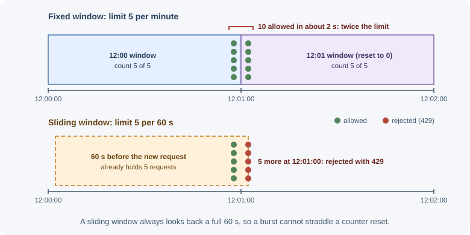
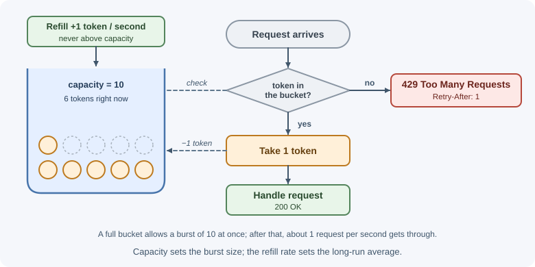
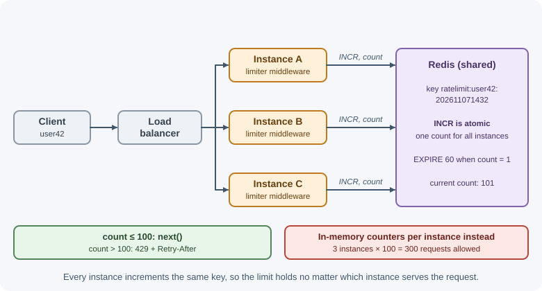

# Rate Limiting and Throttling

Rate limiting caps how many requests a client may make in a period of time,
such as 100 requests per minute per API key. Requests over the limit are
rejected, usually with `429 Too Many Requests`, until the client's allowance
recovers. Throttling is a close relative that slows or queues excess
requests instead of rejecting them outright.

## Why it matters

Without limits, a single client can consume all of your capacity:

- **Abuse and brute force:** attackers try thousands of passwords, coupon
  codes, or OTPs per minute; scrapers download your whole catalog.
- **Overload protection:** a buggy client stuck in a retry loop, or a
  traffic spike, can take the service down for everyone.
- **Fairness:** one heavy tenant should not degrade service for others.
- **Cost control:** each request may call paid APIs (SMS, AI models, maps).
- **Commercial plans:** free tiers get lower limits than paid tiers.

Rate limiting is a standard part of API security (see
[API security](../../09-security-and-testing/api-security.md)) and of
resilience in general.

## Real-world usage

- **GitHub's REST API** allows 5,000 requests per hour for authenticated
  users and 60 per hour for unauthenticated requests. Responses carry
  `x-ratelimit-remaining` and `x-ratelimit-reset`; over the limit, GitHub
  answers 403 or 429 and asks clients not to retry before the reset time
  ([GitHub Docs: REST API rate limits](https://docs.github.com/en/rest/using-the-rest-api/rate-limits-for-the-rest-api)).
- **Stripe** applies a global limit per account — 100 requests per second in
  live mode — plus lower limits on some endpoints, and returns `429 Too Many
  Requests` when they are exceeded
  ([Stripe: rate limits](https://docs.stripe.com/rate-limits)).
- **Amazon API Gateway** throttles requests with the token bucket algorithm,
  where a burst setting allows a short overrun of the steady rate
  ([AWS: API Gateway throttling](https://docs.aws.amazon.com/apigateway/latest/developerguide/api-gateway-request-throttling.html)).
- **Nginx** limits request rates with its `limit_req` module using the
  "leaky bucket" method
  ([nginx: ngx_http_limit_req_module](https://nginx.org/en/docs/http/ngx_http_limit_req_module.html)).

**Popular tools and providers:** `express-rate-limit` with
`rate-limit-redis`, Nginx `limit_req`, API gateways such as Amazon API
Gateway, Kong, and Envoy, and edge services such as Cloudflare rate limiting
rules.

## How it works

### Identifying the client

A limit needs a **key** — who is being counted:

| Key | Pros | Pitfalls |
|---|---|---|
| IP address | Works for anonymous traffic | Many users behind one NAT or corporate proxy share an IP; attackers rotate IPs; IPv6 gives each user huge ranges |
| User ID | Accurate per person | Only after authentication |
| API key / client ID | Natural for public APIs and plans | Keys can be shared or leaked |
| Combination | e.g. per account **and** per IP for sign-in | More state to track |

**Behind a proxy or load balancer**, the TCP connection comes from the proxy,
so every request appears to have the proxy's IP. The real client IP is in a
header such as `X-Forwarded-For`, but clients can forge that header. Only
trust it from proxies you control: in Express, configure `trust proxy` to the
exact number of proxy hops (or their addresses) rather than `true`. A wrong
setting either rate-limits everyone as one client or lets attackers spoof any
IP.

For IPv6, limit by a prefix (such as `/64`) rather than a single address,
since one user can easily control many addresses in their prefix.

### Algorithms

#### Fixed window

Count requests in fixed time buckets (for example, each calendar minute).
Reset the counter at the start of each window.

```text
limit = 5 per minute
12:00:00 ─────────────── 12:01:00 ─────────────── 12:02:00
  ✔ ✔ ✔ ✔ ✔ ✘ ✘            ✔ ✔ ...
            count resets ──┘
```

- Simple: one counter per key per window (Redis `INCR` + `EXPIRE`).
- **Boundary burst problem:** a client can send 5 requests at 12:00:59 and 5
  more at 12:01:00 — 10 requests in two seconds, double the intended rate.



#### Sliding window log

Store the timestamp of every request. On each request, discard timestamps
older than the window and count what remains.

```text
window = 60 s, limit = 5
now = 12:01:30 → keep timestamps after 12:00:30 → count them → allow if < 5
```

- Exact; no boundary burst.
- Memory grows with the limit (one entry per request per key); more
  expensive at high limits.

#### Sliding window counter

Approximate a sliding window using the current and previous fixed-window
counts, weighted by how far into the current window you are:

```text
estimate = current_count + previous_count × (1 − elapsed_fraction_of_current_window)

previous minute: 8 requests, current minute: 3 requests, 25% into the minute
estimate = 3 + 8 × 0.75 = 9
```

- Cheap (two counters) and smooths out boundary bursts.
- Slightly approximate; good enough for most APIs.

#### Token bucket

A bucket holds up to `capacity` tokens and refills at a steady rate. Each
request takes one token; if the bucket is empty, the request is rejected.



- Allows **bursts** up to the capacity, while enforcing an average rate.
- Very common in API gateways and cloud services.
- State per key: token count and last refill time.

#### Leaky bucket

Requests enter a queue (the bucket) and are processed ("leak out") at a
constant rate. If the queue is full, new requests are dropped.

```text
incoming (bursty) ──► [ queue, size N ] ──► processed at fixed rate ──►
                        full → reject
```

- Produces a **smooth, constant output rate** — useful when protecting a
  downstream system that cannot handle bursts.
- Adds latency (requests wait in the queue); this is throttling behavior.

#### Comparison

| Algorithm | Bursts | Accuracy | Memory | Typical use |
|---|---|---|---|---|
| Fixed window | Up to 2× at boundaries | Low at edges | Very low | Simple limits, low stakes |
| Sliding window log | No | Exact | High | Strict limits, low volume (e.g. sign-in) |
| Sliding window counter | Smoothed | Approximate | Low | General API limits |
| Token bucket | Yes, up to capacity | Good | Low | API gateways, public APIs |
| Leaky bucket | No (smoothed output) | Good | Queue size | Protecting fragile downstreams |

### Distributed rate limiting with Redis

With several app instances, an in-memory counter per instance is wrong: three
instances each allowing 100 requests per minute allow 300 in total, and the
count depends on which instance the load balancer picks. Keep the counters in
a shared store, usually [Redis](../../05-application-architecture/redis.md).



The operations must be **atomic**, or two instances can read the same count
and both allow a request. A fixed window needs `INCR` (atomic) followed by
setting an expiry when the key is new:

```text
INCR    ratelimit:user42:202611071432     → returns the new count
EXPIRE  ratelimit:user42:202611071432 60  → only when the count is 1
```

For token buckets and sliding windows, run the read-compute-write logic in a
**Lua script**, which Redis executes atomically.

Decide what happens if Redis is unavailable: **fail open** (allow requests,
risking overload) or **fail closed** (reject, risking an outage). Sign-in
limits often fail closed; general API limits often fail open with an alert.

### Responding to limited requests

- Status **`429 Too Many Requests`**.
- **`Retry-After`** header: seconds to wait (or an HTTP date) before
  retrying.
- Rate limit headers so clients can pace themselves. The IETF `RateLimit`
  header fields specification (a draft in progress) uses `RateLimit-Policy`
  and `RateLimit` fields describing the quota and what remains. Many APIs
  still use the older non-standard `X-RateLimit-Limit`,
  `X-RateLimit-Remaining`, and `X-RateLimit-Reset`.
- A clear error body: which limit was hit and when to retry.

```text
HTTP/1.1 429 Too Many Requests
Retry-After: 30
Content-Type: application/problem+json

{"type":"https://api.example.com/problems/rate-limited",
 "title":"Too many requests","status":429,
 "detail":"Limit of 100 requests per minute exceeded. Retry in 30 seconds."}
```

`503 Service Unavailable` with `Retry-After` is used when the **server as a
whole** is overloaded, not a specific client over its quota.

### Rate limiting, throttling, and quotas

| Term | Meaning | Example |
|---|---|---|
| Rate limiting | Reject requests above a rate | 100 requests/min, extra get 429 |
| Throttling | Slow down or queue excess requests | Add delay after 5 failed sign-ins; process jobs at 10/s |
| Quota | A total allowance over a long period, often tied to billing | 10,000 API calls per month on the free plan |
| Concurrency limit | Maximum simultaneous in-flight requests | At most 5 parallel exports per account |

The terms are often used loosely; be precise in API documentation.

### Where to enforce

```text
Client ─► CDN / WAF ─► API gateway / load balancer ─► reverse proxy ─► app
          (DDoS,        (per-key quotas,             (per-IP          (per-user,
           bot rules)    plan limits)                 limits)          per-action,
                                                                       business rules)
```

- **Edge (CDN, WAF):** absorbs volumetric attacks before they reach you.
- **API gateway:** per-API-key and per-plan limits; central configuration.
- **Reverse proxy** (for example, Nginx `limit_req`): cheap per-IP limits —
  see [Nginx](../../06-servers-and-infrastructure/nginx.md).
- **Application:** limits that need business context — per user, per
  account, per action (password attempts, SMS sends, exports).

Defense in depth: coarse limits at the edge, precise limits in the app.

### Client-side handling

Clients should treat `429` as a signal to slow down:

- Honor `Retry-After` when present.
- Otherwise retry with **exponential backoff and jitter**, with a maximum
  number of attempts (see
  [timeouts, retries, and idempotency](timeouts-retries-and-idempotency.md)).
- Pace requests proactively using the remaining-quota headers.
- Never retry instantly in a tight loop — that makes overload worse.

## When to use and when not to use

**Use rate limiting when:**

- An endpoint is open to the internet, especially sign-in, sign-up,
  password reset, OTP, and search.
- Requests cost money (SMS, email, AI calls) or are expensive (exports,
  reports).
- Tenants or API keys must get a fair share, or plans have different limits.

**Use something else when:**

- The problem is a sudden flood of traffic from many sources — that is a DDoS,
  absorbed at the network edge (CDN or WAF), not in the app.
- The service is slow for everyone because it is under-provisioned —
  limiting hides the problem; scale or cache instead.
- A downstream system needs a steady flow — queue the work and process it at
  a fixed rate (throttling) instead of rejecting requests.

| Problem | Tool | Response to the client |
|---|---|---|
| Brute force on sign-in | Per-account and per-IP limit | 429 with `Retry-After` |
| One API key overusing a shared API | Token bucket per key | 429 with quota headers |
| Free versus paid plan allowance | Monthly quota | 429 or 402, with plan details |
| Too many parallel exports per account | Concurrency limit | 429 or 409 until one finishes |
| Fragile downstream system | Queue with a fixed processing rate (throttle) | 202 Accepted, processed later |
| Whole service overloaded | Load shedding at the gateway | 503 with `Retry-After` |

## Practical examples

### express-rate-limit with a shared Redis store

```js
import express from "express";
import { rateLimit, ipKeyGenerator } from "express-rate-limit"; // v8
import { RedisStore } from "rate-limit-redis";
import { createClient } from "redis";

const redisClient = createClient({ url: process.env.REDIS_URL });
await redisClient.connect();

const app = express();

// Exactly one proxy (the load balancer) sits in front of the app
app.set("trust proxy", 1);

// General API limit: 100 requests per minute per client
const apiLimiter = rateLimit({
  windowMs: 60 * 1000,
  limit: 100,
  standardHeaders: "draft-8", // RateLimit-Policy and RateLimit headers
  legacyHeaders: false,       // no X-RateLimit-* headers
  store: new RedisStore({
    sendCommand: (...args) => redisClient.sendCommand(args),
  }),
});

// Strict limit for sign-in, keyed by email + IP
const signInLimiter = rateLimit({
  windowMs: 15 * 60 * 1000,
  limit: 5,
  standardHeaders: "draft-8",
  legacyHeaders: false,
  // ipKeyGenerator groups IPv6 addresses by subnet so one user cannot
  // rotate through addresses in their own range
  keyGenerator: (request) =>
    `${String(request.body?.email ?? "").toLowerCase()}|${ipKeyGenerator(request.ip)}`,
  store: new RedisStore({
    prefix: "signin:",
    sendCommand: (...args) => redisClient.sendCommand(args),
  }),
});

app.use("/api", apiLimiter);
app.post("/api/sign-in", express.json(), signInLimiter, signInHandler);
```

The default key is the client IP (with IPv6 grouped by subnet). Option names
and header formats have changed across major versions of
`express-rate-limit`, so check the documentation for the version you
install.

### A token bucket in plain JavaScript (single process)

```js
// Illustrates the algorithm; use a shared store for multiple instances
const buckets = new Map();

function allowRequest(key, capacity = 10, refillPerSecond = 1) {
  const now = Date.now();
  const bucket = buckets.get(key) ?? { tokens: capacity, updatedAt: now };

  // Add tokens for the time elapsed since the last request
  const elapsedSeconds = (now - bucket.updatedAt) / 1000;
  bucket.tokens = Math.min(capacity, bucket.tokens + elapsedSeconds * refillPerSecond);
  bucket.updatedAt = now;

  const allowed = bucket.tokens >= 1;
  if (allowed) bucket.tokens -= 1;

  buckets.set(key, bucket);
  return allowed;
}
```

## Best practices

- Choose keys deliberately: per user or API key when authenticated, per IP
  (or IPv6 prefix) otherwise, and combinations for sign-in.
- Configure `trust proxy` precisely so the client IP is correct and cannot be
  spoofed.
- Use a shared store for limits when running more than one instance, with
  atomic operations.
- Apply stricter limits to expensive or sensitive actions (sign-in, OTP,
  SMS, password reset, exports, AI calls).
- Return `429` with `Retry-After` and quota headers; document your limits.
- Layer limits: edge, gateway or proxy, and application.
- Monitor how often limits trigger; tune them from real traffic.
- Decide fail-open versus fail-closed behavior when the limiter's store is
  down.

## In production

- **Every user is throttled at once.** *Symptom:* 429s for everyone right
  after an infrastructure change, such as adding a load balancer. *Detect:*
  the limiter keys in logs all show the same IP — the proxy's;
  `express-rate-limit` also logs a validation error
  (`ERR_ERL_UNEXPECTED_X_FORWARDED_FOR`) when `X-Forwarded-For` arrives but
  `trust proxy` is off. *Cause:* `trust proxy` is unset or counts the wrong
  number of hops. *Fix:* set it to the exact number of proxies and check
  `request.ip` in a test request.
- **Clients exceed the documented limit several times over.** *Symptom:* a
  client with a limit of 100 per minute makes about 300. *Detect:* request
  counts per key summed across instances. *Cause:* each instance keeps its own
  in-memory counter. *Fix:* use a shared store such as Redis.
- **A Redis outage takes the API down.** *Symptom:* every request fails while
  Redis is unreachable. *Detect:* store connection errors from the limiter.
  *Cause:* the limiter blocks traffic when its store fails (the default in
  `express-rate-limit`). *Fix:* choose deliberately — set `passOnStoreError:
  true` to fail open for general limits, and keep failing closed for sign-in.
- **429s keep climbing after the spike ends.** *Symptom:* the rejected rate
  stays high even though real users have gone. *Detect:* the same clients
  retry within milliseconds of each 429. *Cause:* clients ignore
  `Retry-After` and retry without backoff. *Fix:* always send `Retry-After`,
  document it, and use backoff with jitter in your SDKs.
- **A whole office is locked out of sign-in.** *Symptom:* support tickets
  from many users at one company. *Detect:* many accounts share one IP that
  hits the per-IP limit. *Cause:* sign-in limited by IP only. *Fix:* key by
  account and IP together, and give per-IP limits more headroom.

## Important terminology

- **Rate limit:** the maximum number of requests allowed per time window.
- **Throttling:** slowing or queuing excess requests instead of rejecting.
- **Quota:** a total allowance over a longer billing period.
- **Window:** the time period over which requests are counted.
- **Token bucket:** a bucket of tokens refilled at a fixed rate; requests
  spend tokens.
- **Leaky bucket:** a queue drained at a constant rate.
- **Burst:** a short spike of requests above the average rate.
- **Fail open / fail closed:** allow or deny traffic when the limiter cannot
  decide.
- **`Retry-After`:** a response header telling the client when to retry.
- **`X-Forwarded-For`:** a header carrying the original client IP through
  proxies.

## Common mistakes and misconceptions

- **Per-instance in-memory limits** in a multi-instance deployment.
- **Trusting `X-Forwarded-For` from anyone**, letting attackers pick their IP.
- **Not configuring `trust proxy`**, so every client shares the proxy's IP
  and the whole site gets limited together.
- **Only limiting by IP** for sign-in, which lets distributed attacks through
  and blocks offices behind one NAT.
- **Returning `500` or `403`** instead of `429` for limited requests.
- **No `Retry-After`**, leaving clients to guess and retry aggressively.
- **Non-atomic read-then-write counters** in Redis, which miscount under
  concurrency.
- **"Rate limiting stops DDoS."** It helps, but volumetric attacks must be
  absorbed at the network edge.

## Revision questions

1. Why is the fixed window algorithm vulnerable to bursts at window
   boundaries?
2. How does a token bucket allow bursts while enforcing an average rate?
3. Why must distributed rate limiting use atomic operations in a shared
   store?
4. What can go wrong when an app behind a load balancer reads the client IP
   incorrectly?
5. Which headers should accompany a `429` response, and how should clients
   react?
6. Where in the request path would you enforce per-IP, per-API-key, and
   per-action limits?

## Further learning

- [MDN: 429 Too Many Requests](https://developer.mozilla.org/en-US/docs/Web/HTTP/Status/429)
- [MDN: Retry-After](https://developer.mozilla.org/en-US/docs/Web/HTTP/Headers/Retry-After)
- [RFC 6585: Additional HTTP Status Codes (429)](https://www.rfc-editor.org/rfc/rfc6585)
- [Express: Behind proxies (trust proxy)](https://expressjs.com/en/guide/behind-proxies.html)
- [OWASP API Security Top 10](https://api-security.owasp.org/)
- Related notes: [API security](../../09-security-and-testing/api-security.md),
  [Load balancing](../../06-servers-and-infrastructure/load-balancing.md)
