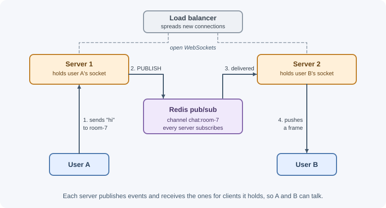

# Real-Time Communication: Polling, SSE, and WebSockets

Plain HTTP is request-response: the client asks, the server answers, and the
server cannot speak first. Real-time features — chat, live notifications,
dashboards, collaborative editing, order tracking — need the server to push
updates as they happen. There are four main techniques: short polling, long
polling, Server-Sent Events (SSE), and WebSockets. Each fits different needs.

## Why it matters

Choosing the wrong technique is expensive. Polling every second from 50,000
clients creates huge load for mostly empty responses. Using WebSockets for a
simple one-way notification feed adds connection management, scaling, and
proxy complexity you did not need. Understanding the trade-offs lets you pick
the simplest approach that meets the latency and direction requirements, and
plan for scaling stateful connections across multiple servers.

## Real-world usage

- **Slack Socket Mode.** Slack apps can receive Events API payloads and
  interactive events over a WebSocket instead of exposing a public HTTP
  Request URL — useful for apps behind a firewall
  ([Slack: Using Socket Mode](https://docs.slack.dev/apis/events-api/using-socket-mode)).
- **Streaming AI responses with SSE.** Anthropic's Messages API streams
  responses incrementally as server-sent events, so text appears as it is
  generated instead of after the whole answer is ready
  ([Anthropic: streaming messages](https://docs.anthropic.com/en/docs/build-with-claude/streaming)).
- **Mastodon's streaming API** offers the same real-time updates either as
  server-sent events over a long-lived HTTP connection or over a WebSocket,
  letting each client pick
  ([Mastodon: streaming API](https://docs.joinmastodon.org/methods/streaming/)).

**Popular tools and providers:** the `ws` library and Socket.IO for Node.js,
the browser `EventSource` API, Redis pub/sub for fan-out across instances,
and hosted services such as Ably, Pusher, and AWS API Gateway WebSocket APIs.

## How it works

### Short polling

The client asks for updates on a fixed interval.

```text
Client                    Server
  │── GET /notifications ──►│  nothing new
  │◄──────── 200 [] ────────│
  │      (wait 5 s)          │
  │── GET /notifications ──►│  nothing new
  │◄──────── 200 [] ────────│
  │      (wait 5 s)          │
  │── GET /notifications ──►│  one new item
  │◄──── 200 [{...}] ───────│
```

- Simple; works everywhere; stateless on the server; easy to cache and scale.
- Latency is up to the interval; most requests return nothing; load grows
  with clients × frequency.
- Fine for infrequent updates (every 30–60 seconds) or low client counts.
- Use conditional requests (`ETag`/`If-None-Match` → `304`) or a `since`
  cursor to keep responses small.

### Long polling

The client makes a request; the server **holds it open** until there is new
data or a timeout (for example, 30 seconds), then responds. The client
immediately sends the next request.

```text
Client                    Server
  │── GET /updates?since=41 ─►│  hold...
  │                           │  (event happens at 12 s)
  │◄──── 200 [{id: 42}] ──────│
  │── GET /updates?since=42 ─►│  hold... (no event for 30 s)
  │◄──────── 204 ─────────────│  timeout: empty response
  │── GET /updates?since=42 ─►│  hold...
```

- Near real-time with plain HTTP; works through almost any proxy.
- Each waiting client holds a connection; there is overhead per message (a
  full request/response); ordering and missed events need a cursor.
- Historically used as a fallback when WebSockets were not available.

### Server-Sent Events (SSE)

SSE is a standard for **one-way server-to-client streaming** over a normal
HTTP response that stays open. The server sends a response with
`Content-Type: text/event-stream` and writes events as text.

Event stream format — fields separated by newlines, events separated by a
blank line:

```text
retry: 5000

id: 42
event: order-status
data: {"orderId":"812","status":"shipped"}

id: 43
data: plain message on the default "message" event

: this line is a comment (often used as a keep-alive)
```

| Field | Meaning |
|---|---|
| `data:` | The event payload (multiple `data:` lines join with newlines) |
| `event:` | Event type; the browser dispatches it to listeners for that name |
| `id:` | Event ID; the browser remembers the last one |
| `retry:` | Reconnection delay in milliseconds |
| `:` | Comment, ignored by the client |

Browser side, the `EventSource` API:

```js
const source = new EventSource("/api/orders/812/events");
source.addEventListener("order-status", (event) => {
  const update = JSON.parse(event.data);
  console.log(update.status);
});
source.onerror = () => {
  // The browser reconnects automatically
};
```

Key properties:

- **Automatic reconnection:** if the connection drops, the browser reconnects
  and sends a `Last-Event-ID` header with the last ID it saw, so the server
  can resend missed events.
- **One direction only:** the client sends data through normal HTTP requests.
- Text only (send JSON as text); works with normal HTTP infrastructure,
  cookies, and authentication.
- Over HTTP/1.1, browsers limit connections per domain (about six), and each
  open `EventSource` uses one — which matters with many tabs. HTTP/2
  multiplexing removes most of this limit.
- `EventSource` cannot set custom headers such as `Authorization`; use
  cookies or a fetch-based SSE client if you need headers.

### WebSockets

A WebSocket is a **persistent, full-duplex** connection: both client and
server can send messages at any time over one TCP connection. It starts as an
HTTP request that asks to **upgrade** the protocol:

```text
GET /chat HTTP/1.1
Host: example.com
Upgrade: websocket
Connection: Upgrade
Sec-WebSocket-Key: dGhlIHNhbXBsZSBub25jZQ==
Sec-WebSocket-Version: 13
Origin: https://example.com

HTTP/1.1 101 Switching Protocols
Upgrade: websocket
Connection: Upgrade
Sec-WebSocket-Accept: s3pPLMBiTxaQ9kYGzzhZRbK+xOo=

(now both sides exchange WebSocket frames: text, binary, ping, pong, close)
```


- Low overhead per message after the handshake; true bidirectional,
  low-latency messaging.
- Supports text and binary data.
- Stateful: each server holds open connections, which affects scaling,
  deploys, and load balancing.
- No built-in reconnection, message acknowledgments, rooms, or replay — you
  build them or use a library.
- Use `wss://` (WebSocket over TLS) in production.

Protocol-level details — framing, the accept-key calculation, close codes —
are covered in [WebSockets](../../01-networking-and-protocols/web-sockets.md).

### The `ws` library and Socket.IO

- **`ws`:** a fast, minimal WebSocket implementation for Node.js. You get raw
  WebSocket connections and handle message formats, heartbeats, and
  reconnection yourself.
- **Socket.IO:** a higher-level library with its own protocol on top of
  WebSocket (with HTTP long-polling fallback). It adds automatic
  reconnection, acknowledgments (callbacks when a message is received),
  **rooms** and namespaces for broadcasting to groups, and adapters for
  scaling. A Socket.IO client cannot talk to a plain WebSocket server, and
  vice versa.

### Authentication for WebSockets

The browser `WebSocket` API cannot set custom headers like `Authorization`
on the handshake. Common approaches:

- **Cookies:** if the WebSocket endpoint is on the same site, the session
  cookie is sent with the upgrade request. Validate it during the handshake,
  and **check the `Origin` header**, because cross-site pages can also open
  WebSockets to your server with the user's cookies (cross-site WebSocket
  hijacking).
- **Short-lived ticket:** the client calls an authenticated HTTP endpoint to
  get a one-time token, then connects with it (for example, in the first
  message, or briefly in the query string — query strings may appear in
  logs, so keep the token single-use and short-lived).
- **First message auth:** accept the connection, require an authentication
  message within a few seconds, and close it otherwise.

Authorize **every message or subscription**, not just the connection: a user
allowed to connect is not necessarily allowed to join every room. Also
handle tokens or sessions that expire while a connection stays open.

### Heartbeats

Idle connections can be silently dropped by proxies, load balancers, NAT
devices, or mobile networks, and a server may not notice a vanished client
for a long time. **Heartbeats** detect this:

- The server sends a WebSocket **ping** frame periodically; the client
  replies with a **pong** automatically. If no pong arrives before the next
  check, terminate the connection.
- For SSE, send a comment line (`: ping`) every 15–30 seconds to keep proxies
  from closing idle streams.
- Set proxy timeouts (for example, Nginx `proxy_read_timeout`) longer than
  the heartbeat interval.

### Scaling real-time connections

With several server instances behind a load balancer, two problems appear:

1. **Connection affinity:** Socket.IO's long-polling fallback sends several
   HTTP requests that must reach the same server, requiring **sticky
   sessions**. Pure WebSocket and SSE connections are single long-lived
   connections, so affinity matters less, but reconnects may land elsewhere.
2. **Cross-instance delivery:** user A is connected to server 1, user B to
   server 2. A message for B must reach server 2. The standard solution is a
   **pub/sub backbone**: every instance publishes events to Redis (or another
   broker) and subscribes to receive events for its connected clients.



Socket.IO provides a Redis adapter for this. Also plan for:

- **Load balancer support** for upgrades and long-lived connections (see
  [load balancing](../../06-servers-and-infrastructure/load-balancing.md)).
- **Deploys:** restarting a server drops its connections; clients must
  reconnect with backoff and jitter so they do not all reconnect at once.
- **Connection limits:** file descriptors and memory per connection.

### Comparison


| | Short polling | Long polling | SSE | WebSockets |
|---|---|---|---|---|
| Direction | Client pulls | Client pulls (server delays reply) | Server → client | Both ways |
| Latency | Up to the interval | Low | Low | Lowest |
| Protocol | Plain HTTP | Plain HTTP | HTTP (`text/event-stream`) | Upgrade to WebSocket |
| Reconnection | N/A | Client loops | Built into `EventSource` | You implement it (or library) |
| Binary data | Yes (HTTP) | Yes | No (text) | Yes |
| Server state | Stateless | Held requests | Open connections | Open connections |
| Infrastructure | Anything | Anything | Most HTTP infra; disable proxy buffering | Needs upgrade support |
| Good for | Rare updates, simple needs | Fallback, moderate needs | Notifications, feeds, progress, AI token streaming | Chat, games, collaboration, live trading |

### How to choose

1. Updates are infrequent and seconds of delay are fine → **short polling**.
2. The server pushes, the client rarely sends → **SSE**.
3. Both sides send frequently with low latency → **WebSockets** (or
   Socket.IO if you want rooms, acknowledgments, and reconnection built in).
4. Very restrictive networks with no streaming support → **long polling**.

## When to use and when not to use

**Use real-time push when:**

- Users act on updates within seconds: chat, live dashboards, order
  tracking, collaborative editing, streaming AI output.
- Polling would mean many requests that mostly return nothing.

**Do not use it when:**

- Data changes rarely (every few minutes or less) — short polling or a
  refresh button is simpler and cheaper.
- The update can wait for the next page load or an email.
- You have no plan for scaling connections, reconnecting, and resuming after
  missed events.

| Need | Choose | Not |
|---|---|---|
| Hourly weather widget | Short polling | WebSockets |
| Deployment or export progress bar | SSE | WebSockets |
| Notification feed | SSE | Polling every second |
| Chat, multiplayer game, live cursors | WebSockets (or Socket.IO) | SSE plus many POSTs |
| Proxies that break streaming | Long polling | SSE |
| Streaming AI tokens to a browser | SSE | Long polling |

## Practical examples

### SSE endpoint in Express

```js
import { EventEmitter } from "node:events";

const orderEvents = new EventEmitter(); // in production: Redis pub/sub

app.get("/api/orders/:id/events", authenticate, (request, response) => {
  response.set({
    "Content-Type": "text/event-stream",
    "Cache-Control": "no-cache",
    Connection: "keep-alive",
    "X-Accel-Buffering": "no", // ask Nginx not to buffer the stream
  });
  response.flushHeaders();

  // Resend anything missed since the client's last event (if you store them)
  const lastEventId = request.get("last-event-id");
  // ...look up and write events after lastEventId...

  const send = (event) => {
    response.write(`id: ${event.id}\n`);
    response.write("event: order-status\n");
    response.write(`data: ${JSON.stringify(event.data)}\n\n`);
  };

  const listener = (event) => {
    if (event.data.orderId === request.params.id) send(event);
  };
  orderEvents.on("update", listener);

  // Keep-alive comment so proxies do not close an idle connection
  const heartbeat = setInterval(() => response.write(": ping\n\n"), 20000);

  // Clean up when the client disconnects
  request.on("close", () => {
    clearInterval(heartbeat);
    orderEvents.off("update", listener);
  });
});
```

### WebSocket server with `ws`, origin check, and heartbeats

```js
import { createServer } from "node:http";
import { WebSocketServer } from "ws";

const server = createServer(app); // share the port with Express
const wss = new WebSocketServer({ noServer: true });

server.on("upgrade", async (request, socket, head) => {
  // Reject cross-site connections and unauthenticated users
  if (request.headers.origin !== "https://app.example.com") {
    socket.write("HTTP/1.1 403 Forbidden\r\n\r\n");
    return socket.destroy();
  }
  const user = await userFromSessionCookie(request.headers.cookie);
  if (!user) {
    socket.write("HTTP/1.1 401 Unauthorized\r\n\r\n");
    return socket.destroy();
  }
  wss.handleUpgrade(request, socket, head, (ws) => {
    wss.emit("connection", ws, request, user);
  });
});

wss.on("connection", (ws, request, user) => {
  ws.isAlive = true;
  ws.on("pong", () => { ws.isAlive = true; });

  ws.on("message", (raw) => {
    let message;
    try {
      message = JSON.parse(raw.toString());
    } catch {
      return ws.close(1008, "Invalid message"); // 1008 = policy violation
    }
    // Validate and authorize each message before acting on it
    handleMessage(user, message, ws);
  });
});

// Heartbeat: terminate connections that did not answer the last ping
const interval = setInterval(() => {
  for (const ws of wss.clients) {
    if (!ws.isAlive) {
      ws.terminate();
      continue;
    }
    ws.isAlive = false;
    ws.ping();
  }
}, 30000);

wss.on("close", () => clearInterval(interval));
server.listen(3000);
```

### Socket.IO with rooms and the Redis adapter (sketch)

```js
import { Server } from "socket.io";
import { createAdapter } from "@socket.io/redis-adapter";
import { createClient } from "redis";

const pubClient = createClient({ url: process.env.REDIS_URL });
const subClient = pubClient.duplicate();
await Promise.all([pubClient.connect(), subClient.connect()]);

const io = new Server(server, { cors: { origin: "https://app.example.com" } });
io.adapter(createAdapter(pubClient, subClient)); // broadcast across instances

io.on("connection", (socket) => {
  socket.on("join-room", (roomId, ack) => {
    // Authorize before joining
    socket.join(roomId);
    ack({ ok: true });
  });
  socket.on("chat-message", ({ roomId, text }) => {
    io.to(roomId).emit("chat-message", { text, from: socket.id });
  });
});
```

## Best practices

- Choose the simplest technique that meets direction and latency needs.
- Authenticate during the handshake, check `Origin`, and authorize every
  message or subscription.
- Use heartbeats; tune proxy timeouts to exceed them.
- Make clients reconnect with exponential backoff and jitter; resume from a
  cursor or `Last-Event-ID`.
- Use a pub/sub backbone (such as Redis) when running multiple instances.
- Validate and size-limit every incoming message.
- Disable response buffering for SSE at proxies.
- Use `wss://` and HTTPS in production.
- Clean up listeners and timers when connections close to avoid leaks.

## In production

- **SSE events arrive in bursts or only at the end.** *Symptom:* progress
  jumps from 0% to 100%. *Detect:* events reach the client together, much
  later than the server wrote them. *Cause:* a proxy (often Nginx) buffers the
  response, or compression middleware holds data back. *Fix:* send
  `X-Accel-Buffering: no` or turn off `proxy_buffering` for that location,
  and exclude `text/event-stream` from compression.
- **Connections drop every 60 seconds.** *Symptom:* clients reconnect once a
  minute while idle. *Detect:* close events at a regular interval in server
  logs. *Cause:* a proxy or load balancer idle timeout (Nginx's
  `proxy_read_timeout` defaults to 60 seconds) is shorter than the time
  between messages. *Fix:* send heartbeats more often than the timeout, and
  raise the proxy timeout for streaming routes.
- **Memory grows until the process restarts.** *Symptom:* heap usage climbs
  with the number of connections ever opened. *Detect:* heap snapshots show
  retained listeners or sockets; `MaxListenersExceededWarning` in logs.
  *Cause:* listeners and timers are not removed when clients disconnect, or
  dead connections are never detected. *Fix:* clean up on `close`, and
  terminate connections that miss a heartbeat.
- **Messages reach only some users.** *Symptom:* a chat message is seen by
  users on one server but not another. *Detect:* the recipients that missed it
  are connected to a different instance. *Cause:* broadcasting only to local
  connections. *Fix:* add a pub/sub backbone such as the Socket.IO Redis
  adapter or Redis channels.
- **A deploy causes a thundering herd.** *Symptom:* CPU and authentication
  load spike right after each release. *Detect:* thousands of reconnects in
  the same second. *Cause:* every client reconnects immediately when its
  server restarts. *Fix:* reconnect with exponential backoff and jitter, and
  drain connections gradually during deploys.

## Important terminology

- **Short polling:** repeated requests on a fixed interval.
- **Long polling:** a request held open until data is available or a timeout.
- **Server-Sent Events (SSE):** one-way event streaming over HTTP using
  `text/event-stream`.
- **`EventSource`:** the browser API for consuming SSE.
- **`Last-Event-ID`:** header sent on SSE reconnection with the last event ID
  received.
- **WebSocket:** a full-duplex protocol established through an HTTP upgrade.
- **`101 Switching Protocols`:** the response that completes a WebSocket
  upgrade.
- **Frame:** a unit of WebSocket data (text, binary, ping, pong, close).
- **Heartbeat:** periodic ping/pong or keep-alive messages to detect dead
  connections.
- **Sticky session:** routing a client's requests to the same server.
- **Pub/sub:** a messaging pattern where publishers send to channels and
  subscribers receive from them.
- **Room:** a Socket.IO grouping for broadcasting to a subset of clients.

## Common mistakes and misconceptions

- **Using WebSockets for one-way notifications** where SSE would be simpler.
- **Polling too frequently**, multiplying load for empty responses.
- **No `Origin` check on WebSocket handshakes**, enabling cross-site
  WebSocket hijacking with cookies.
- **Authenticating only at connect time** and never authorizing messages or
  rechecking expired sessions.
- **No heartbeats**, leaving dead connections and leaking memory.
- **Broadcasting only within one instance** in a multi-instance deployment.
- **Assuming Socket.IO is plain WebSocket.** Its clients and servers only
  talk to each other.
- **Forgetting proxy buffering and timeouts**, which break SSE streams.

## Revision questions

1. Compare short polling and long polling in latency and server load.
2. Describe the SSE event format and how `Last-Event-ID` helps after a
   reconnect.
3. Walk through the WebSocket upgrade handshake. Which status code completes
   it?
4. Why can't browsers send an `Authorization` header with a WebSocket, and
   what alternatives exist?
5. How do you deliver a message to a user connected to a different server
   instance?
6. Which technique would you choose for a chat app, a deployment progress
   bar, and a weather widget updated hourly? Why?

## Further learning

- [MDN: Using server-sent events](https://developer.mozilla.org/en-US/docs/Web/API/Server-sent_events/Using_server-sent_events)
- [MDN: EventSource](https://developer.mozilla.org/en-US/docs/Web/API/EventSource)
- [MDN: The WebSocket API](https://developer.mozilla.org/en-US/docs/Web/API/WebSockets_API)
- [RFC 6455: The WebSocket Protocol](https://www.rfc-editor.org/rfc/rfc6455)
- [HTML Standard: Server-sent events](https://html.spec.whatwg.org/multipage/server-sent-events.html)
- [ws library](https://github.com/websockets/ws)
- [Socket.IO documentation](https://socket.io/docs/v4/)
- Related notes: [WebSockets](../../01-networking-and-protocols/web-sockets.md),
  [Redis](../../05-application-architecture/redis.md)
