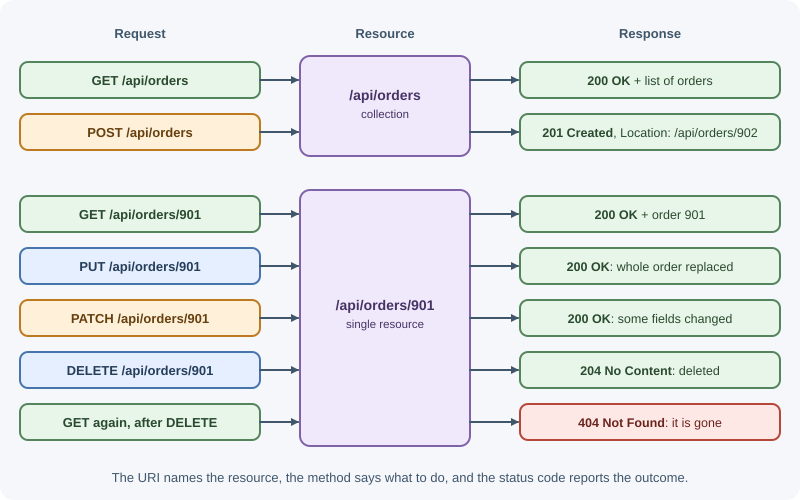
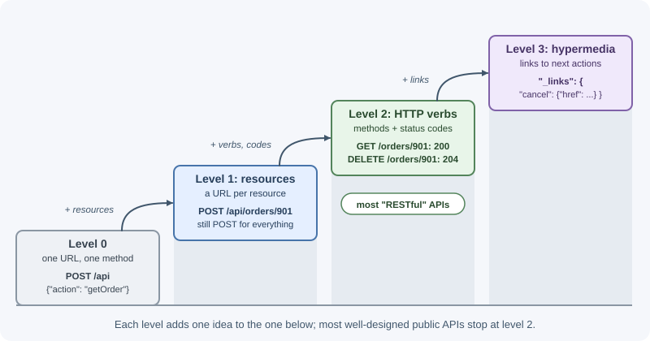

# REST APIs

An API (Application Programming Interface) defines how software systems talk
to each other. REST (Representational State Transfer) is an architectural
style for networked applications, described by Roy Fielding in 2000. In
everyday web development, a "REST API" means an HTTP API where URLs identify
resources and standard HTTP methods read or change them.

## Why it matters

- REST is the most common style for web and mobile backends, and for public
  APIs from payment, messaging, and cloud providers.
- It reuses what HTTP already provides (methods, status codes, caching,
  content negotiation), so clients, proxies, and tools understand it without
  custom software.
- A consistent REST design means a developer who has learned one endpoint
  can guess how the rest work.
- REST's constraints, especially statelessness, are what let an API scale
  horizontally behind a load balancer.

## Real-world usage

- **Stripe.** The [Stripe API reference](https://docs.stripe.com/api) opens
  with: "The Stripe API is organized around REST. Our API has predictable
  resource-oriented URLs, accepts form-encoded request bodies, returns
  JSON-encoded responses, and uses standard HTTP response codes,
  authentication, and verbs." Note that request bodies are form-encoded,
  not JSON: REST does not require JSON.
- **GitHub.** GitHub's REST API uses resource URLs such as
  `/repos/{owner}/{repo}`, standard methods, `Link` headers for
  [pagination](https://docs.github.com/en/rest/using-the-rest-api/using-pagination-in-the-rest-api),
  and `ETag`-based
  [conditional requests](https://docs.github.com/en/rest/using-the-rest-api/best-practices-for-using-the-rest-api),
  which reuse HTTP features exactly as REST intends.
- **Shopify moved from REST to GraphQL for its Admin API.** Shopify states
  that the
  [REST Admin API is a legacy API as of October 1, 2024](https://shopify.dev/docs/api/admin-rest),
  and that from April 1, 2025, new public apps must be built exclusively
  with the GraphQL Admin API. REST is common, but not the only choice for
  large platforms.
- **Slack's Web API is deliberately not REST.** Slack describes its Web API
  as
  [a collection of HTTP RPC-style methods](https://api.slack.com/web) with
  URLs like `https://slack.com/api/METHOD_FAMILY.method`, and says it is not
  a REST API. It is a useful contrast to resource-oriented design.

## How it works

### The six REST constraints

Fielding defined REST as a set of constraints. An API is RESTful to the
degree that it follows them.

| Constraint | What it means | What it buys you |
|---|---|---|
| Client-server | The user interface and the data storage are separate concerns | Frontend and backend evolve independently; many clients share one API |
| Stateless | Each request contains everything needed to understand it; the server keeps no session context between requests | Any server can handle any request; easy horizontal scaling and retries |
| Cacheable | Responses say whether they can be cached | Fewer requests, lower latency, less server load |
| Uniform interface | Resources are identified by URIs and manipulated through representations using a standard set of methods; messages are self-descriptive | Generic clients, proxies, and tools work with every API |
| Layered system | A client cannot tell whether it talks to the server directly or through proxies, gateways, and caches | Load balancers, CDNs, and API gateways can be added transparently |
| Code on demand (optional) | Servers may send executable code, such as JavaScript, to extend the client | Rarely used in APIs; the only optional constraint |

The **uniform interface** is the heart of REST. It has four parts:

1. **Identification of resources:** every resource has a URI.
2. **Manipulation through representations:** clients change a resource by
   sending a representation of it (for example a JSON document), not by
   calling remote functions.
3. **Self-descriptive messages:** each message carries enough metadata
   (method, `Content-Type`, cache headers, status code) to be understood on
   its own.
4. **Hypermedia as the engine of application state (HATEOAS):** responses
   contain links that tell the client what it can do next.

### Resources and URIs

A **resource** is any concept the API exposes: a user, an order, a search
result, the current weather. A **URI** names it. A **representation** is a
particular format of its current state, usually JSON.

Naming rules most teams follow:

- **Use nouns, not verbs.** The method is the verb.
  `GET /api/orders`, not `GET /api/getOrders`.
- **Use plural collection names.** `/api/orders` for the collection,
  `/api/orders/901` for one item.
- **Nest only for real ownership, and only one level deep.**
  `/api/orders/901/items` is clear; `/api/customers/7/orders/901/items/3/notes`
  is fragile. Once an item has its own ID, give it a top-level path too.
- **Use lowercase and hyphens** in paths: `/api/shipping-addresses`.
- **Keep filters, sorting, and paging in the query string:**
  `/api/orders?status=paid&sort=-createdAt&limit=20`.
- **Model actions as sub-resources when they do not fit CRUD:**
  `POST /api/orders/901/cancellation` or `POST /api/orders/901/cancel`.

```text
/api/orders                      collection
/api/orders/901                  single resource
/api/orders/901/items            sub-collection owned by order 901
/api/orders?status=paid&page=2   filtered view of the collection
```

### Methods mapping

| Method | On a collection (`/orders`) | On an item (`/orders/901`) |
|---|---|---|
| `GET` | List orders | Read order 901 |
| `POST` | Create a new order | Usually not used (or an action) |
| `PUT` | Rarely: replace the whole collection | Replace order 901 entirely (or create it at this URI) |
| `PATCH` | Rarely: bulk partial update | Update some fields of order 901 |
| `DELETE` | Rarely: delete the whole collection | Delete order 901 |



See [HTTP methods](http-methods.md) for safety and idempotency.

### Representations

The same resource can have several representations. JSON is the common
choice for APIs, but the client can ask for another format with `Accept`,
and the server labels its choice with `Content-Type`. See
[content negotiation](http-headers.md).

```json
{
  "id": "ord_901",
  "status": "paid",
  "total": { "amount": 4999, "currency": "USD" },
  "createdAt": "2026-11-03T10:15:00Z",
  "customerId": "cus_7"
}
```

A representation is not the database row. Expose what clients need, hide
internal columns, and keep the shape stable even if storage changes.

### Status codes

REST APIs communicate outcomes with HTTP status codes: `200` for reads,
`201` with `Location` for creation, `204` for deletion, `400`/`422` for
invalid input, `401`/`403` for auth problems, `404` for missing resources,
`409` for conflicts. See [HTTP status codes](http-status-codes.md).

### HATEOAS

With hypermedia, a response tells the client which actions are available,
the way links and forms do on a web page:

```json
{
  "id": "ord_901",
  "status": "paid",
  "_links": {
    "self": { "href": "/api/orders/901" },
    "items": { "href": "/api/orders/901/items" },
    "cancel": { "href": "/api/orders/901/cancellation", "method": "POST" },
    "customer": { "href": "/api/customers/7" }
  }
}
```

If the order has shipped, the server simply leaves out the `cancel` link, and
a hypermedia-aware client hides the button. Clients follow links instead of
building URLs, so the server can change URLs without breaking them.

In practice, few APIs implement full HATEOAS; most document their URLs and
expect clients to build them. Including at least `self` links and pagination
links (`next`, `prev`) is common and useful.

### The Richardson Maturity Model

Leonard Richardson described levels of "REST-ness" for HTTP APIs:

| Level | Description | Example |
|---|---|---|
| 0: The swamp of POX | One URL, one method; everything is a remote procedure call tunneled over HTTP | `POST /api` with `{"action": "getOrder", "id": 901}` |
| 1: Resources | Separate URLs for resources, but still one method | `POST /api/orders/901` for everything |
| 2: HTTP verbs | Resources plus proper methods and status codes | `GET /api/orders/901` returns `200`; `DELETE` returns `204` |
| 3: Hypermedia controls | Level 2 plus HATEOAS links | Responses include `_links` to next actions |



Most well-designed public APIs sit at level 2, which is what people usually
mean by "RESTful".

### Statelessness in practice

Stateless means the server does not remember anything about the client
**between** requests. Every request must carry what the server needs:

- **Authentication** in every request: a token in `Authorization`, or a
  session cookie the browser sends automatically.
- **Context** in the URL or body: the page number, filters, the ID being
  edited.

Stateless does **not** mean the application has no state. Orders and users
live in a database; that is resource state, and it is fine. What REST
forbids is *session* state held in one server's memory that the next request
depends on (for example "the server remembers you were on page 3"). A server
session stored in Redis and looked up by a cookie on every request is a
common, pragmatic compromise.

The payoff: any instance can serve any request, crashed instances lose
nothing, and failed requests can be retried on another server.

## When to use and when not to use

Use **REST** when:

- The API is public or used by many third parties with different tools;
  every language has an HTTP client.
- The domain maps naturally to resources (orders, users, invoices) with
  create, read, update, and delete operations.
- You want HTTP caching, CDNs, and standard tooling (curl, OpenAPI,
  gateways) to work without extra effort.

Consider **something else** when:

- Many clients need very different slices of a rich, nested data graph, and
  over-fetching or many round trips hurt: GraphQL may fit better.
- Internal services need low-latency, high-throughput, or streaming calls
  with strict contracts: gRPC may fit better.
- The API is a set of commands rather than resources (a chat or tooling
  protocol): an RPC style can be more honest than forcing actions into
  resources.

| Need | REST | GraphQL | gRPC | RPC (JSON-RPC, tRPC) |
|---|---|---|---|---|
| Public API for unknown clients | Best | Good | Poor (browser limits, tooling) | Fair |
| HTTP caching and CDNs | Best | Hard | No | No |
| Clients choose exactly the fields | Limited (`fields`, `include`) | Best | No | No |
| Internal high-throughput calls | Good | Fair | Best | Good |
| Streaming | Via SSE or WebSockets | Subscriptions | Built in | Depends on transport |

See [API styles](api-styles-graphql-grpc-and-rpc.md) for the details.

## Practical examples

### A complete resource: articles

| Method and path | Purpose | Request body | Success response |
|---|---|---|---|
| `GET /api/articles?author=7&limit=20&cursor=abc` | List, filtered and paginated | none | `200` + list and paging info |
| `GET /api/articles/42` | Read one | none | `200` + article |
| `POST /api/articles` | Create | `{"title": "...", "body": "..."}` | `201` + `Location` + article |
| `PUT /api/articles/42` | Replace | Full article | `200` + article |
| `PATCH /api/articles/42` | Update some fields | `{"title": "New title"}` | `200` + article |
| `DELETE /api/articles/42` | Delete | none | `204` |
| `GET /api/articles/42/comments` | List an article's comments | none | `200` + list |
| `POST /api/articles/42/publication` | Action: publish | none | `200` + article |

Create:

```text
POST /api/articles HTTP/1.1
Host: api.blog.example
Content-Type: application/json
Authorization: Bearer eyJhbGci...

{"title":"Understanding REST","body":"REST is an architectural style..."}
```

```text
HTTP/1.1 201 Created
Location: /api/articles/42
Content-Type: application/json

{"id":42,"title":"Understanding REST","body":"REST is an architectural style...",
 "status":"draft","authorId":7,"createdAt":"2026-11-03T10:15:00Z"}
```

List:

```text
GET /api/articles?author=7&limit=2 HTTP/1.1
Accept: application/json
```

```text
HTTP/1.1 200 OK
Content-Type: application/json
Cache-Control: private, no-cache

{
  "data": [
    {"id": 42, "title": "Understanding REST", "status": "draft"},
    {"id": 41, "title": "HTTP basics", "status": "published"}
  ],
  "nextCursor": "eyJpZCI6NDF9"
}
```

Validation error:

```text
HTTP/1.1 422 Unprocessable Content
Content-Type: application/problem+json

{"type":"https://api.blog.example/problems/validation","title":"Validation failed",
 "status":422,"errors":[{"field":"title","message":"must not be empty"}]}
```

### Implementing it in Express

This is a sketch of the routing layer. An in-memory `articleService` stands
in for the real service, and the handlers not shown answer `501` until you
write them.

```js
import express from "express";

// Stand-in for a service layer backed by a database
const articles = new Map([["42", { id: "42", title: "Understanding REST", status: "draft" }]]);
const articleService = {
  list: async () => [...articles.values()],
  findById: async (id) => articles.get(id) ?? null,
};

// Handlers (controllers) call services that hold the business rules
async function listArticles(req, res) {
  res.json({ data: await articleService.list() });
}

async function getArticle(req, res) {
  const article = await articleService.findById(req.params.id);
  if (!article) return res.status(404).json({ title: "Article not found" });
  res.json(article);
}

// Placeholder for createArticle, updateArticle, deleteArticle, publishArticle
const notWrittenYet = (req, res) => res.sendStatus(501);

const router = express.Router();
router.get("/", listArticles);
router.post("/", notWrittenYet);
router.get("/:id", getArticle);
router.patch("/:id", notWrittenYet);
router.delete("/:id", notWrittenYet);
router.post("/:id/publication", notWrittenYet);

const app = express();
app.use(express.json());
app.use("/api/articles", router);
app.listen(3000);
```

`GET /api/articles/42` returns the article, `GET /api/articles/7` returns
`404`, and the unwritten handlers return `501 Not Implemented`.

See [routing and routers](../express/routing-and-routers.md) and
[project structure](../express/project-structure.md) for how to organize
this, and [authentication and authorization](authentication-and-authorization.md)
for protecting it.

## Best practices

- **Design resources around the client's needs**, not your table layout.
- **Be consistent** in naming, casing, pagination, and error format across
  every endpoint. See [API design best practices](api-design-best-practices.md).
- **Use methods and status codes by their HTTP meaning.**
- **Keep the server stateless**; store shared state in a database or cache.
- **Return the created or updated resource** so clients avoid an extra
  request.
- **Paginate every collection** from day one.
- **Version deliberately** and never break existing clients silently.
- **Document the API** with OpenAPI so clients and tests share one contract.

## In production

- **Mobile app crashes right after a backend deploy.**
  *Detect:* the client crash reporter spikes with JSON parsing or "missing
  field" errors that match the deploy time. *Cause:* a renamed or removed
  response field, a breaking change. *Fix:* make only additive changes,
  version breaking ones, and run contract tests against the old clients'
  expectations.
- **Users can read other users' records.**
  *Detect:* access logs show one account fetching many sequential IDs
  (`/api/orders/1001`, `/1002`, ...), or a security review finds it.
  *Cause:* the handler checks that the user is logged in but not that the
  resource belongs to them (an insecure direct object reference). *Fix:*
  check ownership on every request, ideally in the query
  (`WHERE id = $1 AND customer_id = $2`).
- **Screens are slow because of many requests.**
  *Detect:* traces show one page view making ten or more sequential API
  calls. *Cause:* resources shaped like tables instead of client needs.
  *Fix:* add `include`/`expand` options or a backend-for-frontend endpoint;
  run independent calls in parallel.
- **A list endpoint times out as data grows.**
  *Detect:* latency and response size of `GET /collection` grow week over
  week; slow-query logs show full scans. *Cause:* no pagination, or no index
  on the sort column. *Fix:* paginate with a capped `limit` and index the
  sort and filter columns.
- **Requests fail on some instances only.**
  *Detect:* errors correlate with the instance ID in logs. *Cause:*
  per-instance state (in-memory sessions, local uploaded files) that breaks
  statelessness. *Fix:* move shared state to a database, cache, or object
  storage.

## Important terminology

- **API:** a contract that defines how programs interact.
- **REST:** an architectural style defined by constraints such as
  statelessness and a uniform interface.
- **Resource:** any named concept the API exposes.
- **URI:** the identifier of a resource.
- **Representation:** a specific format of a resource's state, such as JSON.
- **Endpoint:** a method plus a path, such as `GET /api/articles/:id`.
- **Collection:** a resource that contains other resources.
- **HATEOAS:** responses include links describing available next actions.
- **Stateless:** the server keeps no client session context between
  requests.
- **Idempotent:** repeating a request leaves the same server state.

## Common mistakes and misconceptions

- **"REST means JSON."** REST is an architectural style; JSON is just one
  representation format.
- **"REST means CRUD over HTTP."** CRUD maps neatly to REST, but REST is
  about resources, representations, and constraints, not only database
  operations.
- **Verbs in URLs** (`/createUser`, `/getOrders`) duplicate what methods
  already say.
- **Returning `200` for every outcome** and putting the real result in the
  body.
- **Deep nesting** that forces clients to know a whole ownership chain to
  reach an item.
- **Exposing database internals**, such as column names and auto-increment
  IDs, as the public contract.
- **Calling an API RESTful because it uses HTTP.** Level 0 APIs use HTTP but
  are RPC.

## Revision questions

1. Name the six REST constraints and say which one is optional.
2. What does "stateless" forbid, and what does it still allow?
3. Design the endpoints for a "comments on a post" resource, with methods,
   paths, and success codes.
4. What is HATEOAS, and why do most APIs only partially implement it?
5. At which Richardson level is an API that uses proper URLs and methods but
   no links?
6. How would you model the action "cancel an order" in a REST API?

## Further learning

- **Primary source:** [Roy Fielding, Architectural Styles and the Design of
  Network-based Software Architectures, Chapter 5](https://ics.uci.edu/~fielding/pubs/dissertation/rest_arch_style.htm)
  defines REST and its constraints.
- **MDN:** [REST](https://developer.mozilla.org/en-US/docs/Glossary/REST)
  gives a concise overview.
- **RFC 9110:** [HTTP Semantics](https://www.rfc-editor.org/rfc/rfc9110)
  defines the methods, status codes, and headers REST APIs rely on.
- **OWASP:** [REST Security Cheat Sheet](https://cheatsheetseries.owasp.org/cheatsheets/REST_Security_Cheat_Sheet.html).
- **Next:** [API design best practices](api-design-best-practices.md).
