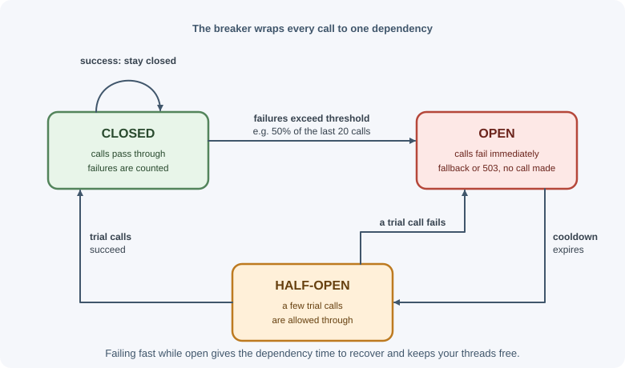

# Timeouts, Retries, and Idempotency

Every call a backend makes to another system — a database, a payment
provider, another microservice — can be slow, fail, or fail halfway.
Timeouts bound how long you wait, retries give transient failures a second
chance, and idempotency makes it safe to repeat an operation without doing it
twice. These three ideas, plus circuit breakers and bulkheads, are the core
toolkit for building reliable distributed systems.

## Why it matters

Consider a checkout request that calls a payment API. The call times out.
Did the card get charged? You do not know: the request may have been lost on
the way, or the charge succeeded and the response was lost on the way back.

- If you **do not retry**, a temporary network glitch fails a customer's
  order.
- If you **retry blindly**, you may charge the customer twice.
- If you **never time out**, one slow dependency ties up your server's
  connections and threads until the whole service stops responding.

Getting this right is the difference between a system that rides out
everyday failures and one where every small outage cascades.

## Real-world usage

- **Stripe's `Idempotency-Key` header.** Clients send a unique key (Stripe
  suggests V4 UUIDs, up to 255 characters) so retries of a request are
  recognized. Stripe compares the parameters of a repeated request with the
  original and returns an error if they differ, and may prune keys once they
  are at least 24 hours old
  ([Stripe API: idempotent requests](https://docs.stripe.com/api/idempotent_requests)).
- **The IETF Idempotency-Key draft** standardizes the header: a retry that
  arrives while the original is still processing should get `409`, and
  reusing a key with a different payload should get `422`
  ([IETF draft: The Idempotency-Key HTTP header field](https://datatracker.ietf.org/doc/draft-ietf-httpapi-idempotency-key-header/)).
- **AWS SDKs.** In standard retry mode the SDKs retry with exponential
  backoff and jitter and keep a "retry quota" — a token bucket that stops
  retries when too many requests are failing, which is a retry budget
  ([AWS SDKs and Tools: retry behavior](https://docs.aws.amazon.com/sdkref/latest/guide/feature-retry-behavior.html)).
  Amazon explains the reasoning in
  [Timeouts, retries, and backoff with jitter](https://aws.amazon.com/builders-library/timeouts-retries-and-backoff-with-jitter/).
- **Circuit breakers at Netflix.** Netflix's Hystrix library was built to
  isolate calls to remote systems and stop cascading failures. It is now in
  maintenance mode, and Netflix says it uses projects such as resilience4j
  for new internal work
  ([Netflix Hystrix on GitHub](https://github.com/Netflix/Hystrix)).

**Popular tools:** resilience4j (Java), Polly (.NET), `opossum` and
`cockatiel` (Node.js circuit breakers and retry policies), and service meshes
such as Envoy and Istio, which add retries, timeouts, and outlier detection
outside the application code.

## How it works

### Why calls between services fail

- Network problems: packet loss, connection resets, DNS failures.
- The remote service is overloaded, restarting, or being deployed.
- Rate limits (`429`).
- Slow queries or garbage collection pauses causing timeouts.
- Bugs and bad data causing errors.

A remote call has **three** possible outcomes, not two: success, failure,
and **unknown** (timeout or lost response). Reliable designs handle the
unknown case explicitly.

### Timeouts

A timeout is the maximum time you are willing to wait. Without one, a
request can hang indefinitely while holding resources (a socket, memory, a
database connection, a user waiting).

| Timeout type | What it bounds |
|---|---|
| Connect timeout | Establishing the TCP (and TLS) connection |
| Read / response timeout | Waiting for data after the request is sent |
| Idle timeout | Time with no activity on an open connection |
| Total (deadline) timeout | The whole operation, including retries |

Guidelines:

- **Always set timeouts** on outbound HTTP calls, database queries, and
  queue operations. Many clients default to no timeout or a very long one.
- Base values on the dependency's normal latency (for example, a little
  above its p99), not on a guess like 30 seconds.
- **Propagate deadlines:** if the incoming request must finish within 2
  seconds, downstream calls should not each be allowed 5 seconds. Pass the
  remaining time budget along.
- A timeout means "outcome unknown," not "operation failed." The remote side
  may still complete the work.

In Node.js, the built-in `fetch` supports cancellation through an
`AbortSignal`; `AbortSignal.timeout(ms)` creates one that aborts
automatically.

### Which failures to retry

| Retry | Do not retry |
|---|---|
| Network errors (connection reset, refused, DNS temporary failure) | `400 Bad Request`, `422` — the request is wrong |
| Timeouts (if the operation is idempotent) | `401`, `403` — credentials or permissions will not change |
| `502 Bad Gateway`, `503 Service Unavailable`, `504 Gateway Timeout` | `404 Not Found`, `409 Conflict` (usually) |
| `429 Too Many Requests` — after the `Retry-After` delay | `501 Not Implemented` |
| Database deadlocks and serialization failures | Errors caused by bugs in your own code |

`500` is ambiguous: retry at most once or twice, because it often indicates a
bug that will repeat.

**Only retry operations that are safe to repeat** — idempotent ones, or ones
protected by an idempotency key (see below).

### Exponential backoff with jitter

Retrying immediately, at fixed intervals, hammers a struggling service at
exactly the moment it needs relief. **Exponential backoff** increases the
delay after each attempt:

```text
delay = min(maxDelay, baseDelay × 2^attempt)

base = 100 ms → 100, 200, 400, 800, 1600 ms ... capped at maxDelay
```

If thousands of clients failed at the same moment, they would all retry at
the same moments too, creating synchronized waves. **Jitter** adds
randomness to spread them out. A common choice is "full jitter":

```text
delay = random(0, min(maxDelay, baseDelay × 2^attempt))
```

Also limit the **number of attempts** (for example, 3–5) and the **total
time**.


### Retry storms and retry budgets

Retries multiply load. If each of three layers retries 3 times, one failing
request at the bottom can become 3 × 3 × 3 = 27 attempts. During an outage,
retries can keep a recovering service down.

Defenses:

- Retry at **one layer** only (usually closest to the failure, or at the
  edge), not at every layer.
- Use a **retry budget**: allow retries only while they are a small fraction
  (for example, 10%) of total requests.
- Combine retries with a **circuit breaker** that stops calling a dependency
  that is clearly down.
- Honor `Retry-After` from the server.

### Idempotency

An operation is **idempotent** if doing it once or many times has the same
effect on the server's state.

| Method | Safe (no state change) | Idempotent |
|---|---|---|
| `GET`, `HEAD`, `OPTIONS` | Yes | Yes |
| `PUT` (replace resource with this) | No | Yes |
| `DELETE` | No | Yes (second delete changes nothing; may return `404`) |
| `POST` (create, charge, send) | No | **No** |
| `PATCH` | No | Depends on the patch (`set x = 5` yes, `x += 1` no) |

See [HTTP methods](http-methods.md). Idempotency is about the **effect**, not
the response: a repeated `DELETE` may return `404` instead of `204`, and
that is fine.

### Idempotency keys for POST

To make a non-idempotent operation safe to retry, the client generates a
unique key (such as a UUID) for each **logical operation** and sends it with
every attempt, commonly in an `Idempotency-Key` header (used by Stripe and
others, and described in an IETF draft).

```text
POST /payments
Idempotency-Key: 6f1d4a2e-9b3c-4f8e-a1d7-2c5e8b0f9a13
{ "orderId": "812", "amount": 4999 }
```

Server behavior:

1. Look up the key (scoped to the client or account).
2. **Not seen before:** record the key as "in progress," perform the
   operation, store the response (status and body) with the key, return it.
3. **Seen and completed:** return the stored response without performing the
   operation again.
4. **Seen and still in progress** (a concurrent duplicate): return `409
   Conflict` (or wait), so the operation does not run twice in parallel.
5. **Same key, different request body:** reject with an error
   (`422`), because the client is misusing the key.
6. Expire keys after a reasonable period (for example, 24 hours).


The "record as in progress" step must be **atomic** — for example, an insert
into a table with a unique constraint on the key, or Redis `SET key value NX`
— so two concurrent attempts cannot both start. See
[concurrency and race conditions](concurrency-and-race-conditions.md).

### Circuit breaker

A circuit breaker wraps calls to a dependency and stops calling it when it is
clearly failing, giving it time to recover and making your service fail fast
instead of waiting on timeouts.



- **Closed:** normal operation; failures are counted.
- **Open:** after too many failures (for example, 50% of the last 20 calls),
  calls fail immediately without touching the dependency.
- **Half-open:** after a cooldown, a few trial calls are allowed. Success
  closes the circuit; failure opens it again.

### Bulkheads

Named after ship compartments that stop one leak from sinking the whole
ship: **isolate resources per dependency** so one slow dependency cannot
exhaust everything. Examples: a separate connection pool or concurrency limit
for the reporting database, a maximum number of in-flight calls to the
recommendations service, separate worker pools for slow and fast jobs.

### Fallbacks

When a call fails or the circuit is open, a **fallback** may still give the
user something useful: cached data, a default value, a simplified response,
or a queued request to process later. Fallbacks must be honest — showing
stale prices is fine for a product list, not for a payment amount.

### At-least-once delivery and deduplication

Message queues and webhook systems usually guarantee **at-least-once**
delivery: a message may be delivered more than once (for example, if a
consumer crashes after processing but before acknowledging). "Exactly once"
across systems is achieved in practice as **at-least-once delivery plus
idempotent processing**:

- Give each message or event a unique ID.
- Record processed IDs (with a unique constraint) in the same transaction as
  the side effect, when possible.
- Skip messages whose IDs were already processed.

See [background jobs and scheduling](background-jobs-and-scheduling.md) and
[message queues](../../05-application-architecture/message-queues.md).

## When to use and when not to use

**Always** set timeouts on outbound calls. The other tools depend on the
operation and the dependency.

**Retry when:**

- The failure is transient (network error, 502, 503, 504, 429).
- The operation is idempotent, or protected by an idempotency key.
- There is time left in the caller's deadline.

**Do not retry when:**

- The error is a client error (400, 401, 403, 404, 422) or a bug.
- A user is waiting and the retry would push past an acceptable response
  time — fail fast and let the client decide.
- Another layer (a client SDK, a service mesh) already retries the same call.

**Add a circuit breaker when** a dependency is called often and can fail for
minutes at a time. It adds little for rarely called dependencies, because
there is not enough traffic to judge their health.

| Situation | Tool |
|---|---|
| Any network call | Timeout (per attempt plus an overall deadline) |
| Occasional network blips on a `GET` | Retries with backoff and jitter |
| Charging a card or sending a message | Idempotency key, then retries |
| A dependency is down for minutes | Circuit breaker plus a fallback |
| One slow dependency starves the others | Bulkhead (separate pool or concurrency limit) |
| Queue or webhook consumers | Deduplicate by message ID |

## Practical examples

### fetch with a timeout and retries with full jitter

```js
const RETRYABLE_STATUS = new Set([429, 502, 503, 504]);

function sleep(ms) {
  return new Promise((resolve) => setTimeout(resolve, ms));
}

function backoffDelay(attempt, baseMs = 200, maxMs = 5000) {
  const exponential = Math.min(maxMs, baseMs * 2 ** attempt);
  return Math.random() * exponential; // full jitter
}

export async function fetchWithRetry(url, options = {}, maxAttempts = 4) {
  for (let attempt = 0; attempt < maxAttempts; attempt += 1) {
    try {
      const response = await fetch(url, {
        ...options,
        signal: AbortSignal.timeout(2000), // per-attempt timeout
      });

      if (!RETRYABLE_STATUS.has(response.status)) {
        return response; // success or a non-retryable error
      }
      if (attempt === maxAttempts - 1) {
        return response; // out of attempts: let the caller handle it
      }

      // Release the connection: Node's fetch needs unread bodies cancelled
      await response.body?.cancel();

      // Honor Retry-After (seconds) when the server provides it
      const retryAfter = Number(response.headers.get("retry-after"));
      await sleep(retryAfter > 0 ? retryAfter * 1000 : backoffDelay(attempt));
    } catch (error) {
      // Network error or timeout (error.name === "TimeoutError")
      if (attempt === maxAttempts - 1) throw error;
      await sleep(backoffDelay(attempt));
    }
  }
}
```

Use this only for idempotent requests, or send an idempotency key with
non-idempotent ones.

### Calling a payment API with an idempotency key

```js
import { randomUUID } from "node:crypto";

// One key per logical operation, reused for every retry of that operation
const idempotencyKey = randomUUID();

const response = await fetchWithRetry("https://payments.example.com/charges", {
  method: "POST",
  headers: {
    "content-type": "application/json",
    "idempotency-key": idempotencyKey,
  },
  body: JSON.stringify({ orderId: "812", amount: 4999 }),
});
```

### Server-side idempotency middleware (simplified)

```js
// Assumes a collection with a unique index on { accountId, key }
export function idempotent() {
  return async (request, response, next) => {
    const key = request.get("idempotency-key");
    if (!key) return next(); // or require it for this endpoint

    const scope = { accountId: request.user.id, key };
    try {
      // Atomic claim: fails with a duplicate-key error if the key exists
      await db.idempotency.insertOne({ ...scope, status: "in_progress", createdAt: new Date() });
    } catch (error) {
      if (error.code !== 11000) throw error;
      const existing = await db.idempotency.findOne(scope);
      if (existing?.status === "completed") {
        return response.status(existing.statusCode).json(existing.body);
      }
      return response.status(409).json({ error: "Request already in progress" });
    }

    // Capture the response so repeats can replay it
    const originalJson = response.json.bind(response);
    response.json = (body) => {
      db.idempotency
        .updateOne(scope, { $set: { status: "completed", statusCode: response.statusCode, body } })
        .catch((error) => request.log.error({ err: error }, "idempotency save failed"));
      return originalJson(body);
    };
    next();
  };
}
```

A production version also compares a hash of the request body, deletes the
"in progress" record if the handler fails before responding, and expires old
keys with a TTL index.

## Best practices

- Set explicit timeouts on every outbound call; propagate deadlines.
- Treat timeouts as "unknown outcome," not as definite failure.
- Retry only transient failures and only idempotent (or key-protected)
  operations.
- Use exponential backoff with jitter, a maximum attempt count, and a total
  time limit.
- Retry at one layer; use retry budgets to avoid retry storms.
- Honor `Retry-After`.
- Require idempotency keys for operations that move money or send messages.
- Add circuit breakers and bulkheads around critical dependencies.
- Design consumers of queues and webhooks to deduplicate by message ID.

## In production

- **A recovering dependency is knocked down again.** *Symptom:* a service
  comes back after an outage and immediately falls over. *Detect:* requests
  to the dependency run at several times the incoming user traffic, and retry
  counters spike. *Cause:* retries at several layers, without jitter or a
  budget, all firing at once. *Fix:* retry at one layer, add jitter and a
  retry budget, and open a circuit breaker while the dependency is down.
- **Customers are charged twice.** *Symptom:* support reports duplicate
  charges after a period of payment timeouts. *Detect:* two successful
  payments for one order ID. *Cause:* a `POST` was retried without an
  idempotency key, or a new key was generated for each attempt. *Fix:*
  generate one key per logical operation, store it with the order before the
  first attempt, and reuse it for every retry.
- **Everything slows down because one dependency hangs.** *Symptom:* latency
  climbs on all endpoints, not just the ones that call the slow dependency.
  *Detect:* many open sockets to one host and connection-pool wait times
  rising. *Cause:* no timeout on outbound calls — undici, which powers Node's
  `fetch`, waits up to 300 seconds by default for response headers. *Fix:*
  set a timeout on every call, and use a bulkhead so one dependency cannot
  take all connections.
- **Work runs twice after the client gives up.** *Symptom:* duplicate
  records appear even though the client saw a timeout. *Detect:* server logs
  show requests completing after the caller's deadline. *Cause:* the caller
  timed out and retried, but the server kept processing the first attempt.
  *Fix:* propagate deadlines and cancel downstream work with an `AbortSignal`,
  and make the operation idempotent.
- **An idempotency key is stuck "in progress".** *Symptom:* retries of one
  operation keep getting `409` long after the first attempt. *Detect:*
  idempotency records in `in_progress` that are older than the longest
  request. *Cause:* the process crashed before marking the record completed.
  *Fix:* expire in-progress claims after a timeout, and clear the claim when
  the handler fails before responding.

## Important terminology

- **Timeout:** the maximum time to wait for an operation.
- **Deadline:** an absolute time by which the whole operation must finish.
- **Transient failure:** a failure likely to succeed on retry.
- **Exponential backoff:** increasing delays between retries.
- **Jitter:** randomness added to delays to avoid synchronized retries.
- **Retry storm:** retries amplifying load during an outage.
- **Retry budget:** a cap on retries as a fraction of total traffic.
- **Idempotent:** having the same effect whether performed once or many
  times.
- **Idempotency key:** a client-supplied unique key that lets the server
  recognize repeats of one operation.
- **Circuit breaker:** a component that stops calls to a failing dependency.
- **Bulkhead:** isolating resources so one failure cannot exhaust them all.
- **Fallback:** an alternative response when the primary path fails.
- **At-least-once delivery:** a guarantee that messages arrive, possibly more
  than once.

## Common mistakes and misconceptions

- **No timeouts**, or relying on very long defaults.
- **Assuming a timeout means the operation did not happen.**
- **Retrying `POST` requests without an idempotency key**, causing duplicate
  orders or charges.
- **Retrying `4xx` errors** that will never succeed.
- **Fixed-interval retries without jitter**, causing thundering herds.
- **Retries at every layer**, multiplying load.
- **Non-atomic idempotency checks** that let two concurrent duplicates both
  run.
- **"Exactly-once delivery solves it."** In practice, use at-least-once
  delivery with idempotent processing.

## Revision questions

1. Why are there three possible outcomes of a remote call, and how does that
   affect retry design?
2. Which HTTP status codes are generally retryable, and which are not?
3. Write the formula for exponential backoff with full jitter and explain why
   jitter helps.
4. How does an idempotency key make a `POST` safe to retry? What must the
   server do with concurrent duplicates?
5. Describe the three states of a circuit breaker and the transitions
   between them.
6. Why is "exactly once" usually implemented as at-least-once delivery plus
   deduplication?

## Further learning

- [MDN: AbortSignal.timeout()](https://developer.mozilla.org/en-US/docs/Web/API/AbortSignal/timeout_static)
- [RFC 9110: HTTP Semantics — idempotent methods](https://www.rfc-editor.org/rfc/rfc9110#name-idempotent-methods)
- [AWS Builders' Library: Timeouts, retries, and backoff with jitter](https://aws.amazon.com/builders-library/timeouts-retries-and-backoff-with-jitter/)
- [AWS Builders' Library: Making retries safe with idempotent APIs](https://aws.amazon.com/builders-library/making-retries-safe-with-idempotent-APIs/)
- [Stripe API: Idempotent requests](https://docs.stripe.com/api/idempotent_requests)
- Related notes: [Scalability](../../05-application-architecture/scalability.md),
  [Error handling](error-handling.md)
