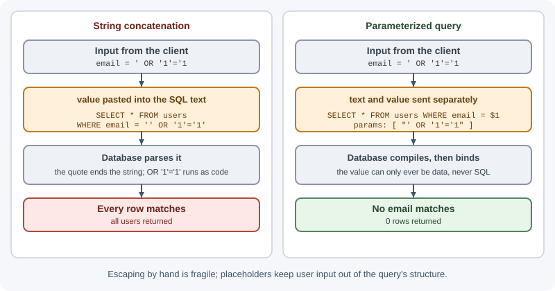

# Validation and Sanitization

Validation checks that incoming data has the shape, type, and meaning your
code expects, and rejects it otherwise. Sanitization and output encoding make
data safe for the specific place it is used next — a database query, an HTML
page, a shell command, or a log file. Together they are the main defense
against injection attacks and a large class of data-corruption bugs.

## Why it matters

A backend receives data from sources it does not control: browsers, mobile
apps, partner systems, webhooks, uploaded files. Any of them can send
something unexpected — by mistake or on purpose. Without validation, a string
where a number was expected crashes a handler; a negative quantity creates a
refund; an object where a string was expected turns a database query into
"match everything"; a filename containing `../` reads files outside the
upload folder.

Several of the most serious OWASP risks come down to trusting input:
injection, which in the
[OWASP Top 10 (2021)](https://owasp.org/Top10/2021/A03_2021-Injection/)
includes cross-site scripting and SQL injection, and mass assignment, which
the [OWASP API Security Top 10 (2023)](https://owasp.org/API-Security/editions/2023/en/0xa3-broken-object-property-level-authorization/)
covers under broken object property level authorization. A clear, consistent
validation layer is one of the highest-value things a backend can have.

## Real-world usage

- **GitHub's REST API** returns `422 Unprocessable Entity` when a request
  omits required parameters or uses the wrong type — for example, an array
  where the endpoint expects a string — along with a "Validation Failed"
  error
  ([GitHub Docs: troubleshooting the REST API](https://docs.github.com/en/rest/using-the-rest-api/troubleshooting-the-rest-api)).
- **Stripe** reports bad input as an `invalid_request_error` and includes a
  `param` field naming the parameter at fault, so a client can show the
  message next to the right form field
  ([Stripe API: errors](https://docs.stripe.com/api/errors),
  [Stripe: error handling](https://docs.stripe.com/error-handling)).
- **Ruby on Rails** blocks mass assignment with Strong Parameters: request
  parameters cannot be used for a mass update until the controller explicitly
  permits them, to stop users from updating sensitive attributes
  ([Rails Guides: Strong Parameters](https://guides.rubyonrails.org/action_controller_overview.html)).

**Popular tools:** schema validators such as Zod, Joi, Yup, AJV (JSON
Schema), and express-validator; DOMPurify for sanitizing user-supplied HTML.

## How it works

### Trust boundaries

A **trust boundary** is any point where data moves from a less trusted place
into your code. Validate at every boundary, as early as possible:


Data from another internal service is still input. It may be buggy, outdated,
or compromised.

### What to validate

| Source | Examples of checks |
|---|---|
| Path parameters | `id` matches the expected ID format (UUID, ObjectId, integer) |
| Query string | Pagination numbers in range; `sort` is one of allowed fields; repeated parameters handled |
| Request body | Required fields present; types correct; lengths and ranges; no unknown fields |
| Headers | `Content-Type` is what you accept; custom headers have the expected format |
| Cookies | Present and well-formed; signed values verify |
| Files | Size, count, actual type (not just the extension), safe names |
| Webhooks | Signature verifies; payload matches the documented schema |
| Environment variables | Required values present and valid at startup |
| Data from other services | Response shape matches what you depend on |

### Syntactic and semantic validation

- **Syntactic validation** checks form: is `email` a string that looks like an
  email address, is `age` an integer, is `date` a valid ISO 8601 date?
- **Semantic validation** checks meaning in context: is the start date before
  the end date, does the product exist, is the quantity within stock, is this
  coupon still valid for this user?

Syntactic checks belong at the edge (request validation). Semantic checks
usually need data and belong in the service layer.

### Allowlist versus denylist

- **Allowlist (positive validation):** define exactly what is allowed and
  reject everything else. `status` must be one of `"open"`, `"closed"`;
  `username` must match `^[a-z0-9_]{3,30}$`.
- **Denylist:** try to block known-bad patterns, such as `<script>` or `'`.
  Attackers find variants you did not list.

Prefer allowlists. Use denylists only as an extra layer, never as the main
defense.

### Schema validation

Rather than scattering `if` statements across handlers, describe the expected
input as a **schema** and validate against it in one place. Libraries such as
Zod, Joi, Yup, AJV (JSON Schema), and express-validator do this. A schema
gives you:

- Type checks, required/optional fields, lengths, ranges, patterns, enums.
- **Stripping or rejecting unknown fields**, which prevents mass assignment.
- **Coercion** where appropriate (query strings are always strings).
- A typed, cleaned result to pass to the rest of the code.
- Consistent, field-level error messages.

The same schema can often be shared with the frontend for instant feedback —
but server validation is the one that counts.

### Type coercion pitfalls

- Query strings and form fields arrive as strings: `?page=2` gives `"2"`.
  Coerce deliberately and validate the result (`"abc"` must not become
  `NaN` and slip through).
- `Number("")` is `0` and `Number(" ")` is `0`; `parseInt("12abc")` is `12`.
- Query parsers turn `?tags=a&tags=b` into an array, and the "extended"
  parser (`qs`, the default in Express 4) turns `?user[role]=x` into an
  object. Express 5's default "simple" parser keeps `user[role]` as a plain
  key but still produces arrays for repeated keys. Code expecting a string can
  receive an array or object.
- JSON bodies can carry `null`, nested objects, very large numbers, or
  `"__proto__"` keys. Validate types, do not assume them.
- Booleans: `"false"` is a non-empty string and therefore truthy.

### Sanitization versus output encoding

- **Validation** decides accept or reject.
- **Sanitization** changes input to remove or neutralize unwanted parts — for
  example, trimming whitespace, normalizing Unicode, or stripping disallowed
  HTML tags from rich text with a dedicated HTML sanitizer.
- **Output encoding (escaping)** transforms data at the moment it is placed
  into another context so it is treated as data, not code.

Encoding is **context-specific**. The same value needs different treatment in
different places:

| Destination | Correct technique |
|---|---|
| SQL query | Parameterized queries / prepared statements |
| MongoDB query | Ensure values are primitives (not objects); use the driver's query API |
| HTML body | HTML-entity encoding (template engines do this by default) |
| HTML attribute | Attribute encoding, and quote attributes |
| JavaScript in a page | Avoid; pass data via JSON in a data attribute or API |
| URL | `encodeURIComponent` for components |
| Shell command | Avoid the shell; pass arguments as an array |
| Log line | Remove or escape newline characters; structured (JSON) logging |

General rule: **validate on input, encode on output.** Do not try to
"sanitize once" on input so that the data is safe everywhere — there is no
single representation safe for every context.

### Injection attacks and defenses

**SQL injection** — user input concatenated into SQL:

```js
// Vulnerable: email = "' OR '1'='1"
db.query(`SELECT * FROM users WHERE email = '${email}'`);

// Safe: the driver sends the value separately from the query text
db.query("SELECT * FROM users WHERE email = $1", [email]);
```



**NoSQL operator injection** — an object where a string was expected:

```text
POST /login   {"email": "admin@example.com", "password": {"$ne": null}}
```

```js
// Vulnerable: password becomes { $ne: null } → matches any password
const user = await db.users.findOne({ email, password });

// Safe: validate types first; only strings reach the query
if (typeof email !== "string" || typeof password !== "string") {
  throw new ValidationError("Invalid credentials format");
}
```

(And never store or compare plain passwords — see
[authentication and authorization](authentication-and-authorization.md).)

**OS command injection** — input passed to a shell:

```js
import { exec, execFile } from "node:child_process";

// Vulnerable: filename = "report.pdf; rm -rf /"
exec(`convert ${filename} out.png`);

// Safer: no shell; arguments are passed as an array
execFile("convert", [filename, "out.png"]);
```

**Path traversal** — `../` sequences escaping a directory:

```js
import path from "node:path";

const uploadsDir = path.resolve("uploads");

app.get("/files/:name", (request, response) => {
  const target = path.resolve(uploadsDir, request.params.name);

  // Reject anything that resolves outside the uploads directory
  if (!target.startsWith(uploadsDir + path.sep)) {
    return response.status(400).json({ error: "Invalid file name" });
  }
  response.sendFile(target);
});
```

A request for `/files/..%2F..%2Fsecret.txt` decodes to `../../secret.txt`,
resolves outside `uploads`, and gets `400`.

**Stored XSS** — input saved, then rendered as HTML later:

A comment containing `<script>stealCookies()</script>` is saved and shown to
every visitor. Defense: encode on output (templating engines and frameworks
like React escape by default), sanitize rich text with an HTML sanitizer that
uses an allowlist of tags and attributes, and add a Content Security Policy.

**Header and log injection** — input containing newline characters
(`\r\n`) can split HTTP headers or forge log lines:

```text
username = "alice\n2026-11-07 INFO admin login succeeded"
```

Defense: reject control characters in fields that should not contain them,
let frameworks set headers (Node rejects invalid header characters), and use
structured JSON logging where values are escaped.

### Mass assignment

Mass assignment happens when the server copies a whole request body into a
database record:

```js
// Vulnerable: body = { "name": "Ann", "role": "admin", "balance": 99999 }
await db.users.updateOne({ _id: userId }, { $set: request.body });
```

Defense: validate against a schema that lists only the fields this endpoint
may change and strips or rejects the rest; build the update object explicitly.

### Size and count limits

Unbounded input is a denial-of-service risk. Set limits on:

- Request body size (`express.json({ limit: "100kb" })`).
- String lengths, array lengths, object nesting depth.
- Number of query parameters and form fields.
- File size and number of files.
- Page size in pagination (`limit` max 100).

Return `413 Content Too Large` for oversized bodies and `400` for values out
of range.

### Unicode normalization

The same visible text can be encoded in different ways. `é` can be one code
point (U+00E9) or `e` plus a combining accent (U+0065 U+0301). Usernames that
look identical may compare as different. Normalize identifiers with
`String.prototype.normalize("NFKC")` before comparing or storing, so both
forms of `é` become the same string.

Normalization does **not** merge look-alike characters from different
scripts: Cyrillic `а` and Latin `a` stay different after NFKC, which enables
impersonation. Restrict identifiers to a limited character set, or check them
against a list of confusable characters, to prevent that.

### ReDoS (regular expression denial of service)

Some regular expressions take exponential time on crafted input because of
catastrophic backtracking — for example, nested quantifiers like `^(a+)+$`
against `"aaaaaaaaaaaaaaaaaaaaaaaa!"`. Because Node runs JavaScript on one
thread, one such request can freeze the whole server. Defenses: avoid nested
quantifiers, limit input length before running a regex, prefer well-tested
validators from libraries, and test patterns with ReDoS checkers.

### Validation error responses

When validation fails, respond quickly with a clear, machine-readable error:

- **`400 Bad Request`:** the request is malformed or fails validation. Many
  APIs use 400 for all validation failures.
- **`422 Unprocessable Content`:** the syntax is valid (well-formed JSON) but
  the content fails semantic rules. Some APIs use 422 for field validation.

Pick one convention and use it consistently. Return field-level details:

```json
{
  "type": "https://api.example.com/problems/validation-error",
  "title": "Request validation failed",
  "status": 400,
  "errors": [
    { "field": "email", "message": "Must be a valid email address" },
    { "field": "quantity", "message": "Must be between 1 and 100" }
  ]
}
```

Do not echo raw input back into HTML error pages, and do not reveal internal
details such as database errors.

## When to use and when not to use

Validation itself is never optional at a trust boundary. The choices are
which technique to use where.

**Use schema validation (Zod, Joi, JSON Schema) when:**

- An endpoint accepts a body, query, or params with known fields — that is,
  almost always.
- You want typed, cleaned values and consistent field-level errors.

**Use hand-written checks when:**

- The rule needs data or context, such as stock levels, ownership, or date
  ranges. Put these semantic checks in the service layer.

**Do not:**

- Use sanitization as a substitute for parameterized queries or output
  encoding.
- Strip HTML from every field "just in case" — it corrupts legitimate data
  (names with `<` or `&`) and does not make output safe.

| Technique | Use for | Not a substitute for |
|---|---|---|
| Schema validation (reject or strip) | Shape, types, ranges, unknown fields | Semantic and ownership checks |
| Parameterized queries | Every database query with input | Validation (still check types) |
| Output encoding | HTML, URLs, headers, logs | Input validation |
| HTML sanitizer (allowlist) | Rich text that must keep some markup | Encoding plain-text fields |
| Rejecting unknown fields | New APIs, internal clients | Public APIs with old clients — strip instead while migrating |

## Practical examples

### A Zod schema used as Express middleware

```js
import { z } from "zod";

const createOrderSchema = z
  .object({
    productId: z.string().uuid(),
    quantity: z.number().int().min(1).max(100),
    note: z.string().trim().max(500).optional(),
  })
  .strict(); // reject unknown fields such as "price" or "status"

const listOrdersQuery = z.object({
  page: z.coerce.number().int().min(1).default(1),   // "2" → 2
  limit: z.coerce.number().int().min(1).max(100).default(20),
  status: z.enum(["open", "shipped", "cancelled"]).optional(),
});

function validate(schema, source = "body") {
  return (request, response, next) => {
    const result = schema.safeParse(request[source]);
    if (!result.success) {
      return response.status(400).json({
        title: "Request validation failed",
        status: 400,
        errors: result.error.issues.map((issue) => ({
          field: issue.path.join("."),
          message: issue.message,
        })),
      });
    }
    // Store the cleaned, typed value instead of the raw input
    request.validated = { ...request.validated, [source]: result.data };
    next();
  };
}

app.post("/api/orders", validate(createOrderSchema), createOrder);
app.get("/api/orders", validate(listOrdersQuery, "query"), listOrders);
```

Handlers then read `request.validated.body` and `request.validated.query`,
never the raw `request.body`. More Express-specific patterns are in
[request validation](../express/request-validation.md).

### Semantic validation in the service layer

```js
export async function createBooking({ roomId, startDate, endDate }, user) {
  if (endDate <= startDate) {
    throw new ValidationError("End date must be after start date");
  }
  const room = await rooms.findById(roomId);
  if (!room) {
    throw new NotFoundError("Room not found");
  }
  // ...availability check, then create
}
```

## Best practices

- Validate every input at the trust boundary, on the server, before use.
- Use schemas with allowlists; reject or strip unknown fields.
- Coerce types deliberately; never assume a query value is a string.
- Use parameterized queries and driver APIs; never build queries with string
  concatenation.
- Encode output for its context; rely on template auto-escaping.
- Avoid the shell; pass command arguments as arrays.
- Resolve and check file paths against an allowed base directory.
- Set limits on body size, lengths, counts, and page sizes.
- Normalize Unicode for identifiers; restrict character sets where possible.
- Keep error responses consistent, field-level, and free of internals.

## In production

- **Old clients break after validation is tightened.** *Symptom:* a spike of
  400 responses right after a deploy, mostly from older mobile app versions.
  *Detect:* 400 rate per endpoint and client version; error bodies such as
  `Unrecognized key: "price"`. *Cause:* a schema was made strict, or a field
  became required. *Fix:* strip unknown fields instead of rejecting them while
  old clients exist, make new fields optional, and version breaking changes.
- **One request freezes the server.** *Symptom:* every request times out and
  one CPU core sits at 100%. *Detect:* event loop delay jumps; a CPU profile
  shows time inside a regular expression. *Cause:* catastrophic backtracking
  (ReDoS) on user input. *Fix:* cap input length before matching, rewrite the
  pattern without nested quantifiers, and use maintained validators.
- **Legitimate requests get 413.** *Symptom:* users with large forms or bulk
  imports see failures. *Detect:* logs show body-parser errors with type
  `entity.too.large`. *Cause:* `express.json()` defaults to a 100 KB limit.
  *Fix:* raise the limit only on routes that need it, or switch large uploads
  to direct-to-storage uploads.
- **Crafted query strings cause 500s.** *Symptom:* errors such as
  `TypeError: email.toLowerCase is not a function`. *Detect:* the failing
  requests repeat a parameter (`?email=a&email=b`) so it arrives as an array.
  *Cause:* the handler assumed a string. *Fix:* validate the query with a
  schema and return 400.
- **Stored XSS reaches users.** *Symptom:* users report unexpected pop-ups
  or redirects on pages with user content. *Detect:* Content Security Policy
  violation reports, or script tags found in stored fields. *Cause:* user
  content rendered without encoding (`innerHTML`, unescaped template output).
  *Fix:* encode on output, sanitize rich text with an allowlist sanitizer,
  and enforce a CSP.

## Important terminology

- **Validation:** checking input against rules and rejecting what fails.
- **Sanitization:** modifying input to remove or neutralize unwanted parts.
- **Output encoding / escaping:** converting data so the destination treats
  it as data, not code.
- **Trust boundary:** where data passes from a less trusted to a more trusted
  context.
- **Allowlist / denylist:** permit only known-good / block known-bad.
- **Schema:** a declarative description of valid data.
- **Coercion:** converting a value from one type to another.
- **Injection:** untrusted data interpreted as code or commands.
- **Parameterized query:** a query where values are sent separately from the
  query text.
- **Mass assignment:** binding request fields directly to a model, including
  fields the client should not control.
- **Path traversal:** using `../` or absolute paths to access files outside an
  intended directory.
- **ReDoS:** denial of service through a slow regular expression.
- **Unicode normalization:** converting equivalent character sequences to one
  canonical form.

## Common mistakes and misconceptions

- **Relying on frontend validation.** Attackers bypass the browser entirely.
- **"Sanitize once on input and it's safe everywhere."** Safety depends on the
  output context.
- **Escaping quotes instead of parameterizing.** Hand-written escaping misses
  edge cases.
- **Assuming JSON fields have the right type** — `{"$ne": null}` is valid JSON.
- **Copying `request.body` into updates.** This is mass assignment.
- **Checking the file extension only.** Extensions and `Content-Type` headers
  are client-controlled.
- **Unbounded regexes on long input**, risking ReDoS.
- **Returning 500 for bad input.** Client mistakes are 4xx responses.

## Revision questions

1. What is a trust boundary, and why is data from another internal service
   still untrusted?
2. Explain the difference between validation, sanitization, and output
   encoding, with one example of each.
3. How does NoSQL operator injection work, and how does type validation stop
   it?
4. Why are allowlists preferred over denylists?
5. What is mass assignment, and how does a strict schema prevent it?
6. When would you choose `400` versus `422` for a validation error?

## Further learning

- [OWASP Input Validation Cheat Sheet](https://cheatsheetseries.owasp.org/cheatsheets/Input_Validation_Cheat_Sheet.html)
- [OWASP SQL Injection Prevention Cheat Sheet](https://cheatsheetseries.owasp.org/cheatsheets/SQL_Injection_Prevention_Cheat_Sheet.html)
- [OWASP Cross Site Scripting Prevention Cheat Sheet](https://cheatsheetseries.owasp.org/cheatsheets/Cross_Site_Scripting_Prevention_Cheat_Sheet.html)
- [OWASP OS Command Injection Defense Cheat Sheet](https://cheatsheetseries.owasp.org/cheatsheets/OS_Command_Injection_Defense_Cheat_Sheet.html)
- [OWASP Mass Assignment Cheat Sheet](https://cheatsheetseries.owasp.org/cheatsheets/Mass_Assignment_Cheat_Sheet.html)
- [MDN: String.prototype.normalize()](https://developer.mozilla.org/en-US/docs/Web/JavaScript/Reference/Global_Objects/String/normalize)
- Related notes: [OWASP](../../09-security-and-testing/owasp.md),
  [API security](../../09-security-and-testing/api-security.md),
  [Error handling](error-handling.md)
