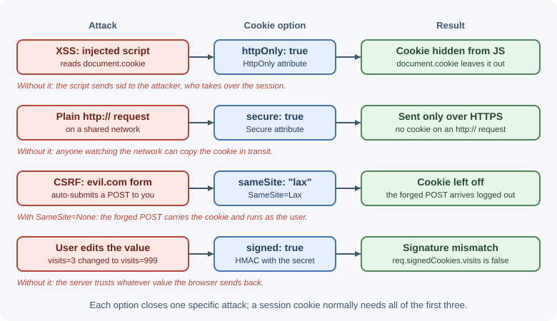

# Cookies and Sessions in Express

HTTP is stateless: every request arrives on its own, with no memory of the
previous one. Cookies let a server ask the browser to store a small value and
send it back on later requests, and sessions build on cookies to remember who
a user is between requests. This lesson shows how to set cookies safely in
Express, how signed cookies work, and how to run server-side sessions with
`express-session`.

## Why it matters

Almost every logged-in web experience depends on cookies: staying signed in,
remembering a cart, keeping a language preference. A cookie that is set
carelessly can be read by injected JavaScript, sent over plain HTTP, or
attached to requests from another site. Those mistakes turn into session
theft, session fixation, and cross-site request forgery (CSRF). Knowing what
each cookie option does lets you choose settings on purpose instead of
copying them.

For the general theory of sessions, cookies, and tokens, see
[sessions, cookies, and JWT](../backend-concepts/sessions-cookies-and-jwt.md).

## Real-world usage

- **GitHub** signs users in with a session cookie: its
  [cookie list](https://docs.github.com/en/site-policy/privacy-policies/github-cookies)
  describes `user_session` as the cookie "used to log you in" for two weeks,
  plus a separate `__Host-user_session_same_site` cookie that lets browsers
  supporting SameSite check whether a request originates from GitHub. This
  is the same pattern as this lesson: an opaque session cookie, with
  SameSite as a cross-site defense.
- **Google Chrome** changed how cookies without a `SameSite` attribute
  behave. Google's
  [web.dev guide](https://web.dev/articles/samesite-cookies-explained)
  explains that such a cookie is treated as if it were `SameSite=Lax`, so
  sites that need a cookie in cross-site contexts must now opt in with
  `SameSite=None; Secure`.
- **Shopify** found that cookies do not work reliably for apps embedded in
  its admin, which run inside an iframe on another site. Its
  [documentation](https://shopify.dev/docs/apps/build/authentication-authorization/session-tokens)
  requires embedded apps to authenticate with short-lived ID tokens
  "because third-party cookies aren't reliably available in that context".
  Cookie-based sessions are the right tool when the app and API are the
  same site; cross-site embedding is where they break down.

Popular tools: `express-session`, `cookie-parser`, `connect-redis`,
`connect-mongo`, `csrf-csrf`, and `csrf-sync`; session data usually lives
in Redis or MongoDB.

## How it works

### Cookie recap

1. The server sends a `Set-Cookie` response header.
2. The browser stores the cookie under the server's site.
3. On later requests that match the cookie's domain and path, the browser
   sends it back in a `Cookie` request header.

```text
Browser                                  Express server
   | POST /login                               |
   |------------------------------------------>|
   |       200 OK                               |
   |       Set-Cookie: sid=abc123; HttpOnly;    |
   |                   Secure; SameSite=Lax     |
   |<------------------------------------------|
   | GET /account                               |
   | Cookie: sid=abc123                         |
   |------------------------------------------>|
```

A cookie is only a name and a value plus attributes. It is not encrypted,
and the user can read and edit it. Anything security-sensitive must either be
an unguessable identifier (a session ID) or be signed so tampering is
detected.

### Setting cookies with `res.cookie()`

`res.cookie(name, value, options)` adds a `Set-Cookie` header. If `value` is
an object, Express serializes it as JSON (prefixed with `j:`).

| Option | What it does | What it protects against |
|--------|--------------|--------------------------|
| `httpOnly` | Hides the cookie from `document.cookie` | Theft by injected JavaScript (XSS) |
| `secure` | Sends the cookie only over HTTPS | Interception on plain HTTP networks |
| `sameSite` | `"strict"`, `"lax"`, or `"none"`: controls cross-site sending | CSRF and cross-site leaks |
| `maxAge` | Lifetime in **milliseconds** (Express converts it to `Max-Age` seconds) | Cookies that live forever |
| `expires` | Absolute expiry as a `Date` | Same as `maxAge`; prefer one of the two |
| `domain` | Which host(s) receive the cookie | Leaving it unset limits the cookie to the exact host |
| `path` | URL path prefix that receives the cookie (default `"/"`) | Sending a cookie to routes that do not need it |
| `signed` | Signs the value with the cookie-parser secret | Undetected tampering |

Without `maxAge` or `expires`, the cookie is a **session cookie**: the browser
deletes it when it decides the browsing session has ended.



### SameSite in detail

- **`Strict`:** never sent on cross-site requests, including clicking a link
  from another site. Safest, but users arriving from an email link appear
  logged out.
- **`Lax`:** sent on top-level navigations that use safe methods (such as
  following a link with GET) but not on cross-site POSTs, images, or
  `fetch()` calls. Some browsers use `Lax` as the default when the
  attribute is missing, but not all do, so always set `SameSite`
  explicitly.
- **`None`:** sent on all cross-site requests. Browsers require `Secure`
  with it. Use only when a different site genuinely needs the cookie, such as
  an embedded widget.

"Site" means the registrable domain: `app.example.com` and
`api.example.com` are the same site but different origins.

### Reading cookies with `cookie-parser`

Express does not parse the `Cookie` header by itself. The `cookie-parser`
middleware fills two objects:

- `req.cookies`: plain cookies.
- `req.signedCookies`: cookies whose signature verified. A tampered signed
  cookie appears as `false`.

### How signed cookies work

When you pass a secret to `cookie-parser` and set `signed: true`, the stored
value becomes `s:<value>.<signature>`, where the signature is an HMAC of the
value using the secret. On each request `cookie-parser` recomputes the
signature. If someone changes the value, the signatures no longer match.

Signing proves the value came from your server; it does **not** hide the
value. Never put secrets or personal data in a cookie because it is signed.

### Server-side sessions with `express-session`

With `express-session`, the cookie holds only a random session ID. The data
lives on the server in a **session store**.


On each request the middleware reads the cookie, verifies its signature,
loads the session from the store, and exposes it as `req.session`. When the
response finishes, a changed session is saved back.

Important options:

| Option | Meaning | Recommended value |
|--------|---------|-------------------|
| `secret` | Signs the session ID cookie. An array allows rotation: the first signs, all verify | A long random value from an environment variable |
| `name` | Cookie name (default `connect.sid`) | A neutral name such as `sid` |
| `resave` | Save the session on every request even if unchanged | `false` (set it explicitly) |
| `saveUninitialized` | Store brand-new sessions that were never modified | `false` for login sessions; avoids storing empty sessions and setting cookies before consent |
| `rolling` | Reset the cookie expiry on every response | `true` for sliding expiry if you want it |
| `cookie` | Cookie options (`httpOnly` defaults to `true`) | `httpOnly`, `secure`, `sameSite`, `maxAge` |
| `store` | Where session data lives | Redis or MongoDB store in production |

!!! warning "MemoryStore is not for production"
    The default `MemoryStore` keeps sessions in the process's memory. It
    leaks memory over time, loses every session on restart, and does not
    work across multiple processes or servers. Use a shared store such as
    Redis (`connect-redis`) or MongoDB (`connect-mongo`).

### Session lifecycle

| Moment | What to do | Why |
|--------|-----------|-----|
| Login succeeds | `req.session.regenerate()`, then store the user ID | Prevents **session fixation**: an attacker cannot plant a known session ID before login |
| Privilege change | Regenerate again | Same reason |
| Each request | Read `req.session.userId` | Identifies the user |
| Logout | `req.session.destroy()` and clear the cookie | Removes the server-side session, not just the cookie |

### Secure cookies behind a proxy

In production, TLS often ends at a load balancer or nginx, which forwards
plain HTTP to Express. Express then thinks the request is insecure, and
`express-session` refuses to send a `secure` cookie. Tell Express to trust
the proxy's `X-Forwarded-Proto` header:

```js
app.set("trust proxy", 1); // trust the first proxy hop
```

Only trust proxies you actually run; see
[security best practices](security-best-practices.md).

## When to use and when not to use

Use cookie-based server sessions when:

- A browser app and its API are served from the same site (for example
  `app.example.com` and `api.example.com`), so the cookie is first-party.
- You need instant logout and revocation: destroying the stored session
  ends access immediately.
- You want the browser to handle credentials automatically, with
  `HttpOnly` keeping them away from JavaScript.

Avoid them, or add something else, when:

- The client is a mobile app, CLI, or another server: a bearer token in the
  `Authorization` header is simpler than managing a cookie jar.
- The frontend is embedded on a different site (an iframe in a partner's
  page): third-party cookies are often blocked.
- You cannot run a shared session store and have several instances; use
  signed, self-contained tokens or a stateless cookie instead.

| Approach | State lives | Revocation | Best for |
|----------|-------------|------------|----------|
| Server session (`express-session` + Redis) | Server store; cookie holds an ID | Immediate (destroy the session) | Same-site browser apps |
| Signed cookie holding the data (`cookie-session`) | In the cookie (size-limited, readable) | Hard until expiry | Tiny, non-sensitive state; no store available |
| JWT in `Authorization` header | Token on the client | Hard until expiry (needs a denylist or short expiry) | Mobile apps, service-to-service, third-party API clients |
| JWT in an `HttpOnly` cookie | Token in the cookie | Same as JWT | Browser apps that want stateless servers |

## Practical examples

### Setting, reading, and clearing a cookie

```js
import express from "express";
import cookieParser from "cookie-parser";

const app = express();
app.use(cookieParser(process.env.COOKIE_SECRET)); // secret enables signing

app.post("/preferences/theme", express.json(), (req, res) => {
  res.cookie("theme", req.body.theme, {
    maxAge: 365 * 24 * 60 * 60 * 1000, // one year, in milliseconds
    httpOnly: true,
    secure: true,
    sameSite: "lax",
  });
  res.sendStatus(204);
});

app.get("/preferences/theme", (req, res) => {
  res.json({ theme: req.cookies.theme ?? "light" });
});

app.delete("/preferences/theme", (req, res) => {
  // Options such as path and domain must match the ones used to set it.
  res.clearCookie("theme", { httpOnly: true, secure: true, sameSite: "lax" });
  res.sendStatus(204);
});

app.listen(3000);
```

The response to the first request contains:

```text
Set-Cookie: theme=dark; Max-Age=31536000; Path=/; Expires=...; HttpOnly;
            Secure; SameSite=Lax
```

### A signed cookie

```js
app.get("/visit", (req, res) => {
  const visits = Number(req.signedCookies.visits ?? 0) + 1;
  res.cookie("visits", String(visits), { signed: true, httpOnly: true });
  res.json({ visits });
});
```

If a user edits the `visits` cookie, `req.signedCookies.visits` becomes
`false`, and the count restarts.

### Sessions with a Redis store

```js
import express from "express";
import session from "express-session";
import { createClient } from "redis";
import { RedisStore } from "connect-redis"; // named export in current versions

const redisClient = createClient({ url: process.env.REDIS_URL });
await redisClient.connect();

const app = express();
app.set("trust proxy", 1);
app.use(express.json());

app.use(
  session({
    store: new RedisStore({ client: redisClient, prefix: "sess:" }),
    name: "sid",
    secret: process.env.SESSION_SECRET,
    resave: false,
    saveUninitialized: false,
    cookie: {
      httpOnly: true,
      secure: process.env.NODE_ENV === "production",
      sameSite: "lax",
      maxAge: 8 * 60 * 60 * 1000, // 8 hours
    },
  })
);
```

A MongoDB store is set up the same way:

```js
import MongoStore from "connect-mongo";

app.use(
  session({
    store: MongoStore.create({ mongoUrl: process.env.MONGODB_URI }),
    secret: process.env.SESSION_SECRET,
    resave: false,
    saveUninitialized: false,
  })
);
```

### Login and logout with regeneration

```js
app.post("/login", async (req, res, next) => {
  const user = await verifyCredentials(req.body.email, req.body.password);
  if (!user) {
    return res.status(401).json({ error: "Invalid email or password" });
  }

  // New session ID after login: defeats session fixation.
  req.session.regenerate((err) => {
    if (err) return next(err);
    req.session.userId = user.id;
    req.session.role = user.role;
    // Save before responding so the next request sees the session.
    req.session.save((saveErr) => {
      if (saveErr) return next(saveErr);
      res.json({ id: user.id, name: user.name });
    });
  });
});

app.post("/logout", (req, res, next) => {
  req.session.destroy((err) => {
    if (err) return next(err);
    res.clearCookie("sid", { httpOnly: true, sameSite: "lax", secure: true });
    res.sendStatus(204);
  });
});

function requireLogin(req, res, next) {
  if (!req.session.userId) {
    return res.status(401).json({ error: "Login required" });
  }
  next();
}

app.get("/account", requireLogin, (req, res) => {
  res.json({ userId: req.session.userId });
});
```

### A simple CSRF defense: checking the Origin header

`SameSite=Lax` already blocks most cross-site POSTs. A cheap second layer is
to reject state-changing requests whose `Origin` header is not yours:

```js
const allowedOrigins = new Set([process.env.APP_ORIGIN]);

function checkOrigin(req, res, next) {
  const safe = ["GET", "HEAD", "OPTIONS"].includes(req.method);
  const origin = req.get("origin");
  if (safe || (origin && allowedOrigins.has(origin))) return next();
  res.status(403).json({ error: "Cross-site request blocked" });
}

app.use(checkOrigin);
```

This check also rejects state-changing requests that send no `Origin`
header at all, such as `curl` or server-to-server calls. That is fine for a
browser-only, cookie-authenticated app; mount it only on cookie-based routes
if other clients use tokens instead.

For forms and older browsers, use a CSRF token pattern (synchronizer token
or double-submit cookie). The old `csurf` package is deprecated; maintained
alternatives include `csrf-csrf` and `csrf-sync`.

## Best practices

- Set `httpOnly`, `secure`, and an explicit `sameSite` on every cookie that
  identifies a user.
- Store only an opaque session ID in the cookie; keep user data server-side.
- Set `resave: false` and `saveUninitialized: false` explicitly.
- Use a shared store (Redis, MongoDB) in production, never `MemoryStore`.
- Regenerate the session on login and privilege changes; destroy it on
  logout.
- Keep secrets in environment variables and rotate them by passing an array
  to `secret`.
- Give sessions both an idle limit and an absolute lifetime.
- Make GET routes safe (no state changes) so `SameSite=Lax` actually helps.
- Set `trust proxy` correctly when TLS ends at a proxy.
- Rename the default `connect.sid` cookie to avoid advertising your stack.

## In production

- **Users are logged out after every deploy or at random.**
  Detect: a jump in 401 "Login required" responses after restarts or when
  traffic shifts between instances; at startup the process logs
  `Warning: connect.session() MemoryStore is not designed for a production
  environment`. Cause: the default `MemoryStore`, so each instance has its
  own sessions and a restart wipes them. Fix: a shared store such as Redis
  through `connect-redis`.
- **Login "succeeds" but the next request is anonymous, only in
  production.** Detect: the login response in the browser's Network panel
  has no `Set-Cookie` header. Cause: `cookie.secure: true` while TLS ends at
  a load balancer, so Express sees plain HTTP and `express-session` refuses
  to send a secure cookie. Fix: `app.set("trust proxy", 1)` (matching your
  real proxy hops) or the session's `proxy` option.
- **The frontend on another domain gets 401s although login worked.**
  Detect: API requests in the Network panel carry no `Cookie` header, and
  the browser may flag the cookie as blocked. Cause: the cookie is
  `SameSite=Lax` (or third-party cookies are blocked) while the frontend is
  cross-site. Fix: serve app and API from the same site, or use
  `SameSite=None; Secure` with credentialed CORS, or switch to tokens.
- **Everyone is logged out right after a secret rotation.** Detect: a sudden,
  site-wide spike in "Login required" right after a config change. Cause:
  the old `secret` was replaced, so existing signed session IDs no longer
  verify. Fix: pass an array `[newSecret, oldSecret]` so new cookies use the
  new secret while old ones still verify, and drop the old one later.
- **Redis memory keeps growing with session keys.** Detect: the number of
  `sess:*` keys and `used_memory` in `INFO` grow with traffic, mostly from
  anonymous visitors and bots. Cause: `saveUninitialized: true` stores a
  session for every visitor. Fix: `saveUninitialized: false` and an explicit
  `cookie.maxAge` (connect-redis uses the cookie expiry as the key TTL).

## Important terminology

- **Cookie:** A name-value pair the browser stores and sends back to a server.
- **Session cookie:** A cookie without `Max-Age`/`Expires`; removed when the
  browser session ends.
- **Persistent cookie:** A cookie with an explicit lifetime.
- **Signed cookie:** A cookie with an HMAC signature that detects tampering;
  still readable.
- **Session store:** Server-side storage that maps session IDs to data.
- **Session fixation:** An attack where the victim is made to log in with a
  session ID the attacker already knows.
- **CSRF:** Cross-site request forgery: another site makes the browser send
  an authenticated request.
- **Trust proxy:** An Express setting that tells it to believe
  `X-Forwarded-*` headers from known proxies.

## Common mistakes and misconceptions

- **"Signed means encrypted."** Signing only detects changes; anyone can read
  the value.
- **Forgetting `cookie-parser`.** `req.cookies` is `undefined` without it.
  (`express-session` reads its own cookie and does not need it.)
- **Clearing with different options.** `res.clearCookie()` must use the same
  `path` and `domain`, or the browser keeps the old cookie.
- **`maxAge` in seconds.** Express expects milliseconds; `maxAge: 3600` is
  3.6 seconds.
- **Using `MemoryStore` in production.** Sessions disappear on restart and
  do not work with more than one instance.
- **`secure: true` while Express sees plain HTTP.** `express-session` skips
  the `Set-Cookie` header when the request is not HTTPS, so behind a proxy
  that terminates TLS the session cookie silently never arrives; configure
  `trust proxy`.
- **Logging out by clearing only the cookie.** The session stays valid on the
  server until it expires; destroy it.
- **Assuming SameSite removes all CSRF risk.** Same-site subdomains and
  state-changing GET routes can still be abused.

## Revision questions

1. What does each of `httpOnly`, `secure`, and `sameSite` protect against?
2. How does `cookie-parser` detect that a signed cookie was modified?
3. Why should a session be regenerated after a successful login?
4. Why is `MemoryStore` unsuitable for production?
5. What problem does `app.set("trust proxy", 1)` solve for secure cookies?
6. How do `SameSite=Lax` and an Origin check work together against CSRF?

## Further learning

- [MDN: Using HTTP cookies](https://developer.mozilla.org/en-US/docs/Web/HTTP/Guides/Cookies)
- [MDN: Set-Cookie header](https://developer.mozilla.org/en-US/docs/Web/HTTP/Reference/Headers/Set-Cookie)
- [Express API: res.cookie()](https://expressjs.com/en/5x/api/response/#rescookie)
- [express-session on GitHub](https://github.com/expressjs/session)
- [cookie-parser on GitHub](https://github.com/expressjs/cookie-parser)
- [OWASP Session Management Cheat Sheet](https://cheatsheetseries.owasp.org/cheatsheets/Session_Management_Cheat_Sheet.html)
- [OWASP CSRF Prevention Cheat Sheet](https://cheatsheetseries.owasp.org/cheatsheets/Cross-Site_Request_Forgery_Prevention_Cheat_Sheet.html)
