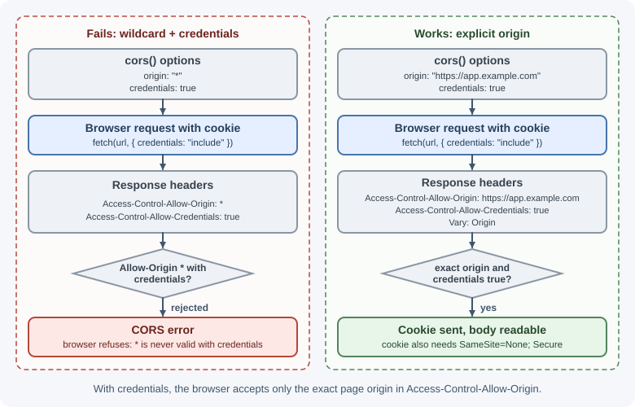

# Configuring CORS in Express

CORS (Cross-Origin Resource Sharing) is how a server tells browsers which
other websites may call it from JavaScript. In Express, CORS is usually
configured with the `cors` middleware package. This lesson shows how to
configure it correctly; the underlying browser rules are explained in
[CORS concepts](../backend-concepts/cors.md).

## Why it matters

A typical setup has a frontend at `https://app.example.com` calling an API
at `https://api.example.com`. Those are different **origins**, so the
browser blocks the frontend from reading API responses unless the API
sends the right CORS headers. Misconfigured CORS either breaks the
frontend with confusing console errors or, if opened too widely with
credentials, lets malicious sites make authenticated requests on a user's
behalf and read the results.

## Real-world usage

- **GitHub**'s REST API "supports cross-origin resource sharing (CORS) for
  AJAX requests from any origin". Its documented responses use
  `Access-Control-Allow-Origin: *`, allow the `Authorization` header in
  preflights, cache preflights for a day (`Access-Control-Max-Age:
  86400`), and expose headers such as `ETag`, `Link`, and the rate-limit
  headers to JavaScript
  ([GitHub documentation](https://docs.github.com/en/rest/using-the-rest-api/using-cors-and-jsonp-to-make-cross-origin-requests)).
  A wildcard origin cannot be combined with cookies, so browser callers
  authenticate with a token they send themselves.
- **Amazon S3** lets you attach a CORS configuration to a bucket. AWS's own
  example is a website hosted in a bucket whose JavaScript needs to make
  authenticated `GET` and `PUT` requests to the bucket's S3 API endpoint,
  which the browser would otherwise block
  ([AWS documentation](https://docs.aws.amazon.com/AmazonS3/latest/userguide/cors.html)).
- **Amazon API Gateway** documents that with a Lambda proxy or HTTP proxy
  integration, "your backend is responsible for returning the
  Access-Control-Allow-Origin, Access-Control-Allow-Methods, and
  Access-Control-Allow-Headers headers". An Express app behind such a
  gateway therefore still needs its own CORS middleware
  ([AWS documentation](https://docs.aws.amazon.com/apigateway/latest/developerguide/how-to-cors.html)).
- **Google Cloud Storage** recommends CORS when "you want your website to
  fetch files, images, or scripts directly from a Cloud Storage bucket
  using a browser-based request", configured on the bucket
  ([Google Cloud documentation](https://cloud.google.com/storage/docs/cross-origin)).

**Popular tools and providers:** the `cors` npm package, reverse proxies
such as Nginx, API gateways, and CDN or storage settings for static assets.

## How it works

### A quick recap

- An **origin** is scheme + host + port: `https://app.example.com:443`.
- Browsers enforce the **same-origin policy**: a page's JavaScript cannot
  read responses from another origin unless that origin allows it.
- The server allows it with response headers such as
  `Access-Control-Allow-Origin`.
- For "non-simple" requests (for example `PUT`, `DELETE`, JSON bodies, or
  an `Authorization` header), the browser first sends a **preflight**
  `OPTIONS` request to ask permission.


### The `cors` package defaults

```bash
npm install cors
```

```js
import cors from "cors";

app.use(cors()); // allow every origin
```

With no options, `cors()` sends `Access-Control-Allow-Origin: *`, allows
the methods `GET, HEAD, PUT, PATCH, POST, DELETE`, reflects whatever
request headers the preflight asks for, and answers preflight requests
with `204`. That is fine for a truly public, read-only API that uses no
cookies, but too open for most applications.

### Options

| Option | Type | Meaning |
|--------|------|---------|
| `origin` | Boolean, string, RegExp, array, or function | Which origins are allowed (see below) |
| `methods` | String or array | Value of `Access-Control-Allow-Methods` |
| `allowedHeaders` | String or array | Request headers the browser may send; defaults to reflecting the preflight's `Access-Control-Request-Headers` |
| `exposedHeaders` | String or array | Response headers JavaScript may read beyond the safe defaults (for example `X-Total-Count`) |
| `credentials` | Boolean | Send `Access-Control-Allow-Credentials: true` so cookies and auth headers work |
| `maxAge` | Number (seconds) | How long browsers may cache the preflight result |
| `preflightContinue` | Boolean | `false` (default): cors ends preflight itself; `true`: pass it to your own `OPTIONS` handler |
| `optionsSuccessStatus` | Number | Status for successful preflights; default `204` (some very old clients need `200`) |

### Forms of the `origin` option

| Value | Behavior |
|-------|----------|
| `"*"` or omitted | `Access-Control-Allow-Origin: *` for every request |
| `true` | Reflect the request's `Origin` back (allows anyone, including with credentials: dangerous) |
| `false` | Disable CORS headers |
| `"https://app.example.com"` | Always send that one origin |
| `["https://a.example.com", "https://b.example.com"]` | Reflect the origin only if it is in the list |
| `/\.example\.com$/` | Reflect the origin if it matches the RegExp |
| `(origin, callback) => { ... }` | Decide dynamically; call `callback(null, true)` to allow or `callback(null, false)` to deny |

Whenever `origin` is anything other than `"*"`, including a single fixed
string, the package adds `Vary: Origin` so caches do not serve one
origin's response to another.

### Credentials need an explicit origin

When the frontend sends cookies (`fetch(url, { credentials: "include" })`)
or the API relies on cookies for sessions, browsers require:

- `Access-Control-Allow-Credentials: true`, and
- `Access-Control-Allow-Origin` set to the **exact** origin, not `*`.

```js
app.use(cors({
  origin: "https://app.example.com",
  credentials: true,
}));
```



CORS and cookie rules are separate checks. `app.example.com` and
`api.example.com` are different origins but the **same site**, so a cookie
with `SameSite=Lax` is still sent. If the frontend and API are on
different sites (for example `app.example.com` and `api.example.net`), the
cookie also needs `SameSite=None; Secure`, and some browsers block or
partition such third-party cookies regardless. See
[cookies and sessions](cookies-and-sessions.md).

### Preflight handling

Registered with `app.use()`, the cors middleware runs for every method,
including `OPTIONS`, so it answers preflights for all routes before any
route or authentication middleware sees them. That is the simplest and
most reliable setup. The flowchart shows the whole decision `cors()` makes
for each request.


If you only enable CORS on specific routes, the preflight for that path
must also get CORS headers:

```js
const partnerCors = cors({ origin: "https://partner.example.com" });

app.options("/api/partner/orders", partnerCors);   // preflight
app.post("/api/partner/orders", partnerCors, createPartnerOrder);
```

To answer preflights for every path explicitly in Express 5, use the new
wildcard syntax, `app.options("/{*splat}", cors(options))`; Express 4
tutorials show `app.options("*", ...)`, which Express 5 rejects.

### CORS protects browsers, not your server

CORS is enforced by browsers. `curl`, Postman, mobile apps, and other
servers ignore it completely and can call your API regardless of your
CORS settings. CORS is therefore **not** authentication or access
control. Protect data with authentication, authorization, and rate
limiting; use CORS only to decide which browser-based frontends may read
responses.

## When to use and when not to use

**Enable CORS when** browser JavaScript served from one origin must read
responses from your API on another origin: a frontend on
`app.example.com` calling `api.example.com`, a public browser-callable
API, or a widget embedded on customers' sites.

**Do not enable it when:**

- Only servers, mobile apps, or command-line tools call the API. They do
  not enforce CORS, so the headers add nothing.
- You can serve the frontend and API from the same origin (for example
  `example.com` and `example.com/api` through a reverse proxy). Same-origin
  requests need no CORS at all.
- You are trying to restrict who can call the API. That needs
  authentication and authorization, not CORS.

| Approach | Use when | Watch out for |
|----------|----------|---------------|
| `cors` package in Express | The app decides allowed origins, possibly per route | Register it before authentication and routes |
| Manual middleware | You need behavior the package lacks | Remember `Vary: Origin` and preflight handling |
| Reverse proxy or API gateway headers | Several services share one CORS policy at the edge | Do not also add headers in Express (duplicate values) |
| Same-origin hosting via a proxy | You control both frontend and API deployment | Needs routing configuration in the proxy |
| Dev-server proxy (for example Vite) | Local development only | Production still needs a real solution |

## Practical examples

### A dynamic allowlist from configuration

```js
import cors from "cors";

// e.g. CORS_ORIGINS="https://app.example.com,https://admin.example.com"
const allowedOrigins = new Set(
  (process.env.CORS_ORIGINS ?? "").split(",").map((o) => o.trim()).filter(Boolean),
);

const corsOptions = {
  origin(origin, callback) {
    // No Origin header: same-origin requests, curl, server-to-server
    if (!origin) return callback(null, true);
    callback(null, allowedOrigins.has(origin)); // false -> no CORS headers sent
  },
  credentials: true,
  methods: ["GET", "POST", "PUT", "PATCH", "DELETE"],
  allowedHeaders: ["Content-Type", "Authorization", "X-Request-Id"],
  exposedHeaders: ["X-Total-Count", "X-Request-Id"],
  maxAge: 600, // cache preflight results for 10 minutes
};

app.use(cors(corsOptions)); // before routes and before auth middleware
```

Denying with `callback(null, false)` omits the CORS headers, so the
browser blocks the response. The `cors` middleware then calls `next()`,
so the request, including a preflight `OPTIONS`, continues to your other
middleware and routes; a denied preflight therefore gets whatever they
answer (often 401 or 404). Passing an `Error` to the callback instead
sends it to your error handler, which would turn a CORS mismatch into a
500.

Keep development origins such as `http://localhost:5173` in the
development configuration only.

### A manual CORS middleware

Writing it by hand shows what the package does:

```js
const ALLOWED = new Set(["https://app.example.com"]);

function manualCors(req, res, next) {
  const origin = req.get("Origin");

  if (origin && ALLOWED.has(origin)) {
    res.set("Access-Control-Allow-Origin", origin);
    res.set("Access-Control-Allow-Credentials", "true");
  }
  // The response differs by Origin, so shared caches must key on it
  res.append("Vary", "Origin");

  if (req.method === "OPTIONS") {
    res.set("Access-Control-Allow-Methods", "GET,POST,PUT,PATCH,DELETE");
    res.set("Access-Control-Allow-Headers", "Content-Type,Authorization");
    res.set("Access-Control-Max-Age", "600");
    return res.sendStatus(204); // end the preflight here
  }

  next();
}

app.use(manualCors);
```

### Checking headers with curl

```bash
curl -i -X OPTIONS http://localhost:3000/api/orders \
  -H "Origin: https://app.example.com" \
  -H "Access-Control-Request-Method: POST" \
  -H "Access-Control-Request-Headers: content-type,authorization"
# HTTP/1.1 204 No Content
# Access-Control-Allow-Origin: https://app.example.com
# Vary: Origin
# Access-Control-Allow-Credentials: true
# Access-Control-Allow-Methods: GET,POST,PUT,PATCH,DELETE
# Access-Control-Allow-Headers: Content-Type,Authorization,X-Request-Id
# Access-Control-Max-Age: 600
# Access-Control-Expose-Headers: X-Total-Count,X-Request-Id
# (other headers such as Date and Connection omitted)
```

### Common browser errors and fixes

| Browser console message (paraphrased) | Usual cause | Fix |
|---------------------------------------|-------------|-----|
| No `Access-Control-Allow-Origin` header is present | cors not registered, registered after the route, origin not in the allowlist, or the request failed before cors ran (crash, proxy error page) | Register cors first; check the allowlist; check server logs for errors |
| Allow-Origin must not be `*` when credentials mode is "include" | `credentials: true` with a wildcard origin | Set an explicit origin or an allowlist |
| Response to preflight does not have HTTP ok status | `OPTIONS` hit a 404, or auth middleware returned 401 for the preflight | Register cors before auth and routes; make sure `OPTIONS` reaches it |
| Request header `authorization` is not allowed by Access-Control-Allow-Headers | Header missing from `allowedHeaders` | Add the header to `allowedHeaders` |
| Method `PUT` is not allowed by Access-Control-Allow-Methods | Method missing from `methods` | Add the method |
| Allow-Origin header contains multiple values | Both the proxy (for example Nginx) and Express add CORS headers | Configure CORS in one place only |
| JavaScript cannot read a custom response header | Header not exposed | Add it to `exposedHeaders` |
| Cookies are not sent or not saved | Missing `credentials: "include"` on fetch, or (for a cross-site API only) the cookie lacks `SameSite=None; Secure` | Fix the client option and cookie attributes |

!!! tip
    During local development, a frontend dev-server proxy (for example
    Vite's `server.proxy`) makes API calls same-origin and avoids CORS
    entirely. Production still needs correct CORS if the origins differ.

## Best practices

- Use an explicit allowlist of origins loaded from configuration.
- Never combine `origin: true` (reflect any origin) with
  `credentials: true`.
- Register cors early, before authentication middleware and routes.
- Allow only the methods and headers your frontend actually uses.
- Expose only the response headers the frontend needs to read.
- Set `maxAge` to reduce repeated preflight requests.
- Configure CORS in one layer (app or proxy), not both.
- Remember that CORS does not secure the API; authentication does.

## In production

- **Preflights rejected by authentication.** *Symptom:* every
  non-simple request from the frontend fails while `curl` works. *Detect:*
  access logs show `OPTIONS` requests answered with `401` or `404`; the
  browser console says the preflight response does not have an HTTP ok
  status. *Cause:* cors registered after authentication or routes, or the
  origin is missing from the allowlist (a denied preflight falls through to
  the rest of the app). *Fix:* register cors first and check the origin
  list.
- **"Multiple values" in `Access-Control-Allow-Origin`.** *Symptom:* CORS
  breaks right after a proxy change. *Detect:* the response carries the
  header twice, or with two comma-separated origins. *Cause:* both Nginx
  (or an API gateway) and Express add CORS headers. *Fix:* configure CORS
  in exactly one layer.
- **Intermittent CORS errors behind a CDN.** *Symptom:* the API works for
  one frontend and fails for another, depending on which one hit the cache
  first. *Detect:* cached responses carry an `Access-Control-Allow-Origin`
  for the wrong origin. *Cause:* a hand-written CORS middleware that
  reflects the origin without `Vary: Origin`. *Fix:* always send
  `Vary: Origin` when the header varies, or exclude those responses from
  shared caches.
- **Server errors reported as CORS errors.** *Symptom:* the browser shows
  "No `Access-Control-Allow-Origin` header" for one endpoint. *Detect:*
  server logs show a 500 or a crash, or the proxy returned its own 502
  page, for the same request. *Cause:* the failing response never passed
  through the cors middleware. When cors is registered first, errors
  that Express handles keep its headers, so the usual culprits are
  crashes, timeouts, and proxy error pages. *Fix:* fix the underlying
  server or proxy error rather than the CORS configuration.
- **A new frontend domain is blocked after launch.** *Symptom:* the new
  site cannot call the API on launch day. *Detect:* CORS errors only for
  requests whose `Origin` is the new domain. *Cause:* the allowlist in the
  environment configuration was not updated. *Fix:* add the origin to
  configuration (for example `CORS_ORIGINS`) and include it in the release
  checklist.

## Important terminology

- **Origin:** The combination of scheme, host, and port of a URL.
- **Same-origin policy:** The browser rule that restricts reading
  responses from other origins.
- **Preflight request:** An automatic `OPTIONS` request the browser sends
  to ask whether a cross-origin request is allowed.
- **Simple request:** A cross-origin request that meets conditions
  allowing it to be sent without a preflight.
- **Credentialed request:** A request that includes cookies or HTTP
  authentication.
- **Allowlist:** The explicit set of origins permitted to call the API.
- **`Vary: Origin`:** A header telling caches that the response depends on
  the request's `Origin`.

## Common mistakes and misconceptions

- Believing CORS stops attackers from calling the API; it only constrains
  browsers.
- Using `app.use(cors())` with cookie-based sessions; credentials require
  an explicit origin.
- Putting authentication middleware before cors, so preflights get 401.
- Using Express 4's `app.options("*", ...)` in Express 5.
- Fixing a CORS error by disabling browser security instead of fixing the
  server headers.
- Reading a "CORS error" in the console when the real problem is a 500
  response that lacked CORS headers; check the server logs.
- Adding CORS headers in both Nginx and Express.

## Revision questions

1. Why do `https://app.example.com` and `https://api.example.com` count as
   different origins?
2. What does a preflight request ask, and which headers answer it?
3. Why can't `Access-Control-Allow-Origin: *` be used with credentials?
4. When should you use a function for the `origin` option?
5. Why must cors run before authentication middleware?
6. Why is CORS not a substitute for authentication?

## Further learning

- [Express: cors middleware](https://expressjs.com/en/resources/middleware/cors.html)
- [cors on npm](https://www.npmjs.com/package/cors)
- [MDN: Cross-Origin Resource Sharing (CORS)](https://developer.mozilla.org/en-US/docs/Web/HTTP/Guides/CORS)
- [MDN: Same-origin policy](https://developer.mozilla.org/en-US/docs/Web/Security/Defenses/Same-origin_policy)
- Related: [CORS concepts](../backend-concepts/cors.md),
  [origins, CORS, and browser security](../../02-frontend-development/browser-internals/origins-cors-and-security.md),
  [HTTP headers](../backend-concepts/http-headers.md).
