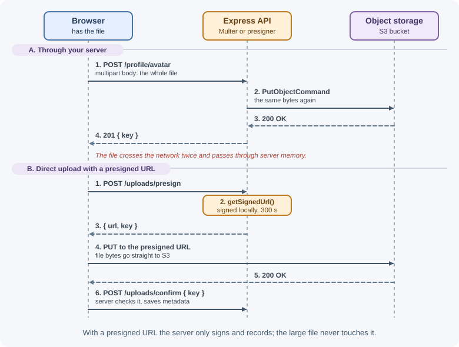

# File Uploads with Multer

Browsers send files to a server as `multipart/form-data` requests, a format
that `express.json()` and `express.urlencoded()` cannot read. Multer is the
standard Express middleware for parsing these requests: it extracts the text
fields into `req.body` and the files into `req.file` or `req.files`. This
lesson covers Multer's storage engines, limits, filtering, error handling,
and how to upload files safely to object storage.

## Why it matters

File uploads are one of the riskiest features in a web application. An
unlimited upload can fill a disk or exhaust memory. A trusted filename can
overwrite server files through path traversal. A file served back with the
wrong content type can run scripts in users' browsers. Handling uploads well
means controlling size, type, naming, and where files end up.

For the architecture side (object storage, presigned URLs, scanning
pipelines), see [file storage and uploads](../backend-concepts/file-storage-and-uploads.md).

## Real-world usage

- **Amazon S3** supports uploads that never pass through your server. Its
  [presigned URL guide](https://docs.aws.amazon.com/AmazonS3/latest/userguide/PresignedUrlUploadObject.html)
  explains that a presigned URL "will allow an upload without requiring
  another party to have AWS security credentials or permissions": the
  server signs, the client uploads directly. This is the pattern shown later
  in this lesson.
- **Slack** moved its file-upload API to a two-step design. Its
  [`files.getUploadURLExternal`](https://docs.slack.dev/reference/methods/files.getUploadURLExternal)
  method returns an upload URL and a file ID; the client sends the bytes to
  that URL and then calls `files.completeUploadExternal` to finalize the
  upload. Separating "send bytes" from "register the file" is the same idea
  as presigned uploads.
- **Shopify** uses staged uploads for product images, videos, and 3D
  models. The
  [`stagedUploadsCreate`](https://shopify.dev/docs/api/admin-graphql/latest/mutations/stagedUploadsCreate)
  mutation generates secure, temporary upload URLs; the app uploads files
  directly to them and then creates the assets that reference the uploaded
  files.

Popular tools and providers: Multer and `busboy` for parsing in Express,
`file-type` for magic-byte checks; object storage such as Amazon S3, Google
Cloud Storage, Azure Blob Storage, and Cloudflare R2.

## How it works

### What a multipart request looks like

```text
POST /profile/avatar HTTP/1.1
Content-Type: multipart/form-data; boundary=----X9f2

------X9f2
Content-Disposition: form-data; name="displayName"

Ada
------X9f2
Content-Disposition: form-data; name="avatar"; filename="me.png"
Content-Type: image/png

<binary bytes of the PNG>
------X9f2--
```

Each **part** is separated by a boundary string. A part has its own headers:
`name` is the form field name, `filename` is the name on the user's
computer, and `Content-Type` is what the browser claims the file is. Multer
streams through these parts using the `busboy` parser.

A browser form needs `enctype="multipart/form-data"`; with `fetch`, pass a
`FormData` object and let the browser set the `Content-Type` header,
including the boundary.

### Setting up Multer

```js
import multer from "multer";
const upload = multer({ storage, limits, fileFilter });
```

`upload` is a factory; you call one of its methods to get route-level
middleware:

| Method | Accepts | Result |
|--------|---------|--------|
| `upload.single("avatar")` | One file in field `avatar` | `req.file` |
| `upload.array("photos", 5)` | Up to 5 files in field `photos` | `req.files` (array) |
| `upload.fields([{ name: "front", maxCount: 1 }, { name: "back", maxCount: 1 }])` | Files in several named fields | `req.files` (object of arrays) |
| `upload.none()` | Text fields only | Error if any file is sent |
| `upload.any()` | Files in any field | `req.files` (array); avoid in most apps |

Text fields always land in `req.body`. Apply Multer only on the routes that
accept uploads, never globally with `app.use()`: a global upload middleware
lets any route receive files.

### The file object

| Property | Meaning |
|----------|---------|
| `fieldname` | The form field name |
| `originalname` | Filename from the user's computer: **untrusted** |
| `mimetype` | Content type claimed by the client: **untrusted** |
| `size` | Size in bytes |
| `buffer` | File contents (memory storage only) |
| `destination`, `filename`, `path` | Where it was saved (disk storage only) |

### Storage engines

**Memory storage** keeps each file as a `Buffer` in `file.buffer`. It is
simple and good when you immediately send the file elsewhere (to S3, or an
image processor), but every concurrent upload consumes RAM, so always pair it
with a small `fileSize` limit.

**Disk storage** writes files to a folder. You control the folder and the
filename:

```js
const storage = multer.diskStorage({
  destination: (req, file, cb) => cb(null, "uploads/tmp"),
  filename: (req, file, cb) => cb(null, `${crypto.randomUUID()}.upload`),
});
```

If you pass only `dest: "uploads/"`, Multer saves files with random names and
no extension, which is a safe default.

### Limits

`limits` stops oversized or abusive requests while they stream:

| Limit | Meaning |
|-------|---------|
| `fileSize` | Maximum bytes per file |
| `files` | Maximum number of files |
| `fields` | Maximum number of text fields |
| `fieldSize` | Maximum bytes per text field value |
| `parts` | Maximum total parts (files + fields) |

Apart from `fieldSize` (1 MB), these limits default to unlimited
(`Infinity`), so a Multer instance without `limits` accepts files of any
size and number.

When a limit is exceeded, Multer stops and passes a `MulterError` to `next()`
with a `code` such as `LIMIT_FILE_SIZE`, `LIMIT_FILE_COUNT`, or
`LIMIT_UNEXPECTED_FILE` (a file in a field you did not declare).

### Filtering file types

`fileFilter(req, file, cb)` runs before a file is stored. Call
`cb(null, true)` to accept, `cb(null, false)` to silently skip, or
`cb(error)` to reject the request.

!!! warning "The MIME type is only a claim"
    `file.mimetype` comes from the client and can be anything. A filter on it
    blocks honest mistakes, not attackers. For real verification, inspect
    the file's first bytes (its **magic bytes**) after upload, for example
    with the `file-type` package, and reject files whose actual type is not
    allowed. Image files can also be re-encoded with an image library, which
    removes hidden payloads and metadata.

Note that `fileFilter` only sees `req.body` fields that appeared **before**
the file in the form, because the request is streamed in order.

Putting the pieces together, each file part passes these checks in order:


## When to use and when not to use

Upload through Express with Multer when:

- Files are small (avatars, attachments of a few megabytes) and you want to
  validate, resize, or scan them before storing.
- The upload is part of a form submission that also carries text fields.
- You need full control over the bytes on the server (for example, to strip
  image metadata).

Prefer direct-to-storage uploads (presigned URLs) when:

- Files are large (videos, archives) or users are on slow connections: the
  upload would occupy a server connection, and a slow upload can run into
  Node's 5-minute default request timeout.
- Upload volume is high and you do not want app servers paying for the
  bandwidth twice (client → server → storage).

| Approach | Bytes pass through your server | Good for | Watch out for |
|----------|--------------------------------|----------|---------------|
| Multer `memoryStorage` | Yes, held in RAM | Small files you forward or process immediately | Memory per concurrent upload; always set `fileSize` |
| Multer `diskStorage` | Yes, written to local disk | Larger files processed on the same machine | Disk filling up; files lost when instances are replaced |
| Streaming to storage (custom engine or `busboy`) | Yes, streamed | Medium files without buffering | More code; still uses server bandwidth |
| Presigned URL to object storage | No | Large or numerous files | Bucket CORS setup; validate the file after upload |

## Practical examples

### Single image upload with limits and a filter

```js
import express from "express";
import multer from "multer";

const app = express();

const ALLOWED_TYPES = new Set(["image/png", "image/jpeg", "image/webp"]);

function imageFilter(req, file, cb) {
  if (ALLOWED_TYPES.has(file.mimetype)) return cb(null, true);
  const err = new Error("Only PNG, JPEG, or WebP images are allowed");
  err.status = 415;
  cb(err);
}

const upload = multer({
  storage: multer.memoryStorage(),
  limits: { fileSize: 2 * 1024 * 1024, files: 1 }, // 2 MB, one file
  fileFilter: imageFilter,
});

app.post("/profile/avatar", upload.single("avatar"), (req, res) => {
  if (!req.file) return res.status(400).json({ error: "No file uploaded" });
  res.status(201).json({
    displayName: req.body.displayName,
    size: req.file.size,
    type: req.file.mimetype,
  });
});
```

Test it with curl:

```text
curl -F "displayName=Ada" -F "avatar=@me.png" http://localhost:3000/profile/avatar
{"displayName":"Ada","size":48213,"type":"image/png"}
```

### Several files and named fields

```js
// The single-file instance above has `files: 1`, which would reject these
// routes with LIMIT_FILE_COUNT, so they get their own instance.
const multiUpload = multer({
  storage: multer.memoryStorage(),
  limits: { fileSize: 2 * 1024 * 1024, files: 10 },
  fileFilter: imageFilter,
});

app.post("/listings/:id/photos", multiUpload.array("photos", 10), (req, res) => {
  res.json({ count: req.files.length });
});

const idUpload = multiUpload.fields([
  { name: "front", maxCount: 1 },
  { name: "back", maxCount: 1 },
]);

app.post("/verify-id", idUpload, (req, res) => {
  const front = req.files.front?.[0];
  const back = req.files.back?.[0];
  if (!front || !back) return res.status(400).json({ error: "Both sides needed" });
  res.sendStatus(202);
});
```

### Handling Multer errors in the error handler

```js
app.use((err, req, res, next) => {
  if (err instanceof multer.MulterError) {
    const status = err.code === "LIMIT_FILE_SIZE" ? 413 : 400;
    return res.status(status).json({ error: err.message, code: err.code });
  }
  if (err.status) return res.status(err.status).json({ error: err.message });
  next(err); // anything else goes to the default handler
});
```

`413 Content Too Large` tells the client the file was too big; `415
Unsupported Media Type` tells it the type is not accepted. See
[error handling in Express](error-handling-in-express.md) for the full
pattern.

### Verifying the real type with magic bytes

```js
import { fileTypeFromBuffer } from "file-type";

// A separate instance: the image filter above would reject PDFs.
const pdfUpload = multer({
  storage: multer.memoryStorage(),
  limits: { fileSize: 10 * 1024 * 1024, files: 1 },
});

app.post("/documents", pdfUpload.single("document"), async (req, res) => {
  if (!req.file) return res.status(400).json({ error: "No file uploaded" });
  // Read the real type from the file's first bytes, not the client's claim
  const detected = await fileTypeFromBuffer(req.file.buffer);
  if (detected?.mime !== "application/pdf") {
    return res.status(415).json({ error: "File is not a PDF" });
  }
  res.sendStatus(201);
});
```

### Uploading to object storage (S3)

Servers usually should not keep uploads on their own disk: disks fill up and
files are lost when instances are replaced. Send them to object storage:

```js
import { S3Client, PutObjectCommand } from "@aws-sdk/client-s3";

const s3 = new S3Client({ region: process.env.AWS_REGION });

app.post("/profile/avatar", upload.single("avatar"), async (req, res) => {
  const key = `avatars/${crypto.randomUUID()}`; // never the original name
  await s3.send(new PutObjectCommand({
    Bucket: process.env.UPLOAD_BUCKET,
    Key: key,
    Body: req.file.buffer,
    ContentType: req.file.mimetype,
  }));
  res.status(201).json({ key });
});
```

For large files, a better pattern skips your server entirely: the server
creates a short-lived **presigned URL**, and the browser uploads straight to
storage.

```js
import { getSignedUrl } from "@aws-sdk/s3-request-presigner";

app.post("/uploads/presign", async (req, res) => {
  const key = `uploads/${crypto.randomUUID()}`;
  const url = await getSignedUrl(
    s3,
    new PutObjectCommand({ Bucket: process.env.UPLOAD_BUCKET, Key: key,
      ContentType: "application/pdf" }),
    { expiresIn: 300 } // seconds
  );
  res.json({ url, key });
});
```



### Serving uploaded files safely

```js
import path from "node:path";

const UPLOAD_DIR = path.resolve("uploads");

app.get("/files/:id", requireLogin, async (req, res) => {
  const file = await findFileRecord(req.params.id); // metadata from the DB
  if (!file || file.ownerId !== req.user.id) return res.sendStatus(404);

  res.set("X-Content-Type-Options", "nosniff");
  // Force download instead of rendering in the browser.
  res.download(file.storedName, file.displayName, { root: UPLOAD_DIR });
});
```

Look files up by an ID in your database, not by a path from the URL. The
`root` option makes Express refuse paths that escape the folder.

## Best practices

- Apply Multer per route, never globally.
- Always set `limits`, especially `fileSize` and `files`.
- Allow a short list of types and verify magic bytes for anything important.
- Generate your own storage names (UUIDs); keep the original name only as
  display metadata in the database.
- Store files outside the web root and outside the project folder, ideally
  in object storage.
- Prefer presigned URLs for large files so uploads do not tie up your server.
- Serve user files with `Content-Disposition: attachment` and
  `X-Content-Type-Options: nosniff`, ideally from a separate domain.
- Scan uploads for malware when users share files with each other.
- Clean up temporary files when a request fails.
- Record metadata (owner, size, type, storage key) in the database.

## In production

- **The process crashes under upload traffic.** Detect: memory graphs
  climbing during uploads, containers restarted for exceeding their memory
  limit, or `JavaScript heap out of memory` in logs. Cause: `memoryStorage`
  with no or very high `fileSize` limits, multiplied by concurrent uploads.
  Fix: set `limits`, stream to disk or storage, or move large files to
  presigned uploads.
- **Large uploads fail with 413 before Express sees them.** Detect: the 413
  response is an HTML page from the proxy, not your JSON error; Express logs
  show no request. Cause: a reverse proxy limit; Nginx's
  `client_max_body_size` defaults to `1m`. Fix: raise it for upload routes
  only, and keep Multer's `fileSize` as the real application limit.
- **Disk full errors.** Detect: `ENOSPC: no space left on device` in logs and
  failed writes across the app. Cause: `diskStorage` temporary files that are
  never deleted when a request fails or after processing. Fix: delete files in
  a `finally` block or error handler, run a cleanup job, or avoid local disk.
- **Files "disappear" after a deploy or exist only on one instance.**
  Detect: 404s for files that were uploaded successfully, often only on some
  requests behind a load balancer. Cause: files saved to local disk on one
  server, which is replaced or not shared. Fix: store files in object storage
  and keep only the key in the database.
- **Browser uploads to presigned URLs fail.** Detect: a CORS error in the
  browser console, or an S3 error response with code `SignatureDoesNotMatch`.
  Cause: the bucket has no CORS rule allowing `PUT` from your origin, or the
  client sent headers (such as `Content-Type`) that differ from what was
  signed. Fix: add a bucket CORS configuration and send exactly the signed
  headers.

## Important terminology

- **multipart/form-data:** A request body format that carries text fields and
  files as separate parts.
- **Boundary:** The delimiter string that separates parts.
- **Storage engine:** Multer's strategy for where file data goes (memory or
  disk, or a custom engine).
- **Magic bytes:** Signature bytes at the start of a file that identify its
  real format.
- **Path traversal:** Using `../` in a path to reach files outside the
  intended folder.
- **Presigned URL:** A time-limited URL that grants permission for one
  storage operation.
- **Object storage:** A service such as Amazon S3 that stores files as
  objects addressed by keys.

## Common mistakes and misconceptions

- **Expecting `express.json()` to parse uploads.** It ignores multipart
  bodies; `req.file` stays `undefined` without Multer.
- **Setting `Content-Type` manually with `FormData`.** The browser must add
  the boundary; setting the header yourself breaks the request.
- **Trusting `originalname`.** It can contain `../`, odd characters, or a
  misleading extension.
- **Trusting `mimetype`.** A script can be sent as `image/png`.
- **Using memory storage without a size limit.** A few large uploads can
  crash the process.
- **Field name mismatch.** `upload.single("avatar")` with a form field named
  `file` causes a `LIMIT_UNEXPECTED_FILE` error.
- **Serving uploads with `express.static` from a public folder.** Users can
  upload HTML or SVG that runs scripts on your domain.

## Revision questions

1. Why can't `express.json()` read a file upload?
2. When would you choose memory storage over disk storage?
3. Why is checking `file.mimetype` not enough to verify a file's type?
4. How should a server respond when a file exceeds `fileSize`, and why?
5. What are the advantages of uploading directly to storage with a presigned
   URL?
6. Name three precautions when serving user-uploaded files back to users.

## Further learning

- [Multer on GitHub](https://github.com/expressjs/multer)
- [MDN: Using FormData objects](https://developer.mozilla.org/en-US/docs/Web/API/XMLHttpRequest_API/Using_FormData_Objects)
- [OWASP File Upload Cheat Sheet](https://cheatsheetseries.owasp.org/cheatsheets/File_Upload_Cheat_Sheet.html)
- [file-type on npm](https://www.npmjs.com/package/file-type)
- [AWS: Uploading objects with presigned URLs](https://docs.aws.amazon.com/AmazonS3/latest/userguide/PresignedUrlUploadObject.html)
- [AWS overview in these notes](../../06-servers-and-infrastructure/aws.md)
