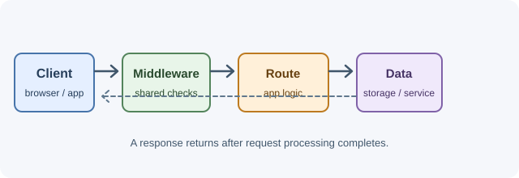

# Backend Development

This section follows the server side of an application: receiving requests,
running application logic, and returning useful and reliable responses.

Begin with [backend fundamentals](backend-fundamentals.md), then learn how
[Node.js](nodejs.md) and [Express](express.md) provide a practical server
runtime and framework. Continue with [REST APIs](rest-apis.md), and see how
[middleware](middleware.md), [authentication and authorization](authentication-and-authorization.md),
and [error handling](error-handling.md) support dependable services.

## Learning objectives

- Understand the responsibilities of a backend service.
- Explore Node.js, Express, and REST API concepts.
- Learn how middleware, authentication, and error handling fit into a server.
- Trace a request through a server and identify where common backend concerns belong.

## Topics

- [Backend Fundamentals](backend-fundamentals.md)
- [Node.js](nodejs.md)
- [Express](express.md)
- [REST APIs](rest-apis.md)
- [Authentication and Authorization](authentication-and-authorization.md)
- [Middleware](middleware.md)
- [Error Handling](error-handling.md)
