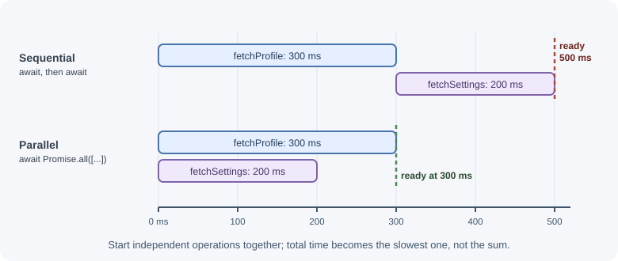

# Asynchronous Programming in Node.js

Almost everything a backend does—reading files, querying databases, calling
other services—takes time. Node.js handles that time without blocking by
using asynchronous patterns: callbacks, promises, and `async`/`await`. This
page covers each pattern, how errors flow through them, and how to run work
in sequence, in parallel, and with timeouts.

## Why it matters

Asynchronous code that is written badly causes the hardest backend bugs:
requests that never respond, errors that disappear, operations that run one
after another when they could run together, and crashes from unhandled
rejections. Mastering these patterns is required for writing any reliable
Node.js service. The browser-side basics are covered in
[async JavaScript](../../02-frontend-development/javascript/async-javascript.md);
this page focuses on Node.js.

## Real-world usage

- **MongoDB's Node.js driver** removed callback support in version 5.0 and
  now offers a promise-only API. Code that still needs callbacks must use a
  separate `mongodb-legacy` package. Supporting two styles was holding the
  API back
  ([MongoDB Node.js driver v5.0.0 release notes](https://github.com/mongodb/node-mongodb-native/releases/tag/v5.0.0)).
- **Stripe's Node.js library** is used with `await`. Since v13 it
  automatically retries a failed request once when that is safe, retries more
  times with exponential backoff if you raise `maxNetworkRetries`, and adds
  idempotency keys so a retry cannot charge a customer twice
  ([stripe-node README](https://github.com/stripe/stripe-node)).
- **AWS's SDK for JavaScript v3** documentation shows a Lambda function that
  starts three DynamoDB calls and waits for all of them with `Promise.all`,
  which is the parallel pattern on this page
  ([AWS SDK for JavaScript v3: Using promises](https://docs.aws.amazon.com/sdk-for-javascript/v3/developer-guide/using-promises.html)).
- **Express 5** forwards a rejected promise from an `async` route handler or
  middleware to the error-handling middleware, which makes `async` handlers
  safe to write. With Express 4 you had to catch the error and call
  `next(err)` yourself
  ([Express: Migrating to Express 5](https://expressjs.com/en/guide/migrating-5.html)).

Popular tools and providers: built-in `node:util` (`promisify`),
`node:timers/promises`, and `AbortSignal`; `p-limit` for capping
concurrency; client libraries such as the AWS SDK v3 and the MongoDB driver
that return promises.

## How it works

### 1. Error-first callbacks

Node.js's original style passes a callback as the last argument. The
callback receives an **error first**, then the result:

```js
import { readFile } from "node:fs";

readFile("config.json", "utf8", (error, text) => {
  if (error) {
    console.error("Could not read config:", error.message);
    return; // stop: text is undefined
  }
  console.log("Config length:", text.length);
});
```

Rules of the convention:

- The first argument is an `Error` or `null`.
- On success, results follow the error argument.
- The callback is called **exactly once**.
- Errors are passed to the callback, not thrown, because the original call
  has already returned by the time the operation fails.

### Callback hell

Dependent steps nest deeper and deeper, and each level must handle errors:

```js
getUser(id, (err, user) => {
  if (err) return handle(err);
  getOrders(user.id, (err, orders) => {
    if (err) return handle(err);
    getInvoice(orders[0].id, (err, invoice) => {
      if (err) return handle(err);
      send(invoice);
    });
  });
});
```

This "pyramid of doom" is hard to read, easy to get wrong (a missing
`return` calls the next step with an error), and hard to run in parallel.
Promises solve these problems.

### 2. Promises

A **promise** is an object representing a value that will be available
later. It is always in one of three states:


Once fulfilled or rejected, a promise is **settled** and never changes.

```js
const promise = new Promise((resolve, reject) => {
  setTimeout(() => resolve("done"), 100);
});

promise
  .then((value) => value.toUpperCase()) // returns a new promise
  .then((upper) => console.log(upper))  // DONE
  .catch((error) => console.error(error))
  .finally(() => console.log("cleanup runs either way"));
```

Key behaviors:

- `.then()` returns a **new** promise, so calls can be chained.
- Returning a value from `.then()` fulfills the next promise with it;
  returning a promise makes the chain wait for it.
- Throwing inside `.then()` rejects the next promise. The rejection skips
  later `.then()` handlers until a `.catch()` handles it.
- `.finally()` runs on both outcomes and passes the original result through.

### Combining promises

| Method | Resolves when | Rejects when | Typical use |
|--------|---------------|--------------|-------------|
| `Promise.all(list)` | All fulfill → array of values in input order | **Any** rejects (first rejection wins; others keep running but are ignored) | Independent operations that must all succeed |
| `Promise.allSettled(list)` | All settle → array of `{ status, value }` / `{ status, reason }` | Never | Run everything, then report which failed |
| `Promise.race(list)` | First to settle fulfills | First to settle rejects | Timeouts, first response wins |
| `Promise.any(list)` | First to **fulfill** | All reject → `AggregateError` | Try several mirrors, use the first success |


### 3. `async` and `await`

`async`/`await` is syntax built on promises that lets asynchronous code read
like synchronous code:

- An `async` function **always returns a promise**. Returning a value
  fulfills it; throwing rejects it.
- `await` pauses the function until a promise settles, then gives the value
  or throws the rejection reason. Other code keeps running while it waits.

```js
async function loadInvoice(userId) {
  try {
    const user = await getUser(userId);
    const orders = await getOrders(user.id);
    return await getInvoice(orders[0].id);
  } catch (error) {
    throw new Error(`Failed to load invoice for ${userId}`, { cause: error });
  }
}
```

### Sequential versus parallel

Each `await` waits before the next line starts. If operations do not depend
on each other, start them together:

```js
// Sequential: total time ≈ 300 + 200 = 500 ms
const profile = await fetchProfile(id);    // 300 ms
const settings = await fetchSettings(id);  // 200 ms

// Parallel: total time ≈ max(300, 200) = 300 ms
const [profile2, settings2] = await Promise.all([
  fetchProfile(id),
  fetchSettings(id),
]);
```



Use sequential code when a step needs the previous result, or when you must
limit load on a downstream service.

### Converting callback APIs: `util.promisify`

`util.promisify` turns a function that follows the error-first convention
into one that returns a promise:

```js
import { promisify } from "node:util";
import { exec } from "node:child_process";

const execAsync = promisify(exec);
const { stdout } = await execAsync("node --version");
console.log(stdout.trim());
```

Most core modules also provide promise versions directly:

```js
import { readFile } from "node:fs/promises";
import { setTimeout as sleep } from "node:timers/promises";
import { lookup } from "node:dns/promises";

await sleep(500); // wait 500 ms without a callback
```

### Cancellation and timeouts: `AbortController`

An `AbortController` creates a signal that can cancel work. Many Node.js
APIs—`fetch`, `fs.readFile`, `timers/promises`, `events.once`,
`child_process`—accept a `signal` option.

```js
const controller = new AbortController();
setTimeout(() => controller.abort(), 2000); // cancel after 2 s

try {
  const response = await fetch("https://example.com/slow", {
    signal: controller.signal,
  });
  console.log(response.status);
} catch (error) {
  if (error.name === "AbortError") console.log("Request cancelled");
  else throw error;
}
```

`AbortSignal.timeout(ms)` is a shortcut that aborts automatically:

```js
const response = await fetch(url, { signal: AbortSignal.timeout(3000) });
// Rejects with a "TimeoutError" DOMException after 3 s.
```

`AbortSignal.any([signalA, signalB])` combines signals, for example a user
cancellation and a timeout.

### Async iteration: `for await...of`

Some sources produce values over time, such as streams, paginated APIs, and
events. Async iterables let you loop over them:

```js
import { createReadStream } from "node:fs";
import { createInterface } from "node:readline";

const lines = createInterface({ input: createReadStream("access.log") });

let count = 0;
for await (const line of lines) {
  if (line.includes(" 500 ")) count++;
}
console.log(`Server errors: ${count}`);
```

You can write your own with an `async function*` generator:

```js
async function* fetchAllPages(url) {
  let next = url;
  while (next) {
    const response = await fetch(next);
    const body = await response.json();
    yield* body.items;
    next = body.nextPage;
  }
}
```

### Unhandled rejections

A promise that rejects with no `.catch()` and no `await` in a `try` block is
an **unhandled rejection**. By default, Node.js treats it as a fatal error:
it prints the error and the process exits with a non-zero code. This
protects you from silently ignoring failures. Always handle rejections, and
see [errors, debugging, and performance](errors-debugging-and-performance.md)
for process-level handlers.

Measured on Node.js 22: `Promise.reject(new Error("boom"))` with no handler
printed the error and ended the process with exit code 1, even though a
timer was still pending.

## When to use and when not to use

- **Use `async`/`await`** for almost all new application code: request
  handlers, services, and scripts.
- **Use `Promise.all` / `allSettled`** when several independent operations
  can run at the same time, and the list is small or capped.
- **Use callbacks** only when an API offers nothing else, and wrap them with
  `util.promisify` at the edge of your code.
- **Use `for await...of`** for data that arrives over time: streams,
  paginated APIs, and lines of a file.
- **Use events or streams, not one promise,** for something that produces
  many values or never "finishes", such as a socket.
- **Do not use `Promise.all` on unbounded lists** (thousands of IDs from a
  request). Cap concurrency instead.

| Need | Best fit | Why not the others |
|------|----------|--------------------|
| One result, later | `async`/`await` | Callbacks nest and lose errors more easily |
| Several independent results | `Promise.all` | Sequential `await` adds the waits together |
| Many results over time | Async iterator or stream | A promise settles only once |
| Repeated notifications | `EventEmitter` | Promises cannot fire twice |
| A thousand jobs, gently | Concurrency limit | `Promise.all` starts all of them at once |

## Practical examples

### Retrying with a delay

```js
import { setTimeout as sleep } from "node:timers/promises";

async function withRetry(operation, attempts = 3, delayMs = 200) {
  for (let attempt = 1; attempt <= attempts; attempt++) {
    try {
      return await operation(); // await inside try so failures are caught
    } catch (error) {
      if (attempt === attempts) throw error;
      await sleep(delayMs * attempt); // back off a little more each time
    }
  }
}

const data = await withRetry(() => fetch("https://example.com/api"));
```

### Limited concurrency

`Promise.all` on 10,000 items starts 10,000 operations at once, which can
overwhelm a database. Process a fixed number at a time instead:

```js
async function mapWithLimit(items, limit, worker) {
  const results = new Array(items.length);
  let nextIndex = 0;

  async function runner() {
    while (nextIndex < items.length) {
      const index = nextIndex++; // safe: JS runs on one thread
      results[index] = await worker(items[index]);
    }
  }

  await Promise.all(Array.from({ length: limit }, runner));
  return results;
}

const users = await mapWithLimit(userIds, 5, (id) => fetchUser(id));
```

### Reporting partial failures

```js
const results = await Promise.allSettled([
  sendEmail(user),
  sendSms(user),
  sendPush(user),
]);

for (const result of results) {
  if (result.status === "rejected") {
    console.error("Notification failed:", result.reason.message);
  }
}
```

## Best practices

- Use `async`/`await` for new code; wrap old callback APIs with
  `util.promisify` or use the `*/promises` modules.
- Run independent operations in parallel with `Promise.all`, but cap
  concurrency for large lists.
- Always set timeouts on network calls with `AbortSignal.timeout`.
- Handle every rejection: `await` inside `try`/`catch`, or attach `.catch()`.
- Add context when rethrowing: `new Error("message", { cause: error })`.
- Do not mix callbacks and promises for the same operation.
- Return or await promises from functions; never start one and forget it
  unless you deliberately handle its errors.

## In production

- **Crash loops from unhandled rejections.**
  - *Symptom:* the process exits with code 1, prints a stack trace, and the
    container restarts again and again.
  - *Detect:* restart counts climb, and the last log lines before each exit
    show the rejected error.
  - *Cause:* a "fire-and-forget" promise (an analytics call, a cache write)
    with no `await` or `.catch()`.
  - *Fix:* await it or attach `.catch()` that logs the error. Keep a
    process-level `unhandledRejection` handler that logs and exits so the
    failure stays visible.
- **Requests that never finish.**
  - *Symptom:* in-flight requests and memory keep rising; clients time out
    while the server never responds.
  - *Detect:* an "active requests" gauge grows, and traces show outbound
    calls with no end time.
  - *Cause:* outbound `fetch` calls without a timeout to a dependency that
    stopped answering.
  - *Fix:* add `AbortSignal.timeout(ms)` to every outbound call, shorter than
    your own request timeout.
- **A connection pool exhausted by `Promise.all`.**
  - *Symptom:* a bulk endpoint triggers database errors about timing out
    while waiting for a pooled connection, and unrelated endpoints slow down
    too.
  - *Detect:* pool usage hits its maximum exactly when the bulk job runs.
  - *Cause:* `Promise.all(ids.map(...))` started thousands of queries at
    once.
  - *Fix:* cap concurrency (`mapWithLimit` above or `p-limit`), or batch IDs
    into one query.
- **Retry storms.**
  - *Symptom:* a dependency that slows down briefly gets overwhelmed and
    stays down.
  - *Detect:* requests to the dependency multiply exactly when its error rate
    rises.
  - *Cause:* every caller retries immediately, several times, without backoff.
  - *Fix:* use exponential backoff with jitter, a small attempt limit, and
    idempotency keys for writes. See
    [timeouts, retries, and idempotency](../backend-concepts/timeouts-retries-and-idempotency.md).
- **Work silently skipped.**
  - *Symptom:* a batch job reports success, but some records were never
    saved, and no error appears.
  - *Detect:* counts in the database do not match the input.
  - *Cause:* `items.forEach(async ...)` returned before the saves finished,
    and their errors were lost.
  - *Fix:* use `for...of` with `await`, or `await Promise.all(...)`.

## Important terminology

- **Callback:** A function passed to another function to be called later.
- **Error-first callback:** A callback whose first argument is an error or
  `null`.
- **Promise:** An object representing the eventual result of an
  asynchronous operation.
- **Settled:** A promise that is fulfilled or rejected.
- **`async` function:** A function that always returns a promise and can use
  `await`.
- **`await`:** Pauses an `async` function until a promise settles.
- **Unhandled rejection:** A rejected promise with no rejection handler.
- **AbortSignal:** An object that signals that an operation should be
  cancelled.
- **Async iterable:** An object that can be looped over with
  `for await...of`.

## Common mistakes and misconceptions

- **Using `async` callbacks with `forEach`.** `forEach` ignores the returned
  promises, so the loop "finishes" before the work does and errors are lost.
  Use `for...of` (sequential) or `Promise.all(items.map(...))` (parallel).

  ```js
  // Wrong
  ids.forEach(async (id) => await save(id));
  // Right
  for (const id of ids) await save(id);
  await Promise.all(ids.map((id) => save(id)));
  ```

- **Forgetting `await`.** `const user = getUser(id)` gives a pending
  promise, not the user, and errors become unhandled rejections.
- **`return promise` inside `try`.** Returning a promise without `await`
  from inside a `try` block means its rejection is not caught there. Use
  `return await promise` when you want the local `catch` to run.
- **"`await` blocks the server."** It pauses only the current function;
  other requests continue.
- **"`Promise.all` cancels the other operations when one fails."** It stops
  waiting, but the other operations keep running.
- **Calling a callback twice** or both calling it and throwing.

## Revision questions

1. What are the rules of the error-first callback convention?
2. What are the three states of a promise, and what does "settled" mean?
3. Compare `Promise.all`, `allSettled`, `race`, and `any` when one input
   rejects.
4. Why does `ids.forEach(async (id) => ...)` not wait for the work?
5. How do you add a timeout to a `fetch` call in Node.js?
6. What happens by default when a promise rejection is not handled?

## Further learning

- [Node.js: JavaScript asynchronous programming and callbacks](https://nodejs.org/en/learn/asynchronous-work/javascript-asynchronous-programming-and-callbacks)
- [Node.js: Discover promises in Node.js](https://nodejs.org/en/learn/asynchronous-work/discover-promises-in-nodejs)
- [MDN: Using promises](https://developer.mozilla.org/en-US/docs/Web/JavaScript/Guide/Using_promises)
- [MDN: async function](https://developer.mozilla.org/en-US/docs/Web/JavaScript/Reference/Statements/async_function)
- [Node.js API: util.promisify](https://nodejs.org/api/util.html#utilpromisifyoriginal)
- [MDN: AbortSignal](https://developer.mozilla.org/en-US/docs/Web/API/AbortSignal)
