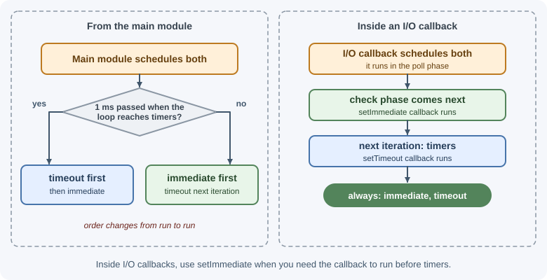
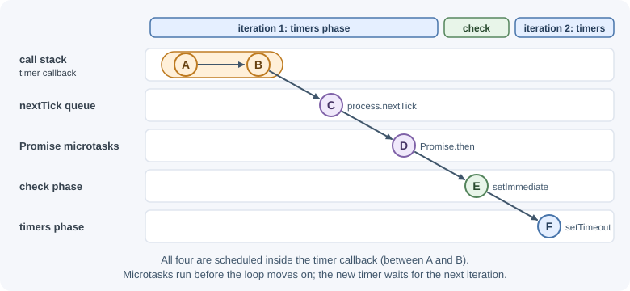

# The Node.js Event Loop

The event loop is the mechanism that lets a single JavaScript thread handle
many operations at once. It repeatedly checks for completed work—expired
timers, finished I/O, closed sockets—and runs the matching callbacks one at
a time. Understanding its phases explains callback ordering and why blocking
code hurts every request.

## Why it matters

Every Node.js server depends on the event loop staying free. If one callback
runs for 200 ms, every other request waits 200 ms. Knowing the loop's phases
and queues lets you predict the order in which code runs, debug "why did this
run first?" puzzles, and keep latency low under load. For how the loop works
in browsers, see
[event loop and concurrency](../../02-frontend-development/javascript/event-loop-and-concurrency.md);
Node.js uses the same idea with different phases.

## Real-world usage

- **Netflix** saw request latency on its Node.js website rise steadily, by
  about 10 ms every hour, along with CPU use. CPU flame graphs showed time
  spent in Express's router. Something was adding the same static-file
  handler to the route array 10 times an hour, and every request walked the
  whole array on the main thread, at about 1 ms of CPU per extra handler
  ([Netflix Technology Blog: Node.js in Flames](https://netflixtechblog.com/node-js-in-flames-ddd073803aa4)).
- **Cloudflare** suffered a global outage when a web-application-firewall
  rule contained a regular expression that "backtracked enormously" and
  exhausted the CPU used to serve HTTP traffic. That proxy is not Node.js,
  but the failure is the one this page calls ReDoS: one pathological regex
  starves everything else on the CPU
  ([Cloudflare blog: Details of the Cloudflare outage on July 2, 2019](https://blog.cloudflare.com/details-of-the-cloudflare-outage-on-july-2-2019/)).
- **Trello** chose Node.js because instant updates required holding a lot of
  open connections. An event loop serving non-blocking I/O handles many idle
  connections on one thread
  ([Atlassian blog: The Trello tech stack](https://www.atlassian.com/blog/trello/the-trello-tech-stack)).

Popular tools and providers: `perf_hooks.monitorEventLoopDelay` and
`performance.eventLoopUtilization()` built into Node.js; Clinic.js; flame
graphs from `--cpu-prof` or Linux `perf`; APM agents that chart event loop
lag.

## How it works

### The call stack and the loop

JavaScript executes on a **call stack**. When a function is called, a frame
is pushed; when it returns, the frame is popped. Node.js can run a new
callback only when the stack is empty. The event loop's job is to choose the
next callback once the current one finishes.

When you run `node app.js`, Node.js:

1. Runs your main module synchronously from top to bottom.
2. Drains the microtask queues (explained below).
3. Enters the event loop and keeps looping while there is pending work:
   active timers, open servers or sockets, pending file operations, and so on.
4. Exits when nothing is left that could produce a callback.

### The phases

Each iteration of the loop (a "tick") goes through these phases in order.
Every phase has a queue of callbacks to run.


| Phase | What runs there |
|-------|-----------------|
| **timers** | Callbacks from `setTimeout` and `setInterval` whose delay has passed. A delay is a *minimum*, not a guarantee. |
| **pending callbacks** | Some system callbacks deferred from the previous iteration, such as certain TCP error reports. |
| **idle, prepare** | Used internally by Node.js. |
| **poll** | Retrieves new I/O events and runs their callbacks (incoming requests, socket data, completed file operations). If there is nothing else to do, the loop waits here for I/O, up to the time of the next timer. |
| **check** | Callbacks scheduled with `setImmediate`. They run right after the poll phase. |
| **close callbacks** | `close` events, such as a socket that was destroyed. |

### Microtasks: `process.nextTick` and promises

Two special queues are not phases. They are drained **after the current
callback finishes and before the next one starts**, in any phase:

1. The **`process.nextTick` queue** is drained first.
2. Then the **Promise microtask queue** (`.then`, `.catch`, `.finally`,
   code after `await`, and `queueMicrotask`) is drained.
3. If either queue gains new items while draining, those also run before the
   loop moves on.

```text
 [callback finishes] → run ALL nextTick callbacks → run ALL promise
                       microtasks → (repeat if new ones were added)
                       → next callback / next phase
```

Because these queues are drained completely, code that keeps adding new
`nextTick` callbacks can **starve** the event loop: I/O and timers never get
a turn. Prefer `queueMicrotask` or promises for ordinary deferral, and
`setImmediate` when you want I/O to get a chance to run first.

!!! note "Top-level code in ES modules"
    Inside callbacks, `process.nextTick` callbacks run before promise
    callbacks. At the top level of an ES module, the module itself is
    evaluated as part of a promise job, so promise callbacks can run before
    `nextTick` callbacks there. Do not write code that depends on the
    relative order of these two queues.

### `setTimeout(fn, 0)` versus `setImmediate(fn)`

- `setTimeout(fn, 0)` schedules `fn` for the **timers** phase once at least
  1 ms has passed (a delay of 0 is treated as 1 ms).
- `setImmediate(fn)` schedules `fn` for the **check** phase of the current
  or next iteration.

From the main module, their order is **not deterministic**: it depends on
whether 1 ms has already passed when the loop first reaches the timers
phase. Inside an **I/O callback** (which runs in the poll phase), the order
is always `setImmediate` first, because the check phase comes right after
poll.



## When to use and when not to use

Keep work on the event loop when:

- It is mostly waiting: database queries, HTTP calls, and file reads through
  async APIs.
- Each callback finishes quickly (a few milliseconds at most).

Take work off the event loop when:

- A single call computes for tens of milliseconds or more: hashing, image
  processing, large JSON, compression of big payloads.
- The input size is controlled by users (a regex on user text, parsing an
  uploaded file).

Choosing a scheduling primitive:

| Primitive | Runs | Use it for | Avoid when |
|-----------|------|-----------|-----------|
| `process.nextTick(fn)` | Before any other queued work, right after the current operation | Emitting an event after the caller has attached listeners | Recursion or loops; it can starve I/O |
| `queueMicrotask(fn)` / `promise.then` | After the nextTick queue, before the next callback | Ordinary "do this right after" deferral | Long chains of CPU work; they also starve I/O |
| `setImmediate(fn)` | Check phase, after pending I/O callbacks | Yielding inside long loops so I/O can run | Precise timing |
| `setTimeout(fn, ms)` | Timers phase, at least `ms` later | Delays and timeouts | Yielding (adds at least 1 ms each time) |
| Worker thread | Another thread with its own loop | CPU-heavy work | Simple I/O; workers cost memory and startup time |

## Practical examples

### Predicting the order inside a callback

```js
setTimeout(() => {
  console.log("A: timer callback starts");

  setTimeout(() => console.log("F: timeout (next timers phase)"), 0);
  setImmediate(() => console.log("E: immediate (check phase)"));
  Promise.resolve().then(() => console.log("D: promise microtask"));
  process.nextTick(() => console.log("C: nextTick"));

  console.log("B: timer callback ends");
}, 0);
```

Output:

```text
A: timer callback starts
B: timer callback ends
C: nextTick
D: promise microtask
E: immediate (check phase)
F: timeout (next timers phase)
```

1. `A` and `B` are synchronous.
2. When the callback returns, the nextTick queue runs (`C`), then promise
   microtasks (`D`).
3. The loop moves from timers to check and runs `E`.
4. The new timer runs in the next iteration's timers phase (`F`).



### Deterministic `setImmediate` inside I/O

```js
import { readFile } from "node:fs";

readFile(new URL(import.meta.url), () => {
  setTimeout(() => console.log("timeout"), 0);
  setImmediate(() => console.log("immediate"));
});
```

Always prints:

```text
immediate
timeout
```

### Microtasks scheduled by microtasks

```js
setTimeout(() => {
  Promise.resolve().then(() => {
    console.log("promise 1");
    process.nextTick(() => console.log("nextTick added by promise"));
  });
  Promise.resolve().then(() => console.log("promise 2"));
}, 0);
```

```text
promise 1
promise 2
nextTick added by promise
```

The promise queue finishes draining, then Node.js checks the nextTick queue
again before moving on.

### Blocking the loop

Anything synchronous and slow blocks every other callback:

- A long `for` or `while` loop over a large dataset.
- Synchronous crypto such as `crypto.pbkdf2Sync` or `bcrypt.hashSync`.
- `JSON.parse` or `JSON.stringify` on very large payloads (many megabytes).
- **Catastrophic regex backtracking**, where a badly written pattern takes
  exponential time on certain inputs:

```js
const evil = /^(a+)+$/;
const input = "a".repeat(24) + "!";
console.time("regex");
evil.test(input); // nested quantifiers backtrack: every extra "a" roughly doubles the time
console.timeEnd("regex");
```

On Node.js 22 this took about 1.5 seconds for 24 characters and about
8 seconds for 26. At 30 characters it would take minutes, and the whole
process is frozen the entire time.

This is called **ReDoS** (regular expression denial of service) when an
attacker controls the input. Avoid nested quantifiers on user input, limit
input length, and test patterns.

### Splitting long work into chunks

If you must do CPU work on the main thread, process it in chunks and yield
to the loop between them with `setImmediate`:

```js
import { setImmediate as nextIteration } from "node:timers/promises";

async function sumLargeArray(numbers) {
  let total = 0;
  const chunkSize = 10_000;

  for (let i = 0; i < numbers.length; i += chunkSize) {
    for (let j = i; j < Math.min(i + chunkSize, numbers.length); j++) {
      total += numbers[j];
    }
    await nextIteration(); // let pending I/O and timers run
  }
  return total;
}
```

For truly heavy computation, use
[worker threads](worker-threads-child-processes-and-cluster.md) instead.

### Measuring event loop delay

`perf_hooks.monitorEventLoopDelay` samples how late the loop is compared
with when it should have run. High values mean something is blocking.

```js
import { monitorEventLoopDelay } from "node:perf_hooks";

const histogram = monitorEventLoopDelay({ resolution: 20 });
histogram.enable();

setInterval(() => {
  // Values are in nanoseconds; convert to milliseconds.
  const p99 = histogram.percentile(99) / 1e6;
  const max = histogram.max / 1e6;
  console.log(`loop delay p99=${p99.toFixed(1)}ms max=${max.toFixed(1)}ms`);
  histogram.reset();
}, 5000);
```

The numbers never drop to zero. The histogram is updated by a timer at the
configured `resolution` (10 ms by default), so even an idle process reports
a baseline near that interval, plus the operating system's timer
granularity. On an idle Node.js 22 process on Windows, the default
resolution gave a p50 of about 16 ms. Record your own baseline, and
investigate with a CPU profile when values rise well above it and stay
there (see
[errors, debugging, and performance](errors-debugging-and-performance.md)).
`performance.eventLoopUtilization()` is a complementary metric: the share of
time the loop spent busy rather than idle.

### When the process exits

A process stays alive while it has **referenced** handles: a listening
server, an active timer, an open socket. `timer.unref()` tells Node.js not
to keep the process alive just for that timer:

```js
const heartbeat = setInterval(() => console.log("still here"), 1000);
heartbeat.unref(); // process can exit even though the interval exists
```

## Best practices

- Keep each callback short. Aim for request handlers that spend most of
  their time awaiting I/O, not computing.
- Never call synchronous file, crypto, or compression APIs inside request
  handlers.
- Limit the size of request bodies and JSON payloads you parse.
- Move CPU-heavy work to worker threads or a separate service.
- Monitor event loop delay and alert on sustained increases.
- Use `setImmediate` to yield during long-running loops; avoid recursive
  `process.nextTick`.
- Treat timer delays as minimums; never rely on exact timing.

## In production

- **Latency grows slowly over hours.**
  - *Symptom:* p50 and p99 latency rise steadily and reset after a restart,
    with CPU climbing in step.
  - *Detect:* a CPU flame graph shows time growing in one code path, such as
    a router or a cache loop, not in I/O waits.
  - *Cause:* a per-request loop over a structure that keeps growing, such as
    handlers or listeners added again and again (Netflix's case above).
  - *Fix:* find what keeps registering, register it once at startup, and add
    a test or a size metric for that structure.
- **One request freezes the server.**
  - *Symptom:* every endpoint stalls for seconds at the same moment, and
    health checks fail.
  - *Detect:* event loop delay spikes in metrics. A CPU profile from that
    moment shows a regex, `JSON.parse`, or a `*Sync` call.
  - *Cause:* unbounded synchronous work on user input, such as a backtracking
    regex or a huge JSON body.
  - *Fix:* limit input sizes, rewrite the regex without nested quantifiers,
    and move parsing of large payloads to a worker thread.
- **Health checks fail under load although the app is "up".**
  - *Symptom:* the orchestrator kills instances during traffic peaks, and
    restarts make it worse.
  - *Detect:* the liveness probe's timeout matches spikes in event loop delay
    or utilization near 1.
  - *Cause:* the probe handler waits in the same queue as slow callbacks.
  - *Fix:* remove the CPU-heavy work, scale out, and give liveness probes a
    realistic timeout. Shedding load (returning `503`) is better than being
    restarted.
- **Timers fire late.**
  - *Symptom:* scheduled jobs, timeouts, or rate-limit windows run late or
    drift.
  - *Detect:* log the expected and actual run time of each timer; compare
    with event loop delay.
  - *Cause:* timers run only when the loop reaches the timers phase; long
    callbacks delay them.
  - *Fix:* keep callbacks short, and never treat `setTimeout` as precise
    scheduling.

## Important terminology

- **Event loop:** The loop that picks the next callback to run when the call
  stack is empty.
- **Phase:** One stage of a loop iteration with its own callback queue
  (timers, poll, check, and so on).
- **Call stack:** The stack of currently executing function frames.
- **Microtask:** A callback in the nextTick or Promise queue, run between
  every macrotask callback.
- **Macrotask:** A callback run by a loop phase, such as a timer, I/O, or
  `setImmediate` callback.
- **Blocking:** Synchronous work that prevents the loop from running other
  callbacks.
- **Starvation:** When one queue keeps refilling so other work never runs.
- **Event loop delay (lag):** How late callbacks run compared with when they
  were scheduled.
- **ReDoS:** Denial of service caused by a regular expression with
  catastrophic backtracking.

## Common mistakes and misconceptions

- **"`setTimeout(fn, 0)` runs immediately."** It runs no sooner than about
  1 ms later, and only after the current callback and all microtasks finish.
- **"`setImmediate` runs immediately."** It runs in the check phase, after
  the poll phase; `process.nextTick` runs sooner despite its name.
- **"Async code can't block."** An `async` function still blocks while it
  runs synchronous code between `await`s.
- **"The event loop is a separate thread."** The loop runs on the main
  thread; while your callback runs, the loop is not running.
- **Recursive `process.nextTick` for "async recursion".** It starves I/O.
- **Relying on the order between `nextTick` and promise callbacks** at the
  top level of a module.

## Revision questions

1. List the event loop phases in order and what runs in each.
2. When are the nextTick and Promise microtask queues drained?
3. Why is the order of `setTimeout(fn, 0)` and `setImmediate(fn)`
   unpredictable in the main module but predictable inside an I/O callback?
4. Give three examples of code that blocks the event loop.
5. How would you detect, in production, that the event loop is being
   blocked?
6. What is starvation, and how can `process.nextTick` cause it?

## Further learning

- [Node.js: The Node.js event loop](https://nodejs.org/en/learn/asynchronous-work/event-loop-timers-and-nexttick)
- [Node.js: Don't block the event loop (or the worker pool)](https://nodejs.org/en/learn/asynchronous-work/dont-block-the-event-loop)
- [Node.js: Understanding process.nextTick()](https://nodejs.org/en/learn/asynchronous-work/understanding-processnexttick)
- [Node.js: Understanding setImmediate()](https://nodejs.org/en/learn/asynchronous-work/understanding-setimmediate)
- [Node.js API: perf_hooks.monitorEventLoopDelay](https://nodejs.org/api/perf_hooks.html#perf_hooksmonitoreventloopdelayoptions)
- [Node.js API: Timers](https://nodejs.org/api/timers.html)
