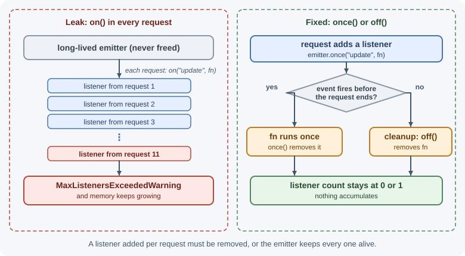

# Events and EventEmitter

Many Node.js objects announce that something happened—a request arrived, a
chunk of data is ready, a connection closed—by emitting named events. The
`EventEmitter` class in `node:events` is the foundation for this. You
register listener functions for an event name, and the emitter calls them
when it emits that event.

## Why it matters

Servers, streams, sockets, child processes, and the `process` object itself
are all event emitters. Using them correctly means knowing when listeners
run, how errors are reported, and how to avoid memory leaks from listeners
that are never removed. You can also use `EventEmitter` to decouple parts of
your own application.

## Real-world usage

- **node-redis**, the official Redis client, reports connection problems
  through an `error` event. Its README warns that you **must** listen to it:
  without a listener, the error is thrown and the Node.js process exits. A
  brief network blip can therefore crash an app that never added the
  listener
  ([node-redis README](https://github.com/redis/node-redis)).
- **Mongoose** connections inherit from `EventEmitter` and emit `connecting`,
  `connected`, `disconnected`, and other events when connectivity to MongoDB
  changes. Applications listen to these to log outages and report health
  ([Mongoose docs: Connection events](https://mongoosejs.com/docs/connections.html)).
- **BullMQ** job workers emit `completed`, `progress`, and `failed` events.
  Applications attach listeners for logging and metrics without touching the
  job code
  ([BullMQ docs: Workers](https://docs.bullmq.io/guide/workers)).

Popular tools and providers: `node:events` itself; client libraries for
Redis, MongoDB, and queues that expose connection and job events; `ws` and
Socket.IO for event-based real-time messaging.

## How it works

### The observer pattern

`EventEmitter` implements the **observer pattern** (also called
publish/subscribe within one process): one object emits events, and any
number of listeners react to them without the emitter knowing who they are.


### Core methods

| Method | What it does |
|--------|--------------|
| `on(name, listener)` / `addListener` | Adds a listener that runs every time the event is emitted. |
| `once(name, listener)` | Adds a listener that runs once, then removes itself. |
| `off(name, listener)` / `removeListener` | Removes a specific listener (you need the same function reference). |
| `removeAllListeners([name])` | Removes all listeners, optionally for one event. |
| `emit(name, ...args)` | Calls each listener with `args`; returns `true` if there were listeners. |
| `prependListener(name, listener)` | Adds a listener to the **front** of the list. |
| `prependOnceListener(name, listener)` | Like `prependListener`, but runs once. |
| `listenerCount(name)` | Number of listeners for an event. |
| `eventNames()` | Names of events that have listeners. |
| `setMaxListeners(n)` | Changes the leak-warning threshold for this emitter. |

### Listeners run synchronously, in order

`emit()` calls every listener **synchronously**, in the order they were
added, before `emit()` returns. It does not schedule them for later.

```js
import { EventEmitter } from "node:events";

const emitter = new EventEmitter();
emitter.on("ping", () => console.log("listener 1"));
emitter.on("ping", () => console.log("listener 2"));

console.log("before emit");
emitter.emit("ping");
console.log("after emit");
```

```text
before emit
listener 1
listener 2
after emit
```

If a listener throws, the exception propagates out of `emit()` and later
listeners do not run. A listener that needs to do slow work should start
asynchronous work rather than block.

Inside a regular `function` listener, `this` refers to the emitter. Arrow
function listeners do not get their own `this`.

### The special `error` event

The event name `"error"` has special behavior. If an emitter emits `"error"`
and **no listener is registered**, Node.js **throws** the error. In a server,
that usually crashes the process.

```js
const emitter = new EventEmitter();
emitter.emit("error", new Error("boom")); // throws the error itself
```

Run as a script, Node.js prints `throw er; // Unhandled 'error' event`,
then `Error: boom` with its stack trace, and exits with code 1.

Always attach an `error` listener to emitters that can fail—streams,
sockets, servers, and child processes:

```js
emitter.on("error", (error) => {
  console.error("Emitter failed:", error.message);
});
```

### Memory leaks and the max-listeners warning

Every listener is a reference that keeps its function (and anything it
closes over) in memory as long as the emitter exists. Adding a listener on
every request to a long-lived emitter, and never removing it, is a classic
memory leak.

To help catch this, Node.js prints a warning when more than **10** listeners
are added for the same event on one emitter:

```text
(node:24884) MaxListenersExceededWarning: Possible EventEmitter memory leak
detected. 11 request listeners added to [EventEmitter]. MaxListeners is 10.
Use emitter.setMaxListeners() to increase limit
```

The number after `node:` is the process ID. Run with `--trace-warnings` to
also print the stack trace of the line that added the eleventh listener.

The warning does not stop anything; it is a hint. If many listeners are
legitimate, raise the limit with `emitter.setMaxListeners(n)`. If not, find
where listeners are added and remove them with `off()` or use `once()`.



### Promise and async-iterator helpers

`node:events` provides helpers that connect events to `async`/`await`:

- **`events.once(emitter, name)`** returns a promise that fulfills with an
  array of the event's arguments the next time it is emitted. It rejects if
  the emitter emits `"error"` first.
- **`events.on(emitter, name)`** returns an async iterator that yields each
  emission's arguments.

```js
import { once } from "node:events";
import { createServer } from "node:http";

const server = createServer((req, res) => res.end("ok"));
server.listen(3000);
await once(server, "listening"); // wait until the server is ready
console.log("Server is listening");
```

Both accept an `AbortSignal` so you can stop waiting.

### Extending EventEmitter

Your own classes can extend `EventEmitter` to emit domain events:

```js
import { EventEmitter } from "node:events";

class Job extends EventEmitter {
  async run() {
    this.emit("start");
    try {
      for (let percent = 25; percent <= 100; percent += 25) {
        await new Promise((resolve) => setTimeout(resolve, 100));
        this.emit("progress", percent);
      }
      this.emit("done");
    } catch (error) {
      this.emit("error", error);
    }
  }
}

const job = new Job();
job.on("progress", (percent) => console.log(`${percent}%`));
job.once("done", () => console.log("Job finished"));
job.on("error", (error) => console.error(error));
job.run();
```

### EventTarget in Node.js

Node.js also implements the web-standard **`EventTarget`** and `Event`
classes used in browsers. APIs that follow web standards, such as
`AbortSignal`, use `EventTarget` with `addEventListener`. The main
differences: `EventTarget` listeners receive an `Event` object, there is no
special `"error"` behavior, and adding the same listener twice has no
effect. Node.js core modules mostly use `EventEmitter`.

### Where Node.js uses events

| Object | Example events |
|--------|----------------|
| `http.Server` | `request`, `connection`, `listening`, `close`, `error` |
| `http.IncomingMessage` (request) | `data`, `end`, `close`, `error` |
| `net.Socket` | `connect`, `data`, `end`, `timeout`, `close`, `error` |
| Readable streams | `data`, `end`, `readable`, `close`, `error` |
| Writable streams | `drain`, `finish`, `close`, `error` |
| `process` | `exit`, `beforeExit`, `uncaughtException`, `unhandledRejection`, `SIGINT`, `SIGTERM`, `warning` |
| `ChildProcess` | `spawn`, `exit`, `close`, `error`, `message` |

## When to use and when not to use

Use `EventEmitter` when:

- Something happens **many times** and several independent parts may want
  to react: connection state changes, progress updates, data arriving.
- You want to keep a module free of knowledge about who reacts to it, such
  as audit logging or metrics on domain events within one process.
- You build a low-level object (a client, a parser) that follows Node.js
  conventions.

Do not use it when:

- There is exactly **one result**: return a promise instead.
- The work must happen **reliably** or on another server: use a message
  queue or background job; in-memory events vanish on a crash.
- You need ordered, flow-controlled data: use a stream, which adds
  backpressure on top of events.
- Code must also run in browsers: prefer `EventTarget`.

| Need | Use | Why |
|------|-----|-----|
| One async result | Promise / `async` function | Settles once, works with `await` and `try`/`catch` |
| Many notifications, same process | `EventEmitter` | Any number of listeners, synchronous delivery |
| A flow of data with backpressure | Stream | Pauses the producer when the consumer is slow |
| Work that must not be lost | Message queue or job queue | Survives restarts; other servers can consume it |
| Browser-compatible events | `EventTarget` | Web standard; same API in browsers |

## Practical examples

### Decoupling side effects

```js
import { EventEmitter } from "node:events";

export const appEvents = new EventEmitter();

// orders.js
export async function createOrder(data) {
  const order = await saveOrder(data);
  appEvents.emit("order:created", order); // the service doesn't know who listens
  return order;
}

// listeners.js
appEvents.on("order:created", (order) => {
  sendConfirmationEmail(order).catch((error) => {
    console.error("Email failed", error); // handle async errors inside the listener
  });
});
```

!!! warning "In-process events are not a message queue"
    Events emitted this way live only in memory. If the process crashes
    before a listener finishes, the work is lost, and other server instances
    never see the event. For work that must happen reliably, use a
    [message queue](../../05-application-architecture/message-queues.md) or
    [background jobs](../backend-concepts/background-jobs-and-scheduling.md).

### Removing a listener correctly

```js
function onData(chunk) {
  console.log("received", chunk.length);
}

socket.on("data", onData);
// later
socket.off("data", onData); // works: same function reference

socket.on("data", (chunk) => console.log(chunk.length));
socket.off("data", (chunk) => console.log(chunk.length)); // does nothing:
// a new arrow function is a different reference
```

### Waiting for an event with a timeout

```js
import { once } from "node:events";

try {
  const [message] = await once(worker, "message", {
    signal: AbortSignal.timeout(5000),
  });
  console.log("Worker replied:", message);
} catch (error) {
  console.error("No reply within 5 s or worker failed:", error.message);
}
```

On timeout, `once()` rejects with an `AbortError` ("The operation was
aborted"), not the `TimeoutError` that `fetch` uses. The timer behind
`AbortSignal.timeout()` does not keep the process alive by itself. Here the
worker keeps it alive, but in a script with nothing else running, Node.js
can exit before the timeout ever fires.

## Best practices

- Always register an `error` listener on emitters that can fail.
- Use `once()` for one-time events such as `ready` or `listening`.
- Remove listeners you add for a temporary purpose, especially on
  long-lived emitters; keep a reference to the function so you can.
- Handle errors inside async listeners; a rejected promise from a listener
  is not caught by `emit()`.
- Use clear, namespaced event names such as `order:created`.
- Prefer `events.once()` with an `AbortSignal` over hand-written
  promise wrappers.
- Use a queue, not in-memory events, for work that must survive restarts or
  span multiple servers.

## In production

- **A dependency hiccup crashes the process.**
  - *Symptom:* a short Redis or database network blip is followed by every
    instance restarting.
  - *Detect:* crash logs show `Unhandled 'error' event` followed by an error
    from the client library, such as a connection reset.
  - *Cause:* no `error` listener on the client, socket, or stream.
  - *Fix:* attach an `error` listener to every client and stream you create,
    log the error, and let the library reconnect.
- **Memory grows with traffic.**
  - *Symptom:* heap usage rises steadily, and `MaxListenersExceededWarning`
    appears in the logs.
  - *Detect:* `emitter.listenerCount(name)` reported in a metric keeps
    rising, and heap snapshots show many copies of the same closure.
  - *Cause:* a listener added to a long-lived emitter (the process, a
    database client) on every request and never removed.
  - *Fix:* use `once()`, or remove the listener with `off()` when the
    request ends. Never "fix" it with `setMaxListeners(0)`.
- **One listener breaks a request.**
  - *Symptom:* a request fails with an error from analytics code,
    unrelated to its own logic.
  - *Detect:* the stack trace shows the error thrown inside `emit()`.
  - *Cause:* listeners run synchronously; a throw in one propagates to the
    code that called `emit()` and skips the remaining listeners.
  - *Fix:* wrap listener bodies in `try`/`catch`, and push slow or risky work
    to a queue.
- **Side effects lost on deploy.**
  - *Symptom:* some customers never receive confirmation emails, usually
    around deploys.
  - *Detect:* the count of `order:created` events in logs is higher than the
    count of emails sent.
  - *Cause:* the email was triggered by an in-memory event, and the process
    was stopped before the listener finished.
  - *Fix:* write the work to a durable queue (or an outbox table) in the same
    flow that creates the order.

## Important terminology

- **Event emitter:** An object that emits named events and calls registered
  listeners.
- **Listener (handler):** A function called when an event is emitted.
- **Emit:** To trigger an event and call its listeners with arguments.
- **Observer pattern:** A design where subscribers react to events from a
  subject without tight coupling.
- **`error` event:** A special event that throws if no listener exists.
- **MaxListenersExceededWarning:** A warning that suggests a possible
  listener leak.
- **EventTarget:** The web-standard event interface, also available in
  Node.js.

## Common mistakes and misconceptions

- **"`emit()` is asynchronous."** Listeners run synchronously before `emit()`
  returns.
- **Forgetting the `error` listener**, causing a crash on the first failure.
- **Adding listeners inside request handlers** to a shared emitter without
  removing them.
- **Trying to remove an anonymous function** with `off()`.
- **Silencing the max-listeners warning** with `setMaxListeners(0)` instead
  of fixing the leak.
- **Using in-process events for durable work** that must not be lost.

## Revision questions

1. What is the difference between `on`, `once`, and `prependListener`?
2. Are listeners called synchronously or asynchronously? What happens if one
   throws?
3. Why is the `error` event special?
4. What does the max-listeners warning tell you, and how should you respond?
5. How do `events.once()` and `events.on()` help with async code?
6. Why are in-process events unsuitable for work that must not be lost?

## Further learning

- [Node.js API: Events](https://nodejs.org/api/events.html)
- [Node.js: The Node.js event emitter](https://nodejs.org/en/learn/asynchronous-work/the-nodejs-event-emitter)
- [MDN: EventTarget](https://developer.mozilla.org/en-US/docs/Web/API/EventTarget)
