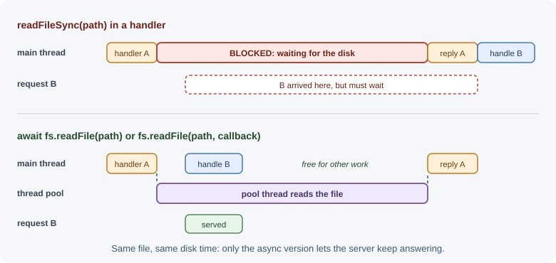

# File System, Path, and OS Modules

The `node:fs` module reads and writes files and folders, `node:path` builds
and inspects file paths safely across operating systems, and `node:os`
reports information about the machine. Together they let a backend load
configuration, write logs and exports, process uploads, and inspect its
environment.

## Why it matters

File access looks simple but hides real problems: blocking the event loop
with synchronous calls, running out of memory by reading huge files at once,
breaking on Windows because of hard-coded `/` separators, and—most
seriously—**path traversal** vulnerabilities that let a user read any file on
the server. Knowing the right API for each job prevents all of these.

## Real-world usage

- **Node.js itself** shipped a security fix in July 2025 for
  CVE-2025-27210: on Windows, device names such as `CON`, `PRN`, and `AUX`
  could bypass path-traversal protection in `path.normalize()` and
  `path.join()`. It was an incomplete fix for an earlier CVE. Path
  handling is subtle enough that even the runtime gets it wrong, which is
  why you must keep Node.js patched and validate resolved paths yourself
  ([Node.js blog: July 2025 security releases](https://nodejs.org/en/blog/vulnerability/july-2025-security-releases)).
- **Heroku** gives each dyno an ephemeral filesystem: files written are not
  visible to other dynos and are discarded when the dyno stops or restarts,
  including automatic restarts
  ([Heroku Dev Center: Dynos](https://devcenter.heroku.com/articles/dynos)).
- **Kubernetes** documents that on-disk files in a container are
  ephemeral: when a container crashes or is stopped, every file it created
  or changed is lost
  ([Kubernetes docs: Volumes](https://kubernetes.io/docs/concepts/storage/volumes/)).
- **AWS Lambda** gives each execution environment a private `/tmp`
  directory of 512 MB to 10,240 MB. It is fine for scratch files during one
  invocation, not for data you need later
  ([AWS Lambda docs: Configure ephemeral storage](https://docs.aws.amazon.com/lambda/latest/dg/configuration-ephemeral-storage.html)).

Popular tools and providers: `node:fs`, `node:path`, and `node:os`; `chokidar`
for cross-platform file watching in dev tools; object storage such as
Amazon S3, Google Cloud Storage, and Azure Blob Storage for durable files.

## How it works

### Three API styles

`node:fs` offers the same operations in three styles:

| Style | Example | Blocks the event loop? | When to use |
|-------|---------|------------------------|-------------|
| Promise | `await fs.readFile(path)` from `node:fs/promises` | No | Default choice in modern code |
| Callback | `fs.readFile(path, callback)` from `node:fs` | No | Older code and APIs |
| Synchronous | `fs.readFileSync(path)` | **Yes** | Startup scripts, CLIs, one-time configuration loading |

Synchronous calls are acceptable **before** a server starts accepting
requests (for example, reading a certificate at startup). Inside request
handlers they block every other request while the disk responds. File
operations in the promise and callback styles run on libuv's thread pool
(see [runtime and architecture](runtime-and-architecture.md)).



### Reading and writing whole files

```js
import fs from "node:fs/promises";

const text = await fs.readFile("notes.txt", "utf8");  // string
const bytes = await fs.readFile("logo.png");          // Buffer (no encoding)

await fs.writeFile("out.txt", "Hello\n");             // create or replace
await fs.appendFile("app.log", "started\n");          // add to the end
await fs.writeFile("data.json", JSON.stringify(data, null, 2));
```

`writeFile` replaces the file by default. The `flag` option changes this:

| Flag | Meaning |
|------|---------|
| `"w"` | Write; create or truncate (default for `writeFile`). |
| `"a"` | Append; create if missing (default for `appendFile`). |
| `"wx"` | Write, but **fail if the file exists** (`EEXIST`). Useful to avoid overwriting. |
| `"r"` | Read; fail if missing (default for `readFile`). |
| `"r+"` | Read and write; fail if missing. |

```js
await fs.writeFile("report.csv", csv, { flag: "wx" }); // never overwrite
```

### Working with folders

```js
await fs.mkdir("exports/2026/11", { recursive: true }); // create parents too

const names = await fs.readdir("uploads");               // ["a.pdf", "img"]

const entries = await fs.readdir("uploads", { withFileTypes: true });
for (const entry of entries) {
  console.log(entry.name, entry.isDirectory() ? "dir" : "file");
}

await fs.rm("tmp", { recursive: true, force: true }); // delete a folder tree
```

`{ recursive: true }` on `mkdir` does not fail if the folder already exists.
`force: true` on `rm` ignores a missing path.

### Metadata, moving, and copying

```js
const info = await fs.stat("video.mp4");
console.log(info.size);          // bytes
console.log(info.isFile());      // true
console.log(info.mtime);         // last modified (Date)

await fs.rename("upload.tmp", "upload.pdf"); // move or rename (same volume)
await fs.copyFile("template.html", "page.html");
await fs.unlink("old.log");                  // delete a file
```

`fs.lstat` describes a symbolic link itself rather than the file it points
to.

### Checking whether a file exists

A tempting pattern is "check, then act":

```js
// Race-prone: the file can disappear between access() and readFile()
await fs.access(file);
const data = await fs.readFile(file);
```

Between the check and the action another process may delete or create the
file. This is a **TOCTOU** (time-of-check to time-of-use) race. Instead,
just perform the operation and handle the error:

```js
try {
  const data = await fs.readFile(file, "utf8");
} catch (error) {
  if (error.code === "ENOENT") {
    // file does not exist
  } else {
    throw error;
  }
}
```

Common error codes: `ENOENT` (no such file or folder), `EEXIST` (already
exists), `EACCES`/`EPERM` (permission denied), `EISDIR` (expected a file,
got a folder), `ENOTDIR`, `EMFILE` (too many open files).

### File handles

`fs.open()` returns a `FileHandle` for repeated reads or writes on one file.
Always close it, ideally in `finally`:

```js
const handle = await fs.open("big.log", "r");
try {
  const buffer = Buffer.alloc(100);
  const { bytesRead } = await handle.read(buffer, 0, 100, 0); // first 100 bytes
  console.log(buffer.subarray(0, bytesRead).toString("utf8"));
} finally {
  await handle.close();
}
```

Forgetting to close handles eventually causes `EMFILE` errors.

### Watching files

`fs.watch()` reports changes to a file or folder. It is useful for
development tools, but its behavior varies by platform: events can be
duplicated, file names may be missing, and recursive watching support
depends on the OS and Node.js version. For production workflows, prefer
explicit triggers (a queue message, an upload callback) over file watching.

### Large files: use streams

`readFile` loads the whole file into memory: a 1 GB file needs at least
1 GB of RAM for every request that reads it at the same time. Files larger
than 2 GiB fail outright with `ERR_FS_FILE_TOO_LARGE`. For large files,
stream them in chunks:

```js
import { createReadStream } from "node:fs";
import { createHash } from "node:crypto";

const hash = createHash("sha256");
for await (const chunk of createReadStream("backup.tar")) {
  hash.update(chunk); // one chunk at a time; memory use stays small
}
console.log(hash.digest("hex"));
```

See [buffers and streams](buffers-and-streams.md).

### The `path` module

Never build paths by joining strings with `/`. Windows uses `\` and
drive letters, and string joining mishandles extra or missing separators.

```js
import path from "node:path";

path.join("uploads", "2026", "file.pdf");  // uploads/2026/file.pdf (\ on Windows)
path.join("/a/b", "../c");                 // /a/c   (normalizes ..)
path.resolve("uploads", "file.pdf");       // absolute: /current/dir/uploads/file.pdf
path.resolve("/srv", "/etc/passwd");       // /etc/passwd  (absolute segment resets)

path.basename("/srv/docs/report.pdf");          // report.pdf
path.basename("/srv/docs/report.pdf", ".pdf");  // report
path.extname("archive.tar.gz");                 // .gz
path.dirname("/srv/docs/report.pdf");           // /srv/docs
path.parse("/srv/docs/report.pdf");
// { root: "/", dir: "/srv/docs", base: "report.pdf", ext: ".pdf", name: "report" }
path.normalize("/srv//docs/./../logs");         // /srv/logs
path.sep;                                       // "/" or "\\"
path.isAbsolute("C:\\data");                    // true on Windows
```

| Function | Returns |
|----------|---------|
| `join(...parts)` | Parts joined with the OS separator and normalized; may stay relative. |
| `resolve(...parts)` | An **absolute** path, processed right to left until absolute; relative to the current working directory. |
| `basename(p, ext?)` | Last segment, optionally without the extension. |
| `dirname(p)` | Everything except the last segment. |
| `extname(p)` | Extension including the dot, from the last `.`. |
| `parse(p)` / `format(obj)` | Split a path into parts / build one from parts. |
| `relative(from, to)` | The relative path from one location to another. |

`path.posix` and `path.win32` give platform-specific behavior regardless of
the current OS.

### Path traversal defense

If user input becomes part of a path, an attacker can send `../../etc/passwd`
to escape the intended folder. Defend by resolving the final path and
checking that it stays inside the base folder:

```js
import path from "node:path";
import fs from "node:fs/promises";

const UPLOAD_ROOT = path.resolve("uploads");

export async function readUpload(userSuppliedName) {
  const target = path.resolve(UPLOAD_ROOT, userSuppliedName);

  // Must be inside UPLOAD_ROOT (the separator prevents "uploads-evil/...")
  if (!target.startsWith(UPLOAD_ROOT + path.sep)) {
    throw new Error("Invalid file path");
  }
  return fs.readFile(target);
}
```


Better still, do not use user-supplied names at all: store files under
generated IDs and keep the original name in a database. See
[file storage and uploads](../backend-concepts/file-storage-and-uploads.md).

### The `os` module

```js
import os from "node:os";

os.platform();        // "linux", "darwin", "win32"
os.cpus().length;     // logical CPU cores
os.availableParallelism(); // recommended degree of parallelism
os.totalmem();        // bytes of RAM
os.freemem();         // bytes currently free
os.tmpdir();          // OS temp folder
os.homedir();         // current user's home folder
os.hostname();
os.EOL;               // "\n" or "\r\n"
os.uptime();          // seconds since boot
```

Use `os.tmpdir()` for temporary files, `os.EOL` when writing text meant for
the local OS, and the CPU count to size worker pools.

## When to use and when not to use

- **Use `node:fs/promises`** for file work inside a running server: config
  reloads, exports, temporary files.
- **Use the sync API** only at startup, in CLIs, and in build scripts.
- **Use streams** (`createReadStream`) for anything large or of unknown size:
  uploads, backups, logs, CSV exports.
- **Use `path.join` / `path.resolve`** for every path, and check resolved
  paths against an allowed root when any part comes from a user.
- **Do not use local disk** as the only copy of user data on servers that
  can be replaced (containers, serverless, autoscaling groups). Use object
  storage or a database.
- **Do not use `fs.watch`** as a production trigger; use a queue message or
  an upload callback.

| Task | Use | Avoid |
|------|-----|-------|
| Read a small config at startup | `readFileSync` | Async ceremony at module load (fine either way) |
| Read a small file per request | `await fs.readFile` | `readFileSync` (blocks every request) |
| Read a large file | `createReadStream` | `readFile` (memory; 2 GiB limit) |
| Store user uploads | Object storage (S3 and similar) | Local disk on replaceable servers |
| Temporary scratch file | `os.tmpdir()` + generated name | Fixed names that collide between requests |

## Practical examples

### Loading JSON configuration at startup

```js
import { readFileSync } from "node:fs";
import path from "node:path";

// Sync is fine here: this runs once, before the server accepts requests.
const configPath = path.join(import.meta.dirname, "..", "config.json");
export const config = JSON.parse(readFileSync(configPath, "utf8"));
```

### Writing a file atomically

A crash in the middle of `writeFile` can leave a half-written file. Write to
a temporary file in the same folder, then rename it (a rename on the same
volume replaces the target in one step):

```js
import fs from "node:fs/promises";
import path from "node:path";

export async function writeJsonAtomic(file, data) {
  const temp = path.join(path.dirname(file), `.${path.basename(file)}.${process.pid}.tmp`);
  await fs.writeFile(temp, JSON.stringify(data));
  await fs.rename(temp, file);
}
```

### Finding all `.log` files recursively

```js
import fs from "node:fs/promises";
import path from "node:path";

async function findLogs(dir) {
  const results = [];
  for (const entry of await fs.readdir(dir, { withFileTypes: true })) {
    const full = path.join(dir, entry.name);
    if (entry.isDirectory()) results.push(...(await findLogs(full)));
    else if (path.extname(entry.name) === ".log") results.push(full);
  }
  return results;
}

console.log(await findLogs("/var/app"));
```

## Best practices

- Use `node:fs/promises` in application code; use sync APIs only during
  startup or in scripts.
- Stream large files instead of reading them whole.
- Build paths with `path.join`/`path.resolve`, never string concatenation.
- Never pass raw user input into file paths; if you must, resolve and verify
  the result stays inside an allowed folder.
- Handle errors by `error.code` instead of checking existence first.
- Close file handles in `finally`.
- Don't rely on local disk for user data in scalable deployments: servers
  and containers are replaceable. Use object storage instead.

## In production

- **Uploaded files disappear.**
  - *Symptom:* files that users uploaded return `404` hours later, or only
    on some requests.
  - *Detect:* the missing files were written by an instance that has since
    restarted, or the request hit a different instance.
  - *Cause:* files were saved to a container's or dyno's local disk, which
    is ephemeral and not shared.
  - *Fix:* write uploads to object storage and keep only metadata in the
    database.
- **`EMFILE: too many open files`.**
  - *Symptom:* file and network operations start failing under load with
    `EMFILE`.
  - *Detect:* the count of open file descriptors for the process
    (`/proc/<pid>/fd` on Linux) climbs steadily.
  - *Cause:* `FileHandle`s or streams that are never closed, often on error
    paths.
  - *Fix:* close handles in `finally`, use `stream.pipeline()` so streams
    are destroyed on error, and raise the OS limit only after fixing leaks.
- **Memory spikes on file endpoints.**
  - *Symptom:* the process is killed for running out of memory, or crashes
    with `JavaScript heap out of memory` during exports or downloads.
  - *Detect:* memory graphs jump when that endpoint runs, and a large file
    triggers `ERR_FS_FILE_TOO_LARGE`.
  - *Cause:* `readFile` of large or user-controlled files, several requests
    at once.
  - *Fix:* stream the file to the response with `pipeline()`.
- **Paths that work locally break on the server.**
  - *Symptom:* `ENOENT` for files that clearly exist in the repository.
  - *Detect:* the error path is relative to a different folder than you
    expected; log `process.cwd()` at startup.
  - *Cause:* relative paths resolve against the process's working directory,
    which differs under a process manager or in a container.
  - *Fix:* anchor paths with `path.join(import.meta.dirname, ...)`.
- **Path traversal in a download endpoint.**
  - *Symptom:* a security scan or log shows requests such as
    `?file=../../etc/passwd` returning `200`.
  - *Detect:* access logs containing `..`, `%2e%2e`, or absolute paths in
    file parameters.
  - *Cause:* user input joined into a path without checking the result.
  - *Fix:* resolve and check against the allowed root (above), or better, map
    generated IDs to files. Keep Node.js patched for path-handling CVEs.

## Important terminology

- **File descriptor / FileHandle:** A reference to an open file used for
  reads and writes.
- **Encoding:** How bytes map to text, such as `utf8`.
- **Flag:** A mode string such as `"w"`, `"a"`, or `"wx"` that controls how
  a file is opened.
- **Absolute path:** A path from the file-system root.
- **Relative path:** A path interpreted from the current working directory
  or another base.
- **Path traversal:** An attack that uses `..` segments to escape an allowed
  folder.
- **TOCTOU race:** A bug where the state changes between checking and using
  a resource.
- **Atomic write:** A write that either fully happens or not at all, often
  done with write-then-rename.

## Common mistakes and misconceptions

- **Using `readFileSync` in request handlers.**
- **Reading large files with `readFile`** and running out of memory.
- **Hard-coding `/` in paths**, breaking on Windows.
- **Assuming relative paths are relative to the source file.** They are
  relative to `process.cwd()`—the folder where the process was started. Use
  `import.meta.dirname` to anchor paths to the file.
- **"`path.join` makes paths safe."** It normalizes `..` but does not stop a
  path from escaping a folder.
- **Using `fs.exists`-style checks before operations**, creating races.

## Revision questions

1. When is a synchronous `fs` call acceptable in a server?
2. What is the difference between `path.join` and `path.resolve`?
3. How would you safely serve a file whose name comes from a URL parameter?
4. Why is "check if the file exists, then read it" a race condition?
5. What do the `"wx"` and `"a"` flags do?
6. Why is relying on local disk a problem for horizontally scaled servers?

## Further learning

- [Node.js API: File system](https://nodejs.org/api/fs.html)
- [Node.js API: Path](https://nodejs.org/api/path.html)
- [Node.js API: OS](https://nodejs.org/api/os.html)
- [Node.js: Reading files with Node.js](https://nodejs.org/en/learn/manipulating-files/reading-files-with-nodejs)
- [OWASP: Path traversal](https://owasp.org/www-community/attacks/Path_Traversal)
- [File systems (operating systems section)](../../08-operating-systems-and-linux/file-systems.md)
