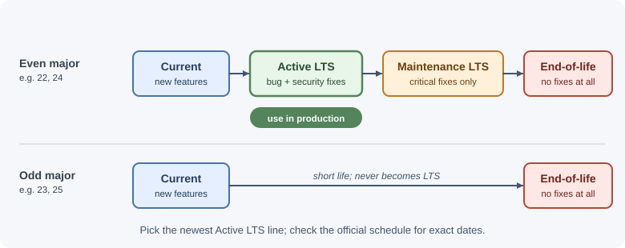

# Installing Node.js and Managing Versions

Before writing a backend in Node.js you need the runtime installed, and you
need to know which version to use. This page explains the Node.js release
lines, the common ways to install and switch versions, and the everyday
commands for running code.

## Why it matters

Different projects often need different Node.js versions. A package may
require a newer API, a deployment platform may support only certain lines,
and an old project may break on a newer runtime. Pinning and switching
versions deliberately avoids "works on my machine" problems and keeps
production on a supported, security-patched release.

## Real-world usage

Hosting platforms read the same version files you use locally, so pinning a
version decides what runs in production:

- **Heroku** chooses the Node.js version from the `engines.node` field in
  `package.json` (for example `"26.x"`). If the field is missing, it picks
  its current default major automatically, which can change under you
  ([Heroku Dev Center: Node.js support](https://devcenter.heroku.com/articles/nodejs-support)).
- **Vercel** lets `engines.node` in `package.json` override the Node.js major
  version selected in the project settings
  ([Vercel docs: Node.js versions](https://vercel.com/docs/functions/runtimes/node-js/node-js-versions)).
- **Netlify** builds with the version in a `NODE_VERSION` environment
  variable, a `.node-version` file, or an `.nvmrc` file, any of which
  overrides the setting in its UI
  ([Netlify docs: Manage build dependencies](https://docs.netlify.com/configure-builds/manage-dependencies/)).
- **AWS Lambda** deprecates a runtime when its language version reaches the
  end of community LTS. After that date it blocks first the creation and
  then the updating of functions on that runtime, which forces teams to plan
  upgrades
  ([AWS Lambda docs: Runtimes](https://docs.aws.amazon.com/lambda/latest/dg/lambda-runtimes.html)).
- **GitHub Actions** `actions/setup-node` can read the version for CI from
  `.nvmrc`, `.node-version`, or `package.json` through its
  `node-version-file` input, so CI uses the same version as development
  ([actions/setup-node README](https://github.com/actions/setup-node)).

Popular tools and providers: nvm, fnm, mise, and Volta (unmaintained) for
switching versions; official `node` Docker images; Heroku, Vercel, Netlify,
and AWS Lambda for hosting.

## How it works

### Release lines

Each Node.js major version moves through phases:



| Phase | What it means | Use it for |
|-------|---------------|------------|
| **Current** | The newest major version; receives new features and can change quickly. | Trying new features, testing libraries ahead of time. |
| **Active LTS** | Long-Term Support: stable, receives bug and security fixes. | Production applications. |
| **Maintenance LTS** | Only critical bug and security fixes. | Existing production apps planning an upgrade. |
| **End-of-life (EOL)** | No more fixes, including security fixes. | Nothing; upgrade. |

Up to Node.js 26, a new major version came out roughly every six months.
**Even-numbered** majors became LTS releases, while **odd-numbered** ones
stayed in Current for six months and then reached end-of-life. The diagram
above shows that model. An LTS line typically receives critical fixes for
about 30 months in total.

The schedule changed with **Node.js 27**: majors now come out once a year,
and every major becomes LTS after its six-month Current phase. Each one is
preceded by a new **Alpha** phase for early testing. Always check the
official release schedule before choosing a version, because the project
sets the exact dates.

!!! tip "Rule of thumb"
    Use the latest **Active LTS** version for production and new projects
    unless a dependency or platform requires something else.

### Version numbers

Node.js uses semantic versioning: `MAJOR.MINOR.PATCH`, for example
`24.3.1`. A major version can contain breaking changes; minor versions add
features; patch versions fix bugs and security issues. Staying on the latest
patch of your major line is important for security.

### Ways to install

| Method | How it works | Good for |
|--------|--------------|----------|
| Official installer (nodejs.org) | Installs one version system-wide. | Beginners, a single project. |
| OS package manager (Homebrew, apt, winget) | Installs from your OS's repository. | Quick setup; versions may lag behind. |
| **nvm** (Node Version Manager) | Installs many versions in your home folder and switches between them per shell. | Developers working on several projects (macOS/Linux; `nvm-windows` is a separate project for Windows). |
| **fnm** (Fast Node Manager) | A fast, cross-platform version manager; can switch automatically when you enter a folder. | Same as nvm, including Windows. |
| **mise** | A general tool-version manager (Node.js, Python, and more) that switches per folder. | Teams managing several languages. |
| **Volta** | Pins the Node.js and package-manager versions in `package.json` and switches automatically. | Existing setups only: the project is **unmaintained**, and its authors recommend migrating to mise. |
| Docker image | `node:<version>` images contain the runtime. | Consistent builds and deployments. |

Version managers are preferred for development because they let each project
use its own version without administrator rights.

### Pinning the version for a project

Two common files tell people and tools which version to use:

- **`.nvmrc`** (read by nvm and fnm) contains just the version:

  ```text
  24
  ```

- The **`engines`** field in `package.json` documents the supported range:

  ```json
  {
    "engines": {
      "node": ">=22"
    }
  }
  ```

  npm warns when the running Node.js does not satisfy `engines`. With
  `engine-strict=true` in `.npmrc`, installs fail instead.


## When to use and when not to use

Use a version manager (nvm, fnm, or mise) when:

- You work on more than one project, or a project's `.nvmrc` differs from
  your system version.
- You need to test a library against several Node.js majors.
- You cannot or should not install software system-wide.

Use the official installer or an OS package manager when:

- You need exactly one Node.js version on a machine, such as a student
  laptop or a single-purpose server.

Use a pinned Docker image (`node:24-alpine`, or an exact patch tag) when:

- Development, CI, and production must run byte-for-byte the same runtime.

Avoid:

- Odd-numbered Current releases up to Node.js 26, and any Current release,
  in production. They change faster and have short support windows.
- Floating tags such as `node:latest` in production images, which can jump
  to a new major on the next rebuild.

| Option | Switch per project | Needs admin rights | Typical use |
|--------|--------------------|--------------------|-------------|
| Official installer | No | Yes | One version per machine |
| OS package manager | No | Usually | Quick setup; versions may lag |
| nvm / fnm / mise | Yes | No | Developers with several projects |
| Docker image | Yes (per image) | No (Docker needed) | CI and production parity |

## Practical examples

### Checking what is installed

```bash
node --version    # e.g. v24.3.1
npm --version     # npm ships with Node.js
which node        # macOS/Linux: where the binary lives
where node        # Windows
```

### Using nvm

```bash
nvm install --lts      # install the latest LTS release
nvm install 22         # install the latest 22.x
nvm use 22             # switch this shell to 22.x
nvm ls                 # list installed versions
nvm alias default 22   # use 22.x in new shells
nvm use                # read .nvmrc in the current folder
```

### The REPL

Running `node` with no file opens the **REPL** (Read–Eval–Print Loop), an
interactive prompt for experimenting:

```text
$ node
> 2 + 3
5
> _ * 10          // _ holds the last result
50
> const os = await import("node:os")
> os.platform()
'linux'
> .help           // list REPL commands
> .exit           // or press Ctrl+D once, or Ctrl+C twice on a blank line
```

Useful REPL commands: `.help`, `.exit`, `.clear`, `.editor` (multi-line
mode), `.load file.js`, and `.save file.js`.

### Running a file

```js
// hello.js
const name = process.argv[2] ?? "world";
console.log(`Hello, ${name}!`);
```

```bash
node hello.js            # Hello, world!
node hello.js Ada        # Hello, Ada!
```

### Restarting on file changes

```bash
node --watch server.js
```

`--watch` restarts the process whenever the entry file or a file it imports
changes. It replaces the need for tools such as nodemon in many projects.
Use `--watch-path=./src` to watch a specific folder instead; this turns off
the automatic watching of imported files.

### Loading environment variables from a file

```bash
node --env-file=.env server.js
```

Node.js reads `KEY=value` lines from the file into `process.env` before your
code runs. Never commit `.env` files that contain secrets. See
[process, environment variables, and configuration](process-env-and-configuration.md).

### Importing built-in modules with `node:`

```js
import { readFile } from "node:fs/promises";
import path from "node:path";
import { createServer } from "node:http";
```

The `node:` prefix makes it clear the module is built in and cannot be
shadowed by an npm package with the same name. Some newer modules, such as
`node:test` and `node:sqlite`, are only available with the prefix.

### Running package binaries with npx

```bash
npx eslint .                  # run the project's local eslint
npx create-vite@latest my-app # download and run a package once
```

`npx` runs a binary from `node_modules/.bin`. If the package is not
installed, it asks before downloading it into the npm cache (`--yes` skips
the prompt). See
[npm and package management](npm-and-package-management.md).

### Corepack and other package managers

Corepack is a tool that manages Yarn and pnpm versions declared in the
`packageManager` field of `package.json`:

```json
{ "packageManager": "pnpm@9.12.0" }
```

Corepack is bundled with Node.js from 14.19.0 up to, but not including,
25.0.0. If your Node.js does not include it, install it with
`npm install -g corepack`, or install pnpm/Yarn directly.

### Running TypeScript files

Node.js can run `.ts` files directly by **stripping type annotations**
before execution. This is on by default from Node.js 22.18.0 and 23.6.0, and
stable from 24.12.0 and 25.2.0:

```bash
node app.ts
```

Type stripping removes types; it does **not** type-check your code, and it
ignores `tsconfig.json`. It supports only syntax that can be erased:
`enum` declarations, namespaces with runtime code, and parameter properties
fail with an error. Keep running `tsc --noEmit` or your editor's checker for
type errors, and use a tool such as `tsx` when you need full TypeScript.

## Best practices

- Use a version manager in development and commit `.nvmrc` so the whole
  team, and CI (`actions/setup-node` with `node-version-file`), uses the same
  major version.
- Use the same major version locally, in CI, and in production. Pin the
  Docker base image to a major version, for example `node:24-alpine`.
- Upgrade to the latest patch release regularly; patch releases often
  include security fixes.
- Plan major upgrades before your line reaches end-of-life. Read the
  changelog for breaking changes and run your test suite on the new version.
- Avoid installing Node.js with `sudo` package managers when you need
  multiple versions; it leads to permission problems with global packages.

## In production

- **The platform picked a different major.**
  - *Symptom:* the app works locally but fails after deploy with
    `TypeError: ... is not a function` or a `SyntaxError` on newer syntax.
  - *Detect:* log `process.version` at startup and compare it with
    `.nvmrc`.
  - *Cause:* no `engines.node` field, so the platform used its own default.
  - *Fix:* set `engines.node` (for example `"24.x"`) and `.nvmrc` to the same
    major.
- **A floating Docker tag jumped versions.**
  - *Symptom:* an image rebuilt without code changes starts failing tests.
  - *Detect:* `node --version` in the build logs differs between the old and
    new image.
  - *Cause:* `FROM node:latest` or `FROM node:lts` now points to a newer
    major.
  - *Fix:* pin `node:24-alpine` or an exact patch tag, and upgrade on purpose.
- **Native add-ons break after an upgrade.**
  - *Symptom:* the process fails at startup while loading a compiled `.node`
    file from a dependency.
  - *Detect:* the error stack points into that package's folder in
    `node_modules`.
  - *Cause:* add-ons written against the V8 or NAN APIs must be recompiled
    for each Node.js major. Add-ons built on the ABI-stable Node-API keep
    working across majors.
  - *Fix:* reinstall dependencies (`npm ci`) in the same image and Node.js
    version that runs in production; never copy `node_modules` from a
    developer machine.
- **A serverless runtime reached its deprecation date.**
  - *Symptom:* deployments to AWS Lambda fail because function updates on
    the old runtime are blocked.
  - *Detect:* the platform's deprecation notices, or the runtime ID such as
    `nodejs22.x` in your infrastructure code.
  - *Cause:* the runtime's Node.js line reached end of LTS.
  - *Fix:* track Node.js end-of-life dates and upgrade a major well before the
    platform's deadline.

## Important terminology

- **LTS (Long-Term Support):** A release line that receives fixes for an
  extended period and is recommended for production.
- **Current:** The newest major release line, with the latest features.
- **End-of-life (EOL):** A release line that no longer receives any fixes.
- **Version manager:** A tool such as nvm, fnm, or mise that installs and
  switches between Node.js versions.
- **REPL:** The interactive Read–Eval–Print Loop opened by running `node`.
- **`engines`:** The `package.json` field that declares supported Node.js
  versions.
- **npx:** A command that runs package binaries, installing them temporarily
  if needed.

## Common mistakes and misconceptions

- **Running a Current release in production.** Up to Node.js 26,
  odd-numbered majors never became LTS and reached end-of-life after about six
  months.
- **Staying on an EOL version.** It no longer receives security patches,
  even for serious vulnerabilities.
- **Assuming `engines` blocks installs.** By default npm only warns.
- **Treating `--watch` as a production tool.** It is for development; use a
  process manager or container orchestrator in production.
- **Believing type stripping type-checks code.** It only removes types.

## Revision questions

1. What is the difference between Current, Active LTS, and Maintenance LTS?
2. Why are version managers preferred over a single system-wide install?
3. What do `.nvmrc` and the `engines` field each do?
4. What does `node --watch` do, and where should it not be used?
5. Why should you import built-in modules with the `node:` prefix?
6. What does running a `.ts` file with Node.js do and not do?

## Further learning

- [Node.js: Download and release information](https://nodejs.org/en/download)
- [Node.js: Previous releases and release schedule](https://nodejs.org/en/about/previous-releases)
- [Node.js: Installing Node.js via package manager](https://nodejs.org/en/download/package-manager)
- [Node.js API: Command-line options](https://nodejs.org/api/cli.html)
- [Node.js API: REPL](https://nodejs.org/api/repl.html)
- [Node.js: Running TypeScript natively](https://nodejs.org/en/learn/typescript/run-natively)
- [nvm on GitHub](https://github.com/nvm-sh/nvm)
