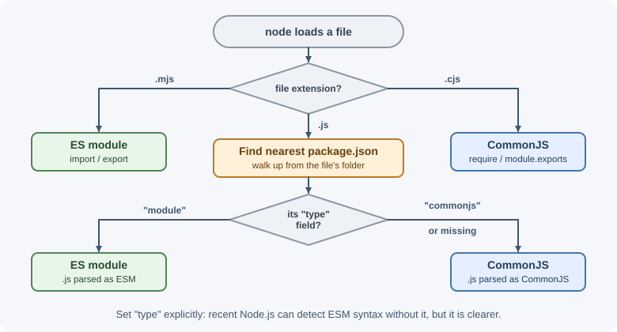

# Modules: CommonJS and ES Modules

A module is a file whose variables and functions are private unless it
explicitly exports them. Node.js supports two module systems: the older
**CommonJS** (`require` and `module.exports`) and the standard
**ECMAScript modules** (ESM, `import` and `export`). Most new code uses ESM,
but backend developers meet both every day.

## Why it matters

Modules let you split a backend into focused files—routes, services,
database access—without polluting a shared global scope. Knowing both
systems helps you read older code and libraries, configure `package.json`
correctly, and fix common errors such as `require is not defined in ES
module scope` or `Cannot use import statement outside a module`.

## Real-world usage

- **node-fetch** became **ESM-only** in version 3: you cannot load it with
  `require()`. Its README tells projects that cannot switch to ESM to stay on
  version 2, which still receives critical fixes. Many CommonJS projects hit
  this when they upgraded
  ([node-fetch README](https://github.com/node-fetch/node-fetch)).
- **Jest** documents its ESM support as **experimental**: you enable it with
  extra configuration, and it relies on Node.js APIs that are themselves
  still experimental. That is why many test suites stay on CommonJS or use a
  transform
  ([Jest docs: ECMAScript Modules](https://jestjs.io/docs/ecmascript-modules)).
- **Vite** documents a common interop surprise: importing a CommonJS module's
  default export gives you the whole `module.exports` object, where you may
  expect `module.exports.default`. The result is errors such as
  `foo is not a function`
  ([Vite docs: Troubleshooting](https://vite.dev/guide/troubleshooting)).
- **TypeScript** added the `node16`, `node18`, `node20`, and `nodenext`
  module settings to model Node.js's dual module system: how each file's
  format is decided and how the two formats may import each other
  ([TypeScript handbook: Modules reference](https://www.typescriptlang.org/docs/handbook/modules/reference.html)).

Popular tools and providers: TypeScript (`module: "nodenext"`), bundlers
such as Vite, esbuild, and Rollup that convert between formats, and `tsx`
for running mixed-format TypeScript.

## How it works

### Why modules exist

Without modules, every script shares one global scope, names collide, and
the load order must be managed by hand. A module system gives each file its
own scope, declares dependencies explicitly, and loads each file once.

### CommonJS

CommonJS was Node.js's original system.

```js
// math.cjs
function add(a, b) {
  return a + b;
}
const PI = 3.14159;

module.exports = { add, PI }; // what require() will return
```

```js
// app.cjs
const { add, PI } = require("./math.cjs");
const fs = require("node:fs");

console.log(add(2, 3), PI);
```

Characteristics:

- `require()` is a normal function call. It loads **synchronously** and can
  appear anywhere, including inside `if` blocks.
- It returns the value of the target module's `module.exports`.
- Resolution can omit extensions: `require("./math")` tries `./math.js`,
  `./math.json`, `./math.node`, then the folder `./math` (its
  `package.json` `main`, or `index.js`) and so on.

#### The module wrapper

Before running a CommonJS file, Node.js wraps it in a function:

```js
(function (exports, require, module, __filename, __dirname) {
  // your module code
});
```

That is why `require`, `module`, `exports`, `__filename` (the file's
absolute path), and `__dirname` (its folder) are available in every
CommonJS file without being imported—and why top-level variables are local
to the file.

#### The `exports` pitfall

`exports` starts as a reference to `module.exports`. Adding properties works;
**reassigning** `exports` breaks the link:

```js
exports.add = add;            // works: adds to module.exports
module.exports = { add };     // works: replaces the exported value
exports = { add };            // does NOTHING: only rebinds the local variable
```

#### Module caching

A module is executed the **first time** it is required. Its `module.exports`
is cached by resolved filename, and later `require()` calls return the same
object. This makes modules natural singletons:

```js
// counter.cjs
let count = 0;
module.exports = { increment: () => ++count };
```

Every file that requires `counter.cjs` shares the same `count`.


### ECMAScript modules (ESM)

ESM is the JavaScript language standard, used by browsers and Node.js.

```js
// math.js  (with "type": "module" in package.json)
export function add(a, b) {   // named export
  return a + b;
}
export const PI = 3.14159;

export default function multiply(a, b) { // one default export per module
  return a * b;
}
```

```js
// app.js
import multiply, { add, PI } from "./math.js"; // default + named
import * as math from "./math.js";             // namespace object
import { readFile } from "node:fs/promises";

console.log(add(2, 3), multiply(2, 3), math.PI);
```

Characteristics:

- `import` and `export` are **static** declarations at the top level. Node.js
  parses them and builds the dependency graph **before** running code.
- Imports are **live bindings**: if the exporting module changes an exported
  `let`, importers see the new value. Importers cannot reassign them.
- Code runs in **strict mode** automatically.
- Loading is asynchronous internally, which allows **top-level `await`**.

### How Node.js decides which system a file uses

| File | Treated as |
|------|-----------|
| `.mjs` | Always ESM |
| `.cjs` | Always CommonJS |
| `.js` with `"type": "module"` in the nearest `package.json` | ESM |
| `.js` with `"type": "commonjs"` | CommonJS |
| `.js` with no `type` field | CommonJS, unless the file contains ES module syntax: since Node.js 22.7.0 it is then detected and run as ESM. Setting `type` explicitly is clearer and avoids a re-parse |

```json
{
  "name": "orders-api",
  "type": "module"
}
```



### `__dirname` in ES modules

ESM files do not have the CommonJS wrapper, so `__dirname` and `__filename`
do not exist. Use `import.meta`:

```js
import path from "node:path";

console.log(import.meta.url);      // file:///home/app/src/server.js
console.log(import.meta.filename); // /home/app/src/server.js
console.log(import.meta.dirname);  // /home/app/src

const viewsDir = path.join(import.meta.dirname, "views");
```

On older Node.js versions without `import.meta.dirname`, use
`path.dirname(fileURLToPath(import.meta.url))` from `node:url`.

### Top-level `await`

ESM files can use `await` outside any function:

```js
// config.js
import { readFile } from "node:fs/promises";

export const config = JSON.parse(await readFile("./config.json", "utf8"));
```

Modules that import `config.js` wait until it finishes. Use this for startup
work, but remember it delays everything that depends on the module.

### Dynamic `import()`

`import()` is a function-like expression that loads a module on demand and
returns a promise. It works in both ESM and CommonJS:

```js
if (process.env.FEATURE_REPORTS === "on") {
  const { generateReport } = await import("./reports.js");
  await generateReport();
}
```

Use it to load optional or heavy modules lazily, or to load an ES module from
CommonJS code.

### JSON modules

```js
import pkg from "./package.json" with { type: "json" };
console.log(pkg.version);
```

The `with { type: "json" }` import attribute is required, and the JSON is
available only as the default export (no named exports). JSON modules are
stable from Node.js 22.12.0. In CommonJS, `require("./data.json")` works
directly.

### Interoperability

- **ESM importing CommonJS:** works. The default import is the CommonJS
  `module.exports` value. Named imports often work too when Node.js can
  detect the export names statically.

  ```js
  import express from "express";           // CommonJS package, default import
  import pkg from "some-cjs-lib";
  const { helper } = pkg;                  // safe fallback for named values
  ```

- **CommonJS loading ESM:** `import()` always works. Since Node.js 22.12.0
  and 20.19.0, `require()` can also load an ES module synchronously, as long
  as its module graph has no top-level `await`. If it does, the call throws
  `ERR_REQUIRE_ASYNC_MODULE`. Version 22.12.0 still printed an experimental
  warning, and the feature is stable from 25.4.0. Older versions throw
  `ERR_REQUIRE_ESM`.
- **Dual packages** can publish both formats using the `exports` field with
  `import` and `require` conditions.

### Resolution rules

| Specifier | CommonJS | ESM |
|-----------|----------|-----|
| `./file` (relative) | Extension optional; tries `.js`, `.json`, `.node`, then `index.js` | **Full path with extension required**: `./file.js` |
| Folder `./utils` | Loads the folder's `package.json` `main`, or `./utils/index.js` | Not supported (`ERR_UNSUPPORTED_DIR_IMPORT`); import the file explicitly |
| `express` (bare) | Searches `node_modules` folders upward | Same, but respects the package's `exports` field |
| `node:fs` | Built-in module | Built-in module |

The **`exports` field** in a package's `package.json` defines its public
entry points. Files not listed there cannot be imported, even if they exist:

```json
{
  "name": "my-lib",
  "type": "module",
  "exports": {
    ".": "./dist/index.js",
    "./utils": "./dist/utils.js"
  }
}
```


### Circular dependencies

When module A imports B and B imports A, one of them sees the other
**partially initialized**.

- In CommonJS, B receives A's `module.exports` as it is at that moment—often
  an incomplete object.
- In ESM, live bindings help, but accessing an exported `let`, `const`, or
  `class` before it is initialized throws a `ReferenceError`.

Fix circular dependencies by moving shared code into a third module, or by
passing dependencies as function parameters.

### The `node:` prefix

Import built-in modules as `node:fs`, `node:path`, and so on. The prefix
makes the source obvious and, in CommonJS, bypasses the `require` cache.
Older built-ins load even without it: `require("http")` always returns the
built-in module. Newer built-ins such as `node:test` and `node:sqlite`
exist **only** with the prefix, so their short names stay free for npm
packages.

## When to use and when not to use

- **Use ESM** (`"type": "module"`) for new applications and new libraries.
  It is the language standard, supports top-level `await`, and is what
  browsers, Deno, and Bun use.
- **Use CommonJS** when you maintain an existing CommonJS codebase, or when
  a tool you depend on still handles CommonJS more reliably (for example
  Jest without extra configuration).
- **Use `.mjs` / `.cjs`** for the odd file that must differ from the
  package's `type`, such as a CommonJS config file in an ESM project.
- **Use dynamic `import()`** for optional features and heavy modules that
  are not needed at startup.
- **Avoid** mixing both styles in one file, and avoid publishing a library
  as both formats unless you must support old Node.js versions. Two copies
  of the same library in one process (one CommonJS, one ESM) do not share
  state.

| Situation | Choose | Reason |
|-----------|--------|--------|
| New API or service | ESM | Standard syntax, top-level `await`, future-facing |
| Existing large CommonJS app | Stay CommonJS; migrate gradually | Migration touches every import path |
| Library for Node.js 22.12+ only | ESM | Those versions can `require()` it too |
| Library that must support older Node.js | Dual package via `exports` conditions | CommonJS users there cannot `require()` ESM |
| Test suite on Jest | CommonJS or a transform | Jest's native ESM support is experimental |

### CommonJS and ESM compared

| Aspect | CommonJS | ES modules |
|--------|----------|------------|
| Syntax | `require()`, `module.exports` | `import`, `export` |
| Standard | Node.js convention | ECMAScript language standard |
| Loading | Synchronous, at runtime | Static graph, async loading |
| Conditional loading | `require()` anywhere | `import()` (async) |
| Top-level `await` | No | Yes |
| `__dirname` / `__filename` | Yes | `import.meta.dirname` / `import.meta.filename` |
| File extensions in imports | Optional | Required for relative paths |
| Strict mode | Opt-in | Always |
| Exports | The `module.exports` object; destructured values do not update | Live bindings |

## Practical examples

### A small ESM project layout

```text
orders-api/
├── package.json        { "type": "module" }
└── src/
    ├── server.js       import { app } from "./app.js";
    ├── app.js          import { ordersRouter } from "./routes/orders.js";
    └── routes/
        └── orders.js   export const ordersRouter = ...
```

### Converting a CommonJS module to ESM

Before (CommonJS, `total.cjs`):

```js
const path = require("node:path");
const { formatPrice } = require("./format");
module.exports = function renderTotal(items) { /* ... */ };
```

After (ESM, `total.js` in a `"type": "module"` package):

```js
import path from "node:path";
import { formatPrice } from "./format.js"; // extension now required
export default function renderTotal(items) { /* ... */ }
```

## Best practices

- Use ESM (`"type": "module"`) for new projects.
- Always include file extensions in relative ESM imports.
- Import built-ins with the `node:` prefix.
- Prefer named exports for utilities; they are easier to search for and
  refactor.
- Keep modules focused; a module that exports everything becomes a hidden
  dependency hub.
- Avoid circular dependencies; extract shared code instead.
- Use dynamic `import()` for optional or heavy modules.

## In production

- **The app will not start after a dependency upgrade.**
  - *Symptom:* startup crashes with `Error [ERR_REQUIRE_ESM]: require() of
    ES Module ... not supported`.
  - *Detect:* the stack trace names a package that recently released a new
    major version.
  - *Cause:* the dependency became ESM-only, and the app runs on a Node.js
    version older than 22.12/20.19 that cannot `require()` ESM.
  - *Fix:* upgrade Node.js, load the package with `await import()`, or pin
    the last CommonJS-compatible major until you migrate.
- **Builds pass but production crashes on imports.**
  - *Symptom:* `ERR_MODULE_NOT_FOUND: Cannot find module '/app/dist/utils'`.
  - *Detect:* the missing path has no `.js` extension, while the compiled
    file is `dist/utils.js`.
  - *Cause:* TypeScript or a bundler emitted extensionless relative imports,
    which ESM does not resolve.
  - *Fix:* write `./utils.js` in source imports and compile with
    `module: "nodenext"`, or bundle the app.
- **A library upgrade breaks deep imports.**
  - *Symptom:* `ERR_PACKAGE_PATH_NOT_EXPORTED` for an import such as
    `some-lib/dist/internal/helpers`.
  - *Detect:* the new version's `package.json` gained an `exports` field.
  - *Cause:* `exports` hides every file it does not list.
  - *Fix:* import only documented entry points, or ask the maintainers to
    export the subpath.
- **Shared state is not shared.**
  - *Symptom:* a singleton (a config cache, a metrics registry) appears
    twice, or `instanceof` checks fail for objects from the same library.
  - *Detect:* log the resolved file path of the library from both places;
    one is the CommonJS build and one the ESM build.
  - *Cause:* some code `require()`s the library and other code `import`s it,
    so a dual package is loaded in both formats.
  - *Fix:* load it one way throughout the app, or keep state in a single
    format-neutral module.

## Important terminology

- **Module:** A file with its own scope that exports selected values.
- **CommonJS:** Node.js's original module system using `require` and
  `module.exports`.
- **ES module (ESM):** The standard JavaScript module system using `import`
  and `export`.
- **Named export:** An export identified by its name.
- **Default export:** The single main export of a module.
- **Live binding:** An ESM import that reflects the exporter's current value.
- **Module cache:** Storage that makes each module run once per process.
- **`exports` field:** The `package.json` map of a package's public entry
  points.
- **Bare specifier:** An import path such as `express` that refers to a
  package rather than a file.

## Common mistakes and misconceptions

- **Omitting `.js` in ESM imports**, causing `ERR_MODULE_NOT_FOUND`.
- **Using `require` in an ES module**, causing `require is not defined in ES
  module scope`. Use `import`, or `createRequire` from `node:module` if you
  truly need `require`.
- **Using `import` in a CommonJS file** without `"type": "module"` or a
  `.mjs` extension.
- **Reassigning `exports`** instead of `module.exports`.
- **Expecting `__dirname` in ESM.**
- **"`import` and `require` are interchangeable."** They differ in timing,
  bindings, and resolution rules.

## Revision questions

1. How does Node.js decide whether a `.js` file is CommonJS or ESM?
2. Why does `exports = {...}` not export anything?
3. What is module caching, and how does it make modules behave like
   singletons?
4. How do you get the current file's folder in an ES module?
5. When would you use dynamic `import()`?
6. What does the `exports` field in `package.json` control?

## Further learning

- [Node.js API: ECMAScript modules](https://nodejs.org/api/esm.html)
- [Node.js API: CommonJS modules](https://nodejs.org/api/modules.html)
- [Node.js API: Packages (`type` and `exports`)](https://nodejs.org/api/packages.html)
- [MDN: JavaScript modules](https://developer.mozilla.org/en-US/docs/Web/JavaScript/Guide/Modules)
- [Modules and error handling in the browser](../../02-frontend-development/javascript/modules-and-errors.md)
