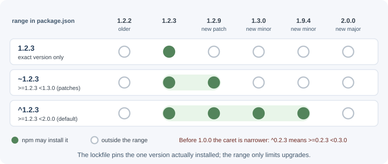

# npm and Package Management

npm (originally "Node Package Manager") is the default tool for installing,
updating, and publishing JavaScript packages, and the name of the public
registry that hosts them. Every Node.js project describes itself and its
dependencies in a `package.json` file, and npm uses that file to build the
`node_modules` folder.

## Why it matters

A typical backend depends on dozens of direct packages and hundreds of
indirect ones. How you declare versions, lock them, install them in CI, and
check them for vulnerabilities decides whether builds are reproducible and
whether a compromised package can reach production. Package management is a
daily skill, not a one-time setup.

## Real-world usage

- **left-pad (2016):** an author unpublished 273 packages from npm after a
  name dispute. One of them, the tiny `left-pad`, sat deep in the dependency
  trees of thousands of projects, including Babel. npm saw hundreds of
  install failures per minute and, in an unprecedented step, re-published
  the exact version (0.0.3) that dependents pinned, ending a 2.5-hour
  disruption
  ([npm blog: kik, left-pad, and npm](https://blog.npmjs.org/post/141577284765/kik-left-pad-and-npm)).
- **event-stream (2018):** a new maintainer of the popular `event-stream`
  package added a dependency, `flatmap-stream`, that contained malicious
  code targeting one company's development environment. npm removed the
  malicious versions and took ownership of the package
  ([npm blog: Details about the event-stream incident](https://blog.npmjs.org/post/180565383195/details-about-the-event-stream-incident)).
- **Shai-Hulud (2025):** a self-replicating worm spread through compromised
  maintainer accounts by injecting malicious post-install scripts into
  popular packages, and stole secrets. GitHub responded by requiring 2FA for
  local publishing, limiting granular tokens to seven days, and pushing
  trusted publishing from CI
  ([GitHub blog: Our plan for a more secure npm supply chain](https://github.blog/security/supply-chain-security/our-plan-for-a-more-secure-npm-supply-chain/)).
- **pnpm** now refuses to run dependencies' build scripts unless they are
  listed in `allowBuilds`, because most compromised packages have used
  install scripts to run code
  ([pnpm docs: Supply chain security](https://pnpm.io/supply-chain-security)).

Popular tools and providers: npm, pnpm, and Yarn as clients; the npm
registry, GitHub Packages, and private registries such as Verdaccio or
Artifactory; Dependabot and Renovate for update pull requests.

## How it works

### `package.json`

```json
{
  "name": "orders-api",
  "version": "1.4.0",
  "private": true,
  "type": "module",
  "main": "./src/server.js",
  "exports": "./src/server.js",
  "scripts": {
    "dev": "node --watch --env-file=.env src/server.js",
    "start": "node src/server.js",
    "test": "node --test",
    "lint": "eslint ."
  },
  "dependencies": {
    "express": "^5.1.0",
    "zod": "^3.23.8"
  },
  "devDependencies": {
    "eslint": "^9.10.0",
    "supertest": "^7.0.0"
  },
  "engines": {
    "node": ">=22"
  }
}
```

| Field | Purpose |
|-------|---------|
| `name` | Package name. Lowercase, URL-safe; may be scoped like `@acme/orders`. |
| `version` | The package's own semantic version. |
| `private` | `true` prevents accidental `npm publish`. Use it for applications. |
| `type` | `"module"` makes `.js` files ES modules; `"commonjs"` (default) makes them CommonJS. |
| `main` | Entry point when someone imports the package (older field). |
| `exports` | Modern, stricter map of the package's public entry points. |
| `scripts` | Named commands run with `npm run <name>`. |
| `dependencies` | Packages needed at runtime in production. |
| `devDependencies` | Packages needed only for development, tests, and builds. |
| `peerDependencies` | Packages the consumer must install, typically for plugins (for example, a React component library declaring `react`). |
| `optionalDependencies` | Packages that may fail to install without failing the whole install. |
| `engines` | Supported Node.js (and npm) versions. |

Create one with `npm init` (interactive) or `npm init -y` (defaults).

### Semantic versioning

Packages use **semantic versioning** (semver): `MAJOR.MINOR.PATCH`.

- **MAJOR** changes may break existing code.
- **MINOR** adds features in a backward-compatible way.
- **PATCH** fixes bugs in a backward-compatible way.
- Pre-releases look like `2.0.0-beta.1`.

Version **ranges** in `package.json` say which versions are acceptable:

| Range | Means | Matches for `1.2.3` |
|-------|-------|---------------------|
| `1.2.3` | Exactly this version | `1.2.3` only |
| `^1.2.3` | Compatible: same major | `>=1.2.3 <2.0.0` |
| `~1.2.3` | Approximately: same minor | `>=1.2.3 <1.3.0` |
| `>=1.2.3 <1.5.0` | Explicit range | As written |
| `1.x` / `1.*` | Any 1.x version | `>=1.0.0 <2.0.0` |
| `*` / `latest` | Anything | Avoid |

`npm install express` saves `^` ranges by default.



!!! note "The 0.x special case"
    Before 1.0.0, any change may break things, so caret ranges are narrower:
    `^0.2.3` means `>=0.2.3 <0.3.0`, and `^0.0.3` means exactly `0.0.3`.

### `package-lock.json`

Ranges allow many versions, so two installs on different days could produce
different trees. **`package-lock.json`** records the exact version, download
URL, and integrity hash of **every** installed package, including indirect
(transitive) dependencies.

- Commit it for applications so every developer, CI run, and server gets the
  identical tree.
- The integrity hashes make npm reject tampered downloads.
- Review lockfile changes in pull requests; unexpected new packages are a
  warning sign.

### `npm install` versus `npm ci`

| Command | Behavior | Use it |
|---------|----------|--------|
| `npm install` | Installs from `package.json`, using the lockfile where it fits; may update the lockfile. | Local development, adding packages. |
| `npm install <pkg>` | Adds a dependency and updates both files. | Adding a runtime dependency. |
| `npm install -D <pkg>` | Adds a devDependency. | Adding a tool. |
| `npm ci` | Requires a lockfile; deletes `node_modules` and installs **exactly** what the lockfile says; fails if `package.json` and the lockfile disagree; never writes `package.json` or the lockfile. | CI pipelines and production builds. |
| `npm ci --omit=dev` | Same, without devDependencies. | Production images. |


### Updating

```bash
npm outdated            # shows Current, Wanted (max in range), Latest
npm update              # updates within your ranges and the lockfile
npm install express@6   # move to a new major deliberately
```

`npm update` never crosses a range boundary, so major upgrades are always a
deliberate choice. Read changelogs before major upgrades.

### Scripts and lifecycle hooks

```bash
npm run dev       # runs scripts.dev
npm start         # shortcut for npm run start
npm test          # shortcut for npm run test
npm run lint -- --fix   # arguments after -- are passed to the script
```

npm adds `node_modules/.bin` to `PATH` while a script runs, so scripts can
call locally installed tools by name (`eslint`, not
`./node_modules/.bin/eslint`).

If a script named `prebuild` or `postbuild` exists, npm runs it before or
after `build`. Packages can also define install lifecycle scripts such as
`preinstall`, `install`, `postinstall`, and `prepare`, which run
automatically when the package is installed—this is important for security
(see below).

### npx

`npx <command>` runs a package's binary from the local `node_modules/.bin`
if it is installed. Otherwise npx asks for confirmation, then downloads the
package into the npm cache and runs it (`--yes` skips the prompt).

```bash
npx prisma migrate dev
npx create-vite@latest my-app
```

### Global versus local installs

- **Local** (default): installed into the project's `node_modules` and
  recorded in `package.json`. Use this for everything the project needs,
  including tools.
- **Global** (`npm install -g`): installed once for the machine. Use it only
  for standalone CLIs you run outside projects. Global tools are not
  recorded in any project, so teammates and CI do not get them.

### Security: the supply chain

Every dependency is code you run with full access to your machine and
servers. Common risks:

- **Known vulnerabilities** in a package version.
- **Typosquatting**: malicious packages with names like `expres` or
  `lodahs`.
- **Malicious install scripts**: `postinstall` runs arbitrary code during
  `npm install`.
- **Compromised maintainer accounts** publishing a malicious new version of a
  popular package.
- **Dependency confusion**: a public package shadowing an internal package
  name.

Defenses:

```bash
npm audit               # report known vulnerabilities
npm audit fix           # apply compatible fixes
npm ci --ignore-scripts # install without running lifecycle scripts
npm ls express          # see why a package is in the tree
```

- Commit and review the lockfile; use `npm ci` in CI.
- Check a package's maintainers, download history, and repository before
  adding it. Fewer dependencies mean a smaller attack surface.
- Consider disabling install scripts (`ignore-scripts=true` in `.npmrc`)
  and allowing only the packages that genuinely need them.
- Use scoped names (`@your-org/...`) and a private registry for internal
  packages.
- Enable automated update tooling (such as Dependabot or Renovate) so fixes
  arrive as reviewable pull requests.

### Workspaces and monorepos

npm **workspaces** manage several packages in one repository with a single
install and shared `node_modules`:

```json
{
  "name": "acme",
  "private": true,
  "workspaces": ["packages/*", "services/*"]
}
```

```bash
npm install                         # installs all workspaces
npm run test --workspaces           # run test in every workspace
npm install zod -w services/orders  # add a dependency to one workspace
```

Workspaces can depend on each other by name, so a shared `@acme/validation`
package can be used by several services without publishing it.

### pnpm and Yarn

| Tool | Key idea |
|------|----------|
| **npm** | Default, ships with Node.js. |
| **pnpm** | Stores each package version once in a global content-addressable store and links it into projects; saves disk space, installs fast, and has a strict layout that prevents using undeclared dependencies. Does not run dependencies' build scripts unless they are listed in `allowBuilds`; by default the install fails when an unapproved one is found. |
| **Yarn** | Alternative client with workspaces and Plug'n'Play mode (no `node_modules`). |

All use `package.json`; each has its own lockfile (`pnpm-lock.yaml`,
`yarn.lock`). Use **one** tool per project and commit its lockfile.

### Publishing basics

```bash
npm login
npm version patch          # bump version, create a git tag
npm publish --access public
```

- Use the `files` field (or `.npmignore`) so you publish only built output,
  not tests or secrets.
- Scoped packages are published with private visibility by default;
  `--access public` makes them public.
- Prefer publishing from CI with provenance or trusted publishing, so users
  can verify where a package was built.

### `.npmrc`

`.npmrc` configures npm per project (`./.npmrc`) or per user
(`~/.npmrc`):

```ini
save-exact=true
engine-strict=true
@acme:registry=https://npm.acme.example/
//npm.acme.example/:_authToken=${NPM_TOKEN}
```

Reference tokens through environment variables as shown; never commit a real
token. npm replaces `${VARIABLE_NAME}` with the variable's value, and leaves
the text unchanged if the variable is not defined.

## When to use and when not to use

- **Use `npm install`** locally to add, remove, or update packages.
- **Use `npm ci`** in CI and production builds, where the install must match
  the lockfile exactly and fail loudly if it cannot.
- **Use exact versions** (`save-exact=true`) for applications that want
  every change to arrive through a reviewed pull request. Ranges plus a
  lockfile are also fine; the lockfile already pins what is installed.
- **Use local installs** (`devDependencies` + `npx`) for project tools;
  reserve `-g` for personal CLIs.
- **Use workspaces** when several packages or services in one repository
  share code.
- **Do not add a dependency** for a few lines of code you can write and test
  yourself; each package is code you trust with your servers.

| Client | Strengths | Trade-offs |
|--------|-----------|-----------|
| npm | Ships with Node.js; no extra setup; workspaces | Flat `node_modules` lets code import undeclared packages |
| pnpm | Fast, disk-efficient, strict layout, blocks unapproved build scripts | Some old tools assume a flat `node_modules` |
| Yarn | Plug'n'Play (no `node_modules`), mature monorepo features | PnP needs editor and tool support |

## Practical examples

### Adding and removing packages

```bash
npm install express            # runtime dependency
npm install -D vitest          # dev dependency
npm uninstall left-pad         # remove and update package.json
npm install express@5.1.0 -E   # exact version (-E = --save-exact)
```

### A production Docker install

```dockerfile
FROM node:24-alpine
WORKDIR /app
COPY package.json package-lock.json ./
RUN npm ci --omit=dev            # exact, reproducible, no dev tools
COPY src ./src
USER node
CMD ["node", "src/server.js"]
```

## Best practices

- Commit `package-lock.json` for applications; use `npm ci` in CI and
  production builds.
- Put build and test tools in `devDependencies` and install production
  images with `--omit=dev`.
- Mark applications `"private": true`.
- Keep dependencies few and up to date; remove unused ones.
- Run `npm audit` in CI and act on high-severity findings.
- Upgrade majors deliberately, one at a time, with tests.
- Use the `engines` field and `.nvmrc` to declare the Node.js version.

## In production

- **CI fails with a lockfile error.**
  - *Symptom:* the pipeline stops at the install step.
  - *Detect:* the log shows `npm error code EUSAGE` and "`npm ci` can only
    install packages when your package.json and package-lock.json or
    npm-shrinkwrap.json are in sync", followed by a line such as
    `Missing: is-number@7.0.0 from lock file`.
  - *Cause:* someone edited `package.json` by hand, or committed it without
    the updated lockfile.
  - *Fix:* run `npm install` locally and commit both files together. Never
    switch CI to `npm install` to make the error go away.
- **"Works on my machine", crashes in the container.**
  - *Symptom:* the production image fails at startup with
    `Cannot find package 'zod'` (ESM) or `Cannot find module 'zod'`
    (CommonJS).
  - *Detect:* the missing package is listed under `devDependencies`, and the
    image was built with `npm ci --omit=dev`.
  - *Cause:* a runtime import of a dev-only package.
  - *Fix:* move it to `dependencies`, and run a smoke test against the built
    image in CI.
- **An update breaks code that never imported the package.**
  - *Symptom:* after `npm update`, a module that was always "there" is
    missing.
  - *Detect:* `npm ls <package>` shows it was only present as a dependency
    of another package.
  - *Cause:* the code relied on a *phantom dependency* that npm's flat
    `node_modules` happened to expose.
  - *Fix:* declare every package you import in your own `package.json`.
    pnpm's strict layout catches this early.
- **A compromised dependency.**
  - *Symptom:* a security advisory, unexpected outbound network traffic
    from build machines, or new packages in a lockfile diff nobody requested.
  - *Detect:* `npm audit` in CI, dependency update tools, and review of
    `package-lock.json` changes in pull requests.
  - *Cause:* a malicious version published through a stolen maintainer
    account, often running code in `postinstall`.
  - *Fix:* pin to the last safe version, disable install scripts, rotate any
    secrets the build could reach, and prefer packages published with
    provenance.

## Important terminology

- **Package:** A folder or archive described by a `package.json`, usually
  published to a registry.
- **Registry:** A server that stores packages, such as the public npm
  registry.
- **Dependency:** A package your code needs.
- **Transitive dependency:** A dependency of one of your dependencies.
- **Semantic versioning:** The MAJOR.MINOR.PATCH versioning convention.
- **Lockfile:** A file that pins the exact resolved dependency tree.
- **Lifecycle script:** A script npm runs automatically, such as
  `postinstall`.
- **Workspace:** A package inside a monorepo managed by one root install.
- **Supply-chain attack:** An attack delivered through a dependency rather
  than your own code.

## Common mistakes and misconceptions

- **Not committing the lockfile**, so different machines install different
  versions.
- **Using `npm install` in CI**, which may change the tree instead of
  failing when files disagree.
- **Putting tools in `dependencies`**, which bloats production images.
- **"`^` means latest."** It means the latest version within the same major.
- **Deleting the lockfile to "fix" install errors**, which silently upgrades
  everything.
- **Trusting a package because it is popular.** Popular packages are
  attractive targets.
- **Installing project tools globally**, so teammates and CI lack them.

## Revision questions

1. What is the difference between `dependencies`, `devDependencies`, and
   `peerDependencies`?
2. Which versions does `^1.4.2` allow? And `~1.4.2`? And `^0.4.2`?
3. Why should `package-lock.json` be committed, and what does it contain?
4. When should you use `npm ci` instead of `npm install`?
5. Name three supply-chain risks and one defense for each.
6. What problem do workspaces solve?

## Further learning

- [npm Docs: package.json](https://docs.npmjs.com/cli/configuring-npm/package-json)
- [npm Docs: package-lock.json](https://docs.npmjs.com/cli/configuring-npm/package-lock-json)
- [npm Docs: npm ci](https://docs.npmjs.com/cli/commands/npm-ci)
- [npm Docs: About semantic versioning](https://docs.npmjs.com/about-semantic-versioning)
- [npm Docs: Auditing package dependencies for security vulnerabilities](https://docs.npmjs.com/auditing-package-dependencies-for-security-vulnerabilities)
- [npm Docs: Workspaces](https://docs.npmjs.com/cli/using-npm/workspaces)
- [Semantic Versioning specification](https://semver.org/)
