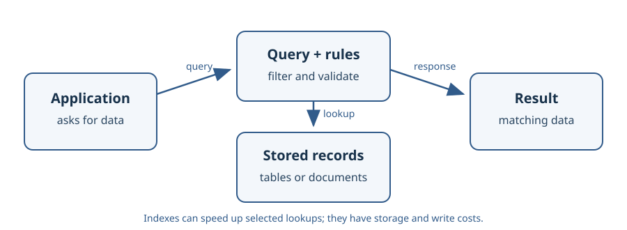

# Databases

This section explores how applications store, retrieve, organize, and optimize
data using database concepts and selected database systems.

## Learning objectives

- Understand core database concepts and the trade-offs behind data models.
- Build familiarity with MongoDB and PostgreSQL.
- Connect database choices and operations to application needs.

## Topics

- [Database Fundamentals](database-fundamentals.md)
- [MongoDB](mongodb/index.md)
- [PostgreSQL](postgresql/index.md)
