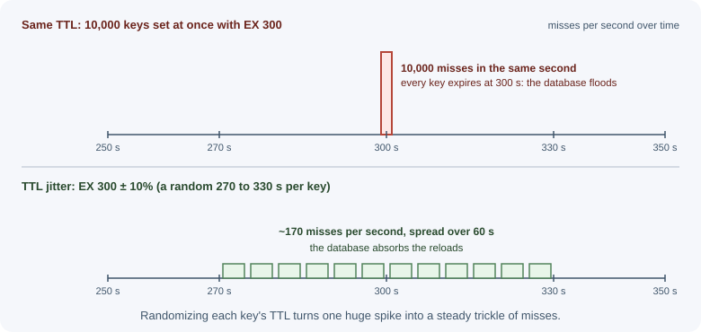

# Cache Failure Modes

Caches make systems faster, but they also create new ways to fail. Popular
keys expiring at once can flood the database; requests for data that does
not exist can bypass the cache entirely; one oversized or extremely hot
key can overload a cache node; and a cache outage can take down the
database behind it. This lesson names each failure mode and the standard
defenses.

## Why it matters

Once a system depends on a high hit ratio, the database is sized for the
traffic that **misses**, not for all traffic. If the cache suddenly stops
absorbing load, the database receives many times more queries than it can
handle and the whole system can collapse. Most large caching incidents
come from a handful of well-known patterns, so learning them is one of the
highest-value topics in caching.

## Real-world usage

- **Facebook: leases against thundering herds.** In the
  [Scaling Memcache at Facebook](https://www.usenix.org/system/files/conference/nsdi13/nsdi13-final170_update.pdf)
  paper, each memcached server hands out a lease token for a key at most
  once every 10 seconds by default. Other clients that miss within that
  window are told to wait briefly; by the time they retry, the lease holder
  has usually filled the cache within milliseconds.
- **Facebook: Gutter for cache server failures.** The same paper describes
  *Gutter*, a small pool of machines (about 1% of the memcached servers in a
  cluster) that takes over for failed servers. Clients that get no response
  retry against Gutter, which keeps a failed cache server from turning into
  a flood of database queries.
- **Cloudflare: request collapsing.** Cloudflare's
  [default cache behavior](https://developers.cloudflare.com/cache/concepts/default-cache-behavior/)
  includes a cache lock: only the first request for an uncached asset is
  forwarded to the origin from a given location, and the other requests
  wait for it, which is single-flight at the CDN.
- **Cloudflare: Tiered Cache.** With
  [Tiered Cache](https://developers.cloudflare.com/cache/how-to/tiered-cache/),
  lower-tier data centers ask an upper-tier data center before contacting
  the origin, reducing origin requests when many edge locations miss at
  once.

## How it works

### Cache stampede (thundering herd)

When a popular key expires, every request that arrives before it is
reloaded misses at the same time and runs the same expensive query.


Defenses:

| Technique | How it works |
|-----------|--------------|
| Request coalescing (single-flight) | Within one process, concurrent misses for the same key share one in-flight load |
| Distributed lock | Across instances, only the request that acquires a lock reloads; others wait briefly or serve stale data |
| Stale-while-revalidate | Keep serving the old value while one request refreshes it |
| Probabilistic early expiration | Each read has a small, rising chance of refreshing before expiry, so one request refreshes early |
| Refresh-ahead | A background job refreshes known hot keys before they expire |

**Probabilistic early expiration** (called XFetch in the VLDB 2015 paper
[Optimal Probabilistic Cache Stampede Prevention](https://www.vldb.org/pvldb/vol8/p886-vattani.pdf))
recomputes when:

```text
now − delta × beta × ln(random()) ≥ expiry

delta  = how long the recomputation takes
beta   = tuning factor (1 by default; > 1 refreshes earlier)
random() returns (0, 1], so −ln(random()) is a positive, usually small number
```

As expiry approaches, the chance that some request decides to refresh
grows, so one request usually refreshes the value before it actually
expires and the others keep reading the cached copy.

### Cache penetration

Requests for keys that **do not exist** in the database are never cached
(there is nothing to store), so every such request goes to the database.
Attackers can exploit this by requesting random ids.

```text
GET /products/999999991  -> cache miss -> DB: not found -> nothing cached
GET /products/999999992  -> cache miss -> DB: not found -> nothing cached
... every request reaches the database
```

Defenses:

- **Negative caching:** cache "not found" results too, with a short TTL
  (for example 30–60 seconds), so repeated lookups are absorbed.
- **Bloom filter:** a compact probabilistic set of all existing ids. If
  the filter says an id is absent, it is definitely absent and the
  database is skipped. It can occasionally say "maybe present" for a
  missing id (a false positive), but never "absent" for an existing one.
- **Input validation:** reject malformed ids before any lookup.
- **Rate limiting** per client for expensive lookups; see
  [rate limiting and throttling](../../03-backend-development/backend-concepts/rate-limiting-and-throttling.md).


### Cache avalanche

Many keys expire at the same moment, or the cache restarts empty, and
the database receives a flood of misses for **different** keys.

Common causes: a bulk job sets thousands of keys with the same TTL, or a
deploy flushes the cache.



Defenses:

- **TTL jitter:** add a random spread, for example `300 s ± 10%`, so
  expirations are spread out.
- **Warm-up:** preload the most important keys before sending traffic to
  a new or restarted cache.
- **Gradual traffic shift** to new cache nodes.
- **Load shedding and limits** on the database path (see the fallback
  section below).

### Hot keys

A single key receives a huge share of traffic (a celebrity profile, a
flash-sale product). In a clustered cache, one key lives on one node, so
that node's CPU or network becomes the bottleneck while the others are
idle.

Defenses:

- A small **in-process cache** with a very short TTL (even 1–5 seconds)
  in front of the distributed cache absorbs most reads of the hot key.
- **Key replication:** store copies under `product:7#1` … `product:7#8`
  (which hash to different nodes) and read a random copy; writes must
  update or delete all copies.
- Read replicas of the cache node holding the hot key.
- Detect them: `redis-cli --hotkeys` works when an LFU eviction policy is
  configured; client-side metrics per key prefix also help.

### Big keys

Very large values (multi-megabyte JSON documents, or collections with
millions of members) cause trouble:

- Redis executes commands one at a time, so reading, writing, or deleting
  a huge key blocks other clients.
- Transferring large values uses network bandwidth and increases latency.
- Uneven memory use across cluster nodes.

Defenses: keep values small, split large collections into several keys,
cache only the fields needed, compress large blobs, use `UNLINK` (which
frees memory in the background) instead of `DEL` for big keys, and find
offenders with `redis-cli --bigkeys` or `MEMORY USAGE key`.

### Stale reads and inconsistency

Cached data can disagree with the database because of races between
reads and writes, missed invalidations, or replication lag in the cache
itself. Symptoms are "I saved it but still see the old value" bugs.
Defenses are covered in [invalidation and expiration](invalidation-and-expiration.md):
correct write ordering, deleting instead of updating, versioning, short
TTLs, and reading the database for decisions that must be correct.

### The cache as a single point of failure

If the cache is down or slow, a naive application either fails every
request or sends all traffic to the database, which then collapses.

```text
Normal:  1,000 req/s ── 95% hits ──> cache;   50 req/s ──> database
Outage:  1,000 req/s ──────────────────────────────────────> database (20× load)
```

Defenses:

- **Short timeouts** on cache calls (a few milliseconds to tens of
  milliseconds). A slow cache must not slow every request.
- **Treat cache errors as misses**, but **limit concurrent database
  fallbacks** (a semaphore or bulkhead), and shed load or serve degraded
  responses beyond that limit.
- **Circuit breaker:** after repeated cache failures, skip the cache for a
  short period instead of waiting on timeouts. See
  [timeouts, retries, and idempotency](../../03-backend-development/backend-concepts/timeouts-retries-and-idempotency.md).
- **High availability** for the cache itself: replicas and automatic
  failover; see [persistence and high availability](../redis/persistence-and-high-availability.md).
- **Capacity planning** that knows how much traffic the database can take
  without the cache.

### Cold starts and warming

A new or flushed cache starts with a 0% hit ratio. Until it fills, every
request misses. Warm it by preloading the top keys (from access logs or
yesterday's most-read items), by shifting traffic gradually, or by
replaying recent read traffic against it before going live.

## When to use and when not to use

| Defense | Use when | Do not use when |
|---|---|---|
| Single-flight (per process) | Any cache with concurrent misses; cheap and always worth it | Not a defense across instances on its own |
| Distributed lock | Expensive recomputation must run once across many instances | You need a correctness guarantee (locks can expire mid-work) |
| Stale-while-revalidate | Slightly old data is acceptable during refresh | Data must be current on every read |
| Probabilistic early expiration | Hot keys with predictable recomputation time | Cold keys; it adds work without benefit |
| Negative caching | Lookups for missing ids are common or abusable | "Not found" can change to "found" and must show immediately |
| Bloom filter | Huge id space with frequent probes for missing ids | Small datasets, or ids created faster than the filter is rebuilt |
| TTL jitter | Many keys are written at the same time | Never harmful; use it by default for bulk loads |
| Local cache for hot keys | One key dominates traffic | The value must change everywhere instantly |

## Practical examples

### Single-flight request coalescing in Node.js

Cache the **promise** of an in-flight load so concurrent callers in the
same process await the same database query.

```js
// singleFlight.js
const inFlight = new Map(); // key -> Promise

export function singleFlight(key, load) {
  const existing = inFlight.get(key);
  if (existing) return existing;               // join the running load

  const promise = load().finally(() => inFlight.delete(key));
  inFlight.set(key, promise);
  return promise;
}
```

```js
import { singleFlight } from "./singleFlight.js";

export async function getProduct(id) {
  const key = `product:${id}`;
  const cached = await redis.get(key);
  if (cached !== null) return JSON.parse(cached);

  // 500 concurrent misses in this process -> 1 database query
  return singleFlight(key, async () => {
    const product = await db.products.findById(id);
    const ttl = 300 + Math.floor(Math.random() * 60);  // TTL jitter
    await redis.set(key, JSON.stringify(product ?? null), "EX", product ? ttl : 30);
    return product;
  });
}
```

This version also stores `null` for missing products with a 30-second
TTL (negative caching). Callers must then treat a cached `null` as "not
found" rather than as a miss.

### A distributed lock for recomputation across instances

Single-flight works per process. With many instances, a short Redis lock
lets one instance recompute while others serve the stale copy.

```js
import { randomUUID } from "node:crypto";

const RELEASE = `
if redis.call("GET", KEYS[1]) == ARGV[1] then
  return redis.call("DEL", KEYS[1])
end
return 0
`;

export async function refreshWithLock(key, load, ttlSeconds) {
  const lockKey = `lock:${key}`;
  const token = randomUUID();

  // NX: only if absent; PX: lock expires so a crash cannot hold it forever
  const acquired = await redis.set(lockKey, token, "PX", 5000, "NX");
  if (!acquired) return null; // someone else is refreshing; caller serves stale data

  try {
    const value = await load();
    await redis.set(key, JSON.stringify(value), "EX", ttlSeconds);
    return value;
  } finally {
    // Delete the lock only if we still own it
    await redis.eval(RELEASE, 1, lockKey, token);
  }
}
```

A lock like this is fine for avoiding duplicate work. It is **not** a
correctness guarantee for critical sections, because a lock can expire
while its holder is still working.

### Database fallback with a concurrency limit

```js
// Allow at most 20 concurrent database fallbacks per instance
let active = 0;
const MAX_FALLBACKS = 20;

export async function getWithFallback(key, load) {
  try {
    const cached = await withTimeout(redis.get(key), 25); // 25 ms budget
    if (cached !== null) return JSON.parse(cached);
  } catch {
    // cache down or slow: fall through to the limited fallback
  }

  if (active >= MAX_FALLBACKS) {
    const error = new Error("Service busy, please retry");
    error.status = 503;
    throw error;                     // shed load instead of overloading the DB
  }

  active += 1;
  try {
    return await load();
  } finally {
    active -= 1;
  }
}

function withTimeout(promise, ms) {
  return Promise.race([
    promise,
    new Promise((_, reject) => setTimeout(() => reject(new Error("timeout")), ms)),
  ]);
}
```

## Best practices

- Coalesce concurrent misses per process, and use stale-while-revalidate
  or locks for expensive hot keys.
- Add jitter to TTLs, especially for bulk-loaded keys.
- Cache negative results briefly and validate ids early.
- Keep values small; split or trim big keys.
- Give cache calls short timeouts and treat failures as misses, with a
  cap on database fallbacks.
- Run the cache with replicas and automatic failover when the system
  depends on it.
- Load-test the "cache down" and "cache cold" scenarios, not only the
  happy path.

## In production

- **Database CPU spikes on a regular rhythm.**
  *Detect:* database load jumps every few minutes, matching a hot key's
  TTL, with many identical queries in the slow-query log. *Cause:* a cache
  stampede on expiry. *Fix:* single-flight per process, a lock or
  stale-while-revalidate across instances, and TTL jitter.
- **Database load rises while the hit ratio falls, with many `404`s.**
  *Detect:* access logs show requests for random or sequential ids that do
  not exist, often from a few clients. *Cause:* cache penetration. *Fix:*
  validate ids, cache "not found" briefly, rate-limit the clients, and add
  a Bloom filter for very large id spaces.
- **A flood of misses after a deploy or cache restart.**
  *Detect:* misses for many different keys at once and a sharp database
  spike right after the cache restarted or a bulk job ran. *Cause:* an
  avalanche from identical TTLs or an empty cache. *Fix:* jitter TTLs, warm
  the cache, and shift traffic gradually.
- **One cache node at 100% CPU while the others idle.**
  *Detect:* per-node metrics in the cluster are uneven, and
  `redis-cli --hotkeys` (which requires an LFU `maxmemory-policy`) or
  per-key client metrics point to one key. *Cause:* a hot key. *Fix:* a
  short-TTL local cache in front of it, or several replicated copies of the
  key.
- **Every request slows down when the cache is unhealthy.**
  *Detect:* p99 latency equals the cache client's timeout; logs show cache
  timeouts. *Cause:* long default client timeouts and unlimited database
  fallbacks. *Fix:* short cache timeouts, a circuit breaker, and a cap on
  concurrent fallbacks.
- **Redis freezes briefly when cleaning up.**
  *Detect:* latency spikes coincide with `DEL` of large keys in
  `SLOWLOG`. *Cause:* deleting a big key synchronously. *Fix:* use
  `UNLINK`, which reclaims memory in another thread, and split big keys.

## Important terminology

- **Cache stampede / thundering herd:** Many simultaneous misses for the
  same key overwhelming the source.
- **Request coalescing (single-flight):** Sharing one in-flight load among
  concurrent requests for the same key.
- **Cache penetration:** Requests for nonexistent data that always bypass
  the cache.
- **Negative caching:** Caching "not found" results.
- **Bloom filter:** A space-efficient probabilistic set with possible
  false positives and no false negatives.
- **Cache avalanche:** Many keys expiring or disappearing at once.
- **TTL jitter:** Randomizing TTLs to spread expirations.
- **Hot key / big key:** A key with extreme traffic, or with an oversized
  value.

## Common mistakes and misconceptions

- Assuming the database can absorb the full load if the cache fails.
- Setting identical TTLs on thousands of keys loaded together.
- Not caching "not found", letting random-id requests hammer the
  database.
- Waiting on a slow cache with the default (long) client timeout.
- Using a cache lock as if it guaranteed mutual exclusion for critical
  business logic.
- Deleting a multi-million-member key with `DEL` during peak traffic.
- Forgetting that single-flight in one process does not coordinate other
  instances.

## Revision questions

1. What causes a cache stampede, and name three ways to prevent it.
2. How does negative caching defend against cache penetration, and what
   does a Bloom filter add?
3. What is the difference between a cache stampede and a cache avalanche?
4. How would you handle a single extremely hot key in a Redis cluster?
5. Why do big keys hurt Redis in particular?
6. How should an application behave when the cache is unavailable?

## Further learning

- [AWS Builders' Library: Caching challenges and strategies](https://aws.amazon.com/builders-library/caching-challenges-and-strategies/)
- [AWS Builders' Library: Using load shedding to avoid overload](https://aws.amazon.com/builders-library/using-load-shedding-to-avoid-overload/)
- [Redis: `UNLINK` command](https://redis.io/docs/latest/commands/unlink/)
- [Redis: `SET` command (NX and PX options)](https://redis.io/docs/latest/commands/set/)
- Related: [eviction policies](eviction-policies.md),
  [Redis as a cache](../redis/redis-as-a-cache.md),
  [availability and reliability](../scalability/availability-and-reliability.md).
