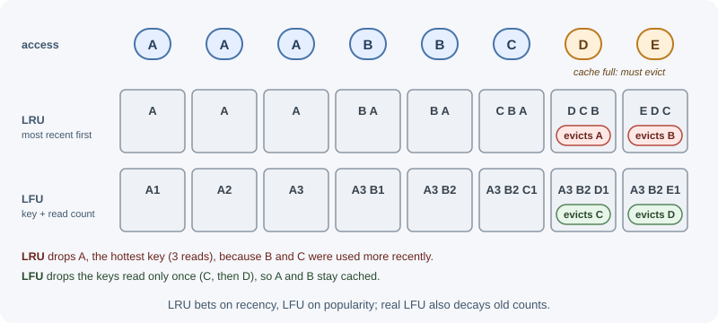

# Eviction Policies

A cache has limited memory. When it is full and a new entry must be
stored, an **eviction policy** decides which existing entry to remove.
Common policies are LRU (least recently used), LFU (least frequently
used), FIFO, random, and TTL-based eviction. Redis exposes these choices
through its `maxmemory-policy` setting.

## Why it matters

The eviction policy decides which data stays in the cache, and therefore
the hit ratio. The wrong policy can push out exactly the data that is
reused most, or, in Redis, make writes fail with out-of-memory errors.
Eviction is different from expiration: expiration removes entries whose
TTL has passed; eviction removes entries early because memory ran out.

## Real-world usage

- **Redis recommends `allkeys-lru` as a starting point.** The Redis
  [key eviction guide](https://redis.io/docs/latest/develop/reference/eviction/)
  calls `allkeys-lru` "a good default option" when a subset of keys is
  accessed far more often than the rest, and explains that Redis
  approximates LRU by sampling keys and keeping a pool of good eviction
  candidates.
- **Managed Redis can have a different default.** Open-source Redis
  defaults to `noeviction`, but Amazon ElastiCache's
  [parameter groups](https://docs.aws.amazon.com/AmazonElastiCache/latest/dg/ParameterGroups.Engine.html)
  list `volatile-lru` as the default `maxmemory-policy`. Code that stores
  keys without TTLs behaves differently on the two.
- **Caffeine combines frequency and recency.** The Java caching library
  [Caffeine](https://github.com/ben-manes/caffeine) offers size-based
  eviction "based on frequency and recency", and its README points to the
  research behind its policy, including the TinyLFU admission policy paper.
- **Redis added an "LRM" policy.** Since Redis 8.6, `allkeys-lrm` and
  `volatile-lrm` evict the *least recently modified* keys: only writes
  update the timestamp, so frequently read but rarely updated data can be
  told apart from data that is actively changing.

## How it works

### Expiration compared with eviction

| | Expiration | Eviction |
|-|------------|----------|
| Trigger | The entry's TTL passed | Memory limit reached |
| Chooses | Exactly the expired entry | A victim chosen by the policy |
| Happens even with free memory | Yes | No |
| Signal | Normal; data aged out | The cache may be too small |

A healthy cache mostly expires entries. Constant eviction means the
working set does not fit.

### LRU: least recently used

LRU removes the entry that has gone unused the longest, assuming recently
used data will be used again soon (temporal locality). It is the most
widely used general-purpose policy.

The classic O(1) implementation combines:

- a **hash map** from key to node, for O(1) lookup, and
- a **doubly linked list** ordered by recency, for O(1) moves and removal.


### LFU: least frequently used

LFU removes the entry with the lowest access count, assuming popular data
stays popular. It protects long-term hot keys from being pushed out by a
burst of one-time reads (for example a batch job scanning many keys once),
which would flush an LRU cache.



Its weakness is history: an item that was popular last week can keep a
high count forever. Practical LFU implementations therefore **decay**
counts over time.

### FIFO, random, and TTL-based

- **FIFO (first in, first out):** evicts the oldest inserted entry
  regardless of use. Simple, but evicts hot entries just because they are
  old.
- **Random:** evicts any entry. Surprisingly reasonable when access is
  roughly uniform, and very cheap.
- **TTL-based (shortest time to live first):** evicts entries closest to
  expiring, since they would disappear soon anyway.

### Comparison

| Policy | Keeps | Good for | Weak when |
|--------|-------|----------|-----------|
| LRU | Recently used | General workloads, recency matters | One-off scans flush hot data |
| LFU | Frequently used | Stable popularity (top products, configs) | Popularity shifts; needs decay |
| FIFO | Newest inserted | Simple buffers | Old entries are still hot |
| Random | Anything | Uniform access; low overhead | Skewed access patterns |
| TTL-based | Long-lived entries | Data with meaningful TTLs | TTLs not set or meaningless |

### Approximated LRU and LFU in Redis

Keeping a perfect linked list over millions of keys costs memory and CPU.
Redis instead **approximates**:

- Each key stores a small access-time (LRU) or access-frequency (LFU)
  field.
- When eviction is needed, Redis samples a few keys (the
  `maxmemory-samples` setting, default 5) and evicts the best candidate
  among them, keeping a small pool of good candidates between rounds.
- Higher sample counts get closer to true LRU at more CPU cost.

Redis LFU uses a small logarithmic counter per key (a Morris-style
counter) that grows more slowly as it gets larger, and **decays** over
time so old popularity fades. `lfu-log-factor` controls how fast counters
grow, and `lfu-decay-time` (in minutes) controls how fast they decay.

### Redis `maxmemory` and `maxmemory-policy`

```text
# redis.conf
maxmemory 2gb
maxmemory-policy allkeys-lru
```

When memory use reaches `maxmemory`, Redis applies the policy. "All keys"
policies consider every key; "volatile" policies consider only keys that
have a TTL set.

| Policy | Evicts | When to pick it |
|--------|--------|-----------------|
| `noeviction` (default) | Nothing; write commands that need memory return an error | Redis holds data that must not be silently dropped (queues, primary data) |
| `allkeys-lru` | Least recently used among all keys | Pure cache with recency-based access; the usual choice |
| `allkeys-lfu` | Least frequently used among all keys | Pure cache with a stable set of popular keys |
| `allkeys-random` | Random key | Uniform access, or lowest overhead |
| `volatile-lru` | Least recently used among keys with a TTL | Mixed use: cache keys have TTLs, persistent keys do not |
| `volatile-lfu` | Least frequently used among keys with a TTL | Mixed use with stable popularity |
| `volatile-random` | Random key with a TTL | Mixed use, uniform access |
| `volatile-ttl` | Key with the shortest remaining TTL | TTLs reflect how long data is worth keeping |
| `allkeys-lrm` (Redis 8.6+) | Least recently **modified** among all keys | Read-heavy data where recent writes signal value |
| `volatile-lrm` (Redis 8.6+) | Least recently modified among keys with a TTL | Mixed use with the same idea |

With any `volatile-*` policy, if no key has a TTL, Redis has nothing to
evict and behaves like `noeviction`: writes start failing. Managed services
can change the default policy (Amazon ElastiCache defaults to
`volatile-lru`), so check the setting rather than assuming `noeviction`.

!!! warning
    Mixing a cache and important data (job queues, sessions you cannot
    lose) in one Redis instance with an `allkeys-*` policy lets cache
    pressure evict the important data. Use separate instances or a
    `volatile-*` policy with TTLs only on cache keys.

### Sizing a cache

1. **Estimate the working set:** how many distinct keys are read in a
   typical TTL window, multiplied by the average value size plus
   per-key overhead.
2. **Look at the hit-ratio curve:** hit ratio usually rises quickly and
   then flattens. Doubling memory past the flat part buys little.
3. **Leave headroom:** Redis needs memory beyond the data for client
   buffers, replication buffers, and, during snapshot persistence,
   copy-on-write pages after forking.
4. **Monitor:** watch `used_memory`, `evicted_keys`, `expired_keys`,
   `keyspace_hits`, and `keyspace_misses` from `INFO`.

```text
Example estimate
  500,000 active products × (2 KB value + ~100 B key/overhead) ≈ 1.05 GB
  + 30% headroom                                               ≈ 1.4 GB
  -> start with maxmemory 1.5gb, then adjust from evicted_keys and hit ratio
```

## When to use and when not to use

- **LRU:** use for general caches where recently used data is likely to be
  reused. Avoid it when large one-off scans or batch jobs read through the
  cache.
- **LFU:** use when a stable set of keys stays popular for a long time.
  Avoid it when popularity shifts quickly and decay is not tuned.
- **Random:** use when access is roughly uniform or eviction overhead must
  be minimal. Avoid it for skewed workloads.
- **TTL-based (`volatile-ttl`):** use when TTLs genuinely express how long
  data is worth keeping. Avoid it when TTLs are arbitrary.
- **No eviction:** use when the data must not be silently dropped (queues,
  primary data). Never use it for a pure cache that is allowed to fill.

| Workload | Recommended policy | Why |
|---|---|---|
| Pure cache, recency matters | `allkeys-lru` | Keeps recently used keys; a solid default |
| Pure cache, stable popular set, periodic scans | `allkeys-lfu` | Scans do not push out long-term hot keys |
| One instance for cache keys (with TTLs) and data you cannot lose | `volatile-lru` / `volatile-lfu` | Only TTL keys are candidates; better still, use two instances |
| Queues, sessions you cannot lose, primary data | `noeviction` + memory alerts | Fail loudly instead of losing data |
| Read-heavy data where writes mark value (Redis 8.6+) | `allkeys-lrm` | Evicts data that has not changed recently |

## Practical examples

### LRU cache with a hash map and a doubly linked list

```js
class Node {
  constructor(key, value) {
    this.key = key;
    this.value = value;
    this.prev = null;
    this.next = null;
  }
}

export class LRUCache {
  constructor(capacity) {
    this.capacity = capacity;
    this.map = new Map();          // key -> Node
    this.head = new Node(null);    // sentinel: most recent side
    this.tail = new Node(null);    // sentinel: least recent side
    this.head.next = this.tail;
    this.tail.prev = this.head;
  }

  #remove(node) {
    node.prev.next = node.next;
    node.next.prev = node.prev;
  }

  #addToFront(node) {
    node.next = this.head.next;
    node.prev = this.head;
    this.head.next.prev = node;
    this.head.next = node;
  }

  get(key) {
    const node = this.map.get(key);
    if (!node) return undefined;   // miss
    this.#remove(node);            // hit: mark as most recently used
    this.#addToFront(node);
    return node.value;
  }

  set(key, value) {
    const existing = this.map.get(key);
    if (existing) {
      existing.value = value;
      this.#remove(existing);
      this.#addToFront(existing);
      return;
    }
    if (this.map.size === this.capacity) {
      const lru = this.tail.prev;  // least recently used
      this.#remove(lru);
      this.map.delete(lru.key);
    }
    const node = new Node(key, value);
    this.map.set(key, node);
    this.#addToFront(node);
  }
}
```

```js
const cache = new LRUCache(2);
cache.set("a", 1);
cache.set("b", 2);
cache.get("a");        // 1  (a is now most recent)
cache.set("c", 3);     // evicts b, the least recently used
cache.get("b");        // undefined
```

Every operation is O(1). JavaScript's `Map` keeps insertion order, so a
shorter LRU can delete and re-insert keys on access and evict
`map.keys().next().value`; the explicit linked list shows the classic
data structure used in other languages and interviews.

### LFU idea in brief

An O(1) LFU keeps a map from key to `{ value, count }` and a map from
count to an ordered set of keys with that count, plus the current minimum
count. On access, a key moves from bucket `count` to `count + 1`; on
eviction, remove the oldest key in the minimum-count bucket.

### Configuring Redis as a cache

```bash
redis-cli CONFIG SET maxmemory 1gb
redis-cli CONFIG SET maxmemory-policy allkeys-lfu
redis-cli INFO stats | grep -E "evicted_keys|keyspace_hits|keyspace_misses"
# evicted_keys:0
# keyspace_hits:982341
# keyspace_misses:41022
```

Settings changed with `CONFIG SET` are lost on restart unless also written
to the configuration file (`CONFIG REWRITE`) or set by your managed
service's parameter settings.

## Best practices

- Use `allkeys-lru` or `allkeys-lfu` for a Redis instance that is purely a
  cache.
- Keep `noeviction` for Redis instances holding data you cannot lose, and
  alert on memory before it fills.
- Do not mix cache data and critical data under an `allkeys-*` policy.
- Size from the working set, then tune from the hit ratio and eviction
  metrics.
- Leave memory headroom for buffers and persistence.
- Treat rising `evicted_keys` with a falling hit ratio as a capacity
  signal.

## In production

- **Writes start failing when the cache fills.**
  *Detect:* application logs show Redis out-of-memory errors on `SET`,
  `used_memory` sits at `maxmemory`, and `evicted_keys` stays at 0.
  *Cause:* `noeviction`, or a `volatile-*` policy with keys that have no
  TTL. *Fix:* use an `allkeys-*` policy for a pure cache, or put TTLs on
  every cache key.
- **Users are logged out at random under load.**
  *Detect:* `evicted_keys` rises during traffic peaks and session keys
  disappear before their TTL. *Cause:* sessions share an `allkeys-*`
  instance with cache data, so cache pressure evicts them. *Fix:* move
  sessions to a separate instance with `noeviction`, or use `volatile-*`
  with TTLs only on cache keys.
- **Hit ratio collapses every night.**
  *Detect:* `keyspace_misses` and database load jump during a nightly batch
  job and stay high afterwards. *Cause:* the job reads many keys once and
  flushes the LRU cache. *Fix:* switch to `allkeys-lfu`, or let the job
  bypass the cache.
- **Behavior differs between local Redis and the managed service.**
  *Detect:* keys without TTLs are never evicted locally but writes fail (or
  keys vanish) in the cloud. *Cause:* different default `maxmemory-policy`
  values, such as `volatile-lru` on ElastiCache. *Fix:* set the policy
  explicitly in every environment.
- **Latency spikes or the server is killed during snapshots.**
  *Detect:* `used_memory_rss` approaches the machine's RAM during
  background saves, followed by swapping or an out-of-memory kill. *Cause:*
  `maxmemory` set too close to physical memory, with no room for
  copy-on-write pages and buffers. *Fix:* leave headroom; the Redis
  eviction guide also recommends leaving RAM free for buffers when using
  replication or persistence.

## Important terminology

- **Eviction:** Removing an entry early because the cache is full.
- **LRU:** Evict the least recently used entry.
- **LFU:** Evict the least frequently used entry.
- **FIFO:** Evict the entry inserted first.
- **Approximated LRU/LFU:** Choosing a victim from a random sample instead
  of tracking exact order.
- **`maxmemory-policy`:** The Redis setting that selects the eviction
  policy.
- **Volatile key:** In Redis, a key that has a TTL.
- **Working set:** The data actively used over a period.

## Common mistakes and misconceptions

- Leaving Redis on the default `noeviction` when using it as a cache, so
  writes fail with out-of-memory errors when it fills.
- Choosing a `volatile-*` policy while setting no TTLs.
- Confusing eviction with expiration.
- Assuming LRU is always best; scans and batch jobs can flush it.
- Setting `maxmemory` to the machine's full RAM, leaving no headroom.
- Using an unbounded in-process cache, which has no eviction at all.

## Revision questions

1. What is the difference between eviction and expiration?
2. Why does an O(1) LRU need both a hash map and a doubly linked list?
3. When does LFU outperform LRU, and why does LFU need decay?
4. Which Redis policy would you choose for a pure cache, and which for an
   instance that also stores job queues?
5. What happens with `volatile-lru` when no keys have a TTL?
6. Which metrics tell you a cache is too small?

## Further learning

- [Redis: Key eviction](https://redis.io/docs/latest/develop/reference/eviction/)
- [Redis: `INFO` command](https://redis.io/docs/latest/commands/info/)
- [Redis: `CONFIG SET` command](https://redis.io/docs/latest/commands/config-set/)
- Related: [cache fundamentals](cache-fundamentals.md),
  [Redis as a cache](../redis/redis-as-a-cache.md),
  [caching overview](../caching.md).
