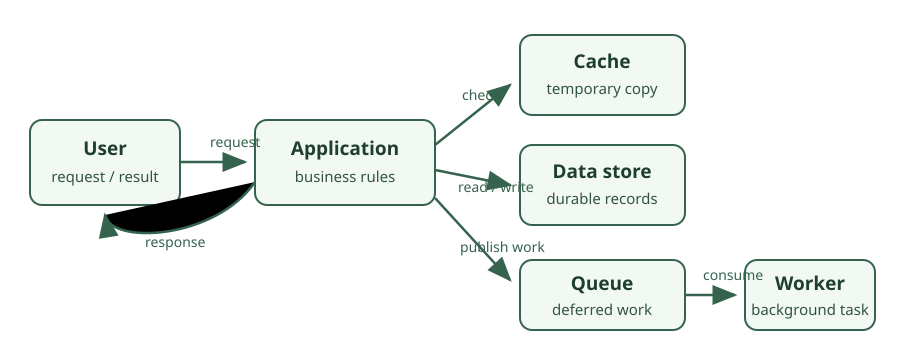

# Application Architecture

This section examines how application components fit together and how systems
can remain responsive and dependable as their needs grow.

## Learning objectives

- Recognize common architectural concerns and trade-offs.
- Understand caching, Redis, and message queues at a system level.
- Develop a foundation for reasoning about scalability and system design.

## Topics

- [Software Architecture](software-architecture.md)
- [Caching](caching.md)
- [Redis](redis.md)
- [Message Queues](message-queues.md)
- [Scalability](scalability.md)
- [System Design](system-design.md)
