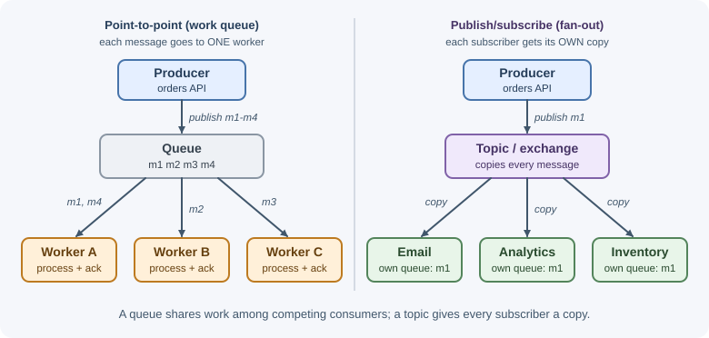

# Messaging Fundamentals

Messaging lets one part of a system send information to another without both
having to be available, fast, or even aware of each other at the same moment.
A producer hands a message to a broker; the broker stores it; a consumer
picks it up when it is ready. This page explains the core vocabulary and
models that every queueing and streaming system builds on.

## Why it matters

Synchronous HTTP calls chain services together: if the email service is
slow, checkout is slow; if it is down, checkout fails. Asynchronous messaging
breaks that chain.

- **Decoupling in time:** the producer and consumer do not need to run at the
  same moment. The consumer can be down for maintenance while messages wait.
- **Decoupling in space:** the producer does not need to know who consumes
  the message, how many consumers there are, or where they run.
- **Load leveling:** a burst of 10,000 orders in a minute becomes a queue that
  workers drain at a steady, safe rate instead of overwhelming a database.
- **Resilience:** a failed message can be retried later; a crashed consumer
  does not lose work, because the message stays in the broker until it is
  acknowledged.
- **Independent scaling:** add more consumers to process faster without
  touching the producer.
- **Fan-out:** one event ("order placed") can trigger email, analytics,
  inventory, and fraud checks, each owned by a different team.

The cost is complexity: eventual consistency, duplicate messages, ordering
questions, and another piece of infrastructure to run and monitor.

## Real-world usage

- **Slack's job queue.** Slack runs business logic that is too slow for a web
  request (message posts, push notifications, URL unfurls, billing
  calculations) through a job queue that was originally held in Redis.
  When a database slowdown made jobs execute slowly, Redis reached its memory
  limit, new jobs could not be enqueued, and every operation depending on the
  queue failed. Slack put **Kafka** in front of Redis as durable storage:
  a service called Kafkagate writes jobs to Kafka, and JQRelay relays them
  into Redis at a rate-limited pace
  ([Scaling Slack's Job Queue](https://slack.engineering/scaling-slacks-job-queue/)).
- **Cloudflare's service communication.** Cloudflare has run Kafka in
  production since 2014 and uses it to decouple microservices, announcing the
  creation, change, or deletion of resources in a common data format; its 14
  clusters have processed over a trillion messages
  ([Cloudflare blog](https://blog.cloudflare.com/using-apache-kafka-to-process-1-trillion-messages/)).
- **AWS Lambda asynchronous invocation.** When a function is invoked
  asynchronously, Lambda places the event in a queue and immediately returns
  success; a separate process reads events from the queue and runs the
  function ([AWS Lambda documentation](https://docs.aws.amazon.com/lambda/latest/dg/invocation-async.html)).
- **Mozilla Pulse.** Mozilla runs Pulse, a managed RabbitMQ cluster, to give
  loose coupling between its automation and infrastructure tools and to
  replace polling: publishers send to topic exchanges and consumers bind their
  own queues ([Mozilla wiki](https://wiki.mozilla.org/Auto-tools/Projects/Pulse)).

**Popular tools and providers:** RabbitMQ, Apache Kafka, Apache Pulsar, NATS,
Redis Streams, and ActiveMQ (self-hosted); Amazon SQS, SNS, and EventBridge;
Google Cloud Pub/Sub; Azure Service Bus; managed hosting such as Amazon MQ,
Amazon MSK, Confluent Cloud, and CloudAMQP.

## How it works

### Producer, broker, consumer

```text
+----------+   publish    +-------------------+   deliver / poll   +----------+
| Producer | -----------> |      Broker       | -----------------> | Consumer |
| (orders  |              |  stores messages  |                    | (email   |
|  API)    |              |  until consumed   | <----------------- |  worker) |
+----------+              +-------------------+   acknowledge      +----------+
```

- **Producer (publisher):** creates and sends messages. It only needs to
  know the broker and a destination name.
- **Broker:** the middleware that receives, stores, routes, and delivers
  messages, such as RabbitMQ, Apache Kafka, or Amazon SQS.
- **Consumer (subscriber, worker):** receives messages, processes them, and
  acknowledges them so the broker knows they are done.
- **Acknowledgement (ack):** the consumer's signal that a message was
  handled. Until it arrives, the broker keeps the message and may deliver it
  again. See [delivery guarantees](delivery-guarantees.md).

### Message anatomy

A message is an envelope of metadata plus a body.

| Part | Purpose | Example |
|---|---|---|
| Message ID | Unique identifier, used for deduplication and tracing | `"msg_01HF3K8..."` |
| Type | What kind of message this is | `"OrderPlaced"` |
| Timestamp | When it was created | `"2026-11-03T10:15:00Z"` |
| Headers / attributes | Key-value metadata the broker or consumer can read without parsing the body | `content-type`, `schema-version`, `tenant` |
| Correlation ID | Ties together all messages and logs belonging to one business flow or request | The original HTTP request ID |
| Causation ID | The ID of the message that caused this one | ID of the `OrderPlaced` message that triggered `PaymentRequested` |
| Reply-to | Where a response should be sent (request-reply) | `"orders.replies.instance-7"` |
| Routing key / partition key | Used by the broker to route or partition | `"order.created"`, a customer ID |
| Body (payload) | The data itself, usually JSON, Avro, or Protobuf | `{"orderId": "ord_901", ...}` |

```json
{
  "id": "msg_01HF3K8Q2V",
  "type": "OrderPlaced",
  "schemaVersion": 2,
  "occurredAt": "2026-11-03T10:15:00Z",
  "correlationId": "req_7f3c9a2e",
  "data": {
    "orderId": "ord_901",
    "customerId": "cus_7",
    "total": { "amount": 4999, "currency": "USD" }
  }
}
```

Messages come in a few flavors:

- **Command:** asks a specific receiver to do something
  (`SendWelcomeEmail`). Usually one consumer.
- **Event:** states that something happened (`OrderPlaced`). The producer
  does not care who reacts; there may be many consumers.
- **Document / query result:** carries data, for example the reply in a
  request-reply exchange.

Version your message schemas and make changes backward compatible (add
fields, do not rename or remove them), exactly as with
[API design](../../03-backend-development/backend-concepts/api-design-best-practices.md),
because producers and consumers deploy at different times.

### Queues and topics

- A **queue** holds messages for **one logical consumer**. Each message is
  processed by exactly one of the consumers reading from that queue.
- A **topic** broadcasts each message to **every subscriber**. Each
  subscriber gets its own copy (or its own position in the log).

### Point-to-point vs publish/subscribe



| | Point-to-point | Publish/subscribe |
|---|---|---|
| Recipients per message | One | All subscribers |
| Typical message | Command, task | Event |
| Scaling | Add consumers to share the work (competing consumers) | Add subscribers for new features |
| Example | "Resize this image" | "User signed up" |

The two combine: a topic fans out to several queues, and each queue has a
pool of competing workers. See [messaging patterns](messaging-patterns.md).

### Push vs pull consumers

| | Push | Pull |
|---|---|---|
| How it works | The broker sends messages to a registered consumer as they arrive | The consumer asks the broker for messages in a loop |
| Flow control | Broker must limit in-flight messages (for example RabbitMQ prefetch) | Natural: the consumer only fetches what it can handle |
| Latency | Very low | Low with long polling; higher with naive polling |
| Examples | RabbitMQ consumers, SNS to HTTP endpoints, Pub/Sub push subscriptions | Kafka consumers, SQS `ReceiveMessage`, Pub/Sub pull subscriptions |

Pull consumers should use **long polling** (wait up to N seconds for a
message) rather than hammering the broker with empty requests.

### Synchronous request/response vs asynchronous messaging


| | Synchronous (HTTP, gRPC) | Asynchronous (messages) |
|---|---|---|
| Caller waits for the result | Yes | No (or only for "accepted") |
| Both sides must be up | Yes | No; the broker buffers |
| Failure of the callee | Fails the caller unless handled | Messages wait and are retried |
| Latency of the overall task | Immediate result | Eventually done |
| Consistency | Easier to reason about | Eventual consistency |
| Debugging | One request trace | Flows spread across services and time |
| Good for | Reads, user needs the answer now | Side effects, slow work, notifying many systems |

Rule of thumb: use synchronous calls when the user needs the answer to
continue ("is this coupon valid?"), and messages for everything that can
happen after the response ("send the receipt", "update the search index").

### Request-reply over queues

Sometimes you want a response but still want the buffering of a broker. The
requester includes a **reply-to** address and a **correlation ID**:

```text
Requester                              Broker                         Responder
   |-- request ------------------------> [pricing.requests] ------------> |
   |   reply-to: replies.instance-7                                       |
   |   correlation-id: c-42                                               |
   |                                                                      | compute
   | <---------------------------------- [replies.instance-7] <-- reply --|
   |   correlation-id: c-42  (matches the pending request)                |
```

The requester keeps a map of pending correlation IDs and resolves the right
one when a reply arrives, with a timeout for replies that never come. This
works, but it reintroduces waiting; if you need it often, a plain HTTP or
gRPC call may be simpler.

### Message brokers vs event-streaming platforms

There are two families of messaging systems with different mental models.

| | Message broker (queue) | Event-streaming platform (log) |
|---|---|---|
| Examples | RabbitMQ, Amazon SQS, Azure Service Bus | Apache Kafka, Amazon Kinesis, Redis Streams, RabbitMQ Streams |
| Storage model | Messages are removed once acknowledged | Append-only log; messages kept for a retention period |
| Consumer position | Broker tracks each message's state | Each consumer group tracks its own offset |
| Replay old messages | No (once consumed, gone) | Yes (rewind the offset) |
| Routing | Rich routing in the broker (exchanges, filters) | Simple: topic and partition |
| Per-message features | Ack/reject, per-message retry, delays, priorities, TTL | Ordered batches; retries handled by the application |
| Ordering | Per queue (weakened by competing consumers and retries) | Strict within a partition |
| Typical use | Task queues, commands, work distribution | Event streams, analytics, many independent readers, event sourcing, change data capture |

Shorthand: a broker is a **smart broker with simple consumers**; a log is a
**simple broker with smart consumers**.

### Overview of common systems

| | RabbitMQ | Apache Kafka | Amazon SQS | Amazon SNS |
|---|---|---|---|---|
| Category | Message broker | Distributed event log | Managed queue | Managed pub/sub |
| Model | Exchanges route to queues | Topics split into partitions | Queues (standard or FIFO) | Topics with subscriptions |
| Delivery | Push with prefetch | Pull by consumer groups | Pull with long polling | Push to subscribers |
| Retention | Until acknowledged (streams retain) | Time/size based, replayable | Up to 14 days | Not stored (delivered and retried) |
| Ordering | Per queue | Per partition | Best effort (standard) or per message group (FIFO) | FIFO topics only |
| Operations | You run it (or use a hosted service) | You run a cluster (or use a managed service) | Fully managed | Fully managed |
| Best for | Flexible routing, task queues | High-throughput streams, replay | Simple, reliable queues on AWS | Fan-out to queues, functions, HTTP |

Details: [RabbitMQ](rabbitmq.md), [Apache Kafka](apache-kafka.md),
[SQS and SNS](cloud-queues-sqs-and-sns.md).

## When to use and when not to use

Use asynchronous messaging when:

- The work can finish after the response: receipts, notifications, search
  indexing, thumbnails, reports.
- Traffic is bursty and a downstream system (a database, a partner API) must
  be protected from spikes.
- Several services, often owned by different teams, need to react to the same
  event.
- A dependency is slow or unreliable and work must survive its outages and be
  retried.
- Work must be spread across many workers that scale independently.

Avoid it when:

- The caller needs the result immediately to continue (a price check, a
  login).
- The work is fast, local, and reliable, such as a single database write.
- Several steps must be strongly consistent with each other at the moment of
  the request.
- The team cannot yet operate and monitor another system; a database-backed
  job table may be enough at small scale (see
  [background jobs](../../03-backend-development/backend-concepts/background-jobs-and-scheduling.md)).
- You want a permanent record of data: a queue is a transport, not a
  database.

| Need | Synchronous HTTP/gRPC | Database job table | Message broker (RabbitMQ, SQS) | Event log (Kafka) |
|---|---|---|---|---|
| Caller needs the answer now | Best | No | No | No |
| A few background jobs in a small app | Overkill | Best | Fine | Overkill |
| Distribute tasks with retries, delays, DLQs | No | Possible, limited | Best | Possible, more work |
| Many independent consumers of the same events | Tight coupling | No | Fan-out with one queue per consumer | Best |
| Replay past events, rebuild state | No | No | No (except RabbitMQ streams) | Best |
| Very high-throughput streams | No | No | Good | Best |

## Practical examples

### Before and after: sending a receipt

Synchronous: the user waits for the email provider, and checkout fails if it
is down.

```js
app.post("/api/orders", async (req, res) => {
  const order = await orders.create(req.body);
  await emailProvider.sendReceipt(order); // slow, and can fail checkout
  res.status(201).json(order);
});
```

Asynchronous: the order is saved, a message is published, and a worker
sends the email later, with retries.

```js
app.post("/api/orders", async (req, res) => {
  const order = await orders.create(req.body);
  await broker.publish("order-events", {
    id: crypto.randomUUID(),
    type: "OrderPlaced",
    occurredAt: new Date().toISOString(),
    correlationId: req.id,
    data: { orderId: order.id, customerId: order.customerId },
  });
  res.status(201).json(order); // returns immediately
});

// Separate process: the email worker
broker.consume("email-queue", async (message) => {
  if (message.type === "OrderPlaced") {
    await emailProvider.sendReceipt(message.data.orderId);
  }
  // returning without throwing = acknowledge; throwing = retry later
});
```

`broker` stands for any client library, and `req.id` is a request ID set by
middleware such as pino-http (plain Express has none). Saving the order and
publishing are two separate writes; the [transactional outbox](messaging-patterns.md)
pattern makes them reliable together.

### A tiny in-memory queue to see the mechanics

```js
// Demo only: messages live in memory and vanish on restart
class DemoQueue {
  #messages = [];
  #inFlight = new Map();

  publish(body) {
    this.#messages.push({ id: crypto.randomUUID(), body, attempts: 0 });
  }

  receive() {
    const msg = this.#messages.shift();
    if (!msg) return null;
    msg.attempts += 1;
    this.#inFlight.set(msg.id, msg); // invisible to others until acked
    return msg;
  }

  ack(id) {
    this.#inFlight.delete(id); // done: gone for good
  }

  nack(id) {
    const msg = this.#inFlight.get(id);
    this.#inFlight.delete(id);
    if (msg) this.#messages.push(msg); // back in line for another attempt
  }
}

const queue = new DemoQueue();
queue.publish({ type: "SendWelcomeEmail", userId: 42 });

const msg = queue.receive();
try {
  console.log("Processing", msg.body, "attempt", msg.attempts);
  queue.ack(msg.id);
} catch {
  queue.nack(msg.id);
}
```

Real brokers add durability, replication, routing, and many consumers, but
the receive/ack/nack cycle is the same.

## Best practices

- **Publish events for facts, send commands for requests**, and name them
  clearly (`OrderPlaced` vs `SendReceipt`).
- **Give every message a unique ID, a type, a timestamp, and a correlation
  ID.**
- **Version message schemas** and only make backward-compatible changes.
- **Assume duplicates and design idempotent consumers.** See
  [delivery guarantees](delivery-guarantees.md).
- **Acknowledge after processing**, not before.
- **Bound retries and use dead-letter queues** for messages that keep
  failing.
- **Monitor queue depth, age of the oldest message, and consumer lag.**
- **Keep messages small**; store large payloads elsewhere and send a
  reference.
- **Do not use a queue as a database.** It is a transport, not the source of
  truth.

## In production

- **Backlog grows at every daily peak.** *Detect:* queue depth and "age of
  oldest message" climb in the evening and only drain overnight. *Cause:* too
  few consumers, or consumers slowed by a downstream database. *Fix:* scale
  consumers on message age (capped by what the database can take), speed up
  the handler, and check whether the work can be batched.
- **Customers receive the same email twice.** *Detect:* logs show the same
  message ID handled by two workers, or support tickets about duplicates.
  *Cause:* at-least-once redelivery after a worker crash, a lost ack, or an
  expired visibility timeout. *Fix:* make the consumer idempotent (dedup by
  message ID) and size timeouts correctly; see
  [delivery guarantees](delivery-guarantees.md).
- **Events go missing after deployments.** *Detect:* a reconciliation job
  finds orders with no matching "order placed" event downstream. *Cause:* the
  service committed to its database and was killed before publishing, or
  consumers used auto-ack. *Fix:* use the
  [transactional outbox](messaging-patterns.md), manual acks after
  processing, and graceful shutdown.
- **Publishers suddenly block or time out.** *Detect:* publish latency spikes;
  RabbitMQ reports a memory or disk alarm; Kafka brokers alert on disk usage.
  *Cause:* an unconsumed backlog filled the broker's memory or disk. *Fix:*
  restore consumers, bound queue lengths, tune retention, and alert on
  backlog long before the broker's limits.
- **A producer release breaks consumers.** *Detect:* deserialization errors
  spike and the dead-letter queue fills right after a deploy. *Cause:* an
  incompatible schema change (renamed or removed field). *Fix:* version
  schemas, make only additive changes, and check compatibility in CI.

## Important terminology

- **Producer / consumer:** the sender / receiver of messages.
- **Broker:** the system that stores and delivers messages.
- **Queue:** a buffer where each message is processed by one consumer.
- **Topic:** a named channel that delivers each message to all subscribers.
- **Point-to-point:** one message, one receiver.
- **Publish/subscribe:** one message, many receivers.
- **Acknowledgement:** confirmation that a message was handled.
- **Correlation ID:** an identifier linking related messages and logs.
- **Command / event:** a request to do something / a record that something
  happened.
- **Long polling:** a pull request that waits for messages instead of
  returning empty immediately.
- **Event-streaming platform:** a system built on a durable, replayable,
  append-only log.

## Common mistakes and misconceptions

- **"A queue makes the system faster."** It makes the *response* faster; the
  total work still takes as long, and consumers must keep up.
- **"Messages are delivered exactly once."** Most systems deliver at least
  once; duplicates happen.
- **Treating an event as a command**, so the producer starts depending on a
  specific consumer's behavior.
- **Putting huge payloads in messages** instead of references.
- **No dead-letter queue**, so one bad message is retried forever or silently
  dropped.
- **Ignoring queue depth** until the backlog is hours old.
- **Using Kafka as a simple task queue** (or a task queue for replayable
  event streams) without understanding the different models.

## Revision questions

1. Give three benefits of asynchronous messaging over synchronous HTTP calls,
   and two costs.
2. What is the difference between a queue and a topic, and between
   point-to-point and publish/subscribe?
3. Which fields should every message envelope carry, and why is a
   correlation ID useful?
4. Compare push and pull consumers. Which does Kafka use? Which does
   RabbitMQ use?
5. How does request-reply work over queues, and when would you avoid it?
6. Explain the difference between a message broker and an event-streaming
   platform.

## Further learning

- **RabbitMQ:** [Tutorials](https://www.rabbitmq.com/tutorials) walk through
  work queues, publish/subscribe, routing, topics, and RPC.
- **Apache Kafka:** [Introduction](https://kafka.apache.org/documentation/#introduction)
  explains event streaming and the log model.
- **AWS:** [Amazon SQS Developer Guide](https://docs.aws.amazon.com/AWSSimpleQueueService/latest/SQSDeveloperGuide/welcome.html).
- **AWS:** [Queue-based load leveling pattern](https://docs.aws.amazon.com/prescriptive-guidance/latest/cloud-design-patterns/queue-based-load-leveling.html).
- **Martin Fowler:** [What do you mean by "Event-Driven"?](https://martinfowler.com/articles/201701-event-driven.html)
- **Related:** [event-driven architecture](../software-architecture/event-driven-architecture.md).
