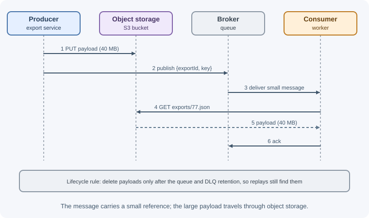

# Messaging Patterns

Messaging systems give you queues, topics, and acknowledgements. Patterns
are the proven ways to combine them into reliable designs: sharing work
across workers, broadcasting events, retrying safely, publishing events
without losing them, and keeping consumers healthy under load. This page
covers the patterns you will use most often.

## Why it matters

- The hard problems in messaging (lost events, duplicates, poison messages,
  backlogs, ordering) have well-known solutions. Reinventing them under
  production pressure usually goes badly.
- Patterns give teams a shared vocabulary: "use an outbox and an idempotent
  consumer" says a lot in one sentence.
- Many of these patterns appear in system design interviews and in every
  serious event-driven system.

## Real-world usage

- **Load leveling at Slack.** After an outage in which its Redis-based job
  queue ran out of memory, Slack wrote jobs to Kafka first and added a relay
  (JQRelay) that moves them into Redis. When execution slows, Slack adjusts
  the relay's rate limits to match the dequeue rate, or pauses relaying,
  while the web app keeps enqueueing into durable Kafka
  ([Slack Engineering](https://slack.engineering/scaling-slacks-job-queue/)).
- **Backpressure and load shedding at Discord.** Discord's push notification
  pipeline handles bursts of over a million requests per minute. Each Pusher
  asks for only as many requests as its Firebase connection can handle
  (backpressure), and the collector in front of it buffers a bounded number of
  requests and sheds the rest in extreme bursts
  ([Discord blog](https://discord.com/blog/how-discord-handles-push-request-bursts-of-over-a-million-per-minute-with-elixirs-genstage)).
- **Log-based change capture at Shopify.** Shopify moved its change data
  capture to Kafka Connect and Debezium, reading database changes from the
  log into Kafka; this log-based approach is the same mechanism used to relay
  a transactional outbox
  ([Shopify Engineering](https://shopify.engineering/capturing-every-change-shopify-sharded-monolith)).
- **Idempotent consumers for Stripe events.** Stripe tells webhook consumers
  to record processed event IDs and skip duplicates, which is the inbox
  pattern ([Stripe webhooks](https://docs.stripe.com/webhooks)).
- **Isolating noisy neighbors in AWS Lambda.** Lambda hashes each customer to
  a few of a fixed set of queues and enqueues into the shortest, so one
  customer's backlog does not delay everyone else
  ([AWS Builders' Library](https://aws.amazon.com/builders-library/avoiding-insurmountable-queue-backlogs/)).

**Popular tools and providers:** Debezium and Kafka Connect (change data
capture and outbox relays), BullMQ (Node.js), Celery (Python), and Sidekiq
(Ruby) for job queues with retries, Temporal for long-running workflows and
sagas, and KEDA for autoscaling consumers on queue metrics in Kubernetes.

## How it works

### 1. Work queue (competing consumers)

Several identical workers read from one queue; each message goes to exactly
one of them.

```text
               +--> worker 1
Producer --> [queue] --> worker 2
               +--> worker 3
```

- **Scale throughput** by adding workers.
- **Resilience:** if a worker dies, its unacknowledged messages go to the
  others.
- **Trade-off:** processing order across messages is lost.

Use it for independent tasks: image processing, emails, report generation.

### 2. Fan-out (publish/subscribe)

One message is delivered to several independent consumers, each with its own
queue (or its own consumer group).

```text
                     +--> [email-queue]     --> email workers
Producer --> topic --+--> [search-queue]    --> search indexer
                     +--> [analytics-queue] --> analytics workers
```

Implementations: a RabbitMQ fanout or topic exchange bound to several
queues, SNS subscribed by several SQS queues, or several Kafka consumer
groups on one topic. Because each consumer has its own buffer, a slow or
failing consumer never affects the others.

### 3. Request-reply

The requester sends a message with a `replyTo` address and a
`correlationId`, then waits (with a timeout) for a reply carrying the same
correlation ID. RabbitMQ offers a built-in "direct reply-to" feature
(`amq.rabbitmq.reply-to`) that avoids declaring a reply queue per request.

Use sparingly: if the caller blocks waiting for the answer, an HTTP or gRPC
call is usually simpler. See [messaging fundamentals](messaging-fundamentals.md).

### 4. Retries with backoff and delay queues

Not every failure deserves the same treatment:

| Failure type | Examples | Action |
|---|---|---|
| Transient | Timeout, `503`, `429`, connection reset, lock conflict | Retry later with exponential backoff and jitter |
| Permanent | Invalid JSON, unknown message type, validation error, missing referenced record that will never exist | Send to the DLQ immediately; retrying cannot help |

Retrying **in place** (immediately requeueing) creates hot loops and hammers
an already struggling dependency. Retry **later** instead:

```text
                          fail (attempt 1)
work queue --> consumer ---------------------> retry-10s queue --(10 s)--> work queue
                          fail (attempt 2)
                       ----------------------> retry-1m queue  --(1 min)-> work queue
                          fail (attempt 3)
                       ----------------------> retry-10m queue --(10 min)-> work queue
                          fail (attempt 4)
                       ----------------------> DLQ (alert a human)
```

How each system delays a retry:

- **RabbitMQ:** retry queues with a message TTL whose dead-letter exchange
  points back to the work queue, or the delayed message exchange plugin.
- **SQS:** leave the message undeleted and set its visibility timeout to the
  backoff delay with `ChangeMessageVisibility`; the redrive policy caps the
  attempts.
- **Kafka:** publish the failed record to retry topics (`orders.retry.1m`,
  `orders.retry.10m`) whose consumers wait until the record is due, then a
  dead-letter topic. The main partition keeps flowing.

Track the attempt count in a header, add **jitter** so retries from many
messages do not synchronize, and cap the total number of attempts. See
[timeouts, retries, and idempotency](../../03-backend-development/backend-concepts/timeouts-retries-and-idempotency.md).

### 5. Dead-letter queue handling and replay

A DLQ is only useful if someone looks at it.

1. **Alert** when the DLQ is not empty (or grows quickly).
2. **Inspect:** each dead message should carry why it failed: the error
   message, the stack or error code, the attempt count, the original queue,
   and timestamps (RabbitMQ adds an `x-death` header; add your own headers
   for the error).
3. **Fix** the cause: deploy a bug fix, restore the missing data, or decide
   the message is invalid.
4. **Replay (redrive)** the messages to the original queue, or **discard**
   them deliberately with a record of why.
5. **Make replay safe** by keeping consumers idempotent; replayed messages
   may already have been partially processed.

Set DLQ retention long enough to investigate (days to weeks), and never let a
DLQ become a silent graveyard.

### 6. Transactional outbox

#### The dual-write problem

A service often needs to **update its database and publish an event**: save
the order, then publish `OrderPlaced`. These are two writes to two systems,
and there is no transaction spanning both.

```text
Option A: write DB, then publish
  BEGIN; INSERT order; COMMIT;     ok
  publish("OrderPlaced")           X broker down / process crashes
  => order exists, but nobody hears about it (lost event)

Option B: publish, then write DB
  publish("OrderPlaced")           ok
  BEGIN; INSERT order; COMMIT;     X constraint violation / crash
  => consumers act on an order that does not exist (phantom event)
```

Retrying or reordering cannot close the gap; a crash can always land between
the two writes.

#### The solution

Write the event to an **outbox table in the same database transaction** as
the business change. A separate **relay** process reads the outbox and
publishes to the broker, marking rows as sent.


- **Polling publisher:** the relay periodically selects unpublished rows,
  publishes them, and marks them published.
- **Change data capture (CDC):** a tool such as Debezium reads the database's
  transaction log (the PostgreSQL WAL, the MySQL binlog, or MongoDB change
  streams) and publishes new outbox rows, with lower latency and no polling
  load. See [MongoDB change streams](../../04-databases/mongodb/change-streams.md).

The relay can publish a row and crash before marking it, so it publishes
**at least once**. Consumers must be idempotent, which brings us to the
inbox.

### 7. Inbox (idempotent consumer)

The consumer records each processed message ID in an **inbox** table, in the
same transaction as its business change. A redelivered message hits the
unique constraint and is skipped. Outbox on the producer side plus inbox on
the consumer side gives **effectively-once** processing end to end. The full
code is in [delivery guarantees](delivery-guarantees.md).

### 8. Saga

A business process spanning several services (reserve stock, charge the card,
schedule shipping) cannot use one database transaction. A **saga** runs it
as a sequence of local transactions, each publishing an event or command that
triggers the next, with **compensating actions** (release stock, refund) to
undo earlier steps when a later one fails. Sagas are coordinated either by
**choreography** (services react to each other's events) or
**orchestration** (a coordinator tells each service what to do). See
[microservices patterns](../software-architecture/microservices-patterns.md).

### 9. Backpressure and scaling consumers on queue depth


A queue absorbs bursts, but if producers are faster than consumers for long
enough, the backlog grows without bound: latency rises, memory or storage
fills, and messages may expire.

Measure:

- **Queue depth:** messages waiting.
- **Age of the oldest message:** how stale the work is. Often the better
  signal, because it maps directly to user-visible delay.
- **Consumer lag** (Kafka): offsets behind the head of each partition.
- **Processing rate vs arrival rate.**

Respond:

- **Autoscale consumers** on backlog per consumer or on message age (for
  example with KEDA on Kubernetes, or target tracking on a custom metric).
  A useful target is "backlog per worker = acceptable delay x messages per
  second one worker processes".
- **Respect the limits of downstream systems:** more workers can overload the
  database they write to. Cap concurrency where the bottleneck is.
- **Limit in-flight work** per consumer (RabbitMQ prefetch, batch size).
- **Bound queues** (for example RabbitMQ `x-max-length` with
  `reject-publish`) so producers get a clear signal instead of the broker
  running out of resources.
- **Shed or degrade** low-priority work when overloaded.
- In Kafka, consumers beyond the partition count add nothing; scale
  partitions first.

### 10. Ordering strategies

When order matters for some messages:

- **Partition by key:** route all messages for one entity to the same
  partition, message group, or session (Kafka key, SQS FIFO
  `MessageGroupId`, Pub/Sub ordering key, Service Bus session).
- **Single active consumer per key or queue:** RabbitMQ's single active
  consumer feature lets several consumers stand by while only one receives
  from the queue.
- **Version numbers or sequence numbers:** consumers apply an event only if
  it is the next expected version, and park or ignore others.
- **Commutative design:** make updates order-independent where possible
  (sets instead of lists, "set to value with timestamp" instead of
  increments).
- **Do not need order:** often the cheapest fix is a consumer that re-reads
  the current state from the source of truth instead of trusting the
  sequence of events.

### 11. Priority queues

Some messages are more urgent: password-reset emails before marketing
emails.

- **Separate queues per priority** with more consumers (or weighted polling)
  on the high-priority queue. Works on every system, including SQS and Kafka,
  which have no per-message priority.
- **Broker priorities:** RabbitMQ classic queues declared with
  `x-max-priority`, and quorum queues (strict priorities since RabbitMQ 4.3),
  deliver higher-priority messages first.
- Watch for **starvation**: if high-priority traffic never stops, low
  priority never runs. Reserve some capacity for every level.

### 12. Claim check (large payloads)

Brokers are optimized for small messages and many cap message size. For a
large payload (a PDF, an image, a big export):



The message is the "claim check" for the stored payload. Clean up stored
objects with a lifecycle rule, and secure the storage as carefully as the
queue. See [file storage and uploads](../../03-backend-development/backend-concepts/file-storage-and-uploads.md).

## When to use and when not to use

| Pattern | Use when | Avoid when |
|---|---|---|
| Competing consumers | Independent tasks that can run in any order | Strict order matters across messages |
| Fan-out | Several services react to the same event | Only one consumer exists (just use a queue) |
| Request-reply | You need a response but also broker buffering, or replies over a bus | The caller blocks waiting anyway: use HTTP or gRPC |
| Delayed retries with backoff | Transient failures of dependencies | The error is permanent (send to the DLQ instead) |
| Transactional outbox | A database change must reliably produce an event | There is no database write, or the event can be derived later by CDC on the main tables |
| Inbox / idempotent consumer | Any at-least-once consumer with side effects | The operation is naturally idempotent already |
| Saga | A business process spans several services' data | All the data lives in one database: use a local transaction |
| Autoscaling on backlog | Workload varies and downstream systems can absorb more workers | The bottleneck is a downstream system with fixed capacity |
| Priority queues | Urgent work must not wait behind bulk work | Everything ends up "high priority" |
| Claim check | Payloads are large or exceed size limits | Messages are small; the extra fetch only adds latency |

General guidance:

- Start with the simplest combination (a queue, competing consumers,
  bounded retries, a DLQ, idempotent handlers) and add patterns when a
  concrete problem appears.
- The outbox and inbox patterns are worth adopting early in any service that
  both writes to a database and publishes events.
- Sagas and request-reply add the most complexity; reach for them only when
  simpler designs cannot meet the requirement.

## Practical examples

### Transactional outbox with PostgreSQL

```sql
CREATE TABLE outbox (
  id           uuid PRIMARY KEY,
  topic        text NOT NULL,
  payload      jsonb NOT NULL,
  created_at   timestamptz NOT NULL DEFAULT now(),
  published_at timestamptz
);
CREATE INDEX outbox_unpublished ON outbox (created_at) WHERE published_at IS NULL;
```

```js
import pg from "pg";
import { randomUUID } from "node:crypto";

const pool = new pg.Pool();

// 1. The business change and the event, in ONE transaction
export async function placeOrder(order) {
  const client = await pool.connect();
  try {
    await client.query("BEGIN");
    await client.query(
      "INSERT INTO orders (id, customer_id, total) VALUES ($1, $2, $3)",
      [order.id, order.customerId, order.total],
    );
    await client.query(
      "INSERT INTO outbox (id, topic, payload) VALUES ($1, $2, $3)",
      [randomUUID(), "order-events", { type: "OrderPlaced", orderId: order.id }],
    );
    await client.query("COMMIT");
  } catch (err) {
    await client.query("ROLLBACK");
    throw err;
  } finally {
    client.release();
  }
}

// 2. The relay: publish unpublished rows, then mark them
export async function relayOutbox(broker) {
  const client = await pool.connect();
  try {
    await client.query("BEGIN");
    // SKIP LOCKED lets several relay instances run without grabbing the same rows
    const { rows } = await client.query(
      `SELECT id, topic, payload FROM outbox
        WHERE published_at IS NULL
        ORDER BY created_at
        LIMIT 100
        FOR UPDATE SKIP LOCKED`,
    );
    for (const row of rows) {
      await broker.publish(row.topic, { id: row.id, ...row.payload }); // wait for the broker's confirm
      await client.query("UPDATE outbox SET published_at = now() WHERE id = $1", [row.id]);
    }
    await client.query("COMMIT");
  } catch (err) {
    await client.query("ROLLBACK"); // rows stay unpublished and are retried next run
    throw err;
  } finally {
    client.release();
  }
}
```

The outbox row's `id` becomes the message ID, so consumers can deduplicate
the occasional re-publish. Delete or archive published rows periodically.

### Retry with backoff using SQS visibility

```js
import { ChangeMessageVisibilityCommand, DeleteMessageCommand } from "@aws-sdk/client-sqs";

const BASE_SECONDS = 10;
const MAX_SECONDS = 15 * 60;

async function handleWithBackoff(sqs, queueUrl, message, receiveCount) {
  try {
    await processMessage(JSON.parse(message.Body));
    await sqs.send(new DeleteMessageCommand({ QueueUrl: queueUrl, ReceiptHandle: message.ReceiptHandle }));
  } catch (err) {
    if (err.permanent) throw err; // let the redrive policy (or explicit DLQ send) handle it
    // Exponential backoff with full jitter: 10 s, 20 s, 40 s ... capped
    const ceiling = Math.min(MAX_SECONDS, BASE_SECONDS * 2 ** (receiveCount - 1));
    const delay = Math.floor(Math.random() * ceiling);
    await sqs.send(new ChangeMessageVisibilityCommand({
      QueueUrl: queueUrl,
      ReceiptHandle: message.ReceiptHandle,
      VisibilityTimeout: delay, // reappears after the backoff delay
    }));
  }
}
```

`receiveCount` comes from the message's `ApproximateReceiveCount` attribute;
the queue's redrive policy still moves the message to the DLQ after the
maximum number of receives.

### Sizing consumers from the backlog

```js
// How many workers do we need to clear the backlog within the target delay?
function desiredWorkers({ backlog, arrivalPerSec, perWorkerPerSec, targetDelaySec, maxWorkers }) {
  // Workers needed to keep up with new arrivals, plus drain the backlog in time
  const needed = (arrivalPerSec + backlog / targetDelaySec) / perWorkerPerSec;
  return Math.min(maxWorkers, Math.max(1, Math.ceil(needed)));
}

console.log(desiredWorkers({
  backlog: 12_000, arrivalPerSec: 50, perWorkerPerSec: 20, targetDelaySec: 300, maxWorkers: 40,
})); // (50 + 40) / 20 = 4.5 -> 5 workers
```

`maxWorkers` is where you encode the limit of the database or API the
workers depend on.

## Best practices

- **Default to competing consumers for tasks and fan-out for events.**
- **Use the transactional outbox** whenever a database change must be
  followed by an event.
- **Make every consumer idempotent** (inbox table, conditional updates,
  idempotency keys).
- **Classify errors**: retry transient ones with backoff and jitter, dead-letter
  permanent ones at once.
- **Give every queue a DLQ, an alert, and a replay procedure.**
- **Scale consumers on backlog age**, capped by downstream capacity.
- **Get ordering from keys**, not from global queues.
- **Keep messages small** and use claim checks for big payloads.

## In production

- **Events arrive minutes late.** *Detect:* the age of the oldest unpublished
  outbox row rises; relay logs show errors or the relay is not running.
  *Cause:* the relay crashed, cannot reach the broker, or its query scans the
  whole outbox table because the partial index is missing. *Fix:* monitor and
  alert on outbox age, run more than one relay with `FOR UPDATE SKIP LOCKED`,
  index unpublished rows, and archive published ones.
- **A dependency recovers and is knocked over again.** *Detect:* when the
  dependency comes back, its request rate spikes far above normal and it
  returns `429` or `503` again. *Cause:* retries without backoff or jitter, so
  every failed message retries at the same moment. *Fix:* exponential backoff
  with jitter, a cap on attempts, and a circuit breaker in the consumer.
- **Autoscaling consumers takes the database down.** *Detect:* database
  connections hit the maximum and query latency jumps right after the
  consumer count scales up. *Cause:* scaling on queue depth with no upper
  bound. *Fix:* cap the worker count and per-worker concurrency to what the
  database can handle; accept a slower drain.
- **The DLQ is a graveyard.** *Detect:* the DLQ has held messages for weeks;
  nobody owns it. *Cause:* no alert, owner, or replay tooling. *Fix:* alert
  when it is not empty, assign an owning team, record the failure reason on
  each message, and build a documented redrive procedure.
- **Status changes apply out of order.** *Detect:* logs show orders marked
  "shipped" before "paid", or version checks rejecting events. *Cause:*
  competing consumers or retries on a channel with no key-based ordering.
  *Fix:* partition by order ID (Kafka key, FIFO group) and enforce version
  checks in the consumer.
- **Claim-check payloads are missing.** *Detect:* consumers fail with "not
  found" when fetching the stored payload, often on DLQ replays. *Cause:* a
  storage lifecycle rule deleted objects before slow or dead-lettered messages
  were processed. *Fix:* keep payloads longer than the queue's retention plus
  the DLQ's retention.

## Important terminology

- **Competing consumers:** several workers sharing one queue.
- **Fan-out:** one message delivered to many consumers.
- **Backoff / jitter:** increasing delays between retries / randomness added
  to those delays.
- **Delay queue / retry queue:** a queue that holds messages until they are
  due for another attempt.
- **Redrive / replay:** moving messages from a DLQ back for processing.
- **Dual-write problem:** inconsistency from writing to two systems without a
  shared transaction.
- **Transactional outbox:** storing outgoing events in the same transaction
  as the data change, and publishing them separately.
- **Change data capture (CDC):** streaming changes from a database's
  transaction log.
- **Inbox:** a record of processed message IDs used for deduplication.
- **Saga:** a multi-step process of local transactions with compensations.
- **Backpressure:** signals and limits that slow producers or bound work when
  consumers cannot keep up.
- **Claim check:** sending a reference to a stored payload instead of the
  payload.

## Common mistakes and misconceptions

- **Publishing an event right after a database commit** and assuming it
  always arrives.
- **Immediate requeue on every error**, overloading a struggling dependency.
- **Retries without jitter**, so thousands of messages retry at the same
  instant.
- **A DLQ nobody monitors.**
- **Scaling consumers without limits** and taking down the database.
- **Request-reply everywhere**, rebuilding synchronous coupling on top of a
  queue.
- **Huge payloads in messages** instead of claim checks.
- **Expecting sagas to behave like ACID transactions**; other services can
  see intermediate states.

## Revision questions

1. Explain the dual-write problem with a concrete failure scenario, and how
   the transactional outbox solves it.
2. Why must consumers of an outbox relay be idempotent?
3. Which errors should be retried and which sent straight to a DLQ? How
   would you implement delayed retries in RabbitMQ, SQS, and Kafka?
4. What signals would you use to autoscale consumers, and what limits the
   number of consumers you should run?
5. How would you guarantee that all events for one customer are processed in
   order while still processing different customers in parallel?
6. When would you use the claim-check pattern?

## Further learning

- **microservices.io:** [Transactional Outbox](https://microservices.io/patterns/data/transactional-outbox.html),
  [Saga](https://microservices.io/patterns/data/saga.html), and
  [Idempotent Consumer](https://microservices.io/patterns/communication-style/idempotent-consumer.html).
- **RabbitMQ:** [Tutorials](https://www.rabbitmq.com/tutorials) on work
  queues, publish/subscribe, and RPC.
- **AWS:** [Queue-based load leveling pattern](https://docs.aws.amazon.com/prescriptive-guidance/latest/cloud-design-patterns/queue-based-load-leveling.html).
- **AWS Builders' Library:** [Timeouts, retries, and backoff with jitter](https://aws.amazon.com/builders-library/timeouts-retries-and-backoff-with-jitter/).
- **Related:** [background jobs and scheduling](../../03-backend-development/backend-concepts/background-jobs-and-scheduling.md).
