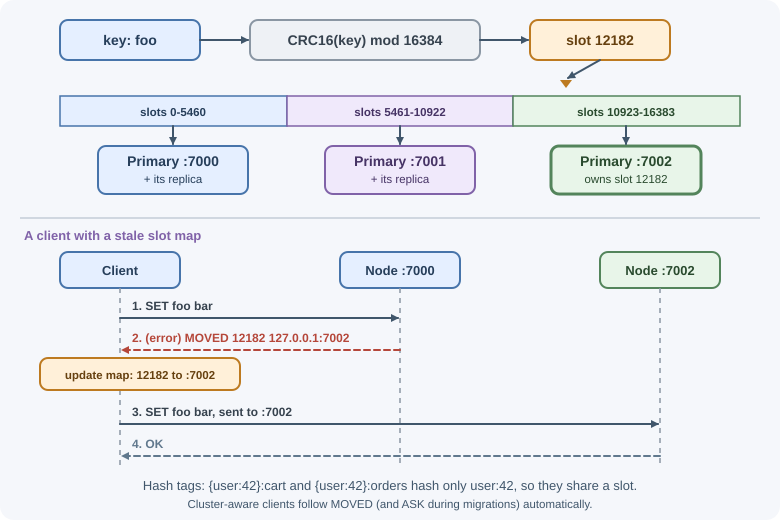

# Persistence and High Availability

Redis keeps data in memory, but it can also write that data to disk and copy
it to other servers. **Persistence** (RDB snapshots and the AOF log) decides
how much data survives a restart. **Replication**, **Sentinel**, and **Redis
Cluster** decide whether Redis keeps serving when a server fails and how it
grows beyond one machine. This lesson explains each mechanism, the
trade-offs, and how managed services package them.

## Why it matters

If Redis is only a cache, losing it means a slow minute while the cache
warms up. If it holds sessions, queues, rate limits, or the only copy of some
data, losing it can log out every user or drop jobs. The right configuration
depends on what the data is worth, so you need to know exactly what each
option protects against and what it costs. Related theory is in
[availability and reliability](../scalability/availability-and-reliability.md)
and [consistency and the CAP theorem](../scalability/consistency-and-cap-theorem.md).

## Real-world usage

- **Mastodon** calls Redis a critical part of an instance: by default one
  Redis instance holds feeds and queues, so its failure takes the whole
  server down. Its scaling guide adds Redis Sentinel: the application is
  given the Sentinel addresses (`REDIS_SENTINELS`) and the primary's name
  (`REDIS_SENTINEL_MASTER`) and asks Sentinel for the current primary, so it
  follows failovers automatically
  ([Mastodon: Scaling up your server](https://docs.joinmastodon.org/admin/scaling/)).
- **GitLab** runs separate Redis instances on GitLab.com and supports Redis
  Cluster for its cache workloads. Because Cluster spreads keys over slots,
  its developers must put hash tags in keys used together
  (`project:{1}:set_a`), and a validator checks this in development and
  tests ([GitLab: Redis guidelines](https://docs.gitlab.com/development/redis/)).
- **Slack** learned that an in-memory queue is only as durable as Redis:
  after an outage, it put Kafka in front of its Redis job queue to provide
  "a buffer against memory exhaustion and job loss"
  ([Slack engineering](https://slack.engineering/scaling-slacks-job-queue/)).

Popular providers:
[Amazon ElastiCache](https://docs.aws.amazon.com/AmazonElastiCache/latest/dg/AutoFailover.html)
(Multi-AZ with automatic failover and replica promotion, plus scheduled
backups), [Amazon MemoryDB](https://docs.aws.amazon.com/memorydb/latest/devguide/what-is-memorydb.html)
(a durable in-memory database with a Multi-AZ transactional log), and
[Google Cloud Memorystore for Redis](https://cloud.google.com/memorystore/docs/redis/memorystore-for-redis-overview).

## How it works

### RDB snapshots

An **RDB** file is a compact, point-in-time snapshot of the whole dataset
(`dump.rdb` by default).

```text
Redis main process --fork()--> child process writes snapshot to temp file
       |                                   |
   keeps serving clients            rename temp -> dump.rdb when complete
```

- Snapshots are taken automatically by `save <seconds> <changes>` rules (for
  example "after 300 seconds if at least 100 keys changed"), or manually
  with `BGSAVE`.
- The child process shares memory with the parent using **copy-on-write**:
  pages are copied only when the parent modifies them. Under heavy writes, a
  snapshot can temporarily need much more memory, so leave headroom.
- Restarting from an RDB file is fast.
- **Trade-off:** everything written since the last snapshot is lost in a
  crash, often minutes of data.

### AOF (append-only file)

The **AOF** logs every write command. On restart, Redis replays the log to
rebuild the dataset.

How often the log is flushed to disk with `fsync` is set by `appendfsync`:

| Setting | Durability | Performance |
|---------|------------|-------------|
| `always` | Every write is on disk before the reply: minimal loss | Slowest |
| `everysec` (default when AOF is on) | At most about one second of writes lost | Good; the usual choice |
| `no` | The operating system decides when to flush (can be tens of seconds) | Fastest |

The log grows forever unless compacted. **AOF rewrite** (automatic, or
`BGREWRITEAOF`) writes the minimal set of commands that recreates the
current data. Since Redis 7, the AOF is stored as several files (a base file
plus incremental files, tracked by a manifest) in a dedicated directory, and
the base can be written in compact RDB format.

### Choosing persistence

| Configuration | What you lose in a crash | Typical use |
|---------------|--------------------------|-------------|
| No persistence | Everything | Pure cache that can be rebuilt |
| RDB only | Writes since the last snapshot | Cache with faster warm-up; data where minutes of loss are acceptable |
| AOF `everysec` (often plus RDB) | About one second | Sessions, queues, counters |
| AOF `always` | Almost nothing (at a large throughput cost) | Rarely used; consider a database instead |


When both are enabled, Redis loads the AOF on startup, because it is the
more complete record. A common default for self-hosted Redis is RDB
snapshots on and AOF off, so check your configuration rather than assuming.

Persistence protects against a process restart on the same disk. It does
not protect against losing the machine or the disk; that needs replicas and
backups.

### Replication

A **replica** keeps a copy of a **primary**'s data:

```text
            writes
clients ----------> PRIMARY ---- async replication stream ----> REPLICA 1
   \                                                    \-----> REPLICA 2
    \---- reads (optional, may be slightly stale) ---> replicas
```

1. A replica connects with `REPLICAOF host port`.
2. It receives a full snapshot, then a continuous stream of write commands.
3. After a brief disconnect, it resumes from a **replication backlog**
   (partial resynchronization) instead of copying everything again.

Replication is **asynchronous**: the primary replies to the client before
replicas confirm. If the primary dies, writes it acknowledged but had not
yet sent are lost. Mitigations:

- `WAIT numreplicas timeout` blocks until that many replicas have received
  the preceding writes. It reduces, but does not eliminate, the loss window.
- `min-replicas-to-write` and `min-replicas-max-lag` make a primary refuse
  writes when it cannot reach enough replicas, limiting damage when it is
  cut off from the rest of the system.

Replicas are read-only by default and can serve read traffic, but reads may
return slightly old data.

### Sentinel: automatic failover

Replication alone copies data; something must notice a failed primary and
promote a replica. **Redis Sentinel** is a separate process (usually on port
26379) that does this:


- **Monitoring:** Sentinels ping the primary and replicas.
- **Quorum:** a configured number of Sentinels must agree the primary is
  unreachable before a failover starts, which avoids reacting to one
  Sentinel's network problem.
- **Automatic failover:** a replica is promoted and the others are
  reconfigured.
- **Client discovery:** applications connect to the Sentinels and ask for
  the current primary (for example with
  `SENTINEL get-master-addr-by-name mymaster`), so they follow failovers.

Run at least three Sentinels on independent machines. Sentinel provides
high availability for **one** primary's dataset; it does not shard data.

### Redis Cluster: sharding plus failover

When the dataset or write load is too big for one primary, **Redis Cluster**
splits keys across several primaries, each with its own replicas.



- The key space is divided into **16,384 hash slots**. A key's slot is
  `CRC16(key) mod 16384`, and each primary owns a range of slots.
- **Hash tags:** if a key contains `{...}`, only the text inside the braces
  is hashed, so `{user:42}:cart` and `{user:42}:orders` share a slot.
- **Multi-key limits:** commands, transactions, and Lua scripts that touch
  several keys work only if all keys are in the same slot; otherwise Redis
  returns a `CROSSSLOT` error. Only database 0 exists.
- **Redirects:** if a client sends a command to the wrong node, the node
  replies `MOVED <slot> <host:port>` (the slot lives elsewhere; update your
  slot map) or, while a slot is being migrated, `ASK <slot> <host:port>` (try
  that node once, for this command only). Cluster-aware clients handle both.
- **Failover is built in:** nodes gossip over a cluster bus, detect a failed
  primary, and promote one of its replicas; Sentinel is not used.
- **Resharding:** slots can be moved between nodes while the cluster is
  running.

A common minimum is three primaries, each with at least one replica. See
[database scaling](../scalability/database-scaling.md) for sharding in
general; MongoDB uses related ideas in
[replication](../../04-databases/mongodb/replication.md) and
[sharding](../../04-databases/mongodb/sharding.md).

### Sentinel or Cluster?

| | Sentinel | Cluster |
|-|----------|---------|
| Purpose | High availability for one dataset | Sharding and high availability |
| Write capacity | One primary | Several primaries |
| Multi-key operations | Unrestricted | Same hash slot only |
| Client requirements | Sentinel-aware client | Cluster-aware client |
| Choose when | Data fits on one server | Data or writes exceed one server |

### Backups

Persistence and replicas do not protect against mistakes: a `FLUSHALL` or a
bad deploy is replicated instantly. Back up RDB files on a schedule (the
current `dump.rdb` can be copied safely, because Redis writes a temporary
file and renames it only when complete), store copies off the server, and
test restores. Managed services offer automatic snapshots. See
[backups](../../07-devops-and-deployment/backups.md).

### Managed services

Running replication, failover, patching, and backups yourself takes effort.
Managed offerings handle them:

- **Amazon ElastiCache** offers Valkey, Redis OSS, and Memcached engines,
  with replication groups, Multi-AZ automatic failover, cluster mode for
  sharding, and automatic backups. **Amazon MemoryDB** targets use as a
  durable primary database. See [AWS](../../06-servers-and-infrastructure/aws.md).
- Other clouds provide similar services, such as Google Cloud Memorystore
  and Azure Managed Redis (Microsoft is retiring Azure Cache for Redis in
  its favor), and Redis Ltd. offers its own cloud service.

Read the provider's documentation for exact failover times, durability
guarantees, and supported commands; managed services restrict some
administrative commands, so check the provider's list before relying on
one.

### Memory limits and fragmentation

- Set `maxmemory` below the machine's RAM, leaving headroom for
  copy-on-write during snapshots and rewrites, replication buffers, and
  client buffers. Running out of RAM can get the process killed by the
  operating system.
- **Fragmentation:** the allocator may hold more memory than the data needs.
  `INFO memory` reports `mem_fragmentation_ratio` (`used_memory_rss`
  divided by `used_memory`), but that ratio also includes other process
  overheads, so a high value only matters when `mem_fragmentation_bytes` is
  large; `allocator_frag_ratio` is the true fragmentation metric. Redis can
  defragment actively with `activedefrag yes`. A ratio below 1 (resident
  memory smaller than used memory) hints that memory was swapped out, which
  is very slow.

## When to use and when not to use

Choose each mechanism for what it protects against:

- **No persistence:** a pure cache that can be rebuilt from the source.
- **RDB snapshots:** faster restarts and simple backup files, when losing
  the writes since the last snapshot is acceptable.
- **AOF `everysec` (often with RDB):** sessions, queues, and counters where
  losing about a second of writes is the most you can accept.
- **Replicas + Sentinel:** keep one dataset available when a server fails.
- **Redis Cluster:** the data or the write load no longer fits on one
  primary.

Do not rely on them when:

- Losing even acknowledged writes is unacceptable (payments, ledgers):
  replication is asynchronous, so keep the record of truth in a database.
- You need protection from mistakes such as `FLUSHALL` or bad deploys:
  persistence and replicas copy the mistake; only off-server backups help.
- Your application needs many multi-key operations on unrelated keys:
  Cluster restricts them to one hash slot, so a single primary with
  Sentinel may be simpler.

| | RDB | AOF `everysec` | RDB + AOF |
|-|-----|----------------|-----------|
| Writes lost in a crash | Everything since the last snapshot | About one second | About one second (AOF is loaded on startup) |
| Restart speed with a big dataset | Fastest | Slower (replays the log) | AOF used; a compact RDB-format base makes it faster |
| File size | Compact | Usually bigger | Both kept |
| Extra disk I/O | Periodic snapshots | Continuous appends and fsyncs | Both |
| Good for | Caches, backups | Sessions, queues | Must-keep state that also needs backup files |

## Practical examples

### Checking and changing persistence

```text
127.0.0.1:6379> CONFIG GET save
1) "save"
2) "3600 1 300 100 60 10000"
127.0.0.1:6379> CONFIG GET appendonly
1) "appendonly"
2) "no"
127.0.0.1:6379> CONFIG SET appendonly yes
OK
127.0.0.1:6379> BGSAVE
Background saving started
127.0.0.1:6379> INFO persistence
# Persistence
rdb_last_bgsave_status:ok
aof_enabled:1
aof_last_bgrewrite_status:ok
...
```

The equivalent `redis.conf` settings:

```text
save 3600 1 300 100 60 10000
appendonly yes
appendfsync everysec
```

### Replication status

```text
127.0.0.1:6379> INFO replication
# Replication
role:master
connected_slaves:2
slave0:ip=10.0.1.12,port=6379,state=online,offset=884213,lag=0
slave1:ip=10.0.1.13,port=6379,state=online,offset=884213,lag=1
...
127.0.0.1:6379> SET order:1001 "paid"
OK
127.0.0.1:6379> WAIT 1 100        # wait up to 100 ms for 1 replica
(integer) 2
```

(Redis output still uses the older words "master" and "slave" in some
fields.)

### Hash slots and redirects

```text
127.0.0.1:7000> CLUSTER KEYSLOT somekey
(integer) 11058
127.0.0.1:7000> CLUSTER KEYSLOT foo{hash_tag}
(integer) 2515
127.0.0.1:7000> CLUSTER KEYSLOT bar{hash_tag}
(integer) 2515                     # same tag, same slot

$ redis-cli -p 7000
127.0.0.1:7000> SET foo bar
(error) MOVED 12182 127.0.0.1:7002

$ redis-cli -c -p 7000              # -c follows redirects
127.0.0.1:7000> SET foo bar
-> Redirected to slot [12182] located at 127.0.0.1:7002
OK

127.0.0.1:7002> MSET user:1 a user:2 b
(error) CROSSSLOT Keys in request don't hash to the same slot
```

### Connecting to Redis Cluster from Node.js

```js
import { createCluster } from "redis";

const cluster = createCluster({
  rootNodes: process.env.REDIS_CLUSTER_URLS.split(",").map((url) => ({ url })),
});
cluster.on("error", (err) => console.error("Redis Cluster error", err));
await cluster.connect(); // discovers all nodes and the slot map

await cluster.set("user:42:name", "Ada");          // routed to the right node
await cluster.mGet(["{user:42}:cart", "{user:42}:orders"]); // same slot: allowed
```

For Sentinel-managed deployments, use a client with Sentinel support (check
your client's documentation) and give it the Sentinel addresses and the
primary's name instead of a fixed host.

## Best practices

- Decide what losing Redis data would cost, then choose persistence to
  match.
- Use AOF with `everysec` (often together with RDB) for sessions, queues,
  and other state you must keep.
- Run replicas plus Sentinel, or Redis Cluster, when downtime matters; use at
  least three Sentinels on separate machines.
- Remember that replication is asynchronous; never treat Redis as the only
  copy of critical financial or legal records.
- Design keys with hash tags if you will use Cluster and need multi-key
  operations.
- Take off-server backups and test restoring them.
- Leave memory headroom for forks and buffers; monitor fragmentation and
  replication lag.
- Use a managed service unless you have the operational capacity to run
  Redis yourself.

## In production

**Writes are suddenly refused after a background save fails.**

- **Detect:** `INFO persistence` shows `rdb_last_bgsave_status:err`; the
  Redis log shows the fork or the save failing; clients get errors on every
  write.
- **Cause:** with `stop-writes-on-bgsave-error yes` (the default), Redis
  stops accepting writes after a failed snapshot. Common reasons are a full
  disk or `fork()` failing for lack of memory when the kernel's
  `vm.overcommit_memory` is 0.
- **Fix:** free disk space, set `vm.overcommit_memory = 1` as the Redis FAQ
  recommends, and leave memory headroom for copy-on-write.

**Latency spikes every time a snapshot or AOF rewrite starts.**

- **Detect:** `latest_fork_usec` in `INFO stats` is large; `LATENCY DOCTOR`
  reports fork-related events; spikes line up with `save` rules.
- **Cause:** the fork itself runs on the main thread and takes longer for
  large datasets; transparent huge pages make it worse.
- **Fix:** disable transparent huge pages as the Redis latency guide says,
  keep each instance's dataset moderate, and schedule snapshots away from
  peaks.

**Writes slow down while the disk is busy.**

- **Detect:** `aof_delayed_fsync` in `INFO persistence` keeps increasing.
- **Cause:** the disk cannot keep up with AOF fsyncs, often while a
  snapshot or rewrite is also writing.
- **Fix:** use faster local disks, keep `appendfsync everysec`, and consider
  `no-appendfsync-on-rewrite yes` if a small extra loss window during
  rewrites is acceptable.

**Replicas keep re-copying the whole dataset.**

- **Detect:** `sync_full` keeps rising in `INFO stats`; the replica's
  `master_link_status` flips to `down`.
- **Cause:** after a disconnect, the replica's position is no longer in the
  primary's replication backlog (`repl-backlog-size`, 1 MB by default), or
  the replica output buffer limit cuts the connection during the transfer.
- **Fix:** raise `repl-backlog-size` and the
  `client-output-buffer-limit replica` setting for large or busy datasets.

**Recent writes are missing after a failover.**

- **Detect:** data acknowledged just before the primary failed is absent
  on the promoted replica.
- **Cause:** replication is asynchronous, so the replica never received
  those writes.
- **Fix:** use `WAIT` for writes that matter, configure
  `min-replicas-to-write` and `min-replicas-max-lag`, and keep critical
  records in a database.

## Important terminology

- **RDB:** A point-in-time snapshot file of the dataset.
- **AOF:** The append-only file that logs write commands.
- **fsync:** A system call that forces buffered data onto disk.
- **Copy-on-write:** Sharing memory between processes until one modifies a
  page.
- **Replica:** A server that holds a copy of a primary's data.
- **Failover:** Promoting a replica when the primary fails.
- **Quorum:** The number of Sentinels that must agree before acting.
- **Hash slot:** One of 16,384 buckets that keys are assigned to in Redis
  Cluster.
- **MOVED / ASK:** Redirect replies telling a client which node owns a slot.

## Common mistakes and misconceptions

- **"Redis is in memory, so it cannot persist" or "it always persists."**
  Persistence is configurable, and the defaults vary.
- **"Replicas mean zero data loss."** Asynchronous replication can lose
  recently acknowledged writes during failover.
- **"Persistence is a backup."** A deleted key is deleted in the AOF and
  replicas too.
- **Running one or two Sentinels.** Too few to form a reliable majority.
- **Using multi-key commands across slots in Cluster.** They fail with
  `CROSSSLOT`.
- **Setting `maxmemory` equal to the machine's RAM.** Forks and buffers can
  push the process out of memory.
- **Hard-coding the primary's address with Sentinel.** The application does
  not follow failovers.

## Revision questions

1. Compare RDB snapshots and AOF in terms of data loss and performance.
2. What does each `appendfsync` setting trade off?
3. Why can a failover lose writes that clients saw as successful, and how
   does `WAIT` help?
4. What jobs does Sentinel perform, and why does it need a quorum?
5. How does Redis Cluster decide which node stores a key, and what are hash
   tags for?
6. What is the difference between `MOVED` and `ASK` redirects?

## Further learning

- [Redis documentation: Persistence](https://redis.io/docs/latest/operate/oss_and_stack/management/persistence/)
- [Redis documentation: Replication](https://redis.io/docs/latest/operate/oss_and_stack/management/replication/)
- [Redis documentation: High availability with Sentinel](https://redis.io/docs/latest/operate/oss_and_stack/management/sentinel/)
- [Redis documentation: Scale with Redis Cluster](https://redis.io/docs/latest/operate/oss_and_stack/management/scaling/)
- [Redis command reference: WAIT](https://redis.io/docs/latest/commands/wait/)
- [Redis command reference: CLUSTER KEYSLOT](https://redis.io/docs/latest/commands/cluster-keyslot/)
- [Amazon ElastiCache documentation](https://docs.aws.amazon.com/elasticache/)
